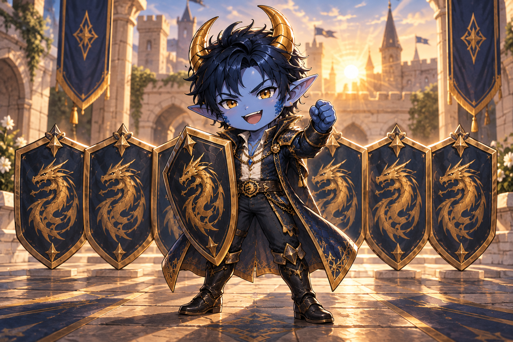
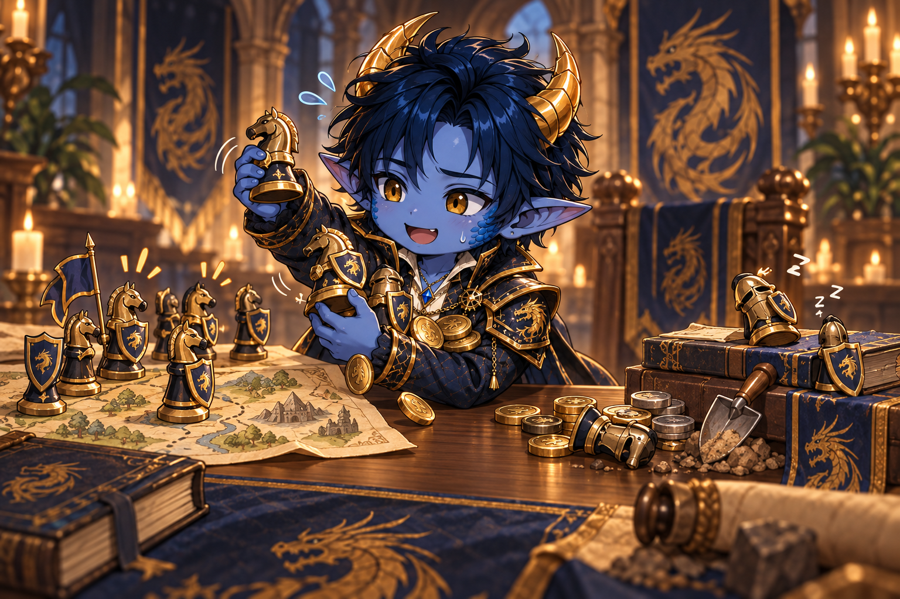

# The future of our alliance – internal discussion

##HIDDEN

This page is an internal discussion paper for the alliance council. It is intended to help us compare our options openly and objectively. We are not making a final decision yet. First, we need to ask what kind of alliance we want to become and what level of activity and teamwork we expect.

## The central question

Do we primarily want to remain a large, influential alliance, even if some members take little part in our shared activities? Or do we want a smaller but reliably active community, with stronger expectations around teamwork and event participation?

Power and rankings are not the only things to consider. Reliability, motivation, community spirit and the long-term sustainability of each model matter just as much.

## Option 1: Smaller, but consistently active

We remove members who remain passive over the long term and expect clearly defined minimum activity from existing and new members. This particularly includes important alliance events, reliable teamwork and following our shared agreements.

### Opportunities

- We can rely more strongly on agreements being followed and the alliance responding together.
- Members are more likely to feel that everyone is pulling together and contributing to shared success.
- Attacks and rallies can fill more quickly and reliably, reducing long waits caused by limited participation.
- If everyone shields together on Saturdays, we appear organised, disciplined and united.
- Losing total points could match us with opponents in Alliance Duel who better reflect our actual active strength and are easier to beat.
- Active members feel their efforts are more valuable because expectations visibly apply to everyone.

### Risks

- We lose passive or partly active members who currently donate regularly to alliance research or start alliance excavations.
- Our total power drops significantly; falling out of the top 10 is likely.
- A lower rank could mean less influence on the server and less weight in shared chats and agreements.
- We could lose our level-3 city.
- A small alliance is more vulnerable to holidays, breaks and individual departures because each absent person has a larger impact.
- Rigid requirements can pressure otherwise active members. Committed people who cannot attend every event could lose motivation.
- Removing people too quickly can start a downward spiral: fewer members, less visible strength, fewer applicants and then still fewer members.

## Option 2: Keep passive and partly active members

We deliberately retain a larger membership and accept that people take part in events, battles and agreements to different degrees. Activity remains welcome, but is only required to a limited extent.

### Opportunities

- Our total power and ranking are more likely to remain intact.
- We preserve server influence and our weight in discussions between alliances.
- We have a better chance of keeping our level-3 city.
- Less active members still contribute, for example through research donations, alliance excavations or occasional event participation.
- This model accommodates people with changing availability and avoids unnecessary pressure.
- A large membership can convey stability and appeal to outsiders.

### Risks

- We do not know who we can actually rely on during important events and coordinated actions.
- Attacks and rallies fill slowly or not at all; the active group carries a disproportionately large share of the work.
- Agreements such as shielding together are only partly followed, making us appear disorganised.
- Our total power may appear stronger than our available fighting strength. We may therefore face opponents who are too strong for our active core.
- Active members may feel their effort is taken for granted while lack of participation has no consequences.
- The greatest danger is a gradual loss of motivation among committed members. If active members leave, the alliance may initially remain large but lose its ability to act.

## Option 3: Merge with an alliance of similar size

We look for a similarly sized alliance with which to combine members, leadership and structures. As there is currently no suitable German alliance available, a merger would probably be international and would need careful language and cultural preparation.

### Opportunities

- Two active cores could form a much more reliable and effective alliance together.
- A larger active membership could cover gaps in event participation, rallies, research and organisation.
- Total power, rankings and server influence could be retained or even grow.
- A merger could bring fresh motivation, knowledge, contacts and tactical options.
- Leadership tasks could be shared more widely and R4 responsibilities filled more consistently.
- With good preparation, we might preserve both competitiveness and a lively community.

### Risks

- There is a significant risk of losing our identity: DIE's name, established culture, rules, leadership style and community spirit could be diluted or lost entirely.
- Without a suitable German partner, a language barrier is very likely. Event and attack coordination becomes harder, slower and more error-prone.
- Different expectations around activity, teamwork, communication and conflict resolution can quickly cause tension.
- A merger raises difficult power questions: who leads, how are R4 positions divided and which existing rules stay?
- Not every member will support the move. Long-standing members in particular may no longer feel at home.
- Poor preparation can create factions and an “us versus them” attitude instead of a new shared alliance.
- Practical limits such as membership capacity, city ownership and the choice of receiving alliance may prevent everyone from moving together.
- If the merger fails, we could lose members, identity and negotiating room at the same time.

## A possible middle path without an immediate merger

Before choosing one of the three options, we could agree on a trial activity period. We would define a few clear minimum requirements and observe over several weeks how many members actually meet them.

Possible elements include:

- mandatory attendance only at a few particularly important alliance events;
- an absence notification option for holidays, illness or personal commitments;
- different expectations for active fighters, supporters and members taking a temporary break;
- a transparent warning or discussion phase before removal;
- targeted recruitment of active players before consistently reallocating places;
- a fixed trial period followed by an alliance council review.

This could reveal the size of our genuinely reliable core without immediate irreversible decisions. However, it only resolves the underlying conflict if we subsequently enforce the agreed rules consistently.

## Criteria for our decision

Before discussing individual members, we should agree on shared standards:

1. **What exactly does “active” mean to us?** Daily presence, event participation, research donations, responding to messages or a combination?
2. **Which events and agreements are truly mandatory?** Not everything needs equal priority.
3. **How do we distinguish unwillingness from limited time?** Reliable absence notifications and communication could matter more than time online.
4. **How important are top-10 ranking and server influence compared with internal teamwork?**
5. **What is the actual risk to our level-3 city, and how much does it matter?**
6. **What minimum number of reliably active members do we need for events, rallies and research to work?**
7. **What compromises are we willing to make to preserve our identity as a German alliance?**
8. **How will we assess after a few weeks whether our chosen approach works?**

## Questions for the alliance council

- What do we want DIE to look like in six months?
- Which threatens our alliance more: losing power and rank, or losing our active members' motivation?
- What minimum participation can we fairly require without turning the game into an obligation?
- Which contributions from less active members are still valuable to us?
- Can we credibly implement a binding middle path, or would we merely postpone the decision?
- Under what conditions would a merger be acceptable at all?
- Which merger terms would be non-negotiable, especially name, identity, language, leadership and shared rules?

## Aim of the discussion

In the end, we should do more than choose between keeping and removing members. We need a shared, understandable model of:

- what DIE should stand for,
- what contribution we expect from each other,
- how we handle temporary inactivity,
- how we motivate active members over the long term, and
- how much power, rank, city ownership and server influence matter to us.

Only once that vision is clear can we fairly decide which path suits us best and what concrete steps follow.
