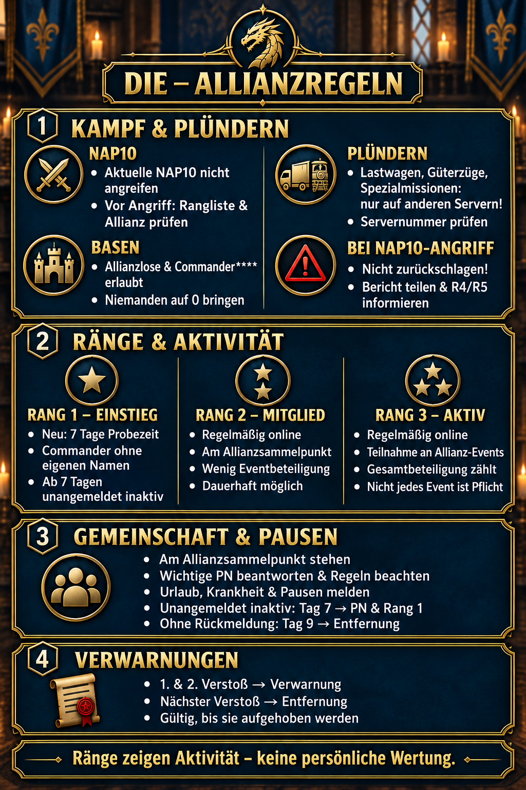

# Règles de notre alliance

Nos règles protègent l’alliance, évitent les conflits inutiles et garantissent que nos attaques et pillages respectent les accords de notre serveur. En cas de doute, vérifiez avant d’agir. Si la situation n’est pas claire, demandez conseil à un R4 ou R5.



## 1. Respecter le NAP10

Nous **n’attaquons aucun membre des alliances actuellement classées dans le NAP10**. Le classement peut changer : ne vous fiez donc pas à une position antérieure.

Avant chaque attaque, vérifiez à nouveau le classement actuel et l’alliance de votre cible. Si celle-ci appartient au NAP10 ou si la situation n’est pas claire, n’attaquez pas. Nous évitons ainsi les représailles et les conflits diplomatiques susceptibles d’affecter toute l’alliance.

## 2. Attaques de bases autorisées

Nous pouvons attaquer les **joueurs sans alliance** ainsi que ceux dont le nom suit le modèle **Commander\*\*\*\***. Même lorsque la cible est autorisée, restez raisonnable : ne réduisez personne complètement à **0**.

Une cible autorisée ne justifie pas des attaques répétées et inutiles. Arrêtez une fois votre objectif atteint. Avant toute nouvelle attaque, vérifiez si le nom, le rang ou la situation de l’alliance a changé.

## 3. Piller les bonnes cibles

Nous ne pillons pas les camions, trains de marchandises ou missions spéciales **de notre propre serveur**. Dans l’écran correspondant, choisissez toujours une cible provenant **d’un autre serveur**.

Vérifiez soigneusement le numéro du serveur avant de commencer. Une récompense attrayante ou une cargaison rare ne remplace pas cette règle. Nous protégeons ainsi la coopération sur notre serveur et évitons les conflits inutiles avec les autres alliances.

## 4. Si un membre du NAP10 vous attaque

Si un membre d’une alliance du NAP10 vous attaque, notre règle est simple : **ne ripostez pas**. Une contre-attaque directe peut compliquer la résolution et transformer un incident isolé en conflit plus large.

Partagez plutôt le rapport de combat et signalez l’incident à un **R4 ou R5**. Si possible, indiquez le nom de l’attaquant, son alliance et l’heure de l’attaque. La direction de l’alliance coordonnera ensuite la réponse et vous indiquera la marche à suivre.

## Rangs et activité

### Rang 1 – Entrée

Les nouveaux membres ont une **période d’essai de 7 jours**. Les commandants sans nom personnalisé ainsi que les membres ayant **7 jours ou plus d’inactivité non signalée** sont également placés au rang 1. Après 7 jours d’absence non signalée, un **message privé** est envoyé ; sans réponse, **le membre est exclu de l’alliance au 9e jour**.

### Rang 2 – Membre

Membre régulièrement connecté et présent au **point de ralliement de l’alliance**, mais participant peu aux événements. **Le rang 2 peut être permanent.**

### Rang 3 – Actif

Membre régulièrement connecté et participant aux **événements de l’alliance**. Tous les événements ne sont pas obligatoires : c’est la **participation globale** qui compte.

## Communauté et absences

Restez au **point de ralliement de l’alliance**, répondez aux **messages privés importants** et respectez les règles. **Merci de signaler les vacances, maladies et pauses.** Les rangs reflètent l’activité et ne constituent **pas un jugement personnel**.

## Infractions et avertissements

Les infractions aux règles donnent lieu à **2 avertissements**. L’infraction suivante entraîne **l’exclusion de l’alliance**. Les avertissements restent valables **jusqu’à leur levée**.

| Situation | Conduite à tenir |
| --- | --- |
| La cible appartient à une alliance actuellement classée dans le NAP10 | Ne pas attaquer |
| La cible est sans alliance ou s’appelle Commander\*\*\*\* | Attaque autorisée, sans la réduire à 0 |
| Le camion, train de marchandises ou la mission spéciale se trouve sur notre serveur | Ne pas piller ; choisir une cible d’un autre serveur |
| Un membre du NAP10 vous attaque | Ne pas riposter ; envoyer le rapport à un R4 ou R5 |
| Vous avez un doute | Demander à un R4 ou R5 avant d’agir |

> **À retenir :** vérifiez d’abord le classement et le serveur. Signalez les incidents liés au NAP10 au lieu de riposter.

## Message d’alliance à copier

```html
<size=46><b>DIE – RÈGLES DE L’ALLIANCE</b></size>

🛡️ <size=40><b>1. Respecter le NAP10</b></size>
Nous n’attaquons pas les membres des alliances actuellement classées dans le NAP10. Vérifiez régulièrement le classement.

🏰 <size=40><b>2. Attaques de bases</b></size>
Nous pouvons attaquer les joueurs sans alliance et les Commander****. Merci de ne réduire personne à 0.

🚚 <size=40><b>3. Pillage</b></size>
Nous ne pillons pas les camions, trains de marchandises ou missions spéciales de notre serveur. Choisissez toujours <color=#9DBA32><b>un autre serveur</b></color>.

⚠️ <size=40><b>4. Attaques du NAP10</b></size>
<color=#E6A23C><b>Nous ne ripostons pas !</b></color> Partagez le rapport de combat et signalez l’incident à un R4 ou R5.

📌 <size=40><b>Infractions</b></size>
1re et 2e infraction = avertissement ; infraction suivante = exclusion. Les avertissements restent valables jusqu’à leur levée.

💬 <size=40><b>Des questions ?</b></size>
Vous pouvez toujours vous adresser à un R4 ou R5.
```

## Règles de rang et d’activité à copier

```html
<size=46><b>DlE – RANGS ET ACTIVITÉ</b></size>

⭐ <size=40><b>Rang 1 – Entrée</b></size>
Nouveau : 7 jours d’essai. Commandants sans nom personnalisé et membres absents 7 jours ou plus sans prévenir.
Jour 7 : message privé. Sans réponse : exclusion au jour 9.

⭐⭐ <size=40><b>Rang 2 – Membre</b></size>
Régulièrement connecté, présent au point de ralliement, faible participation aux événements. Peut être permanent.

⭐⭐⭐ <size=40><b>Rang 3 – Actif</b></size>
Régulièrement connecté et participant aux événements de l’alliance. La participation globale compte ; tous les événements ne sont pas obligatoires.

🤝 <size=40><b>Communauté</b></size>
Restez au point de ralliement, répondez aux messages privés importants et respectez les règles.

⚠️ <size=40><b>Avertissements</b></size>
2 avertissements ; infraction suivante : exclusion. Valables jusqu’à leur levée.

📌 <size=40><b>Important</b></size>
Signalez les vacances, maladies et pauses. Les rangs reflètent l’activité, pas la valeur personnelle.
```
