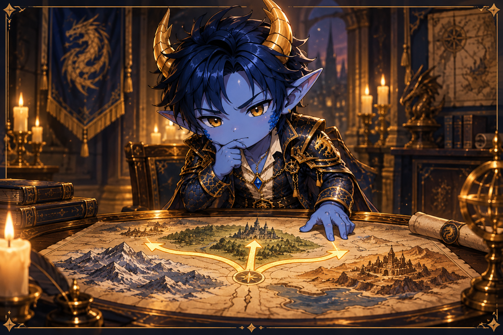
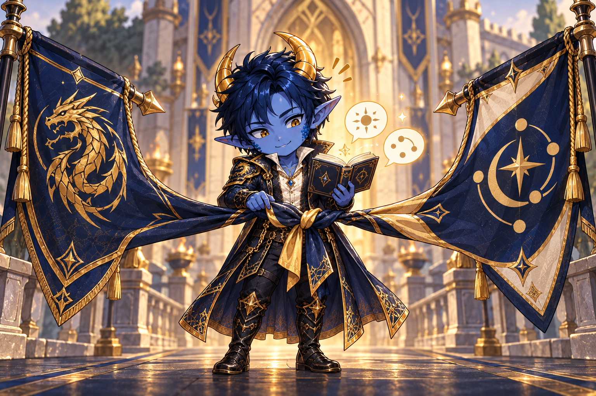

# Будущее нашего альянса — внутреннее обсуждение

##СКРЫТЫЙ

Эта страница представляет собой документ для внутреннего обсуждения совета альянса. Он предназначен для того, чтобы помочь нам открыто и объективно сравнить наши варианты. Мы еще не принимаем окончательного решения. Во-первых, нам нужно задаться вопросом, каким альянсом мы хотим стать и какого уровня активности и командной работы мы ожидаем.

## Центральный вопрос

Хотим ли мы в первую очередь оставаться большим и влиятельным альянсом, даже если некоторые его члены принимают мало участия в нашей общей деятельности? Или нам нужно меньшее, но надежно активное сообщество с более высокими ожиданиями в отношении командной работы и участия в мероприятиях?

Власть и рейтинги — не единственные вещи, которые следует учитывать. Надежность, мотивация, дух сообщества и долгосрочная устойчивость каждой модели имеют не меньшее значение.

## Вариант 1: Меньше, но постоянно активен

Мы удаляем участников, которые остаются пассивными в долгосрочной перспективе, и ожидаем четко определенной минимальной активности от существующих и новых участников. Это, в частности, включает в себя важные мероприятия альянса, надежную командную работу и соблюдение наших общих соглашений.

### Возможности

- Мы можем больше полагаться на выполнение соглашений и на совместную реакцию альянса.
- Участники с большей вероятностью будут чувствовать, что все объединяются и вносят свой вклад в общий успех.
- Атаки и митинги могут заполняться быстрее и надежнее, сокращая длительное ожидание, вызванное ограниченным участием.
- Если по субботам все вместе защищаются, мы кажемся организованными, дисциплинированными и сплоченными.
- Потеря общего количества очков может привести к тому, что мы столкнемся с противниками в Дуэли Альянсов, которые лучше отражают нашу фактическую активную силу и которых легче победить.
- Активные члены чувствуют, что их усилия более ценны, поскольку ожидания очевидны для всех.

### Риски

- Мы теряем пассивных или частично активных участников, которые в настоящее время регулярно делают пожертвования на исследования альянса или начинают раскопки альянса.
- Наша общая мощность значительно падает; выпадение из топ-10 вполне вероятно.
- Более низкий ранг может означать меньшее влияние на сервер и меньший вес в общих чатах и соглашениях.
- Мы можем потерять наш город третьего уровня.
- Небольшой альянс более уязвим к праздникам, перерывам и индивидуальным отъездам, поскольку каждый отсутствующий человек оказывает большее влияние.
- Жесткие требования могут оказывать давление на активных членов. Преданные люди, которые не могут посещать каждое мероприятие, могут потерять мотивацию.
- Слишком быстрое удаление людей может начать нисходящую спираль: меньше членов, меньше видимой силы, меньше кандидатов, а затем еще меньше членов.

## Вариант 2. Оставьте пассивных и частично активных участников.

Мы намеренно сохраняем большее число членов и признаем, что люди в разной степени принимают участие в событиях, битвах и соглашениях. Активность по-прежнему приветствуется, но требуется лишь в ограниченной степени.

### Возможности

- Наша общая власть и рейтинг, скорее всего, останутся неизменными.
- Мы сохраняем влияние сервера и свой вес в дискуссиях между альянсами.
- У нас больше шансов сохранить город третьего уровня.
- Менее активные члены по-прежнему вносят свой вклад, например, посредством пожертвований на исследования, раскопок альянса или периодического участия в мероприятиях.
- Эта модель подходит для людей с меняющейся доступностью и позволяет избежать ненужного давления.
- Большое членство может обеспечить стабильность и привлекательность для посторонних.

### Риски

- Мы не знаем, на кого реально можем положиться во время важных событий и слаженных действий.
- Атаки и митинги заполняются медленно или не заполняются вообще; на активную группу ложится непропорционально большая доля работы.
- Такие соглашения, как совместное экранирование, соблюдаются лишь частично, из-за чего мы выглядим дезорганизованными.
- Наша общая мощь может оказаться сильнее, чем имеющаяся у нас боевая мощь. Поэтому мы можем столкнуться с противниками, которые слишком сильны для нашего активного ядра.
- Активные члены могут чувствовать, что их усилия воспринимаются как нечто само собой разумеющееся, в то время как отсутствие участия не имеет последствий.
- Самая большая опасность – это постепенная потеря мотивации среди преданных своему делу членов. Если активные члены уйдут, альянс может первоначально остаться большим, но потеряет способность действовать.

## Вариант 3: Слияние с альянсом аналогичного размера.

Мы ищем альянс такого же размера, в котором можно было бы объединить членов, руководство и структуры. Поскольку в настоящее время подходящего немецкого альянса нет, слияние, вероятно, будет международным и потребует тщательной языковой и культурной подготовки.

### Возможности

- Два активных ядра вместе могли бы сформировать гораздо более надежный и эффективный альянс.
- Более широкое активное членство могло бы покрыть пробелы в участии в мероприятиях, митингах, исследованиях и организации.
- Общая власть, рейтинги и влияние серверов могут сохраниться или даже вырасти.
- Слияние может принести новую мотивацию, знания, контакты и тактические возможности.
- Лидерские задачи можно было бы распределять более широко, а обязанности R4 выполнялись бы более последовательно.
- При хорошей подготовке мы сможем сохранить и конкурентоспособность, и живое сообщество.

### Риски

- Существует значительный риск потери нашей идентичности: имя DIE, устоявшаяся культура, правила, стиль руководства и дух сообщества могут быть размыты или полностью потеряны.
- Без подходящего немецкого партнера весьма вероятен языковой барьер. Координация событий и атак становится сложнее, медленнее и более подвержена ошибкам.
- Различные ожидания в отношении деятельности, командной работы, общения и разрешения конфликтов могут быстро вызвать напряжение.
- Слияние поднимает сложные вопросы власти: кто руководит, как распределяются позиции R4 и какие существующие правила остаются в силе?
- Не все члены поддержат этот шаг. В частности, давние члены могут больше не чувствовать себя как дома.
- Плохая подготовка может привести к возникновению фракций и позиции «мы против них» вместо нового общего альянса.
- Практические ограничения, такие как количество членов, владение городом и выбор принимающего альянса, могут помешать всем двигаться вместе.
- Если слияние провалится, мы можем одновременно потерять членов, идентичность и пространство для переговоров.

## Возможный средний путь без немедленного слияния

Прежде чем выбрать один из трех вариантов, мы могли договориться о периоде пробной активности. Мы бы определили несколько четких минимальных требований и в течение нескольких недель наблюдали бы, сколько членов действительно им соответствует.

Возможные элементы включают в себя:

- обязательное присутствие лишь на нескольких особо важных мероприятиях альянса;
- возможность уведомления об отсутствии в связи с праздниками, болезнью или личными обязательствами;
- разные ожидания от активных бойцов, сторонников и членов, находящихся на временном перерыве;
- этап прозрачного предупреждения или обсуждения перед удалением;
- целенаправленный набор активных игроков перед последовательным перераспределением мест;
- фиксированный испытательный период, за которым следует проверка совета альянса.

Это может раскрыть размер нашего действительно надежного ядра без немедленных необратимых решений. Однако это разрешит основной конфликт только в том случае, если мы впоследствии последовательно будем обеспечивать соблюдение согласованных правил.

## Критерии нашего решения

Прежде чем обсуждать отдельных членов, нам следует договориться об общих стандартах:

1. **Что именно для нас означает «активный»?** Ежедневное присутствие, участие в мероприятиях, пожертвования на исследования, ответы на сообщения или и то и другое?
2. **Какие события и соглашения действительно обязательны?** Не все требует одинакового приоритета.
3. **Как отличить нежелание от ограниченности времени?** Надежные уведомления об отсутствии и общение могут иметь большее значение, чем время пребывания в сети.
4. **Насколько важны рейтинг топ-10 и влияние сервера по сравнению с внутренней командной работой?**
5. **Каков реальный риск для нашего города третьего уровня и насколько это важно?**
6. **Какое минимальное количество надежно активных участников нам нужно, чтобы мероприятия, митинги и исследования работали?**
7. **На какие компромиссы мы готовы пойти, чтобы сохранить свою идентичность как немецкого альянса?**
8. **Как мы оценим через несколько недель, работает ли выбранный нами подход?**

## Вопросы совету альянса

- Как мы хотим, чтобы DIE выглядел через шесть месяцев?
- Что больше угрожает нашему альянсу: потеря власти и ранга или потеря мотивации наших активных членов?
- Какого минимального участия мы можем справедливо потребовать, не превращая игру в обязательство?
- Какие вклады менее активных участников по-прежнему ценны для нас?
- Можем ли мы надежно реализовать обязательный средний путь или мы просто отложим принятие решения?
- При каких условиях слияние вообще было бы приемлемо?
- Какие условия слияния не подлежат обсуждению, особенно имя, идентичность, язык, лидерство и общие правила?

## Цель обсуждения

В конце концов, нам следует делать больше, чем просто выбирать между сохранением и удалением участников. Нам нужна общая, понятная модель:

- что должен означать DIE,
- какого вклада мы ожидаем друг от друга,
- как мы справляемся с временным бездействием,
- как мы мотивируем активных участников в долгосрочной перспективе и
- насколько важны для нас власть, ранг, владение городом и влияние на сервер.

Только после того, как это видение станет ясным, мы сможем справедливо решить, какой путь нам подходит лучше всего и какие конкретные шаги последуют.
