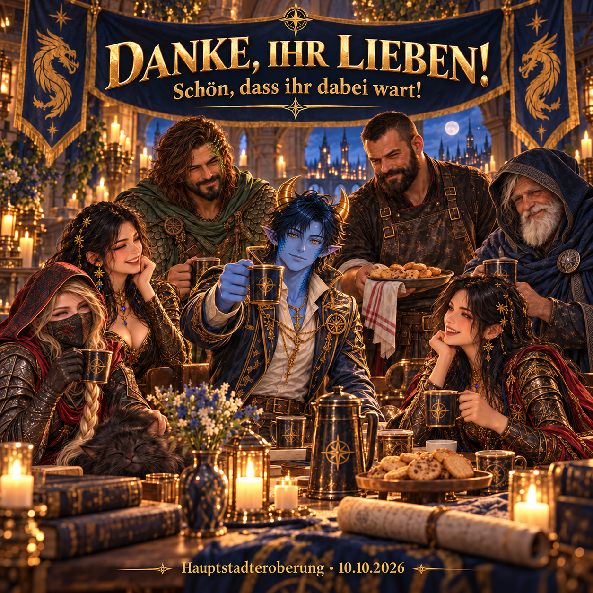

# Спасибо за участие в захвате столицы

Сообщение о захват столицы от 10 октября 2026 г., написанное 11 октября 2026 г. От Anthlan и наших офицеров R4 нашим участникам.



## Копия версии сообщения альянса

```html
<size=38><color=#FFD700><b>Спасибо всем!</b></color></size>

Дорогие рыцари-драконы,
Я просто хочу сказать вам спасибо – и от имени наших офицеров R4.

<b>Спасибо всем, кто приехал с нами в столицу: как активным, так и пассивным участникам!</b> Независимо от того, заработали ли вы очки или остались там без боя, я рад, что вы присоединились к нам. Вы все являетесь частью наших общих усилий.

15 из нас фигурируют в рейтинге с примерно 9,56 миллионами очков. Это радует меня, как и всех, чье присутствие там не заметно.

Я знаю, что не каждый может всегда быть рядом. Приятно, когда мы собираемся вместе и каждый вносит свой вклад.

А сейчас пришло время выпить кофе и сердечно поблагодарить вас от меня.

<color=#FFD700><b>Я так рада, что ты здесь!</b></color>
Ваш Anthlan и ваши офицеры R4
```

Копия немецкого оригинала содержит 901 символ, включая форматирование и разрывы строк, и не превышает ограничения в 1000 символов. Английская версия копии также ниже этого предела.

## Основа

Цифры взяты из полного рейтинга, составленного 10 октября 2026 года около 16:49. Они описывают записанный счет, а не исход боя.

На изображении показаны Anthlan, mysteryZ, Somea, DaVinci1986, Drachenherz, Helltrain и Thor63 в обычном полуреалистичном фэнтезийном стиле, основанном на всех семи листах моделей M2. По прямому запросу пользователя символы составляют часть основной темы этого личного благодарственного сообщения.
