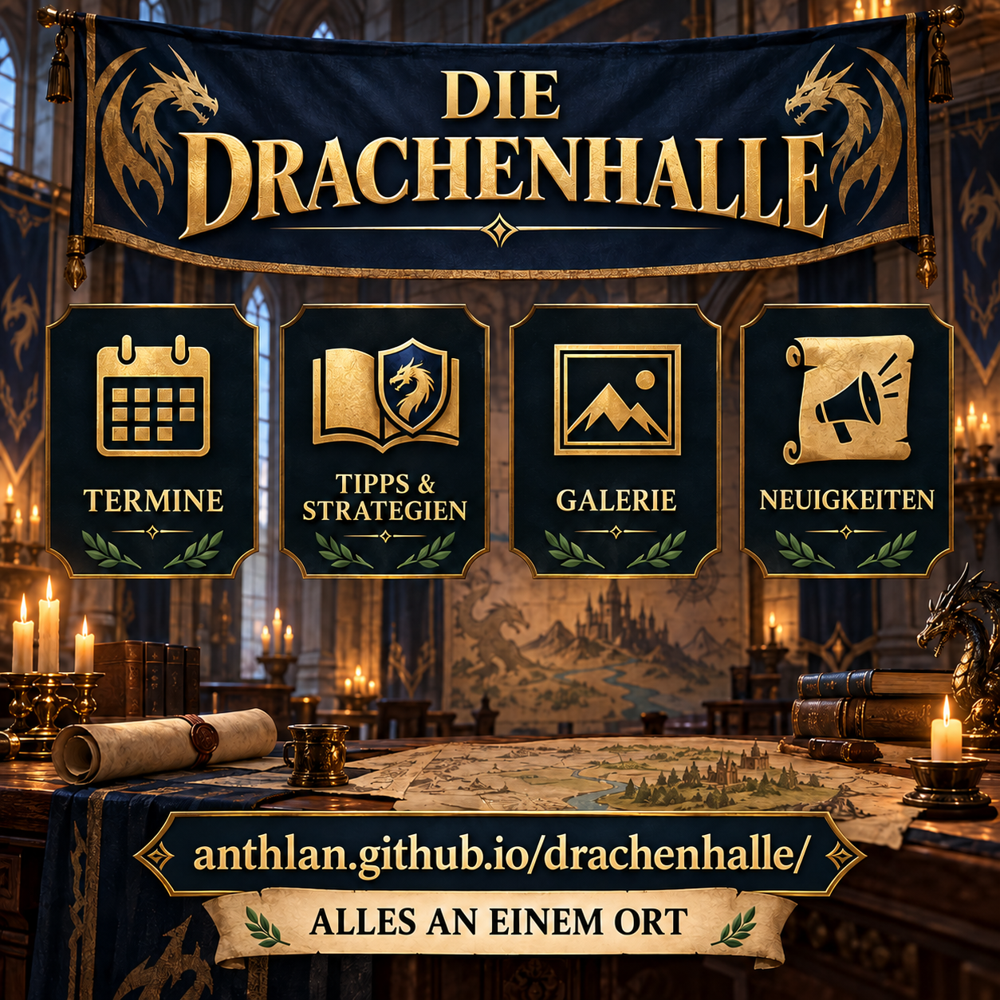
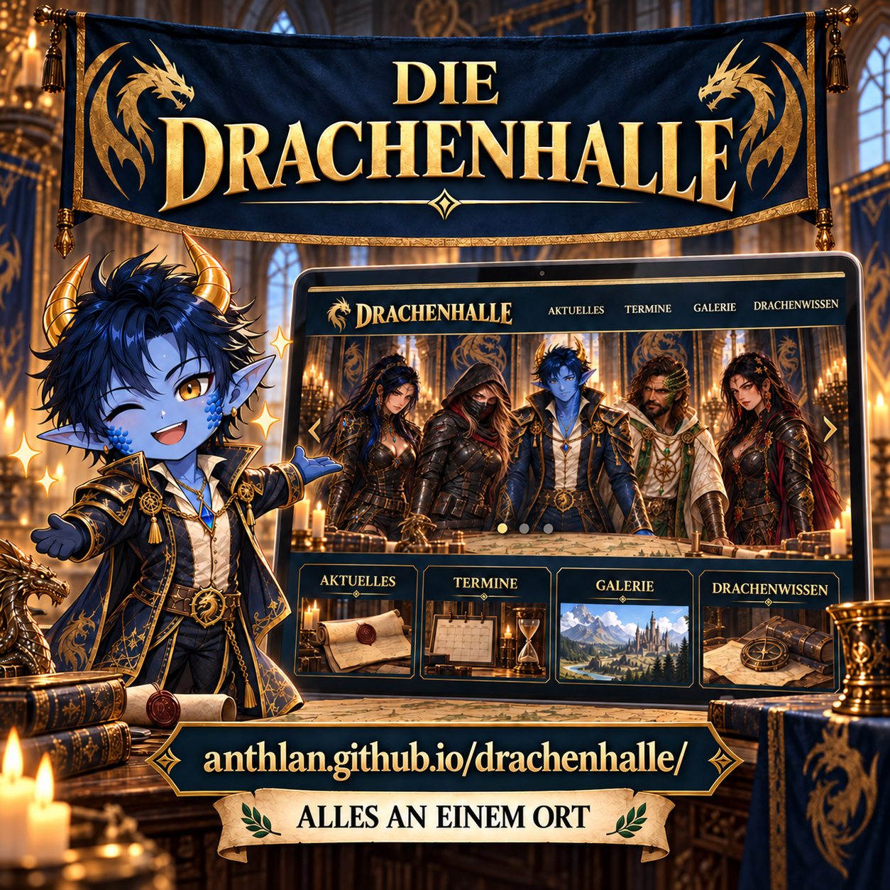

# Introducing the Dragon Hall

The Dragon Hall is our shared place for news, events, game knowledge and images. This article explains why it is worth visiting regularly and how we can introduce new and existing members to the website.

## What members can find there

- upcoming events with calendar downloads,
- tips, strategies and detailed event guides,
- the gallery with chat images, reaction images, avatars and character models,
- recent additions to the archive,
- and the upload inbox for personal contributions.

This message is especially useful for new members, after larger website updates or as an occasional reminder in alliance chat.

## Graphics

The factual version puts the website and its sections in the foreground.



The chibi version shows Anthlan as the presenter and feels more personal.



## Alliance message to copy

```html
<color=#FFD700><b>DIE DRAGON HALL</b></color>
Our alliance website brings everything important together in one place:

• Keep track of <b>events</b> and add them directly to your calendar
• Read <b>tips and strategies</b> whenever you need them
• Discover the <b>gallery</b> with chat images, avatars and characters
• Find <b>news</b> and new content quickly
• Easily <b>submit</b> your own images and documents

<color=#7FFF00><b>Visit the Dragon Hall now:</b></color>
anthlan.github.io/drachenhalle/en/

Save the link and check back regularly so you never miss an event, tip or new image.
```
