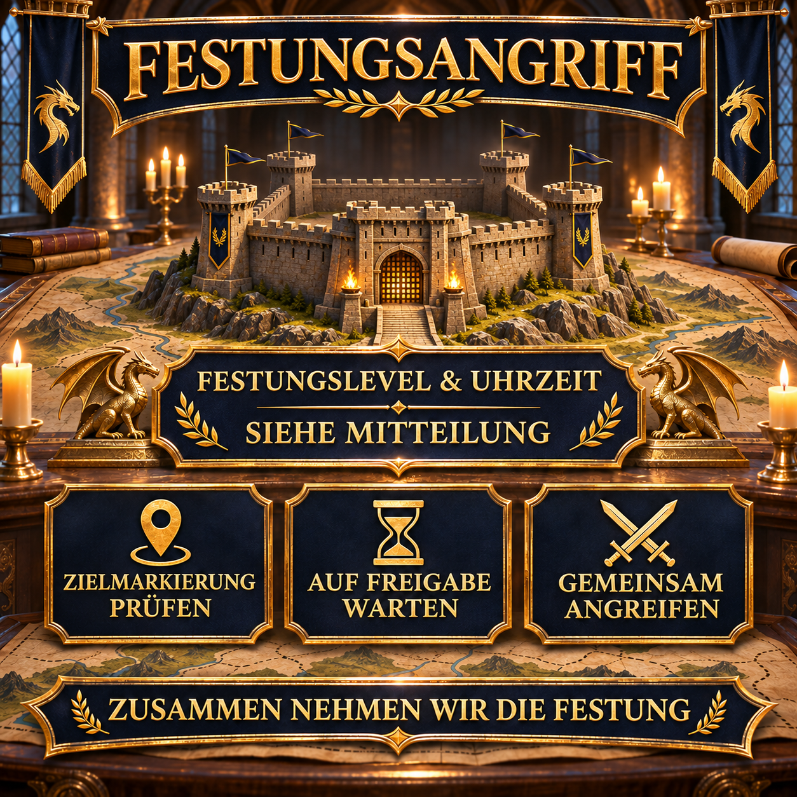

# Festungsangriff: gemeinsam und koordiniert angreifen

Beim Angriff auf eine Festung zählt vor allem, dass alle Beteiligten dasselbe Ziel kennen und erst zur vereinbarten Zeit starten. Diese wiederverwendbare Ankündigung verbindet deshalb Festungslevel, Startzeit und die wichtigsten Absprachen für einen geschlossenen Angriff.

Das konkrete Festungslevel und die Uhrzeit werden für jeden Einsatz neu eingesetzt. Weitere Details können kurzfristig über die Zielmarkierung und den Allianzchat abgestimmt werden.



## Unser gemeinsamer Ablauf

Die Voraussetzungen und der genaue Ablauf richten sich nach der aktuell ausgewählten Festung. Für die Ankündigung ist entscheidend, dass alle Beteiligten die Zielmarkierung prüfen, ihre Märsche bereithalten und die Freigabe abwarten.

- Seid einige Minuten vor dem angekündigten Start online.
- Prüft das Festungslevel und unsere aktuelle Zielmarkierung.
- Haltet die benötigten Märsche möglichst frei.
- Spieler mit hohem Widerstand sollten die Versammlungen starten, weil ihr Widerstand dann auch für Teilnehmer mit geringerem Widerstand wirkt.
- Wartet auf die gemeinsame Freigabe im Allianzchat.
- Startet keine vorzeitigen Einzelangriffe auf das markierte Ziel.

> **Vor dem Versenden:** `[UHRZEIT]` und `[FESTUNGSLEVEL]` durch die Angaben für den geplanten Angriff ersetzen.

## Allianz-Mitteilung zum Kopieren

```html
<color=#FFD700><b>🏰 FESTUNGSANGRIFF – HEUTE [UHRZEIT]</b></color>

Um <color=#FFD700><b>[UHRZEIT] Uhr</b></color> greifen wir gemeinsam eine <b>Festung auf Level [FESTUNGSLEVEL]</b> an.

📍 <b>Zielmarkierung prüfen:</b> Achtet darauf, dass ihr die richtige Festung ausgewählt habt.
⏳ <b>Auf Freigabe warten:</b> Bitte nicht vorzeitig angreifen.
⚔️ <b>Märsche bereithalten:</b> Seid rechtzeitig online und achtet auf den Allianzchat.
🛡️ <b>Widerstand nutzen:</b> Spieler mit hohem Widerstand starten die Versammlungen; ihr Widerstand wirkt dann auch für Teilnehmer mit geringerem Widerstand.

Beginnt den Angriff erst nach der gemeinsamen Freigabe, damit wir geschlossen am Ziel eintreffen.

<color=#90EE90><b>Zusammen nehmen wir die Festung!</b></color>

<b>Fragen?</b> Einfach Anthlan oder einen der R4 anschreiben.
```
