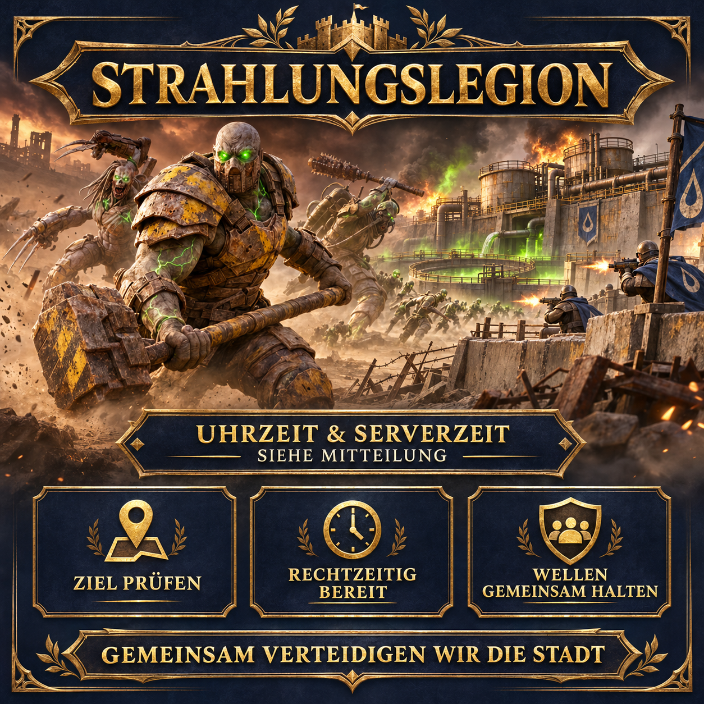

# Strahlungslegion: die angegriffene Stadt gemeinsam verteidigen

Die Strahlungslegion greift während des Events dienstags und freitags eine vorher angekündigte Allianzstadt an. Dadurch können wir uns rechtzeitig abstimmen und gemeinsam auf die Verteidigungswellen vorbereiten.

Bei einer erfolgreichen Verteidigung erhalten alle Allianzmitglieder Belohnungen. Je mehr Wellen wir überstehen, desto größer fallen diese aus. Scheitert die Verteidigung, verliert die Stadt Haltbarkeit; bei 0 Haltbarkeit wird sie von der Strahlungslegion besetzt.



## Vor dem Angriff

- Prüft das vom Spiel angekündigte Ziel und unsere aktuelle Allianzmarkierung.
- Seid einige Minuten vor der vereinbarten Uhrzeit online.
- Haltet eure vorgesehenen Märsche und Truppen für die Verteidigung frei.
- Achtet kurz vor dem Start auf Absprachen im Allianzchat.

## Während der Verteidigung

- Verteidigt das angekündigte Ziel gemeinsam und bleibt für die folgenden Wellen verfügbar.
- Achtet auf eure Truppen und reagiert auf Hinweise der Eventkoordination.
- Haltet möglichst viele Wellen durch, um die gemeinsame Belohnung zu steigern.
- Vermeidet einen Fehlschlag, damit die Stadt keine Haltbarkeit verliert und nicht besetzt wird.

> **Vor dem Versenden:** `[UHRZEIT]` durch die vereinbarte Startzeit ersetzen. `[SERVERZEIT]` wird automatisch aus `[UHRZEIT]` berechnet: Winterzeit −3 Stunden, Sommerzeit −4 Stunden.

## Allianz-Mitteilung zum Kopieren

```html
<color=#FFD700><b>☢️ STRAHLUNGSLEGION – HEUTE [UHRZEIT]</b></color>

Um <color=#FFD700><b>[UHRZEIT] Uhr</b></color> beginnt der angekündigte Angriff der Strahlungslegion auf unsere Allianzstadt.
🕒 <b>Serverzeit:</b> [SERVERZEIT] Uhr

📍 <b>Ziel prüfen:</b> Achtet auf das angekündigte Ziel und unsere Allianzmarkierung.
⏰ <b>Rechtzeitig bereit sein:</b> Bitte einige Minuten vorher online sein und Märsche freihalten.
🛡️ <b>Gemeinsam verteidigen:</b> Bleibt für die Angriffswellen verfügbar und achtet auf den Allianzchat.
🌊 <b>Wellen halten:</b> Je mehr Wellen wir gemeinsam überstehen, desto größer fallen die Belohnungen für alle aus.

<color=#FF8C69><b>⚠️ Stadt schützen:</b></color>
Eine gescheiterte Verteidigung senkt die Haltbarkeit. Bei 0 Haltbarkeit besetzt die Strahlungslegion die Stadt.

<color=#90EE90><b>Gemeinsam verteidigen wir die Stadt!</b></color>

<b>Fragen?</b> Einfach Anthlan oder einen der R4 anschreiben.
```
