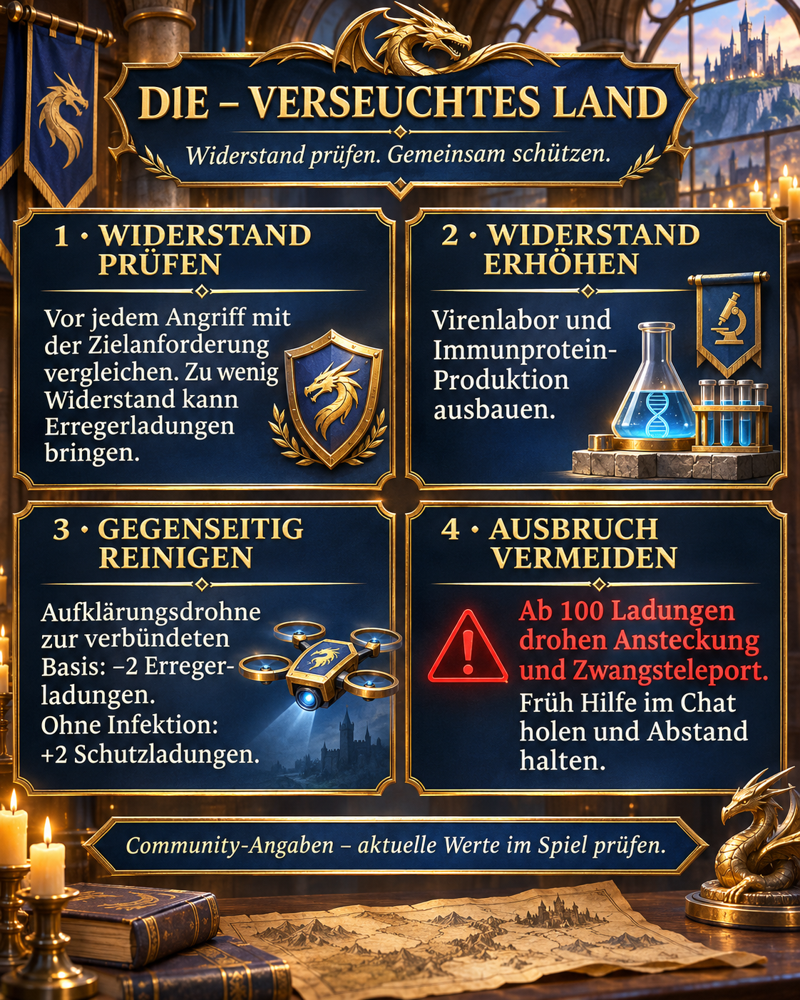

# Verseuchtes Land: Widerstand prüfen und Erreger gemeinsam reinigen

Für uns in DIE stehen Widerstand, Erregerkontrolle und gegenseitige Hilfe im Mittelpunkt. Diese Seite verbindet die Allianz-Mitteilung mit einer ausführlicheren Einordnung der neuen Saisonmechanik.

## Stand und Verlässlichkeit

Recherche: 2. November 2026. Alle Mechanikwerte sind **Community-Hinweise**, nicht von uns durch Spielaufnahmen bestätigt. Russische Quellen nennen die Saison „Облучённая земля“, englische „Radiated Land“. Aktuelle Zielanzeigen und Eventregeln im Spiel haben Vorrang. Für unsere Allianz liegt hier kein bestätigtes Enddatum vor; diese Seite ist deshalb nicht als abgeschlossen archiviert.

## Grafik und Kurzfassung



Deutsche Originalgrafik im blau-goldenen DIE-Stil: Widerstand prüfen, Produktion ausbauen, gegenseitig reinigen und Ausbruch vermeiden.

## Widerstand und Erreger unterscheiden

Widerstand ist der Schutzwert, den wir vor einem Angriff mit der Zielanforderung vergleichen. Erregerladungen beschreiben die bereits angesammelte Belastung. Ein Sieg allein belegt nicht, dass der Angriff ohne Infektion bleibt. Laut [Quelle 1](https://zroutehub.bond/handbook/event_season_guide/) können Angriffe bei zu geringem Widerstand Ladungen verursachen. Eine genaue Formel für Risiko und Widerstandsdifferenz ist nicht belegt.

## Widerstand aufbauen

Das Virenlabor erhöht den Widerstand; Immunprotein dient seinem Ausbau. Die saisonalen Produktionsgebäude liefern Protein und werden mit Uran-Kristallen verbessert. [Quelle 2](https://trassaz.ru/sezon-s1/) nennt zusätzlich Forschung und einen Passbonus von +250 Widerstand. Das ist kein Kaufargument ohne Prüfung des aktuellen Angebots. Unsere Empfehlung: Produktion und Labor gemeinsam entwickeln, neue Ziele erst nach Prüfung ihrer Anforderungen angehen.

## Reinigung und Ausbruch

Laut [Quelle 1](https://zroutehub.bond/handbook/event_season_guide/) entfernt eine Aufklärungsdrohne zur verbündeten Basis 2 Erregerladungen beziehungsweise gibt 2 Schutzladungen bei unbelasteter Basis. Schutzladungen nicht mit einem normalen Basisschild gleichsetzen. Bei 100 Ladungen drohen laut Community ein Ausbruch, Ansteckung in der Umgebung und Zwangsteleport. Deshalb früh Hilfe im Chat holen, Belastung kontrollieren und bei drohendem Ausbruch Abstand zu unseren Basen halten. Reinigung nicht absichtlich deaktivieren, solange wir die Mechanik nicht gemeinsam geprüft haben.

## Widersprüche und offene Fragen

Die Quellen nennen 30 beziehungsweise 35 übertragene Ladungen beim Ausbruch. Auch bei Protein aus Beobachter-Kämpfen widersprechen sie sich. Reichweite, Auslösezeit, Reinigungslimits, Rally-Regeln und die Dauer möglicher Nachteile nach einer Reinigung bleiben für unseren Spielstand zu testen. Erreger, Schutzladungen, Widerstand und Antikörper sind getrennte Begriffe; eine Umrechnung ist nicht belegt.

## Unser Vorgehen

- Vor Angriffen Zielanforderung und eigenen Widerstand prüfen.
- Labor und Proteinproduktion ausbauen; Ressourcen nicht ungeprüft in ein einziges Gebäude stecken.
- Erregerstand nach Kämpfen kontrollieren und früh gegenseitige Reinigung organisieren.
- Abweichungen mit Screenshot von Ziel, Widerstand und Erregerstand dokumentieren.

## Quellen und Einordnung

1. [Server 33](https://zroutehub.bond/handbook/event_season_guide/) — Russischer Community-Guide von Server 33: saisonale Gebäude, Widerstand, Drohnenreinigung und Ausbruch. Trotz der Überschrift „offizieller Guide“ ist die Website eine inoffizielle Community-Seite.

2. [Z Route Wiki](https://trassaz.ru/sezon-s1/) — Russischer Fan-Guide, datiert 7. Oktober 2026: Gamma-Virus, Labor, Forschung und saisonale Boni. Einzelne Angaben weichen von Quelle 1 ab.

3. [ARES](https://rutube.ru/video/b487339c34cd06938c1ba8a1af58c624/) — Video von ARES, 23. September 2026, 22:18 Minuten: Die Beschreibung nennt Widerstand, Moral und verseuchtes Land. Nur ergänzender Videolink; konkrete Zahlen dieser Seite wurden nicht aus dem Video verifiziert.

## Allianz-Mitteilung zum Kopieren

```html
<color=#FFD700><b>☣️ DlE – VERSEUCHTES LAND</b></color>

🛡️ <b>Vor Angriffen Widerstand prüfen!</b> Liegt er unter der Zielanforderung, könnt ihr Erreger sammeln – auch bei hoher Kampfkraft.

🧪 <b>Virenlabor und Immunprotein-Produktion ausbauen.</b> So erhöhen wir unseren Widerstand.

🛰️ <b>Gegenseitig reinigen!</b> Eine Aufklärungsdrohne zur verbündeten Basis entfernt laut Community-Guide 2 Erregerladungen; ohne Infektion gibt sie 2 Schutzladungen.

<color=#FF4040><b>⚠️ Erreger frühzeitig melden!</b></color> Sie schwächen euch. Ab 100 Ladungen drohen Ausbruch, Ansteckung benachbarter Basen und Zwangsteleport. Bei hoher Belastung Abstand zu unseren Basen halten und Hilfe im Chat anfordern.

<b>Gemeinsam schützen, gegenseitig helfen!</b>

Hinweise aus Community-Guides; prüft die aktuellen Werte im Spiel.
```
