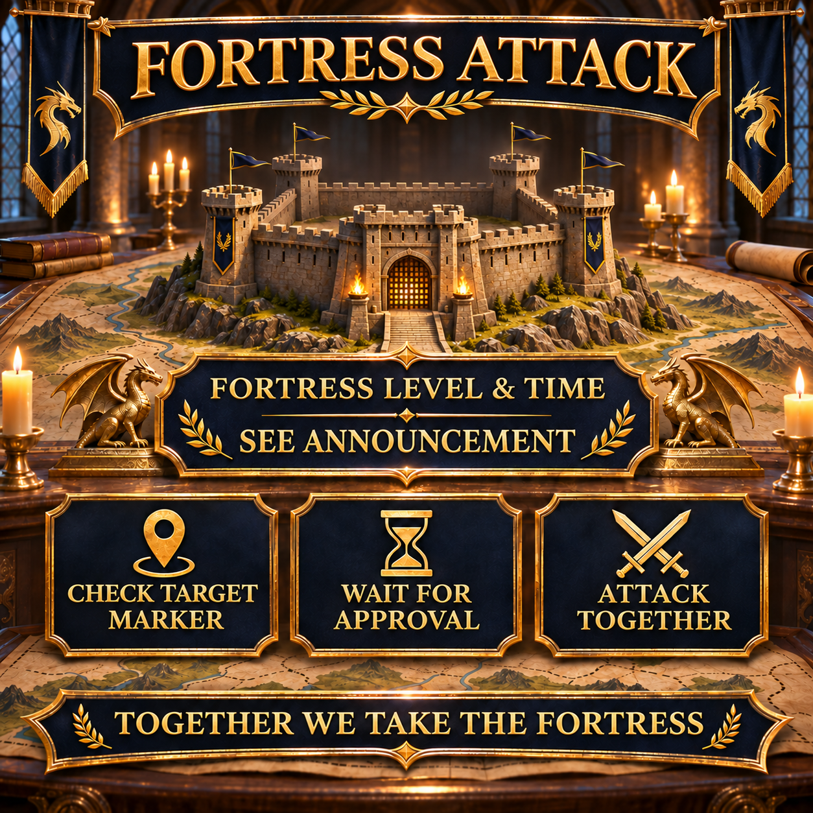

# Fortress attack: attack together in coordination

When attacking a fortress, the most important thing is that everyone involved knows the same target and does not start before the agreed time. This reusable announcement therefore combines the fortress level, start time and the key arrangements for a coordinated attack.

The specific fortress level and time are entered anew for every operation. Further details can be coordinated at short notice through the target marker and alliance chat.



## Our coordinated procedure

The requirements and exact procedure depend on the fortress currently selected. For the announcement, it is essential that everyone checks the target marker, keeps their marches ready and waits for approval.

- Be online a few minutes before the announced start.
- Check the fortress level and our current target marker.
- Keep the required marches available if possible.
- Players with high resistance should start the rallies, because their resistance then also applies to participants with lower resistance.
- Wait for joint approval in alliance chat.
- Do not launch early individual attacks on the marked target.

> **Before sending:** `[TIME]` and `[FORTRESS LEVEL]` must be replaced with the details for the planned attack. `[SERVER TIME]` is calculated automatically from `[TIME]`: −3 hours in winter and −4 hours in summer.

## Alliance message to copy

```html
<color=#FFD700><b>🏰 FORTRESS ATTACK – TODAY [TIME]</b></color>

At <color=#FFD700><b>[TIME]</b></color>, we will attack a <b>Level [FORTRESS LEVEL] fortress</b> together.
🕒 <b>Server time:</b> [SERVER TIME]

📍 <b>Check the target marker:</b> Make sure you have selected the correct fortress.
⏳ <b>Wait for approval:</b> Please do not attack early.
⚔️ <b>Keep marches ready:</b> Be online in time and follow alliance chat.
🛡️ <b>Use resistance:</b> Players with high resistance start the rallies; their resistance then also applies to participants with lower resistance.

Begin the attack only after joint approval so that we reach the target together.

<color=#90EE90><b>Together we take the fortress!</b></color>

<b>Questions?</b> Just message Anthlan or an R4.
```
