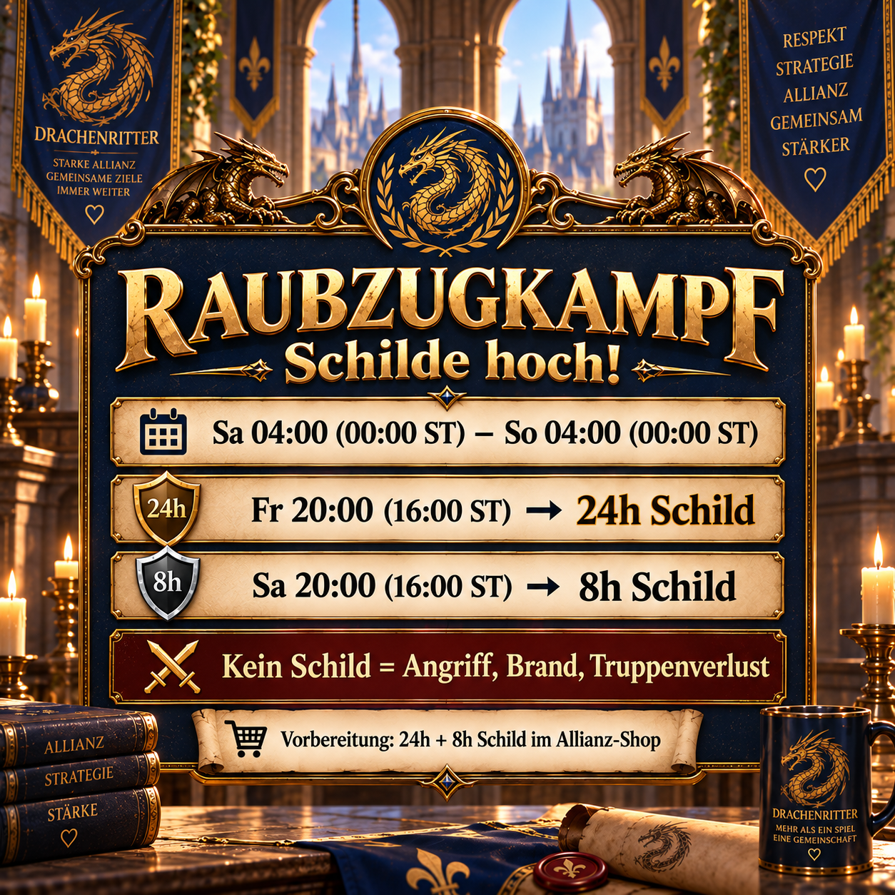

# Raid battles: activate shields in time

During raid battles, opponents from other servers can teleport to us and attack unprotected bases. We therefore prepare before the combat period begins, obtain the shields in advance and activate them according to a shared plan.

This announcement combines three things every member needs to know: the actual danger period, timely preparation in the alliance shop and the two activation times in our shield plan.



## Why the shield plan matters

A single 24-hour shield does not reliably cover the entire period. Our plan therefore combines a 24-hour and an 8-hour shield. This keeps bases protected during the critical period without every member having to do their own calculations.

Without a shield, any base can become a target, regardless of its strength. If a base is completely burned down, very large numbers of soldiers can be lost on the drill ground. Anyone not actively joining the raid battle should therefore also follow the shared shield plan.

## Preparation

- Get **one 24-hour shield and one 8-hour shield** from the alliance shop before Friday evening.
- Activate the first shield on time on Friday evening.
- Extend your protection on Saturday evening with the 8-hour shield.
- After activation, check that the displayed remaining duration covers the entire planned period.
- Before sending the message, check that local time and server time still match.

## Alliance message to copy

```html
<color=#FFD700><b>⚔️ Raid battle – shields up! 🛡️</b></color>

From <b>Saturday 04:00 (00:00 server time)</b> until <b>Sunday 04:00 (00:00 server time)</b>, raid battle is back. During this time, opponents from other servers can teleport to us and attack our bases.

<color=#87CEEB><b>Preparation:</b></color>
Please get <b>1× 24h shield + 1× 8h shield</b> from the alliance shop in time.

<color=#90EE90><b>Our shield plan:</b></color>
<b>Friday 20:00 (16:00 server time)</b> → 24h shield
<b>Saturday 20:00 (16:00 server time)</b> → 8h shield

<color=#FF6347><b>⚠️ Important:</b></color> Without a shield, <b>anyone</b> can become a target, regardless of strength. If your base is burned to 0, massive numbers of soldiers die on the drill ground.

<b>Shield up and avoid losses! 🛡️</b>
```
