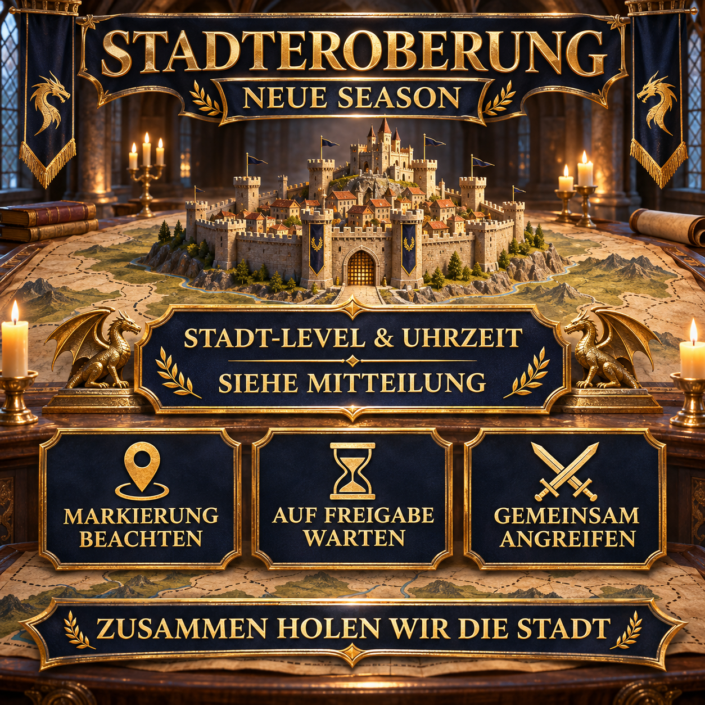

# City conquest in the new season: attack together

In the new season, we conquer cities together and coordinate the attack through the alliance marker and alliance chat. This reusable announcement states the current target, start time and procedure immediately before the attack.

The specific city level and time are entered anew for each operation. This keeps the template usable when targets change.



## Our coordinated procedure

The actual targets and requirements depend on the current season map. For the announcement, it is therefore especially important that everyone follows the same marked city, the same start time and the approval given in alliance chat.

- Be online a few minutes before the announced start.
- Keep the required marches available if possible.
- Use rallies whenever possible instead of attacking the target individually.
- Check the current alliance marker and alliance chat.
- Do not start the attack until approval has been given.
- Ask beforehand if the target or procedure is unclear.

> **Before sending:** `[TIME]` and `[CITY LEVEL]` must be replaced with the details for the planned attack. `[SERVER TIME]` is calculated automatically from `[TIME]`: −3 hours in winter and −4 hours in summer.

## Alliance message to copy

```html
<color=#FFD700><b>🏰 CITY CONQUEST – TODAY [TIME]</b></color>

At <color=#FFD700><b>[TIME]</b></color>, we attack a <b>level [CITY LEVEL] city</b> together.
🕒 <b>Server time:</b> [SERVER TIME]

📍 <b>Check the marker:</b> Check our marked target before the start.
⏳ <b>Wait for approval:</b> Please do not attack early.
⚔️ <b>Attack together:</b> Keep your marches ready and watch alliance chat.
🤝 <b>Use rallies:</b> Start or join a rally against the marked target whenever possible.

Please be online a few minutes early so we can begin the attack together.

<color=#90EE90><b>Together we take the city!</b></color>

<b>Questions?</b> Simply contact Anthlan or one of the R4 officers.
```
