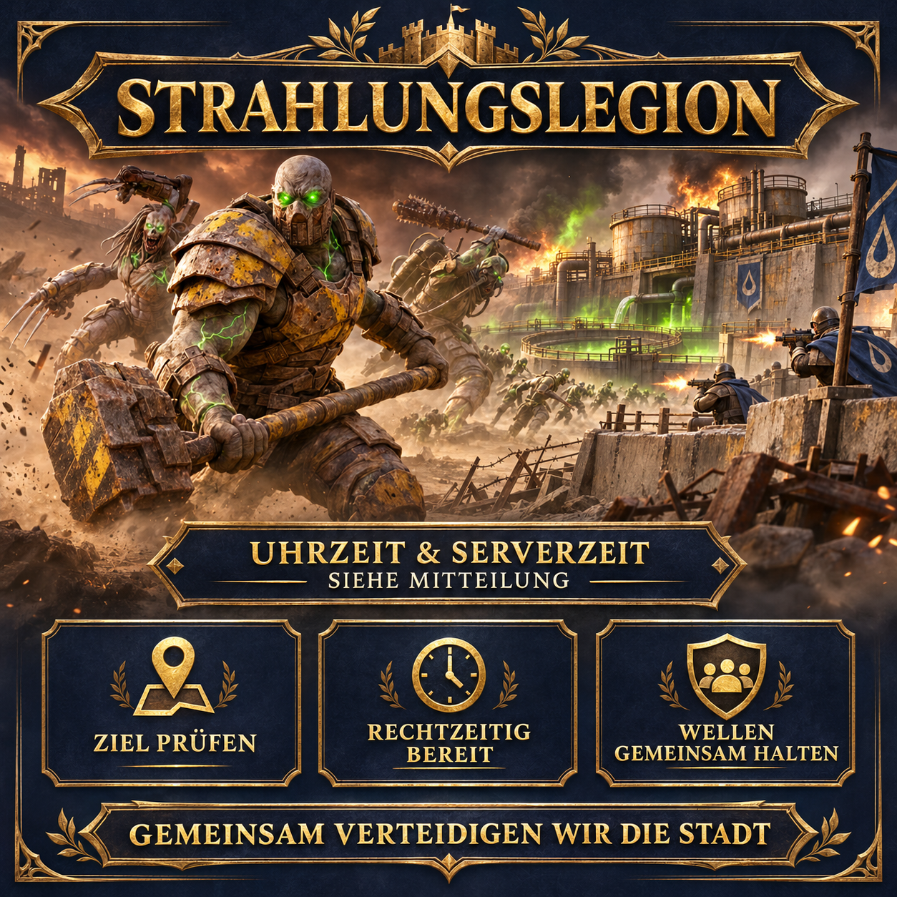

# Radiation Legion: defend the attacked city together

During the event, the Radiation Legion attacks a previously announced alliance city every Tuesday and Friday. This gives us time to coordinate and prepare together for the defensive waves.

After a successful defence against the Radiation Legion, all alliance members receive rewards. The more waves we survive, the greater the rewards. If the defence fails, the city loses durability; when its durability reaches 0, the Radiation Legion occupies the city.



## Before the attack

- Check the target announced by the game and our current alliance marker.
- Be online a few minutes before the agreed time.
- Keep the designated marches and troops available for the defence.
- Watch alliance chat for final coordination shortly before the start.

## During the defence

- Defend the announced target together and remain available for the following waves.
- Watch your troops and follow instructions from the event coordinators.
- Survive as many waves as possible to increase the shared rewards.
- Avoid a failed defence so the city does not lose durability or become occupied.

> **Before sending:** `[TIME]` must be replaced with the agreed start time. `[SERVER TIME]` is calculated automatically from `[TIME]`: −3 hours in winter and −4 hours in summer.

## Alliance message to copy

```html
<color=#FFD700><b>☢️ RADIATION LEGION – TODAY [TIME]</b></color>

At <color=#FFD700><b>[TIME]</b></color>, the announced Radiation Legion attack on our alliance city begins.
🕒 <b>Server time:</b> [SERVER TIME]

📍 <b>Check the target:</b> Watch for the announced target and our alliance marker.
⏰ <b>Be ready in time:</b> Please be online a few minutes early and keep your marches available.
🛡️ <b>Defend together:</b> Remain available for the attack waves and watch alliance chat.
🌊 <b>Hold the waves:</b> The more waves we survive together, the greater the rewards for everyone.

<color=#FF8C69><b>⚠️ Protect the city:</b></color>
A failed defence reduces its durability. At 0 durability, the Radiation Legion occupies the city.

<color=#90EE90><b>Together we defend the city!</b></color>

<b>Questions?</b> Simply contact Anthlan or one of the R4 officers.
```
