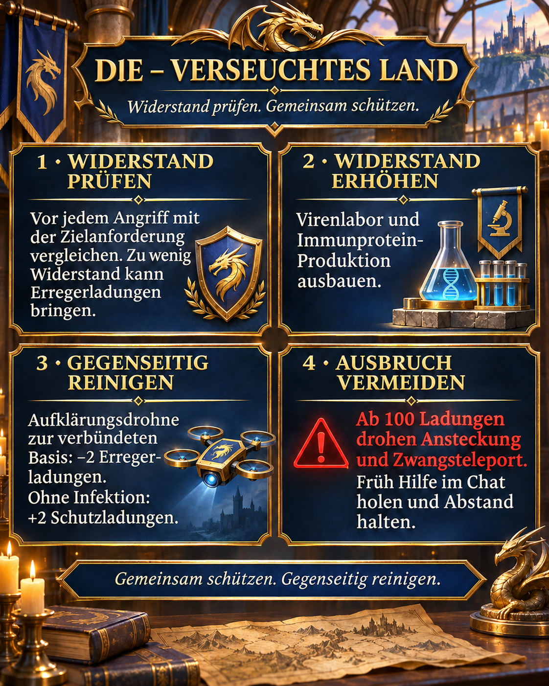

# Radiated Land: check resistance and clear pathogens together

In Radiated Land, resistance matters alongside combat power when choosing targets we can attack safely. Pathogen charges weaken us and, at high levels, can spread to nearby bases. Developing our seasonal buildings and helping cleanse each other keeps us protected together.

## Graphic and summary



## Resistance versus pathogen charges

Resistance is the protection value we compare with the target requirement before attacking. Pathogen charges are the contamination already accumulated. Winning does not prevent infection: with insufficient resistance, even a successful attack can add pathogen charges. [More about the mechanic](https://zroutehub.bond/handbook/event_season_guide/).

## Building resistance

The virus laboratory increases our resistance and uses immune protein for upgrades. Seasonal production buildings supply that protein and use uranium crystals for upgrades. Develop production and the laboratory together so supply keeps pace with demand. Research and a season pass bonus of +250 provide additional resistance. [More about development](https://trassaz.ru/sezon-s1/).

## Cleansing and outbreaks

A reconnaissance drone sent to an allied base removes 2 pathogen charges. An uninfected base receives 2 protection charges instead. At 100 pathogen charges, an outbreak infects nearby targets and forces the affected base to teleport. Report rising contamination early in alliance chat so we can help cleanse each other in time. Keep away from our bases if an outbreak is imminent. [More about cleansing and outbreaks](https://zroutehub.bond/handbook/event_season_guide/).

## Understanding resistance and protection charges

Resistance protects us when attacking infected targets. Allied cleansing removes pathogen charges already accumulated. Protection charges build up on an uninfected base and are distinct from a normal base shield. Antibodies are another separate value. These terms must not be treated as equivalent.

## Our approach

- Compare our resistance with the target requirement before every attack.
- Develop the virus laboratory and immune protein production together.
- Check pathogen charges after battles and ask for cleansing early.
- Keep away from our bases if an outbreak threatens and ask for help in alliance chat.

## Sources

1. [Server 33](https://zroutehub.bond/handbook/event_season_guide/) — Russian community guide to seasonal buildings, resistance, drone cleansing and outbreaks.

2. [Z Route Wiki](https://trassaz.ru/sezon-s1/) — Russian fan guide dated 7 October 2026 covering gamma virus, resistance and seasonal bonuses.

3. [ARES](https://rutube.ru/video/b487339c34cd06938c1ba8a1af58c624/) — Russian video dated 23 September 2026 with tips on resistance, morale and contaminated land (22:18).

## Alliance message to copy

```html
<color=#FFD700><b>☣️ DlE – RADIATED LAND</b></color>

🛡️ <b>Check resistance before attacking!</b> Below the target requirement, you may gain pathogen charges even with high combat power.

🧪 <b>Upgrade the virus laboratory and immune protein production.</b> This builds our resistance.

🛰️ <b>Help cleanse each other!</b> A reconnaissance drone to an allied base removes 2 pathogen charges, or adds 2 protection charges if uninfected.

<color=#FF4040><b>⚠️ Report contamination early!</b></color> Charges weaken you. At 100, outbreaks, nearby infections and forced teleportation threaten. Keep away from our bases when heavily contaminated and ask for help in chat.

<b>Protect each other and work together!</b>
```
