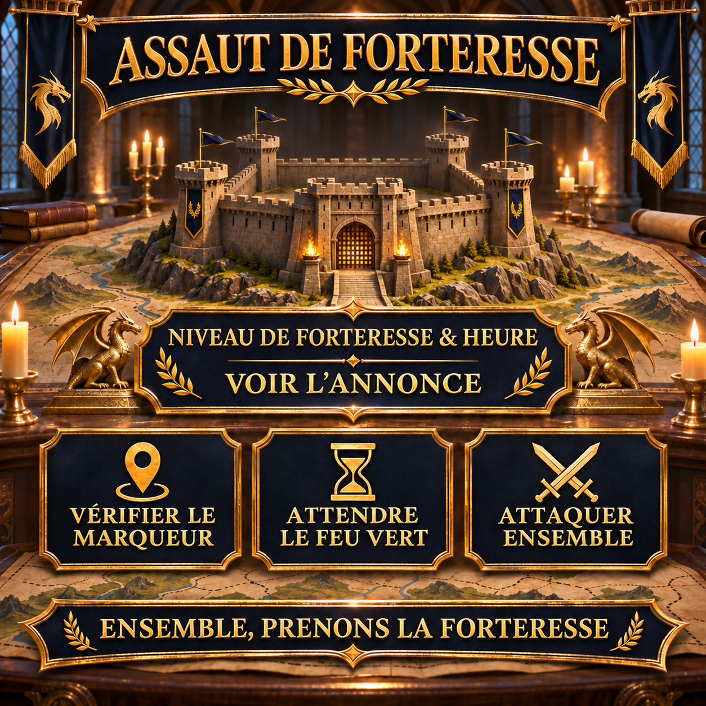

# Assaut de forteresse : attaquer ensemble et de façon coordonnée

Lors d’un assaut de forteresse, l’essentiel est que tous les participants connaissent la même cible et ne commencent qu’à l’heure convenue. Cette annonce réutilisable rassemble donc le niveau de la forteresse, l’heure de départ et les principales consignes pour une attaque coordonnée.

Le niveau de la forteresse et l’heure sont renseignés à nouveau pour chaque opération. Les autres détails peuvent être coordonnés peu avant l’attaque grâce au marqueur de cible et au chat d’alliance.



## Notre déroulement coordonné

Les conditions et le déroulement exact dépendent de la forteresse actuellement sélectionnée. Pour l’annonce, il est essentiel que chacun vérifie le marqueur de cible, garde ses marches disponibles et attende le feu vert.

- Soyez en ligne quelques minutes avant le départ annoncé.
- Vérifiez le niveau de la forteresse et notre marqueur de cible actuel.
- Gardez si possible les marches nécessaires disponibles.
- Les joueurs disposant d’une résistance élevée doivent lancer les rassemblements, car leur résistance s’applique alors aussi aux participants dont la résistance est plus faible.
- Attendez le feu vert commun dans le chat d’alliance.
- Ne lancez aucune attaque individuelle prématurée sur la cible marquée.

> **Avant l’envoi :** `[HEURE]` et `[NIVEAU DE FORTERESSE]` doivent être remplacés par les informations de l’attaque prévue.

## Message d’alliance à copier

```html
<color=#FFD700><b>🏰 ASSAUT DE FORTERESSE – AUJOURD’HUI [HEURE]</b></color>

À <color=#FFD700><b>[HEURE]</b></color>, nous attaquerons ensemble une <b>forteresse de niveau [NIVEAU DE FORTERESSE]</b>.

📍 <b>Vérifier le marqueur de cible :</b> Assurez-vous d’avoir sélectionné la bonne forteresse.
⏳ <b>Attendre le feu vert :</b> Merci de ne pas attaquer trop tôt.
⚔️ <b>Garder les marches disponibles :</b> Soyez en ligne à temps et suivez le chat d’alliance.
🛡️ <b>Utiliser la résistance :</b> Les joueurs disposant d’une résistance élevée lancent les rassemblements ; leur résistance s’applique alors aussi aux participants dont la résistance est plus faible.

Ne lancez l’attaque qu’après le feu vert commun afin que nous arrivions ensemble sur la cible.

<color=#90EE90><b>Ensemble, prenons la forteresse !</b></color>

<b>Des questions ?</b> Contactez simplement Anthlan ou un R4.
```
