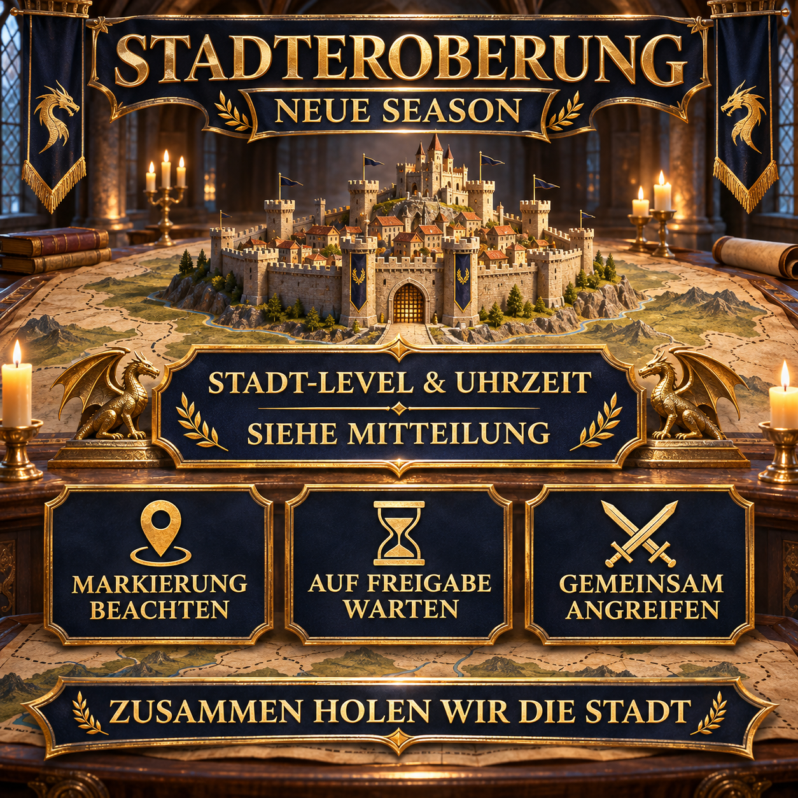

# Conquête d’une ville dans la nouvelle saison : attaquer ensemble

Dans la nouvelle saison, nous conquérons les villes ensemble et coordonnons l’attaque à l’aide du marqueur d’alliance et du chat d’alliance. Cette annonce réutilisable indique la cible actuelle, l’heure de départ et le déroulement juste avant l’attaque.

Le niveau de la ville et l’heure sont renseignés à nouveau pour chaque opération. Le modèle reste ainsi utilisable lorsque la cible change.



## Notre déroulement coordonné

Les cibles et les conditions réelles dépendent de l’état actuel de la carte de saison. Pour l’annonce, il est donc essentiel que tout le monde suive la même ville marquée, la même heure de départ et le feu vert donné dans le chat d’alliance.

- Soyez en ligne quelques minutes avant le départ annoncé.
- Gardez si possible les marches nécessaires disponibles.
- Privilégiez les attaques groupées plutôt que d’attaquer la cible individuellement.
- Vérifiez le marqueur d’alliance actuel et le chat d’alliance.
- Ne lancez l’attaque qu’après le feu vert commun.
- Posez vos questions à l’avance si la cible ou le déroulement n’est pas clair.

> **Avant l’envoi :** `[HEURE]` et `[NIVEAU DE VILLE]` doivent être remplacés par les informations de l’attaque prévue.

## Message d’alliance à copier

```html
<color=#FFD700><b>🏰 CONQUÊTE DE VILLE – AUJOURD’HUI À [HEURE]</b></color>

À <color=#FFD700><b>[HEURE]</b></color>, nous attaquerons ensemble une <b>ville de niveau [NIVEAU DE VILLE]</b>.

📍 <b>Vérifier le marqueur :</b> Vérifiez notre cible marquée avant le départ.
⏳ <b>Attendre le feu vert :</b> Merci de ne pas attaquer trop tôt.
⚔️ <b>Attaquer ensemble :</b> Gardez vos marches prêtes et surveillez le chat d’alliance.
🤝 <b>Privilégier les attaques groupées :</b> Lancez ou rejoignez si possible une attaque groupée contre la cible marquée.

Soyez en ligne quelques minutes à l’avance afin que nous puissions lancer l’attaque ensemble.

<color=#90EE90><b>Ensemble, prenons la ville !</b></color>

<b>Des questions ?</b> Contactez simplement Anthlan ou l’un des R4.
```
