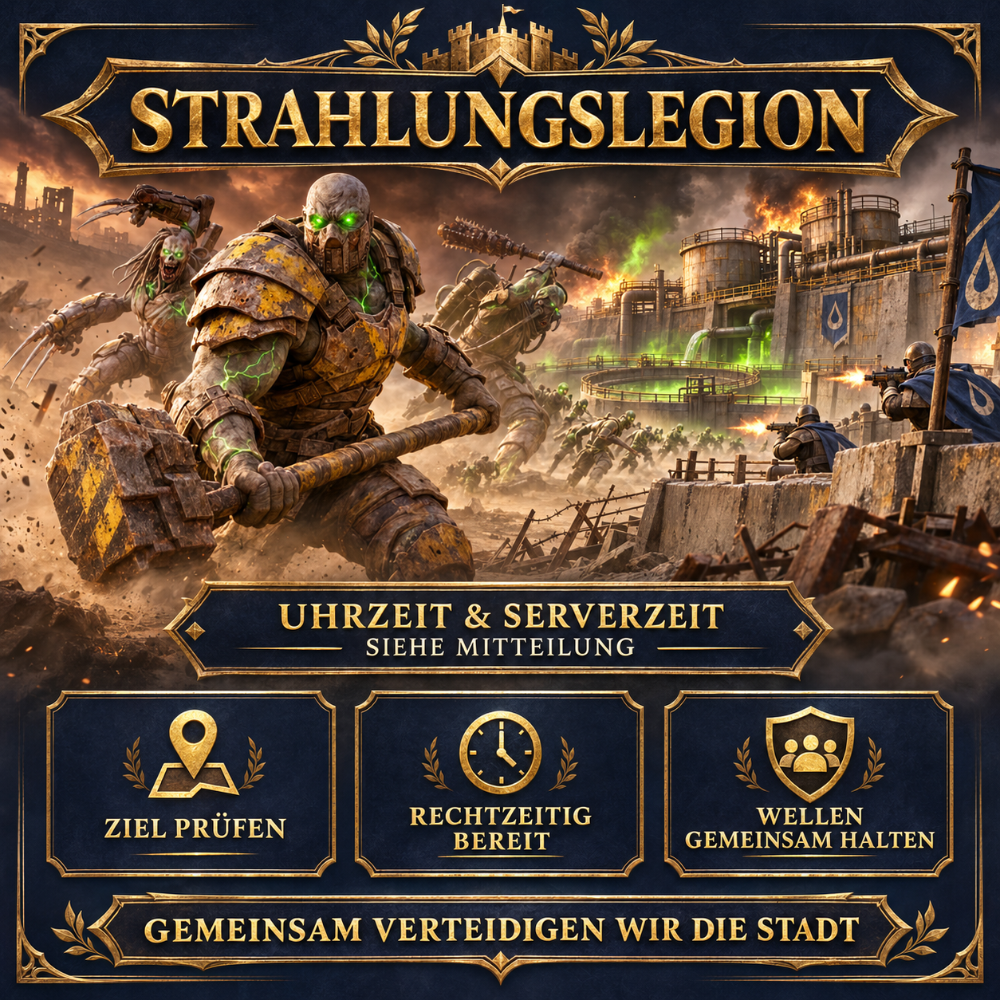

# Légion radioactive : défendre ensemble la ville attaquée

Pendant l’événement, la Légion radioactive attaque chaque mardi et vendredi une ville d’alliance annoncée à l’avance. Nous pouvons ainsi nous coordonner à temps et préparer ensemble les vagues de défense.

Après une défense réussie contre la Légion radioactive, tous les membres de l’alliance reçoivent des récompenses. Plus nous résistons à des vagues, plus les récompenses sont importantes. Si la défense échoue, la ville perd de la durabilité ; lorsque celle-ci atteint 0, la Légion radioactive occupe la ville.



## Avant l’attaque

- Vérifiez la cible annoncée par le jeu et notre marqueur d’alliance actuel.
- Soyez en ligne quelques minutes avant l’heure convenue.
- Gardez les marches et les troupes prévues disponibles pour la défense.
- Surveillez le chat d’alliance pour les dernières consignes avant le départ.

## Pendant la défense

- Défendez ensemble la cible annoncée et restez disponibles pour les vagues suivantes.
- Surveillez vos troupes et suivez les consignes de la coordination de l’événement.
- Résistez à autant de vagues que possible afin d’augmenter les récompenses communes.
- Évitez l’échec de la défense afin que la ville ne perde pas de durabilité et ne soit pas occupée.

> **Avant l’envoi :** `[HEURE]` doit être remplacée par l’heure de départ convenue. `[HEURE SERVEUR]` est calculée automatiquement à partir de `[HEURE]` : −3 heures en hiver et −4 heures en été.

## Message d’alliance à copier

```html
<color=#FFD700><b>☢️ LÉGION RADIOACTIVE – AUJOURD’HUI À [HEURE]</b></color>

À <color=#FFD700><b>[HEURE]</b></color> commencera l’attaque annoncée de la Légion radioactive contre notre ville d’alliance.
🕒 <b>Heure du serveur :</b> [HEURE SERVEUR]

📍 <b>Vérifier la cible :</b> Repérez la cible annoncée et notre marqueur d’alliance.
⏰ <b>Être prêts à temps :</b> Soyez en ligne quelques minutes à l’avance et gardez vos marches disponibles.
🛡️ <b>Défendre ensemble :</b> Restez disponibles pour les vagues d’attaque et surveillez le chat d’alliance.
🌊 <b>Tenir les vagues :</b> Plus nous résistons ensemble à de vagues, plus les récompenses sont importantes pour tous.

<color=#FF8C69><b>⚠️ Protéger la ville :</b></color>
Une défense échouée réduit sa durabilité. À 0 de durabilité, la Légion radioactive occupe la ville.

<color=#90EE90><b>Ensemble, défendons la ville !</b></color>

<b>Des questions ?</b> Contactez simplement Anthlan ou l’un des R4.
```
