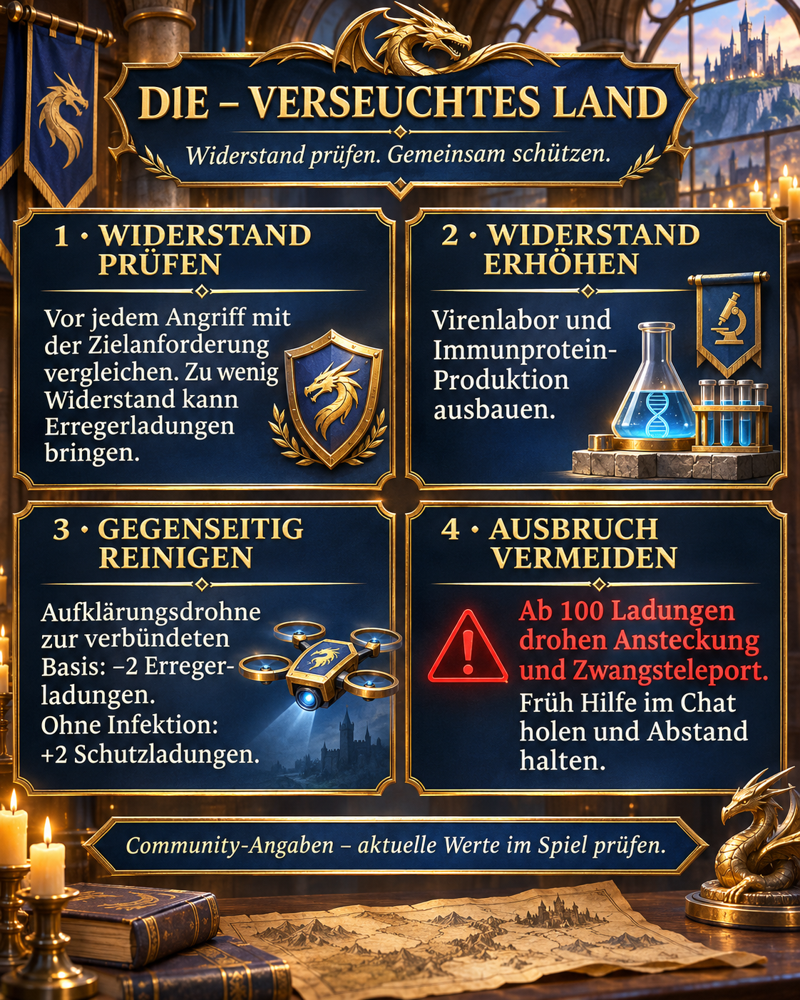

# Terres contaminées : vérifier la résistance et éliminer les agents pathogènes ensemble

Chez DIE, nous privilégions la résistance, le suivi de la contamination et l’entraide. Cette page réunit notre message d’alliance et une explication plus détaillée des nouvelles mécaniques saisonnières.

## État et fiabilité

Recherche du 2 novembre 2026. Toutes les valeurs sont des **indications communautaires**, sans confirmation par nos propres captures. Les sources russes parlent de « Облучённая земля », les sources anglaises de « Radiated Land ». Les indications actuelles du jeu priment. Aucune date de fin pour notre alliance n’est confirmée ; cette page n’est donc pas archivée comme terminée.

## Illustration et résumé



Illustration originale en allemand, dans le style bleu et or de DIE : vérifier la résistance, développer la production, se décontaminer et éviter une épidémie. Ces quatre actions sont expliquées en français ci-dessous.

## Résistance et charges pathogènes

La résistance est la protection à comparer aux exigences de la cible avant une attaque. Les charges pathogènes représentent la contamination déjà accumulée. Une victoire ne garantit pas une attaque sans infection. Selon la [source 1](https://zroutehub.bond/handbook/event_season_guide/), une résistance insuffisante peut entraîner des charges. La formule exacte reliant le risque à l’écart de résistance n’est pas établie.

## Augmenter la résistance

Le laboratoire viral augmente la résistance et utilise des protéines immunitaires pour ses améliorations. Les bâtiments saisonniers produisent ces protéines et s’améliorent avec des cristaux d’uranium. La [source 2](https://trassaz.ru/sezon-s1/) cite aussi la recherche et un bonus de pass de +250. Vérifiez l’offre actuelle avant tout achat. Nous recommandons de développer ensemble production et laboratoire et de vérifier les exigences des nouvelles cibles.

## Décontamination et épidémie

La [source 1](https://zroutehub.bond/handbook/event_season_guide/) annonce −2 charges par drone de reconnaissance envoyé à une base alliée, ou +2 charges protectrices si elle est saine. Ces charges ne sont pas un bouclier de base normal. À 100 charges, la communauté décrit une épidémie, une contamination du voisinage et une téléportation forcée. Demandez de l’aide tôt et éloignez-vous de nos bases si une épidémie menace. Ne désactivez pas volontairement la décontamination alliée avant un test commun.

## Désaccords et questions ouvertes

Les sources indiquent 30 ou 35 charges transmises et divergent sur les protéines obtenues contre les Observateurs. Portée, délai, limites de décontamination, règles de ralliement et durée des pénalités après nettoyage restent à tester. Agents pathogènes, charges protectrices, résistance et anticorps sont distincts ; aucune conversion n’est établie.

## Notre méthode

- Comparer résistance et exigence avant les attaques.
- Développer laboratoire et production sans tout investir aveuglément dans un seul bâtiment.
- Contrôler les charges après les combats et organiser rapidement l’entraide.
- Documenter les écarts par des captures de la cible, de la résistance et des charges.

## Sources et évaluation

1. [Server 33](https://zroutehub.bond/handbook/event_season_guide/) — Guide russe de la communauté du serveur 33 : bâtiments saisonniers, résistance, drones et épidémie. Malgré la mention « guide officiel », le site est communautaire et non officiel.

2. [Z Route Wiki](https://trassaz.ru/sezon-s1/) — Guide de fans russe du 7 octobre 2026 : virus gamma, laboratoire, recherche et bonus saisonniers. Certaines indications divergent de la source 1.

3. [ARES](https://rutube.ru/video/b487339c34cd06938c1ba8a1af58c624/) — Vidéo ARES du 23 septembre 2026, 22:18 : la description mentionne résistance, moral et terres contaminées. Lien complémentaire uniquement ; les chiffres de cette page n’ont pas été vérifiés dans la vidéo.

## Message d’alliance à copier

```html
<color=#FFD700><b>☣️ DlE – TERRES CONTAMINÉES</b></color>

🛡️ <b>Vérifiez la résistance avant chaque attaque !</b> Sous le seuil requis, vous risquez des charges pathogènes malgré votre puissance.

🧪 <b>Améliorez le laboratoire viral et la production de protéines immunitaires.</b>

🛰️ <b>Décontaminons-nous !</b> Selon la communauté, un drone de reconnaissance vers une base alliée retire 2 charges pathogènes ou ajoute 2 charges protectrices si elle est saine.

<color=#FF4040><b>⚠️ Signalez la contamination tôt !</b></color> Elle vous affaiblit. À 100 charges : risque d’épidémie, de contamination voisine et de téléportation forcée. Éloignez-vous de nos bases en cas de forte contamination et demandez de l’aide dans le chat.

<b>Protégeons-nous ensemble !</b>

Indications communautaires ; vérifiez les valeurs en jeu.
```
