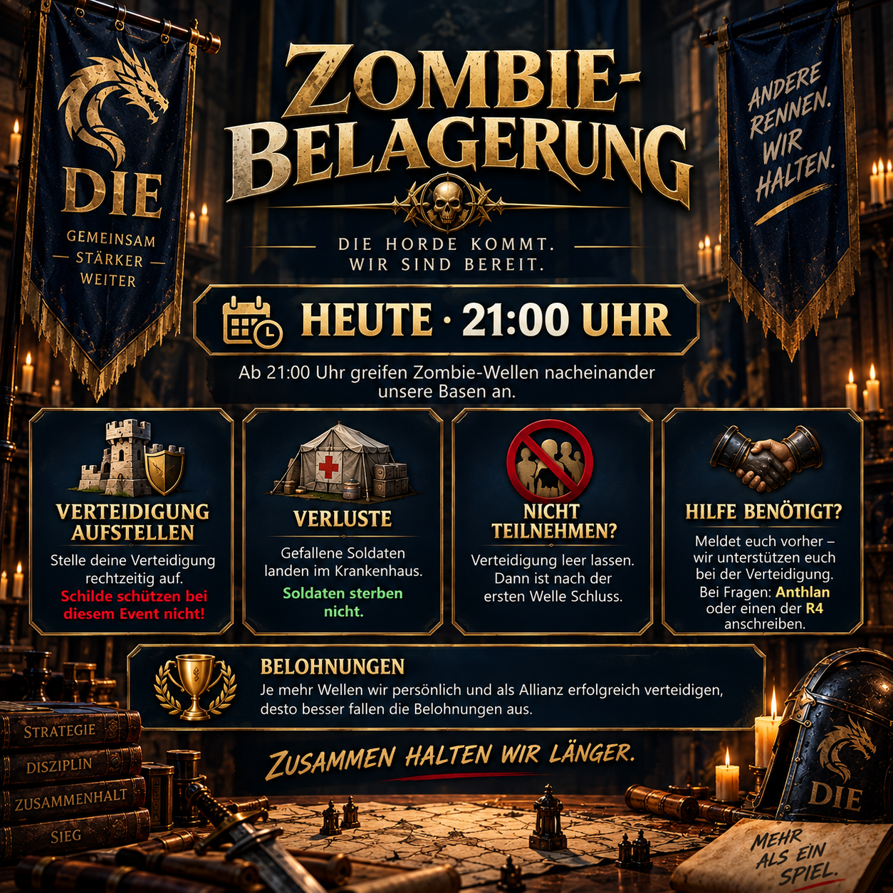

# Zombie Siege : défendre les vagues ensemble

Pendant Zombie Siege, plusieurs vagues attaquent nos bases les unes après les autres. Contrairement à une attaque normale, un bouclier actif n'aide pas ici. avance.

L'annonce explique le processus de sorte que les participants actifs et les membres qui veulent s'asseoir cette fois-ci savent quoi faire.



## Comment fonctionne la participation

Si vous voulez participer, faites votre défense avant le début. Chaque vague que vous survivez améliore votre performance individuelle et votre contribution au résultat de l'alliance. Si votre défense est violée, le siège se termine pour vous.

Les pertes pendant l'événement vont à l'hôpital; les soldats ne meurent pas. Cependant, vérifiez que vous avez suffisamment de capacité d'hôpital avant de commencer.

## Étendre ou recevoir un soutien

Si vous ne voulez pas participer, laissez votre défense vide. Votre événement se termine alors après la première vague, sans aucune préparation supplémentaire.

Si vous avez besoin d'aide pour la défense, demandez avant le début si possible. Cela donne le temps à l'alliance de coordonner l'aide. Anthlan et les R4 Les officiers sont vos premiers points de contact.

> **Avant l’envoi :** remplacez `[HEURE]`, `[NIVEAU]` et `[NIVEAU DE BASE]` par les informations annoncées pour cet événement. L’illustration existante montre la version pour **21:00**.

## Message de l'Alliance à copier

```html
<color=#FFD700><b>🧟 SIÈGE DE ZOMBIES – AUJOURD’HUI [HEURE]</b></color>

À partir de <color=#FFD700><b>[HEURE]</b></color>, les vagues de zombies attaquent nos bases les unes après les autres.
Nous jouons le <b>niveau [NIVEAU]</b>. Les bases à partir du <b>niveau [NIVEAU DE BASE]</b> seront attaquées.

🛡️ <b>Défendez votre défense</b> – les boucliers ne vous protègent pas ici.
, Les pertes vont à la <b>hôpital</b>; les soldats ne meurent pas.
, Si votre défense est violée, votre événement se termine.
- Plus nous survivons, plus notre individu et notre alliance sont récompensés.

<b>Ne voulez pas participer?</b> Laissez votre défense vide → votre événement se termine après vague 1.

<b>Besoin d'aide pour se défendre?</b> Faites-nous savoir au préalable et nous vous aiderons.

<color=#90EE90><b>Des questions?</b></color> Message Anthlan ou une R4.
```
