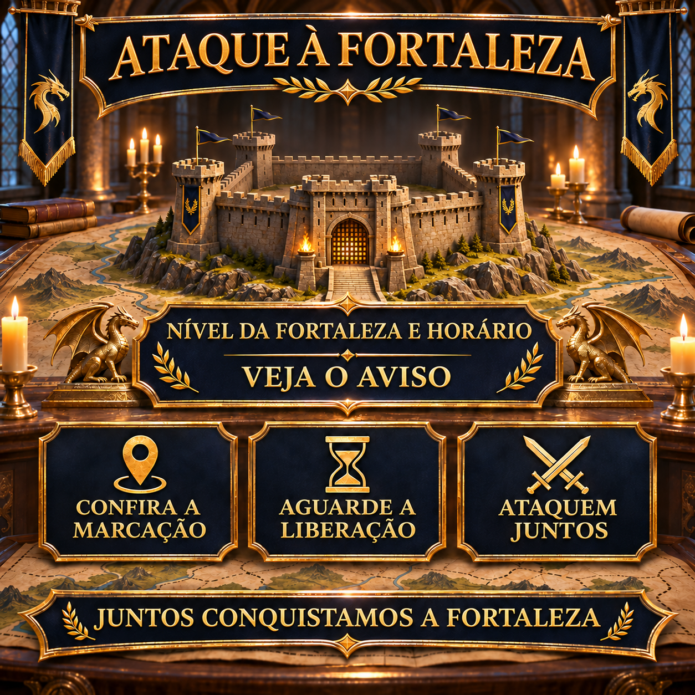

# Ataque à fortaleza: atacar juntos e de forma coordenada

Ao atacar uma fortaleza, o mais importante é que todos conheçam o mesmo alvo e comecem somente no horário combinado. Por isso, este aviso reutilizável reúne o nível da fortaleza, o horário de início e as principais orientações para um ataque coordenado.

O nível da fortaleza e o horário são preenchidos novamente em cada operação. Os demais detalhes podem ser combinados pouco antes do ataque pela marcação do alvo e pelo chat da aliança.



## Nosso procedimento coordenado

Os requisitos e o procedimento exato dependem da fortaleza selecionada. Para o aviso, é essencial que todos confiram a marcação do alvo, mantenham suas marchas disponíveis e aguardem a liberação.

- Fique online alguns minutos antes do início anunciado.
- Confira o nível da fortaleza e nossa marcação atual do alvo.
- Se possível, mantenha as marchas necessárias disponíveis.
- Jogadores com resistência alta devem iniciar os ataques conjuntos, pois essa resistência também se aplica aos participantes com resistência menor.
- Aguarde a liberação conjunta no chat da aliança.
- Não faça ataques individuais antecipados ao alvo marcado.

> **Antes de enviar:** `[HORÁRIO]` e `[NÍVEL DA FORTALEZA]` devem ser substituídos pelos dados do ataque planejado. `[HORÁRIO DO SERVIDOR]` é calculado automaticamente a partir de `[HORÁRIO]`: −3 horas no inverno e −4 horas no verão.

## Mensagem da aliança para copiar

```html
<color=#FFD700><b>🏰 ATAQUE À FORTALEZA – HOJE [HORÁRIO]</b></color>

Às <color=#FFD700><b>[HORÁRIO]</b></color>, atacaremos juntos uma <b>fortaleza de nível [NÍVEL DA FORTALEZA]</b>.
🕒 <b>Horário do servidor:</b> [HORÁRIO DO SERVIDOR]

📍 <b>Confira a marcação do alvo:</b> Verifique se você selecionou a fortaleza correta.
⏳ <b>Aguarde a liberação:</b> Não ataque antes da hora.
⚔️ <b>Mantenha as marchas disponíveis:</b> Esteja online a tempo e acompanhe o chat da aliança.
🛡️ <b>Use a resistência:</b> Jogadores com resistência alta iniciam os ataques conjuntos; essa resistência também se aplica aos participantes com resistência menor.

Comece o ataque somente após a liberação conjunta para chegarmos juntos ao alvo.

<color=#90EE90><b>Juntos conquistamos a fortaleza!</b></color>

<b>Dúvidas?</b> Fale com Anthlan ou com um R4.
```
