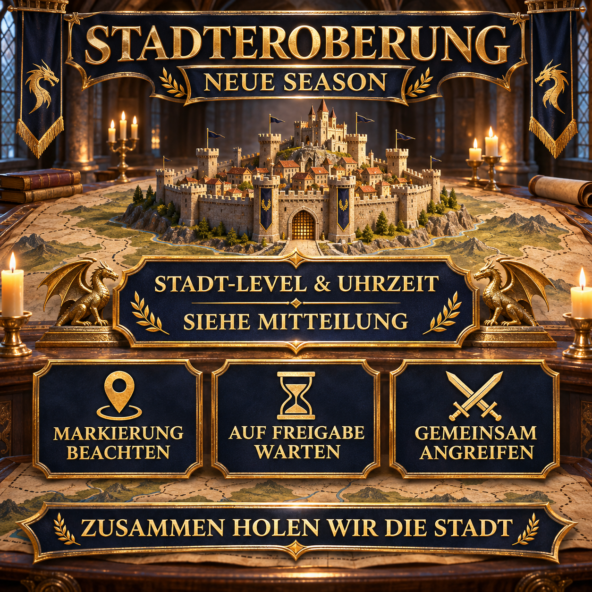

# Conquista de cidade na nova temporada: atacar juntos

Na nova temporada, conquistamos cidades juntos e coordenamos o ataque pela marcação e pelo chat da aliança. Este aviso reutilizável informa o alvo atual, o horário de início e o procedimento imediatamente antes do ataque.

O nível da cidade e o horário são preenchidos novamente em cada operação. Assim, o modelo continua útil quando o alvo muda.



## Nosso procedimento coordenado

Os alvos e requisitos reais dependem da situação atual do mapa da temporada. Por isso, é especialmente importante que todos sigam a mesma cidade marcada, o mesmo horário de início e a liberação dada no chat da aliança.

- Fique online alguns minutos antes do início anunciado.
- Se possível, mantenha as marchas necessárias disponíveis.
- Sempre que possível, use ataques conjuntos em vez de atacar o alvo sozinho.
- Confira a marcação atual e o chat da aliança.
- Inicie o ataque somente depois da liberação conjunta.
- Pergunte antes se o alvo ou o procedimento não estiver claro.

> **Antes de enviar:** `[HORÁRIO]` e `[NÍVEL DA CIDADE]` devem ser substituídos pelos dados do ataque planejado.

## Mensagem da aliança para copiar

```html
<color=#FFD700><b>🏰 CONQUISTA DA CIDADE — HOJE ÀS [HORÁRIO]</b></color>

Às <color=#FFD700><b>[HORÁRIO]</b></color>, atacaremos juntos uma <b>cidade de nível [NÍVEL DA CIDADE]</b>.

📍 <b>Confira a marcação:</b> Confira nosso alvo marcado antes do início.
⏳ <b>Aguarde a liberação:</b> Não ataque antes da hora.
⚔️ <b>Ataquem juntos:</b> Mantenha suas marchas prontas e acompanhe o chat da aliança.
🤝 <b>Use ataques conjuntos:</b> Sempre que possível, inicie ou participe de um ataque conjunto contra o alvo marcado.

Fique online alguns minutos antes para iniciarmos o ataque juntos.

<color=#90EE90><b>Juntos conquistamos a cidade!</b></color>

<b>Dúvidas?</b> Fale com Anthlan ou com um dos R4.
```
