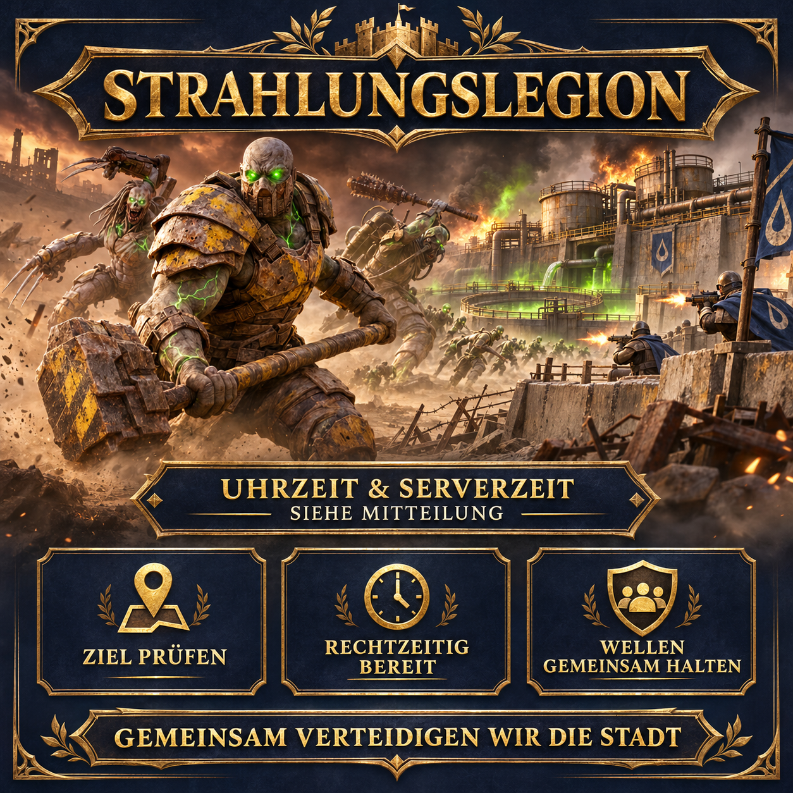

# Legião Radioativa: defender juntos a cidade atacada

Durante o evento, a Legião Radioativa ataca, às terças e sextas-feiras, uma cidade da aliança anunciada com antecedência. Assim, podemos nos coordenar a tempo e preparar juntos as ondas de defesa.

Depois de uma defesa bem-sucedida contra a Legião Radioativa, todos os membros da aliança recebem recompensas. Quanto mais ondas resistirmos, maiores serão as recompensas. Se a defesa falhar, a cidade perderá durabilidade; quando a durabilidade chegar a 0, a Legião Radioativa ocupará a cidade.



## Antes do ataque

- Confira o alvo anunciado pelo jogo e a nossa marcação atual da aliança.
- Esteja online alguns minutos antes do horário combinado.
- Deixe as marchas e tropas previstas disponíveis para a defesa.
- Acompanhe o chat da aliança para as últimas instruções antes do início.

## Durante a defesa

- Defendam juntos o alvo anunciado e permaneçam disponíveis para as ondas seguintes.
- Acompanhem suas tropas e sigam as instruções da coordenação do evento.
- Resistam ao maior número possível de ondas para aumentar as recompensas coletivas.
- Evitem uma defesa fracassada para que a cidade não perca durabilidade nem seja ocupada.

> **Antes de enviar:** `[HORÁRIO]` deve ser substituído pelo horário de início combinado. `[HORÁRIO DO SERVIDOR]` é calculado automaticamente a partir de `[HORÁRIO]`: −3 horas no inverno e −4 horas no verão.

## Comunicado da aliança para copiar

```html
<color=#FFD700><b>☢️ LEGIÃO RADIOATIVA – HOJE ÀS [HORÁRIO]</b></color>

Às <color=#FFD700><b>[HORÁRIO]</b></color> começa o ataque anunciado da Legião Radioativa à nossa cidade da aliança.
🕒 <b>Horário do servidor:</b> [HORÁRIO DO SERVIDOR]

📍 <b>Confira o alvo:</b> Fique atento ao alvo anunciado e à nossa marcação da aliança.
⏰ <b>Esteja pronto a tempo:</b> Entre alguns minutos antes e deixe suas marchas disponíveis.
🛡️ <b>Defendam juntos:</b> Permaneçam disponíveis para as ondas de ataque e acompanhem o chat da aliança.
🌊 <b>Resistam às ondas:</b> Quanto mais ondas resistirmos juntos, maiores serão as recompensas para todos.

<color=#FF8C69><b>⚠️ Protejam a cidade:</b></color>
Uma defesa fracassada reduz a durabilidade. Com durabilidade 0, a Legião Radioativa ocupa a cidade.

<color=#90EE90><b>Juntos, defenderemos a cidade!</b></color>

<b>Dúvidas?</b> Fale com Anthlan ou com um dos oficiais R4.
```
