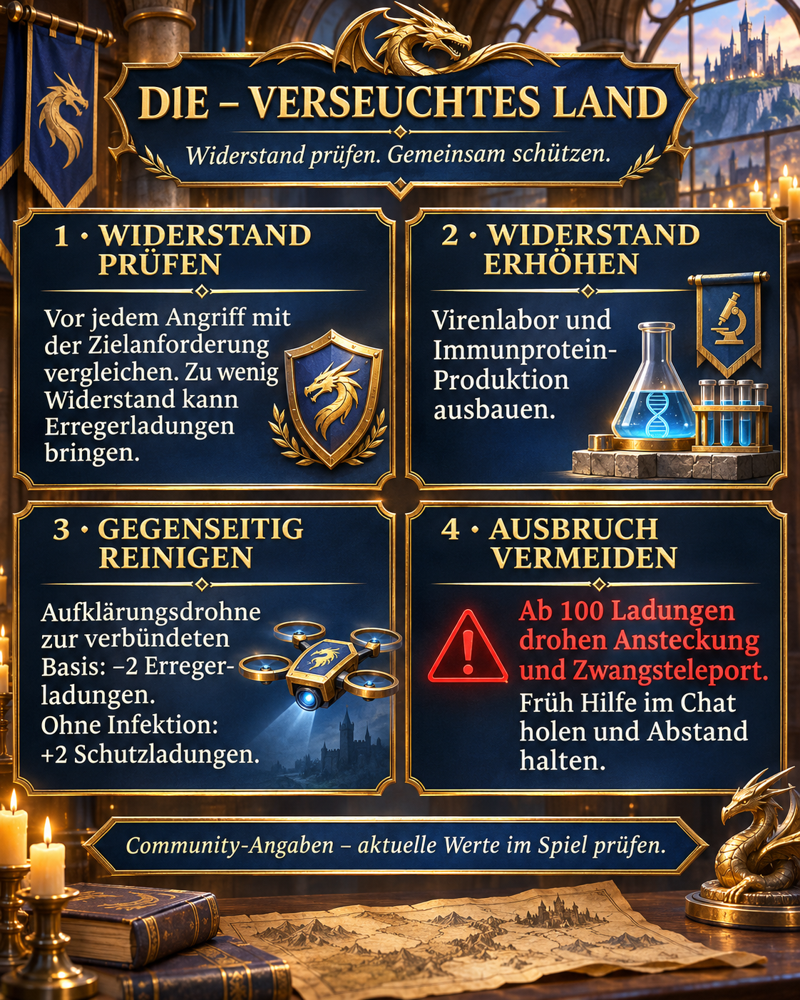

# Terra contaminada: verificar resistência e remover patógenos juntos

Para nós da DIE, resistência, controle da contaminação e ajuda mútua vêm primeiro. Esta página reúne a mensagem da aliança e uma explicação mais detalhada das novas mecânicas sazonais.

## Atualização e confiabilidade

Pesquisa de 2 de novembro de 2026. Todos os valores são **relatos da comunidade**, sem confirmação por capturas nossas do jogo. Fontes russas usam “Облучённая земля”; em inglês, “Radiated Land”. Os requisitos atuais das metas e as regras do jogo têm prioridade. Não há data de encerramento confirmada para nós, por isso a página não está arquivada como concluída.

## Imagem e resumo



Imagem original em alemão no estilo azul e dourado da DIE: verificar resistência, desenvolver produção, ajudar na limpeza e evitar surtos. As quatro ações estão explicadas em português abaixo.

## Resistência e cargas de patógeno

Resistência é a proteção que comparamos ao requisito do alvo antes de atacar. Cargas de patógeno representam a contaminação já acumulada. Vencer não garante um ataque sem infecção. Segundo a [fonte 1](https://zroutehub.bond/handbook/event_season_guide/), atacar abaixo do requisito pode acrescentar cargas. Não foi estabelecida uma fórmula exata para o risco conforme a diferença de resistência.

## Como aumentar a resistência

O laboratório de vírus aumenta a resistência e usa proteína imune nas melhorias. Os prédios sazonais fornecem proteína e usam cristais de urânio para melhorias. A [fonte 2](https://trassaz.ru/sezon-s1/) também cita pesquisa e bônus de passe de +250. Confira a oferta atual antes de comprar. Recomendamos desenvolver produção e laboratório juntos e verificar os requisitos dos novos alvos.

## Limpeza e surto

A [fonte 1](https://zroutehub.bond/handbook/event_season_guide/) informa −2 cargas por drone de reconhecimento enviado à base aliada, ou +2 cargas de proteção se ela estiver sem infecção. Essas cargas não são um escudo comum. Com 100 cargas, a comunidade descreve surto, contaminação próxima e teletransporte forçado. Peçam ajuda cedo e mantenham distância das nossas bases se houver risco de surto. Não desativem a limpeza aliada de propósito antes de testarmos a mecânica juntos.

## Divergências e dúvidas

As fontes citam 30 ou 35 cargas transferidas e divergem sobre proteína em combates contra Observadores. Alcance, atraso, limites de limpeza, regras de reunião e duração das penalidades após limpeza ainda precisam ser testados na nossa versão. Patógenos, cargas de proteção, resistência e anticorpos são conceitos diferentes; não há conversão estabelecida.

## Nossa rotina

- Comparar resistência e requisito antes dos ataques.
- Desenvolver laboratório e produção de proteína sem investir tudo cegamente num só prédio.
- Conferir cargas após os combates e organizar ajuda com antecedência.
- Registrar divergências com capturas do alvo, resistência e cargas.

## Fontes e avaliação

1. [Server 33](https://zroutehub.bond/handbook/event_season_guide/) — Guia russo da comunidade do servidor 33: prédios sazonais, resistência, drones e surto. Apesar do título “guia oficial”, o site é comunitário e não oficial.

2. [Z Route Wiki](https://trassaz.ru/sezon-s1/) — Guia de fãs russo de 7 de outubro de 2026: vírus gama, laboratório, pesquisa e bônus sazonais. Algumas afirmações divergem da fonte 1.

3. [ARES](https://rutube.ru/video/b487339c34cd06938c1ba8a1af58c624/) — Vídeo ARES de 23 de setembro de 2026, 22:18: a descrição menciona resistência, moral e terra contaminada. Link complementar; os números desta página não foram verificados no vídeo.

## Mensagem da aliança para copiar

```html
<color=#FFD700><b>☣️ DlE – TERRA CONTAMINADA</b></color>

🛡️ <b>Confiram a resistência antes de atacar!</b> Abaixo do requisito, vocês podem ganhar cargas mesmo com alto poder.

🧪 <b>Melhorem o laboratório de vírus e a produção de proteína imune.</b>

🛰️ <b>Vamos ajudar na limpeza!</b> Segundo a comunidade, um drone de reconhecimento para uma base aliada remove 2 cargas de patógeno; sem infecção, adiciona 2 cargas de proteção.

<color=#FF4040><b>⚠️ Avisem cedo sobre contaminação!</b></color> Ela enfraquece vocês. Com 100 cargas, há risco de surto, contaminação próxima e teletransporte forçado. Com alta contaminação, afastem-se das nossas bases e peçam ajuda no chat.

<b>Vamos nos proteger juntos!</b>

Relatos da comunidade; confiram os valores atuais no jogo.
```
