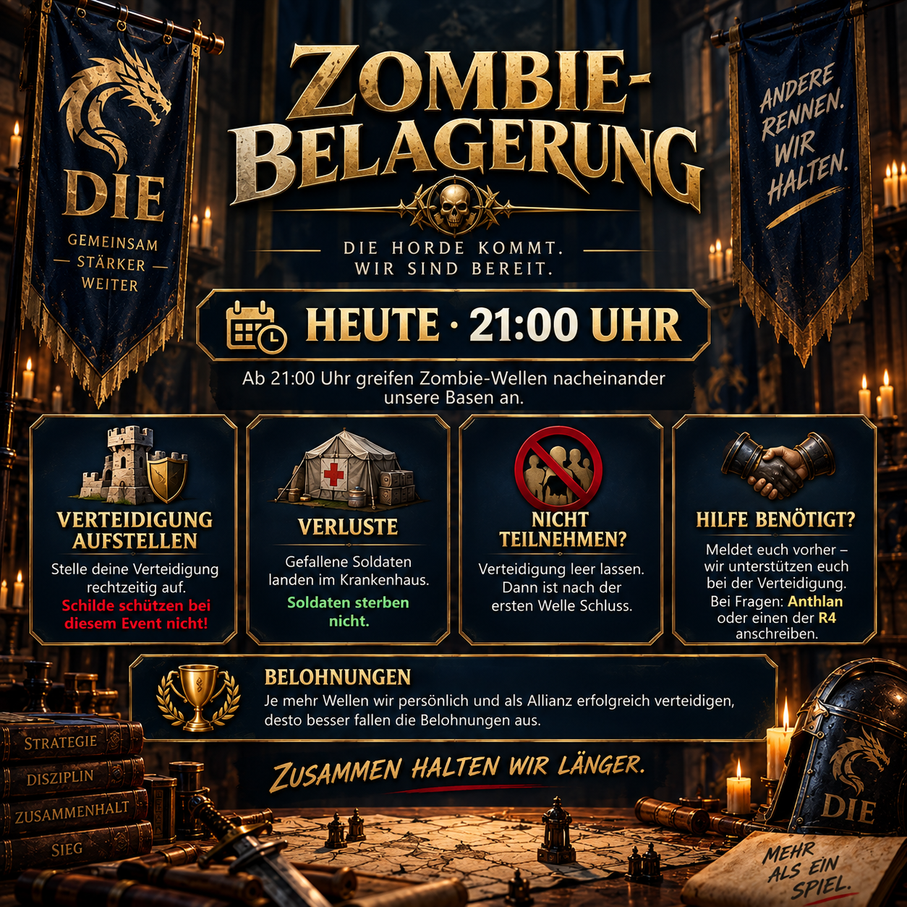

# Zombie Siege: defender as ondas juntos

Durante o Cerco dos Zombies, várias ondas atacam as nossas bases uma após a outra. Ao contrário de um ataque normal, um escudo ativo não ajuda aqui. O que importa é estabelecer uma defesa, ter capacidade hospitalar suficiente e coordenar com a aliança com antecedência.

O anúncio explica o processo para que os participantes ativos e os membros que querem ficar fora desta vez saibam o que fazer.



## Como funciona a participação

Se quiser participar, defenda-se antes do início. Cada onda que sobreviver melhora o seu desempenho individual e a sua contribuição para o resultado da aliança. Se a sua defesa for violada, o cerco termina para você.

As perdas durante o evento vão para o hospital; os soldados não morrem. Mesmo assim, verifique se tem capacidade hospitalar suficiente antes de começar.

## Sentar ou receber apoio

Se não quiser participar, deixe a sua defesa vazia. O seu evento termina depois da primeira onda, sem mais preparação necessária.

Se precisar de apoio na defesa, pergunte antes do início, se possível. Isto dá à aliança tempo para coordenar a ajuda. O Anthlan e os oficiais da R4 são os seus primeiros pontos de contacto.

> **Antes de enviar:** `[UHRZEIT]` deve ser substituída pela hora local anunciada para este evento. A ilustração existente mostra a versão para **21:00**.

## Mensagem da Aliança para copiar

```html
<color=#FFD700><b>🧟 ZOMBIE SIEGE – Hoje em dia</b></color>

A partir <color=#FFD700><b>Não, não.</b></color>, ondas zumbi atacar as nossas bases uma após a outra.

🛡️ <b>Configure a sua defesa .</b> – Os escudos não te protegem aqui.
🏥 As perdas vão para o <b>Hospital</b>; Os soldados não morrem.
💀 Se a sua defesa for violada, o seu evento termina.
🏆 Quanto mais ondas sobrevivermos, melhores serão as recompensas individuais e de aliança.

<b>Não quer participar?</b> Deixe a sua defesa vazia . → O seu evento termina após a onda 1.

<b>Precisa de ajuda na defesa?</b> Diga-nos antes e ajudaremos.

<color=#90EE90><b>Perguntas?</b></color> Basta enviar mensagem ao Anthlan ou a R4.
```
