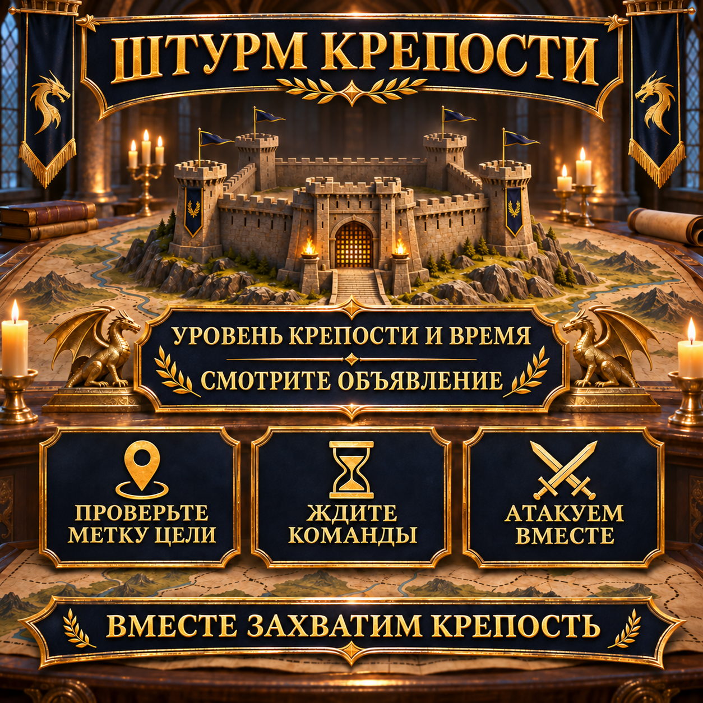

# Штурм крепости: атакуем вместе и согласованно

При штурме крепости прежде всего важно, чтобы все участники знали одну и ту же цель и начинали только в согласованное время. Поэтому этот многоразовый шаблон объявления объединяет уровень крепости, время начала и основные договорённости для согласованной атаки.

Уровень крепости и время заново вводятся для каждой операции. Остальные детали можно уточнить незадолго до атаки по метке цели и в чате альянса.



## Наш согласованный порядок действий

Условия и точный порядок зависят от выбранной крепости. В объявлении важно напомнить всем проверить метку цели, подготовить марши и дождаться команды.

- Будьте в сети за несколько минут до объявленного начала.
- Проверьте уровень крепости и нашу текущую метку цели.
- По возможности оставьте нужные марши свободными.
- Игроки с высоким сопротивлением должны запускать сборы: их сопротивление будет действовать и для участников с более низким сопротивлением.
- Дождитесь общей команды в чате альянса.
- Не начинайте преждевременные одиночные атаки на отмеченную цель.

> **Перед отправкой:** `[ВРЕМЯ]` и `[УРОВЕНЬ КРЕПОСТИ]` нужно заменить данными запланированной атаки. `[ВРЕМЯ СЕРВЕРА]` автоматически рассчитывается по `[ВРЕМЯ]`: −3 часа зимой и −4 часа летом.

## Сообщение альянса для копирования

```html
<color=#FFD700><b>🏰 ШТУРМ КРЕПОСТИ — СЕГОДНЯ [ВРЕМЯ]</b></color>

В <color=#FFD700><b>[ВРЕМЯ]</b></color> мы вместе атакуем <b>крепость уровня [УРОВЕНЬ КРЕПОСТИ]</b>.
🕒 <b>Серверное время:</b> [ВРЕМЯ СЕРВЕРА]

📍 <b>Проверьте метку цели:</b> Убедитесь, что выбрана правильная крепость.
⏳ <b>Дождитесь команды:</b> Пожалуйста, не атакуйте раньше времени.
⚔️ <b>Подготовьте марши:</b> Будьте вовремя в сети и следите за чатом альянса.
🛡️ <b>Используйте сопротивление:</b> Игроки с высоким сопротивлением запускают сборы; их сопротивление будет действовать и для участников с более низким сопротивлением.

Начинайте атаку только после общей команды, чтобы мы вместе прибыли к цели.

<color=#90EE90><b>Вместе захватим крепость!</b></color>

<b>Есть вопросы?</b> Напишите Anthlan или одному из R4.
```
