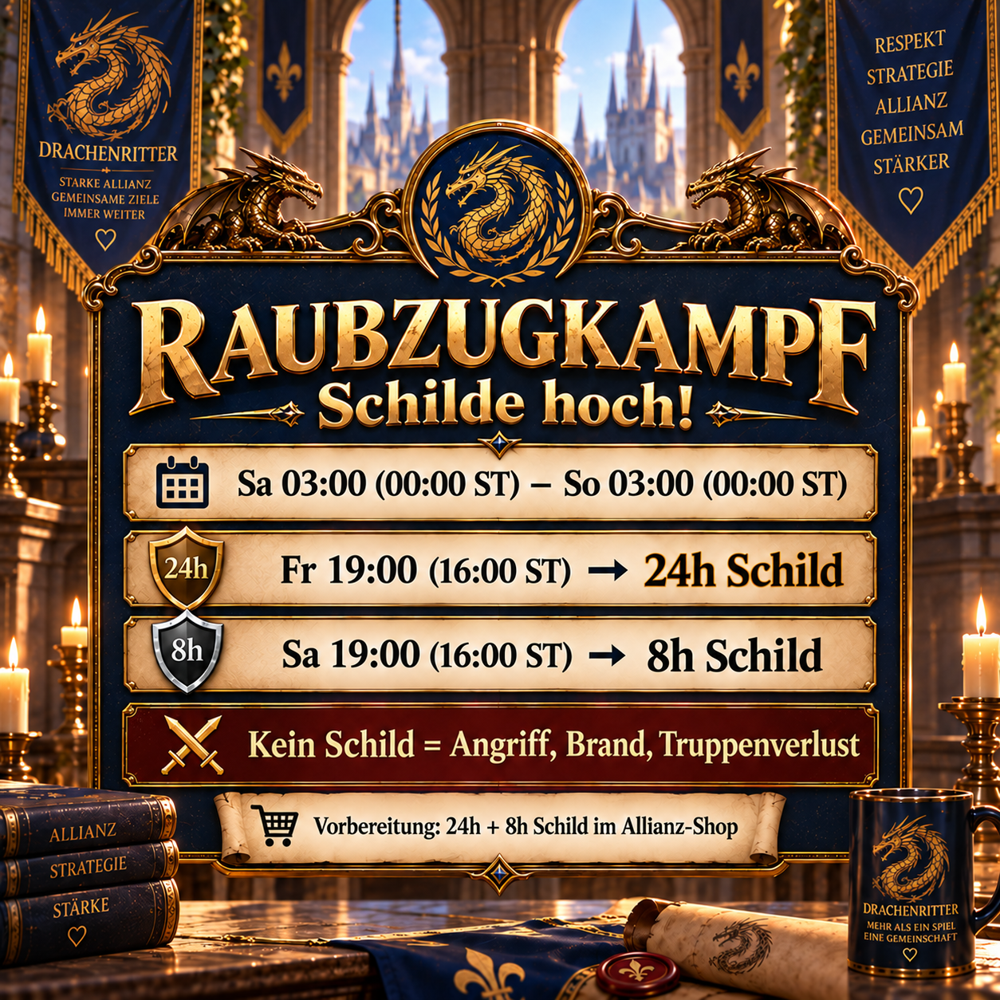

# Рейды: вовремя активируйте щиты

Во время рейдовых боёв к нам могут телепортироваться противники с других серверов и атаковать незащищённые базы. Поэтому мы готовимся до начала боевого периода, заранее получаем щиты и активируем их по общему плану.

В этом объявлении объединены три вещи, которые должен знать каждый участник: реальный период опасности, своевременная подготовка в магазине альянса и два времени активации в нашем плане щита.

**Зимнее время в Германии (текущее):**



**Летнее время в Германии:**


## Почему план защиты имеет значение

Один 24-часовой щит не может надежно покрыть весь период. Поэтому наш план сочетает в себе 24-часовой и 8-часовой щит. Это обеспечивает защиту баз в критический период, и каждому участнику не придется делать собственные расчеты.

Без щита мишенью может стать любая база, независимо от ее силы. Если база полностью сгорит, на полигоне может погибнуть очень большое количество солдат. Поэтому любой, кто не участвует активно в рейдовой битве, также должен следовать плану общего щита.

## Подготовка

- Получить **один 24-часовой щит и один 8-часовой щит** из магазина альянса до вечера пятницы.
- Активируйте первый щит вовремя в пятницу вечером.
- Увеличьте свою защиту в субботу вечером с помощью 8-часового щита.
- После активации убедитесь, что отображаемая оставшаяся продолжительность охватывает весь запланированный период.
- Перед отправкой сообщения замените **`[ВРЕМЯ]`** на время щита, установленное альянсом.

## Сообщение Альянса, которое нужно скопировать

```html
<color=#FFD700><b>⚔️ Рейдовый бой – щиты подняты! 🛡️</b></color>

От <b>Суббота 03:00 (00:00 по серверному времени)</b> пока <b>Воскресенье 03:00 (00:00 по серверному времени)</b>, рейдовый бой возвращается. За это время к нам могут телепортироваться противники с других серверов и атаковать наши базы.

<color=#87CEEB><b>Подготовка:</b></color>
Пожалуйста, получите <b>1 × 24-часовой щит + 1 × 8-часовой щит</b> из магазина альянса вовремя.

<color=#90EE90><b>Наш план защиты:</b></color>
<b>Пятница [ВРЕМЯ]</b> → 24-часовой щит
<b>Суббота [ВРЕМЯ]</b> → 8-часовой щит

<color=#FF6347><b>⚠️ Важно:</b></color> Без щита, <b>кто-нибудь</b> может стать мишенью, независимо от силы. Если ваша база сожжена до нуля, на полигоне погибнет огромное количество солдат.

<b>Защититесь и избегайте потерь! 🛡️</b>
```
