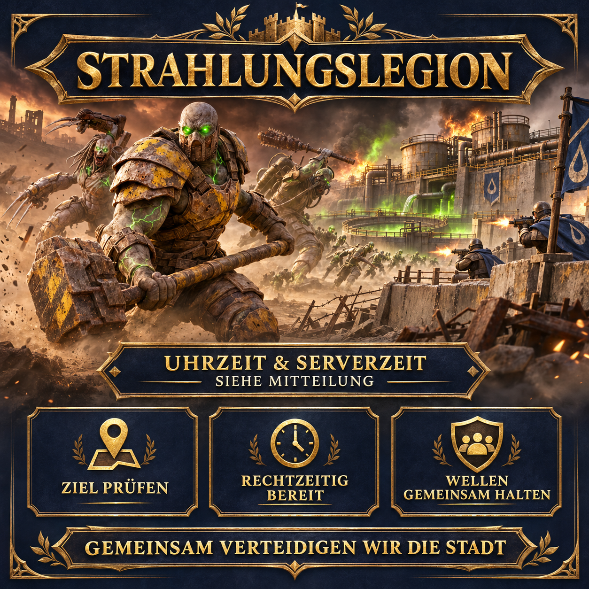

# Радиационный легион: вместе защитим атакованный город

Во время события Радиационный легион каждый вторник и пятницу атакует заранее объявленный город альянса. Благодаря этому мы можем вовремя договориться и вместе подготовиться к волнам обороны.

После успешной обороны от Радиационного легиона награды получают все участники альянса. Чем больше волн мы выдержим, тем выше будут награды. Если оборона провалится, город потеряет прочность; когда прочность достигнет 0, Радиационный легион оккупирует город.



## Перед атакой

- Проверьте объявленную игрой цель и нашу актуальную метку альянса.
- Будьте в сети за несколько минут до согласованного времени.
- Освободите нужные марши и войска для обороны.
- Перед началом следите за последними указаниями в чате альянса.

## Во время обороны

- Вместе защищайте объявленную цель и оставайтесь доступными для следующих волн.
- Следите за своими войсками и выполняйте указания координаторов события.
- Выдержите как можно больше волн, чтобы увеличить общие награды.
- Не допускайте провала обороны, чтобы город не терял прочность и не был оккупирован.

> **Перед отправкой:** `[ВРЕМЯ]` замените согласованным временем начала. `[ВРЕМЯ СЕРВЕРА]` рассчитывается автоматически по `[ВРЕМЯ]`: зимой −3 часа, летом −4 часа.

## Сообщение альянса для копирования

```html
<color=#FFD700><b>☢️ РАДИАЦИОННЫЙ ЛЕГИОН — СЕГОДНЯ В [ВРЕМЯ]</b></color>

В <color=#FFD700><b>[ВРЕМЯ]</b></color> начнётся объявленная атака Радиационного легиона на наш город альянса.
🕒 <b>Время сервера:</b> [ВРЕМЯ СЕРВЕРА]

📍 <b>Проверьте цель:</b> Следите за объявленной целью и нашей меткой альянса.
⏰ <b>Будьте готовы вовремя:</b> Зайдите в игру на несколько минут раньше и освободите марши.
🛡️ <b>Защищайтесь вместе:</b> Оставайтесь доступными для волн атаки и следите за чатом альянса.
🌊 <b>Сдерживайте волны:</b> Чем больше волн мы выдержим вместе, тем выше будут награды для всех.

<color=#FF8C69><b>⚠️ Защитите город:</b></color>
Неудачная оборона снижает его прочность. При прочности 0 Радиационный легион оккупирует город.

<color=#90EE90><b>Вместе защитим город!</b></color>

<b>Вопросы?</b> Напишите Anthlan или одному из офицеров R4.
```
