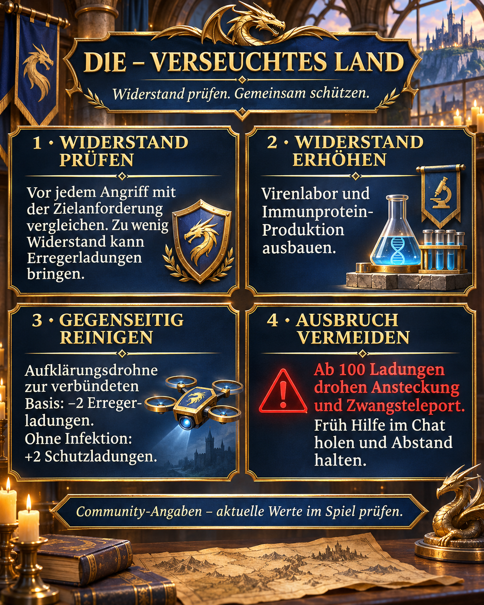

# Облучённая земля: проверяем сопротивление и вместе снимаем заражение

Для нас в DIE главное — сопротивление, контроль заражения и взаимопомощь. Здесь собраны сообщение альянса и подробное объяснение новых сезонных механик.

## Актуальность и достоверность

Дата проверки: 2 ноября 2026 года. Все численные параметры — **сведения сообщества**, не подтверждённые нашими снимками игры. Немецкое название — «Verseuchtes Land», английское — «Radiated Land». Приоритет имеют текущие требования целей и правила в игре. Подтверждённой даты завершения для нас нет, поэтому страница не помечена как завершённое событие.

## Иллюстрация и краткое содержание



Оригинальная немецкая иллюстрация в сине-золотом стиле DIE: проверять сопротивление, развивать производство, помогать с очисткой и избегать вспышки. Ниже эти четыре действия объяснены по-русски.

## Сопротивление и заряды патогена

Сопротивление — защитный показатель, который мы сравниваем с требованием цели до атаки. Заряды патогена — уже накопленное заражение. Победа сама по себе не гарантирует отсутствия заражения. По [источнику 1](https://zroutehub.bond/handbook/event_season_guide/), атаки при недостаточном сопротивлении могут добавлять заряды. Точная формула зависимости риска от разницы сопротивления не установлена.

## Как повышать сопротивление

Лаборатория вирусов повышает сопротивление и улучшается иммунным белком. Сезонные производственные здания дают белок и улучшаются урановыми кристаллами. [Источник 2](https://trassaz.ru/sezon-s1/) также называет исследования и бонус пропуска +250. Перед покупкой проверяйте актуальное предложение. Мы рекомендуем развивать производство и лабораторию вместе и проверять требования новых целей.

## Очистка и вспышка

По [источнику 1](https://zroutehub.bond/handbook/event_season_guide/), разведывательный дрон на базу союзника снимает 2 заряда, а незаражённой базе даёт 2 защитных заряда. Это не обычный щит базы. При 100 зарядах сообщество описывает вспышку, заражение соседей и принудительную телепортацию. Заранее просите помощь, следите за заражением и при угрозе вспышки держитесь подальше от наших баз. Не отключайте очистку союзниками намеренно, пока мы вместе не проверим механику.

## Противоречия и вопросы

Источники называют 30 или 35 передаваемых зарядов и расходятся по белку за Наблюдателей. Радиус, задержку, лимиты очистки, правила сборов и длительность штрафов после очистки ещё нужно проверить в нашей версии. Патоген, защитные заряды, сопротивление и антитела — разные понятия; пересчёт между ними не установлен.

## Наш порядок действий

- До атаки сравниваем сопротивление с требованием цели.
- Развиваем лабораторию и производство белка без слепого вложения всего в одно здание.
- После боёв проверяем заряды и заранее организуем взаимную очистку.
- Расхождения фиксируем снимками цели, сопротивления и количества зарядов.

## Источники и оценка

1. [Server 33](https://zroutehub.bond/handbook/event_season_guide/) — Русский справочник сообщества сервера 33: сезонные здания, сопротивление, дроны и вспышка. Несмотря на заголовок «официальный гайд», сайт неофициальный.

2. [Z Route Wiki](https://trassaz.ru/sezon-s1/) — Русский фанатский гайд от 7 октября 2026 года: гамма-вирус, лаборатория, исследования и сезонные бонусы. Некоторые сведения расходятся с источником 1.

3. [ARES](https://rutube.ru/video/b487339c34cd06938c1ba8a1af58c624/) — Видео ARES от 23 сентября 2026 года, 22:18: описание упоминает сопротивление, мораль и заражённую землю. Только дополнительная ссылка; числа этой страницы по видео не проверялись.

## Сообщение альянса для копирования

```html
<color=#FFD700><b>☣️ DlE — ОБЛУЧЁННАЯ ЗЕМЛЯ</b></color>

🛡️ <b>Проверяйте сопротивление до атаки!</b> Ниже требования цели можно получить заряды патогена даже с высокой мощью.

🧪 <b>Улучшайте лабораторию вирусов и производство иммунного белка.</b>

🛰️ <b>Помогаем с очисткой!</b> По данным сообщества, разведывательный дрон на базу союзника снимает 2 заряда, а незаражённой базе даёт 2 защитных заряда.

<color=#FF4040><b>⚠️ Сообщайте о заражении заранее!</b></color> Оно ослабляет вас. При 100 зарядах грозят вспышка, заражение соседей и принудительная телепортация. При сильном заражении держитесь подальше от наших баз и просите помощь в чате.

<b>Защищаем друг друга вместе!</b>

Сведения сообщества; проверяйте текущие значения в игре.
```
