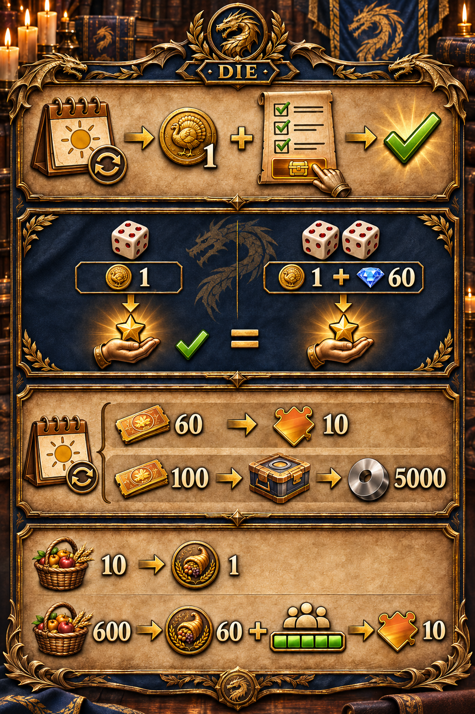
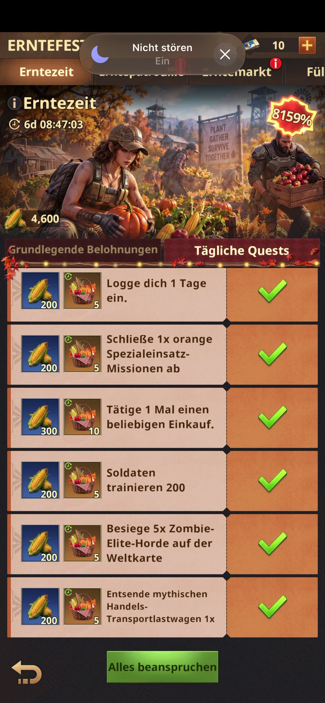
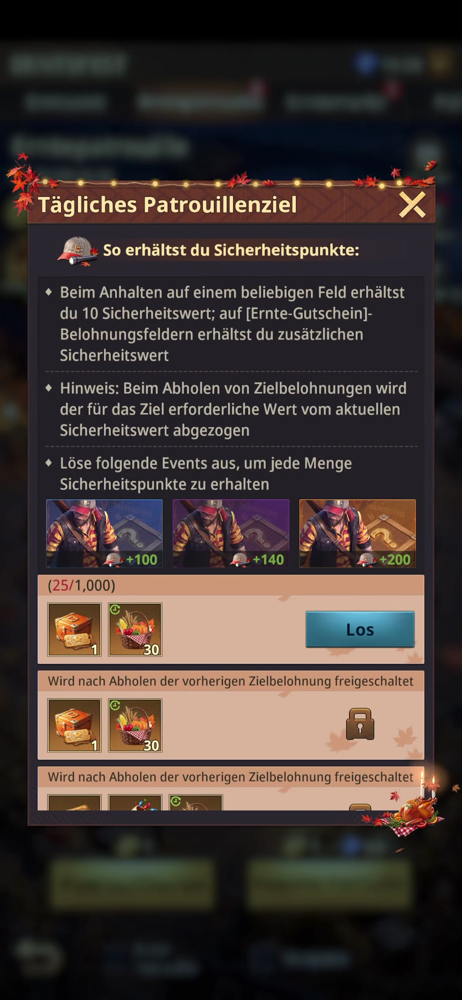
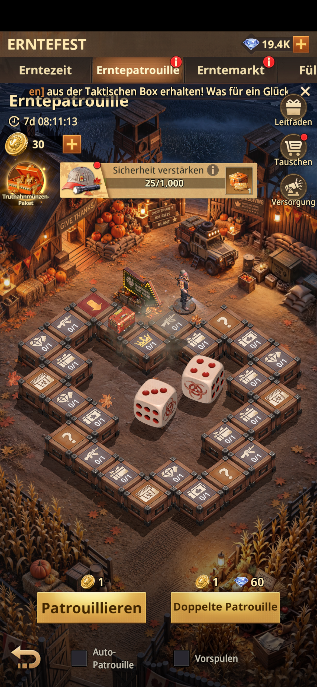
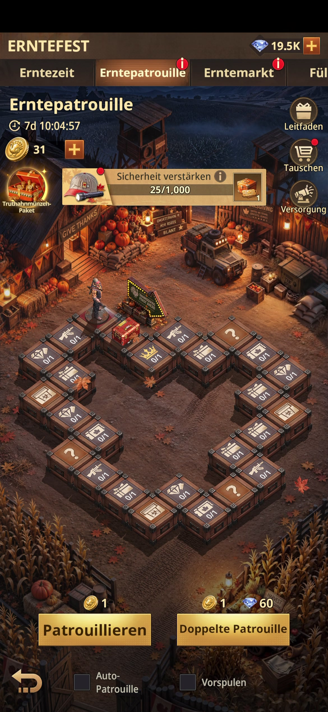
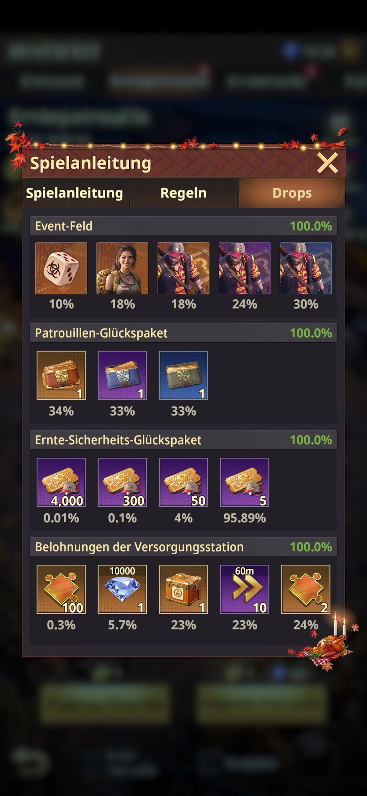
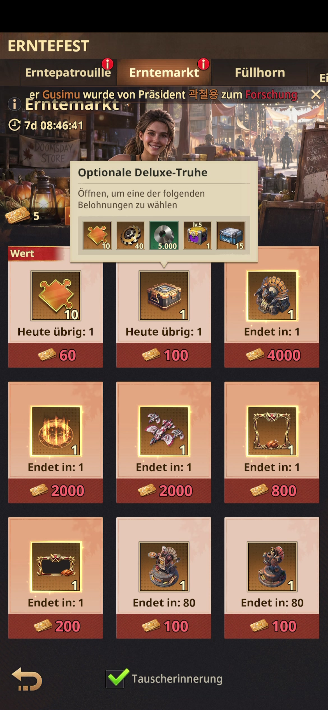
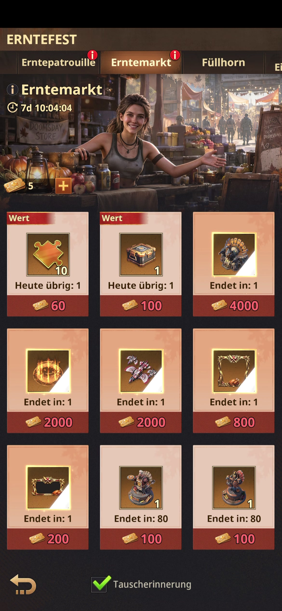
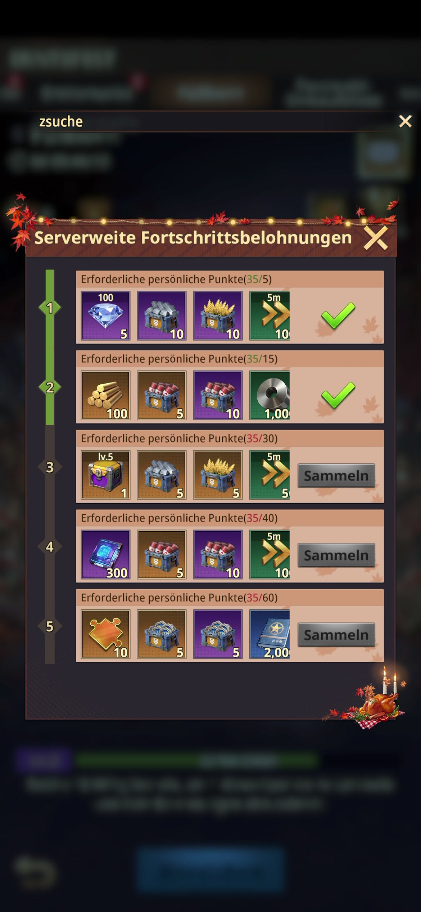
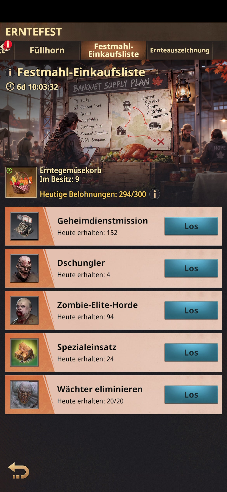

# Event – Erntefest

## Das Wichtigste in Kürze

- Täglich die **Gratis-Truthahnmünze**, Pass-Aufgaben und erreichbare Belohnungen abholen. Die sechs Aufgaben ohne Kaufbedingung bringen zusammen **1.300 Pass-Punkte und 30 Körbe**.
- **Sicherheitswert bleibt über den Tagesreset erhalten.** Beim Abholen eines Patrouillenziels wird dessen Anforderung abgezogen. Die Sammelstrategie des Flügelevents lässt sich deshalb nicht pauschal übertragen.
- Die **doppelte Patrouille nutzt zwei Würfel: 2–12 Schritte** für **1 Münze und 60 Diamanten**. Sie bietet **keinen zusätzlichen Belohnungsertrag**. Für die Belohnungsplanung reicht die normale Patrouille mit einem Würfel und 1–6 Schritten.
- Im Erntemarkt kosten **10 goldene Universalsplitter täglich 60 Tickets** und die **Optionale Deluxe-Truhe 100 Tickets**. Die Truhe bietet unter anderem **5.000 Veredelte Steine zur Auswahl** und damit den doppelten Steinkurs des normalen Tauschs.
- Ein **Ernte-Sicherheits-Glückspaket** enthält mindestens **5 Tickets**, im rechnerischen Mittel **7,4945**. Das ist ein Wert **je Paket**, nicht je Münze oder Würfelwurf.
- Die Einkaufsliste zeigt ein **Tageslimit von 300 Erntegemüsekörben**; ungenutztes Tageslimit wird übertragen. **10 Körbe ergeben 1 Fülle-Punkt**. Für die fünf Server-Stufenbelohnungen sind zusätzlich **5, 15, 30, 40 und 60 persönliche Punkte** erforderlich.
- Pass, Füllhorn, Einkaufsliste und Auszeichnung zeigen rund **6 Tage 10 Stunden**, Patrouille und Markt rund **7 Tage 10 Stunden** Restzeit. Jeden Reiter separat prüfen.
- Für F2P und kleine Budgets zuerst benötigte dauerhafte Materialien planen. Der **Basis-Skin für 4.000 Tickets** ist ein optionales Großziel ohne belegte Kostenprognose.

> **Empfehlung für DIE:** Gratisquellen und Tagesaufgaben nutzen, Körbe rechtzeitig einreichen und nur bereits vorhandene Tickets verplanen. Münzen, Glückspakete und Tickets sind drei unterschiedliche Rechengrößen.



## Wofür ist dieser Event-Guide?

Dieser Guide erklärt die **reduzierte Erntefest-Ausgabe in Z:Route: Redemption** vom **23.11.2026**: Erntezeit, Erntepatrouille, Erntemarkt, Füllhorn, Festmahl-Einkaufsliste und Ernteauszeichnung. Die beiden Videos, der Screenshot und die Angaben aus der Allianz bilden die vollständige verfügbare Informationsgrundlage dieser Ausgabe. Der Guide verbindet eine tägliche Routine mit einem Belohnungs- und Paketvergleich für unterschiedliche Budgets.

## Die tägliche Routine

1. Im Münzshop die **eine kostenlose Truthahnmünze** abholen und die Pass-Aufgaben unter Erntezeit prüfen.
2. Körbe über **Geheimdienstmission, Dschungler, Zombie-Elite-Horde, Spezialeinsatz und Wächter eliminieren** sammeln. Normale Allianz- und Wettkampfziele dabei möglichst verbinden.
3. Im Füllhorn volle Zehnergruppen einreichen und den eigenen Mindestbeitrag für die Server-Stufenbelohnungen prüfen. Für die letzte sichtbare Stufe sind insgesamt **60 persönliche Punkte beziehungsweise 600 eingereichte Körbe** nötig; zusätzlich muss der Server die Stufe erreichen.
4. Patrouillieren, erreichbare Sicherheitsziele prüfen und nach Auto-Patrouillen sowohl den Belohnungsspeicher als auch den Ereigniseingang leeren.
5. Tagesangebote nur für ein festes Ziel kaufen; die übrigen Tickets sammeln und vor Marktende gezielt ausgeben.

## Welche Ressource gehört wohin?

| Ressource | Zweck | Planungsregel |
| --- | --- | --- |
| Truthahnmünzen | Würfeln in der Erntepatrouille | Normal: 1 Münze für einen Würfel; doppelt: 1 Münze und 60 Diamanten für zwei Würfel. |
| Sicherheitswert | Patrouillenziele und deren Belohnungen | Bleibt über Nacht erhalten, wird beim Abholen des Ziels verbraucht. |
| Erntemarkt-Tickets | Käufe im Erntemarkt | Nur vorhandenen Bestand als sicheres Kaufbudget zählen. |
| Pass-Punkte | Belohnungsreihen der Erntezeit | Gehören zum Pass, nicht zum Ticketkonto. |
| Erntegemüsekörbe | Füllhorn und gemeinsamer Serverfortschritt | 10 Körbe für 1 Fülle-Punkt; Rest rechtzeitig ergänzen. |

## Laufzeiten: nicht alle Reiter enden zusammen

| Bereich | Restzeit in der Aufnahme | Konsequenz |
| --- | --- | --- |
| Erntezeit / Pass | etwa 6 Tage 10 Stunden | Aufgaben und Passbelohnungen früher abschließen. |
| Füllhorn, Einkaufsliste, Ernteauszeichnung | etwa 6 Tage 10 Stunden | Körbe und erreichte Auszeichnungen rechtzeitig abholen. |
| Erntepatrouille und Erntemarkt | etwa 7 Tage 10 Stunden | Diese Reiter zeigen rund einen Tag mehr; kein Aufschub für die anderen Bereiche. |

Die Tabelle hält die Restzeiten der ersten Aufnahme fest. Maßgeblich ist der aktuelle Timer des jeweiligen Reiters. Pass, Füllhorn und Auszeichnung deshalb rechtzeitig abschließen, auch wenn Patrouille und Markt noch länger verfügbar sind.

## Erntezeit: Tagesaufgaben und Pass-Punkte

Die Erntezeit verbindet Tagesaufgaben mit einer gestuften Belohnungsleiste. Bei **9.100 Pass-Quest-Punkten** wird eine Pass-Truhe freigeschaltet. Diese sieben Tagesaufgaben sind dokumentiert:

| Tagesaufgabe | Pass-Punkte | Erntegemüsekörbe |
| --- | ---: | ---: |
| 10 Helden rekrutieren | 300 | 5 |
| Einmal einloggen | 200 | 5 |
| Eine orange Spezialeinsatz-Mission abschließen | 200 | 5 |
| Einen beliebigen Einkauf tätigen | 300 | 10 |
| 200 Soldaten trainieren | 200 | 5 |
| 5 Zombie-Elite-Horden auf der Weltkarte besiegen | 200 | 5 |
| Einen mythischen Handels-Transportlastwagen entsenden | 200 | 5 |
| **Summe aller sieben Aufgaben** | **1.600** | **40** |
| **Summe ohne Einkaufsaufgabe** | **1.300** | **30** |

Die sechs Aufgaben ohne Einkaufsbedingung ergeben **1.300 Pass-Punkte und 30 Körbe pro vollständig erledigtem Tagespaket**. Sieben solche Tagespakete ergeben rechnerisch **7 × 1.300 = 9.100 Pass-Punkte** und erreichen genau die angezeigte Pass-Truhenschwelle. Benötigte Rekrutierungskarten, orange Mission und mythischen Lastwagen rechtzeitig vorbereiten.

Die Einkaufsaufgabe liefert separat **300 Pass-Punkte und 10 Körbe**. Für einen Plan ohne Käufe wird sie nicht mitgerechnet.



## Erntepatrouille: Fortschritt erhalten und Felder verbessern

Truthahnmünzen bezahlen Würfelwürfe; die Augenzahl bestimmt die Schritte. Belohnungsfelder gewähren Gegenstände und Feld-EP. Höhere Feldlevel erhöhen die Belohnungen. Beim Erreichen oder Passieren des Startfelds werden zufällig Belohnungen und Feld-EP von **2 bis 4 Feldern** vergeben. Ereignisfelder lösen eigene Zufallsereignisse aus.

### Sicherheitswert und tägliche Zielkette

Jede Landung auf einem beliebigen Feld gibt **10 Sicherheitswert**. Auf **Ernte-Gutschein-Belohnungsfeldern** kommt weiterer Sicherheitswert hinzu. Drei Ereignisvarianten gewähren zusätzlich **100, 140 oder 200 Sicherheitspunkte**.

Das erste Ziel verlangt **1.000 Sicherheitswert** und belohnt mit **einem Ernte-Sicherheits-Glückspaket und 30 Körben**. Die folgende Stufe zeigt ebenfalls ein solches Paket und 30 Körbe. Weitere Stufen enthalten je ein goldenes Taschensymbol, eine Dekoration mit Kanonenmotiv und 100 Körbe. Jede Stufe wird erst nach Abholen der vorherigen freigeschaltet. Für die nächste Abholung zählt die dann angezeigte Anforderung.



Die Sicherheitsziele wechseln täglich. Abholbarer, nicht eingesammelter Vortagslohn wird laut Regel per Mail nachgesendet; **Rest-Sicherheitswert wird übertragen**. Nach Eventende greift diese Nachsendung nicht mehr. Nutzt die Patrouille regelmäßig und holt erreichbare Ziele ab; ein ungenutzter Restwert muss nicht allein wegen des Tagesresets ausgegeben werden.

Bei Auto-Patrouille werden Belohnungen zwischengespeichert und Ereignisse müssen anschließend manuell bearbeitet werden. Übrige Truthahnmünzen werden zum Ende laut Regel je Münze in **30 Beschleunigungstruhen zu 5 Minuten**, also **150 Minuten**, umgewandelt. Das ist kein Ticket-Ertrag.

### Doppelte Patrouille: zwei Würfel für mehr Schritte

Bei der **doppelten Patrouille werden zwei Würfel gleichzeitig geworfen und ihre Augenzahlen addiert**. Damit sind **2 bis 12 Schritte** möglich; normal sind es mit einem Würfel **1 bis 6**. Die Kosten betragen **1 Truthahnmünze und 60 Diamanten** statt einer Münze für den normalen Zug.

**Mathematische Einordnung unter der Annahme fairer, unabhängiger Würfel:** Die durchschnittliche Schrittzahl steigt von **3,5 auf 7**. Die Summen sind unterschiedlich wahrscheinlich: **7** entsteht in **6 von 36** Kombinationen, **2** und **12** jeweils nur in **1 von 36**.

**Die doppelte Patrouille bietet keinen Mehrertrag an Belohnungen.** Die zusätzlichen 60 Diamanten bezahlen den zweiten Würfel und damit mehr Schritte im selben Zug. Der Modus ist kein Belohnungsmultiplikator. Für die Belohnungsplanung und bei knappem Diamantenbudget die **normale Patrouille** nutzen. Der Sicherheitswert wird laut Regel je Landung vergeben, nicht je gelaufenem Schritt.





## Glückspakete: was die Drop-Tabelle wirklich belegt

| Tickets je Ernte-Sicherheits-Glückspaket | Angezeigte Wahrscheinlichkeit |
| ---: | ---: |
| 5 | 95,89 % |
| 50 | 4 % |
| 300 | 0,1 % |
| 4.000 | 0,01 % |

Rechnerischer Mittelwert: **5 × 0,9589 + 50 × 0,04 + 300 × 0,001 + 4.000 × 0,0001 = 7,4945 Tickets je Sicherheitspaket**. Für 100 solche Pakete sind das mindestens 500 Tickets und im Mittel 749,45. Die Chance auf mindestens einen 4.000er-Treffer läge bei unabhängigen Ziehungen nur bei rund **0,995 %**. Den seltenen Treffer nicht als Budgetbestand einplanen.

Die Aufnahme nennt zusätzlich ein **Patrouillen-Glückspaket** mit 34/33/33 % für drei unterschiedliche Paketsymbole und einen separaten Pool der Versorgungsstation. Jeder Pool wird getrennt betrachtet. Die **7,4945 Tickets gelten je Sicherheitspaket**; sie sind kein fester Ticketkurs je Münze. Für Kaufentscheidungen zählt deshalb der tatsächlich erreichte Ticketbestand.



## Erntemarkt: Belohnungen nach persönlichem Nutzen

| Sichtbares Angebot | Tickets | Limit in der Aufnahme | Einordnung |
| --- | ---: | --- | --- |
| 10 goldene Universalsplitter | 60 | 1 täglich | Für gezielten Heldenausbau prüfen; stärkster sichtbarer Splitterkurs. |
| Optionale Deluxe-Truhe | 100 | 1 täglich | Unter anderem 5.000 Veredelte Steine oder 10 goldene Universalsplitter zur Auswahl. |
| Basis-Skin mit Truthahnmotiv | 4.000 | 1 im Event | Nur bei bewusstem Großziel; Name und Boni nicht eingeblendet. |
| Leuchteffekt / Flugzeugmotiv | je 2.000 | je 1 im Event | Wirkung und dauerhafte Boni vorab prüfen. |
| Avatarrahmen / Namensschild | 800 / 200 | je 1 im Event | Persönliches Sammlerziel. |
| Zwei goldene Eventdekorationen | je 100 | je 80 im Event | Benötigte Stufen und Boni im Spiel vergleichen. |
| Violette Eventdekoration | 40 | 80 im Event | Nur bei konkretem Ausbauziel. |
| UR-Überlebendentruhe | 100 | 30 im Event | Ein zufälliger UR-Überlebender; keine Auswahl. |
| Weitere 10 goldene Universalsplitter | 100 | 30 im Event | 10 Tickets je Splitter statt 6 im Tagesangebot. |
| Roter / goldener Bauplan | 300 / 60 | 10 / 100 im Event | Nur gezielt benötigte Qualität kaufen. |
| 10 goldene Rekrutierungskarten | 100 | 30 im Event | Am eigenen Ausbauziel messen. |
| UR-Flügelmann-Auswahltruhe | 300 | 5 im Event | Auswahl aus zwölf gezeigten Flügelmann-Komponenten; passend zum eigenen Ausbau wählen. |
| 100 Holz | 60 | 200 im Event | Mit dem aktuellen Ausbauengpass vergleichen. |
| 3-Stunden-Beschleuniger | 10 | 200 im Event | 18 Minuten je Ticket; möglicher Resteverwerter. |
| 5 × 10.000 des angezeigten Materials | 25 | 20 im Event | Materialname nicht im Detail eingeblendet. |
| SSR Held EXP Truhe | 8 | 1.000 im Event | Liefert Helden-EP abhängig vom Basislevel. |
| SSR Ressourcen-Auswahl-Truhe | 8 | 1.000 im Event | Auswahl aus einer Nahrungs-, Metall- oder Öltruhe; Ertrag vom Basislevel abhängig. |
| 100 Veredelte Steine / 100 blaue Bücher | je 4 | je 1.000 im Event | Nur benötigtes Material gegen Resttickets. |

Die geöffneten Tooltip-Texte bestätigen die genannten Truhen. Die übrigen Angebotsnamen sind weiterhin beschreibend nach den sichtbaren Symbolen. Bei unverändertem Tagespreis kosten fünf Splitter-Tageskäufe **300 Tickets für 50 Splitter**; fünf tägliche Deluxe-Truhen **500 Tickets**. Verpasste Tageskäufe lassen sich nicht einfach am letzten Tag nachholen.

### Deluxe-Truhe: doppelter Steinkurs bestätigt

Die **Optionale Deluxe-Truhe** bietet die Wahl zwischen **10 goldenen Universalsplittern**, **40 Gegenständen mit Zahnradsymbol**, **5.000 Veredelten Steinen**, **einer Stufe-5-Truhe** und **15 Ressourcen-Auswahltruhen**. Die Bezeichnungen folgen den sichtbaren Auswahlmöglichkeiten.

Wer Veredelte Steine benötigt, erhält über diese Tagestruhe **5.000 ÷ 100 = 50 Steine je Ticket**. Der reguläre Tausch von 100 Steinen für 4 Tickets liefert **25 Steine je Ticket**. Die tägliche Deluxe-Truhe hat damit für Steine den **doppelten Gegenwert**. Für Splitter ist das direkte Tagesangebot günstiger: **6 Tickets je Splitter** statt **10** über die Truhe. Das ergibt eine klare Wahl nach Engpass: Splitter direkt im Tagesangebot; Steine bevorzugt über die Deluxe-Truhe; übrige Tickets bei Bedarf in den normalen Steintausch.

Die **UR-Überlebendentruhe für 100 Tickets ist eine Zufallstruhe**. Sie bleibt nur dann sinnvoll, wenn viele mögliche UR-Überlebende für den eigenen Account noch nützlich sind. Die **UR-Flügelmann-Auswahltruhe für 300 Tickets** erlaubt dagegen eine gezielte Auswahl. Bei der geöffneten Helden-EP-Truhe sind **7.872.000 EP**, bei der exemplarisch geöffneten Nahrungstruhe **1.327.800 Nahrung** zu sehen; beides sind Werte des aufgenommenen Basislevels und keine allgemeingültigen Mengen.





## Münzpakete und tatsächlicher Preis

| Paket | Münzen | Preis in der Aufnahme | Preis je Münze |
| --- | ---: | ---: | ---: |
| Kleines grünes N-Paket | 2 | 1,19 € | 0,595 € |
| Blaues N-Paket | 4 | 2,49 € | 0,623 € |
| R-Paket | 8 | 5,99 € | 0,749 € |
| SR-Paket | 15 | 11,99 € | 0,799 € |
| SSR-Paket | 30 | 23,99 € | 0,800 € |
| UR-Paket | 60 | 59,99 € | 1,000 € |
| MR-Paket mit Zusatzgegenstand | 110 | 119,99 € | 1,091 € |
| MR-Paket ohne diesen Zusatzgegenstand | 110 | 119,99 € | 1,091 € |

Der Shop sagt, dass die Pakete täglich aktualisiert werden. Die beiden MR-Varianten zeigen **5 beziehungsweise 15 Käufe pro Tag**; die kleineren Pakete jeweils einen. Das grüne 1,19-€-Paket ist bereits als **0/1** markiert: Die Anzeige belegt den Preis und Inhalt, aber keinen noch verfügbaren Kauf. Beigaben unterscheiden sich; die Tabelle vergleicht ausschließlich Münzen. Werbung mit Prozentwerten ersetzt keinen Gegenwertvergleich. Im sichtbaren Shop sind kleine Pakete je Münze günstiger.

## Empfehlung nach Budget

| Budget | Sinnvoller Plan | Kaufgrenze |
| --- | --- | --- |
| F2P – 0 € | Gratis-Münze, Aufgaben ohne Kaufbedingung und Körbe sammeln; bei Steinbedarf die tägliche Deluxe-Truhe anpeilen, bei Splitterbedarf das 60er-Angebot. | Nur mit eingesammelten Tickets und erreichbaren Tageskäufen planen. |
| Kleines Budget – bis 20 € | Erst kostenlose Erträge nutzen; bei bewusstem Münzkauf die kleinen Tagespakete nach Verfügbarkeit vergleichen. | Ein Ticketziel bleibt trotz bezahlter Münzen zufallsabhängig. |
| Gezielte Käufer – 20 bis 100 € | Ein Hauptziel wählen, Tageslimit beachten und nach jeder Patrouille den echten Ticketbestand prüfen. | Normale Patrouille nutzen; die Doppelpatrouille gibt keinen Belohnungsbonus. |
| Großspender – über 100 € | Skin oder Sammlerziel nur mit festem Gesamtbudget verfolgen und den Ticketstand schrittweise gegen das Ziel prüfen. | Seltene Gewinne nicht vorab als Kaufbudget zählen. |

## Füllhorn und Festmahl-Einkaufsliste

Die Einkaufsliste zeigt **294/300** erhaltene Körbe am Aufnahmetag; diese 294 sind ein persönlicher Zwischenstand. Das Tageslimit beträgt 300 und ungenutzte Tageslimits werden laut Infotext auf den nächsten Tag übertragen. Für „Wächter eliminieren“ sind zusätzlich **20/20** sichtbar. Die übrigen angezeigten Quellenzahlen sind keine belegten Einzellimits. Eine Ertragsmenge je Kampf oder Mission ist nicht angegeben.

Im Füllhorn werden **10 Erntegemüsekörbe zu 1 Fülle-Punkt** eingereicht. Alle Spieler des Servers tragen zur gemeinsamen Stufe bei. Die neue Belohnungsansicht ergänzt jedoch eine wichtige Voraussetzung: **Jede Stufenbelohnung verlangt zusätzlich einen persönlichen Mindestpunktestand.**

| Server-Belohnungsstufe | Erforderliche persönliche Punkte | Insgesamt einzureichende Körbe | Auszug der sichtbaren Belohnung |
| --- | ---: | ---: | --- |
| 1 | 5 | 50 | Unter anderem 5 × 100 Diamanten |
| 2 | 15 | 150 | Unter anderem 100 Holz und Veredelte Steine |
| 3 | 30 | 300 | Unter anderem eine Stufe-5-Truhe |
| 4 | 40 | 400 | Unter anderem 300 des angezeigten blauen Chipmaterials |
| 5 | 60 | 600 | Unter anderem 10 goldene Universalsplitter |

Die Schwellen beziehen sich auf den **gesamten eigenen Punktestand**, nicht auf fünf getrennte Einzahlungen. Für alle fünf persönlichen Voraussetzungen reichen also 600 Körbe insgesamt. Dazu muss der Server jeweils die gemeinsame Stufe freischalten. In der Aufnahme sind bei **35 persönlichen Punkten** erst die ersten beiden Server-Stufen grün; persönliche Punkte allein ersetzen den Serverfortschritt nicht.

Körbe gibt es über die Einkaufsliste, die Pass-Aufgaben und die Patrouillenziele. Für die Abgabe zählt der **tatsächliche Korbbestand**. Als Rechenbeispiel entsprechen sieben vollständig genutzte 300er-Tageskontingente der Einkaufsliste **2.100 Körben beziehungsweise 210 Fülle-Punkten**. Neun Restkörbe ergeben noch keinen vollen Punkt.





## Ernteauszeichnung

Die Auszeichnung zeigt Schwellen bei **1.000, 4.000, 10.000, 20.000, 40.000, 70.000 und 100.000**. Oben steht **Thanksgiving-Imbisswagen** mit **Held-ANG +1.600 auf maximaler Stufe**. Diese Bonusangabe bezieht sich auf die maximale Stufe. Die angezeigten **5.600** sind der persönliche Zwischenstand der Aufnahme. Erreichte Stufenbelohnungen vor dem früheren Timer dieses Reiters abholen.

## Quellen und Verlässlichkeit

- Primärquellen: Videos **20261123_155503000_iOS.MP4** (1:32) und **20261123_171253000_iOS.MP4** (1:13 gerundet), beide vom 23.11.2026; unveränderte Standbilder sichern die Spielanzeigen.
- **00:06–00:14:** Münzpakete und Gratis-Münze. **00:16–00:25:** Pass. **00:28–00:50:** Patrouillenregeln und Drop-Tabelle.
- **00:53–01:03:** Marktpreise und Limits. **01:08–01:10:** Füllhornregel. **01:20–01:25:** Korbquellen. **01:26–01:31:** Auszeichnung.
- Zweites Video: **00:02–00:07** Tagesaufgaben; **00:10–00:21** Sicherheitsregeln und Zielbelohnungen; **00:26–00:27** Deluxe-Truhe; **00:30–00:32** UR-Überlebendentruhe; **00:36–00:38** UR-Flügelmann-Auswahl; **00:41–00:49** EP- und Ressourcen-Truhen; **00:54–00:57** Serverbelohnungen.
- Screenshot **20261123_174848000_iOS.png** zeigt zwei gleichzeitig geworfene Würfel. Bestätigung aus der Allianz: Die doppelte Patrouille addiert beide Würfel zu 2–12 Schritten und bietet keinen Mehrertrag an Belohnungen.
- Bestätigung aus der Allianz: Diese Event-Ausgabe ist reduziert; das bereitgestellte Material umfasst die verfügbaren Informationen. Der Guide beschreibt diese Ausgabe und übernimmt keine zusätzlichen Mechaniken, Angebote oder Werte aus dem Flügelevent.
- Wahrscheinlichkeiten gelten für ihren jeweiligen Pool; eine Münze wird nicht einem Sicherheitspaket gleichgesetzt. Aussagen zu fairen, unabhängigen Würfeln sind als mathematische Annahme gekennzeichnet. Die Planung verwendet vorhandene Tickets und tatsächlich erreichbare Ziele.

**Stand: 23.11.2026 · Reduzierte Event-Ausgabe.** Nach bestätigtem Ende für DIE wird der Guide im Event-Archiv eingeordnet.

## Sprachneutrales Eventmotiv

Die Handlungsübersicht im DIE-Stil verwendet Piktogramme, Zahlen und Rechenzeichen. Sie zeigt tägliches Abholen, den gleichen Belohnungsertrag beider Patrouillenarten, die Tagesangebote und den nötigen Füllhorn-Beitrag. Sie kann für alle Sprachfassungen sowie im Allianzchat genutzt werden.

## Allianz-Mitteilung zum Kopieren

Die Kopiervorlage bleibt einschließlich Formatierungsbefehlen und Zeilenumbrüchen unter 1.000 Zeichen.

```html
<color=#FFD700><b>ERNTEFEST – TÄGLICH ABHOLEN</b></color>

<color=#7FFF00><b>GRATIS:</b></color> Münze, Pass-Aufgaben und Belohnungen täglich abholen. Münzen nicht bis zum letzten Tag sparen.

<color=#7FFF00><b>PATROUILLE:</b></color> Tagesziele, Auto-Belohnungen und Ereignisse abholen. Rest-Sicherheitswert bleibt über den Reset erhalten.

<color=#7FFF00><b>DOPPELT:</b></color> 2 Würfel (2–12 Schritte) für 1 Münze + 60 Diamanten; kein Mehrertrag. Normal genügt.

<color=#7FFF00><b>MARKT:</b></color> Täglich 10 goldene Splitter für 60 Tickets oder Deluxe-Truhe für 100 Tickets (wahlweise 5.000 Steine). Nur vorhandene Tickets verplanen.

<color=#7FFF00><b>FÜLLHORN:</b></color> 10 Körbe = 1 Punkt. Letzte Serverbelohnung: insgesamt 600 Körbe + erreichte Serverstufe.

<color=#FFAA00><b>TIMER:</b></color> Pass, Füllhorn und Auszeichnung enden früher als Patrouille und Markt. Jeden Timer prüfen!
```
