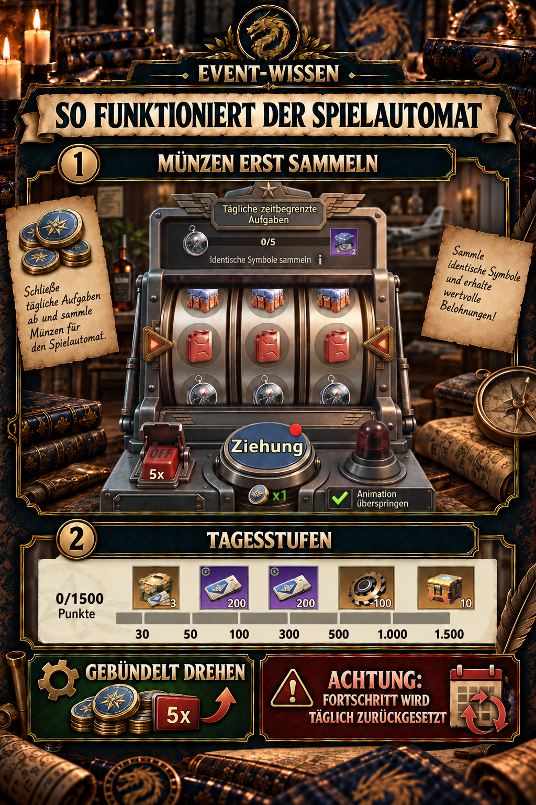
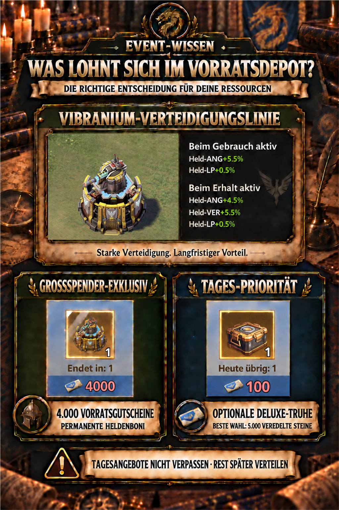

# ✈️ Event – Flight Crew Battle Preparation

## Key points

- The **Launch Sequence offers 15 Flying Star Coins per event day**. Across five event days, that is **75 coins**.
- There is also **one free coin per shop reset**. With eight accessible reset windows, up to **83 free coins** are therefore possible in total.
- Do not spend coins individually as soon as you receive them: slot-machine point progress resets daily. Collect first, then deliberately reach a daily milestone at **30, 50, 100, 300, 500, 1,000 or 1,500 points**.
- The separate **daily time-limited task** chain has 15 stages. Requirements of **5, 5, 10, 10, 15 and 20** are established for the first six; rewards are now visible through stage 15.
- The sensible main goal for Free2Play and **Targeted Buyers** is permanent progression materials. The daily-limited **Optional Deluxe Chest** is particularly strong when choosing 5,000 Refined Stones.
- **Free2Play** players collect coins and preferably concentrate draws on the last safe usage day. **Targeted Buyers** can instead secure UR Omni Hero Shards or the Optional Deluxe Chest daily.
- The **Vibranium Defense Line for 4,000 Supply Vouchers** is strong, but realistically an exclusive high-spender reward – not a sensible main goal with a €0–100 budget.
- Among direct Supply Voucher packs, **€2.49 for 20 vouchers** offers the best rate. From €5.99 to €119.99, the rate remains practically constant at around €0.15 per voucher.
- **The theoretical expected coin value is not a reliable personal return.** In a practical test, 279 coins used predominantly at 5× produced only 5.38 vouchers per coin; another 50 coins at 1× achieved 9.2 per coin. Direct vouchers are more predictable for fixed targets; preferably draw at 1× when using coins.
- With a large coin stock and the goal of **maximum Supply Vouchers**, several daily runs to stage 7 or 9 are preferable to a single run to stage 15, since all task rewards visibly marked with vouchers are awarded by stage 7.

> **Quick recommendation:** Save small F2P stocks for a reliable daily milestone. With large stocks and a voucher focus, repeat early voucher boxes across several days through stage 7 or 9. Targeted Buyers secure only desired daily offers; when aiming for the skin, buy only the remaining voucher gap directly after all draws.


## What is this event guide for?

This guide puts the time-limited **Flight Crew Battle Preparation** event into context. It explains event currencies, the airport slot machine, the supply shop and sensible spending for Free2Play players, Targeted Buyers and high spenders. The latter are often called **“Whales”** in gaming terminology.

Some sections have different remaining durations. Always check each tab’s timer and do not redeem coins or Supply Vouchers at the last minute.

## How many free coins are available?

On each of five event days, the Launch Sequence offers **15 Flying Star Coins** in total. Specific sources and tasks differ by day. For planning, use the simple calculation: **15 coins × 5 event days = 75 coins**.

The shop also provides **one free coin per reset**. The timer visible at event start exceeds seven days, likely allowing eight collections. Completing all five event days and catching every reset window gives **up to 83 free coins**. Missing tasks or a reset reduces the total accordingly.

Important: the daily Celebration Points during the five event days are a separate resource for daily tasks, not additional Flying Star Coins.

## The three most important event resources

| Resource | Use | Recommendation |
| --- | --- | --- |
| **Flying Star Coins** | One coin pays for a normal airport slot-machine draw. The 5× mode multiplies a single random result by five. | Collect free coins, combine them for a good daily milestone and draw at 1× for greater predictability. |
| **Supply Vouchers** | Earned from draws, combinations, daily stages and bonus draws. Spent in the Supply Depot. | Buy daily offers only with a clear goal; otherwise save and allocate deliberately before the Supply Depot expires. |
| **Aid Supplies** | Earned by completing **“Start Time” tasks** and through daily activity. Other event sections may provide additional Aid Supplies. | Regularly check all available event tasks and tabs. |

## Use the slot machine correctly

Every draw awards points for the daily progress bar. Visible stages are **30, 50, 100, 300, 500, 1,000 and 1,500 points**. This counter resets daily.

Therefore:

1. Collect free coins and task rewards every day.
2. Do not automatically spin immediately after receiving each coin.
3. Save until you can reliably reach a worthwhile daily milestone.
4. Prefer **1×** for a fixed voucher target. The 5× mode saves time but turns five coins into only one random result multiplied by five, substantially increasing variability.
5. Stop after the planned milestone. Do not buy more uncontrollably because of coins already spent.

According to event rules, unused coins are converted after the event. **One coin equals 30 five-minute speedups**, or 150 minutes. This prevents complete loss, but is usually weaker than deliberately reached daily stages and draw rewards.

### Practical measurement: Why 5× is riskier

One documented run used **279 coins predominantly in 5× mode** and earned **1,500 new vouchers**. That is only **5.38 vouchers per coin**. Instead of 279 independent 1× results, it produced only 55 results multiplied by five and four remaining single draws – 59 independent random results altogether.

A subsequent series of **50 individual 1× draws** earned another **460 vouchers**, or **9.2 vouchers per coin**. Together, the two series earned 1,960 vouchers from 329 coins, or **5.96 per coin**. The 1× series is still small at 50 draws, but shows the benefit of broader risk diversification: a single poor result affects only one coin instead of five.

These measurements do not replace official probabilities with a new universal expected value. The theoretical long-term average is the same in both modes; 1× merely makes personal returns more stable. For a fixed goal: **draw at 1×, check progress and preferably close a remaining gap directly.**

### Daily time-limited tasks: 15 stages

Screenshots show a **15-stage daily task chain** with its own countdown. Each stage unlocks the next. The first six requirements are confirmed; rewards are visible through stage 15:

| Stage | Requirement | Visible reward |
| ---: | ---: | --- |
| 1 | **5 confirmed** | 2 purple boxes with voucher symbol |
| 2 | **5 confirmed** | 1 purple building part |
| 3 | **10 confirmed** | 1 gold box with voucher symbol |
| 4 | **10 confirmed** | 1 light-colored building part |
| 5 | **15 confirmed** | 2 gold boxes with voucher symbol |
| 6 | **20 confirmed** | 1 light-colored building part |
| 7 | unknown | 4 gold boxes with voucher symbol |
| 8 | unknown | 1 light-colored building part |
| 9 | unknown | 1 red-gray building part |
| 10 | unknown | 1 light-colored building part |
| 11 | unknown | 1 red-gray building part |
| 12 | unknown | 1 light-colored building part |
| 13 | unknown | 3 UR Survivor Chests (random UR survivor) |
| 14 | unknown | 3 UR Survivor Chests (random UR survivor) |
| 15 | unknown | 3 UR Survivor Chests (random UR survivor) |

The first six tasks show a total of **65 required units or actions**. Tasks use changing symbols, so this total must not automatically be read as 65 coins or draws: how quickly one coin increases the relevant progress depends on the draw result.

#### Conservative extrapolation of requirements

A linear continuation of the confirmed sequence 5, 5, 10, 10, 15, 20 gives a rough working assumption of about **140 progress units through stage 9** and approximately **360 through stage 15**. Changing task symbols mean this is not a reliable coin forecast. Planning ranges of approximately **130–155 through stage 9** and **330–400 through stage 15** are more reasonable than one exact value.

#### 280 coins: Stage 9 twice or stage 15 once?

Anyone wanting to **maximize Supply Vouchers** should restart the chain after a reset rather than force the final stages at any cost:

- One run through stage 7 or 9 gives **2 purple and 7 gold boxes with voucher symbols**.
- **Two runs through stage 9** therefore give **4 purple and 14 gold voucher boxes**.
- **One run through stage 15** still gives only **2 purple and 7 gold voucher boxes**. Stages 8–15 show no further reward explicitly marked with a voucher symbol.

Your assumption is therefore correct for **maximum voucher yield**: if 280 coins actually suffice for two complete stage-9 runs, this split is more attractive than one deep run. The repeated voucher boxes yield roughly **78 Supply Vouchers** mathematically: 2 purple boxes at 4 each and 7 gold boxes averaging around 10.01 vouchers each. Across all nine boxes, that averages about **8.67 vouchers per box**. However, confirmed requirements alone cannot guarantee how far 280 coins will go, since a draw can produce different numbers of matching symbols.

For **total value**, the decision is more nuanced. A second run through stage 9 also repeats one purple decoration priced at 40 vouchers in the shop and four UR decorations at 100 vouchers each. Together with voucher boxes, this corresponds to a calculated shop-equivalent value of around **518 vouchers**. Stages 10–15 instead provide three UR decorations at 100 vouchers each and nine UR Survivor Chests with random UR survivors. At the nominal shop price of 100 vouchers per chest, these represent **1,200 vouchers of value**.

However, this list price can quickly overestimate the personal value of random chests. The deep run overtakes the second stage-9 run once each of the nine UR Survivor Chests is personally worth at least around **24 vouchers**. Anyone who barely needs random survivors is better served by two stage-9 runs; anyone who can use nearly every possible UR survivor likely receives higher total value from stage 15. For pure voucher focus, the recommendation remains unchanged: reach stage 9 on day one, record actual coin use, and aim for stage 9 again on day two only if the remaining stock includes an adequate safety margin.



### Why the skin is unrealistic without a high-spender budget

A draw’s purple base reward is 5, 50, 250 or 500 Supply Vouchers. Displayed probabilities mathematically yield a theoretical expected value of around **10 Supply Vouchers per coin** from this base reward alone. Rare high results strongly raise that value. Combinations, daily stages and airdrop bonuses add more, but are also random.

Using only the theoretical base value, 4,000 Supply Vouchers would require approximately **400 coins** on average. The poor 5× run at 5.38 vouchers per coin would instead require around **744 coins**; the short 1× measurement at 9.2 per coin around **435 coins**. Both are practical examples, not a new forecast for all players. Even a budget up to €100 remains heavily luck-dependent and should not be planned around the skin.

If a result includes an airdrop-chest symbol, it creates an additional selection opportunity. The visible bonus pool consists of **40% Supply Vouchers** and **60% Refined Stones**. This is valuable but still does not guarantee a particular voucher quantity.

## When should you spend Supply Vouchers?

The Supply Depot has two types of purchase limits:

- **“Remaining today: 1”** renews at the daily reset. A skipped purchase cannot be made up later.
- **“Ends in: …”** indicates the remaining limit for the entire offer period. These purchases can be planned together shortly before expiry.

Do **not automatically spend Supply Vouchers every day**. Daily spending makes sense only if one of these two daily offers is your fixed goal:

1. **UR Omni Hero Shards:** 10 shards for 60 Supply Vouchers, once daily. Anyone deliberately building these rare shards must purchase on each desired day.
2. **Optional Deluxe Chest:** one chest for 100 Supply Vouchers, once daily. This opportunity also expires with the reset.

If neither daily offer is your goal, collect vouchers. Near the event’s end, you then know your total stock and can distribute it across event-limited offers without unnecessary remainders. Do not wait until the final minute; redeem before the Supply Depot timer expires.

### Direct Supply Vouchers per day

New offer screens show two daily sources, either free or paid with diamonds:

- **1 Supply Voucher per day free**
- **1 additional Supply Voucher for 500 diamonds**, once daily

This allows at most two direct vouchers per day, but only one is truly free. **500 diamonds for one Supply Voucher is generally not a good standard F2P exchange.** It may make sense only when that exact voucher enables an important daily purchase or complete exchange.

### Evaluating the Optional Deluxe Chest

For 100 Supply Vouchers, choose one of these visible rewards:

- 10 UR Omni Hero Shards
- 40 of the visible gold components
- 5,000 Refined Stones
- 1 level-5 chest
- 15 of the visible progression boxes

The **5,000 Refined Stones** are the strongest general choice with a reliably measurable value. They equal **50 stones per Supply Voucher**. The regular exchange offers 100 stones for 4 vouchers, only 25 stones per voucher. Anyone needing Refined Stones therefore gets **double the value** from the daily Deluxe Chest.

For UR Omni Hero Shards, however, the Deluxe Chest is not the best rate: the direct daily offer provides 10 shards for 60 vouchers, while those same 10 shards cost 100 through the chest. Prefer other contents only when that specific material restricts your progress more than 5,000 Refined Stones.

## Supply Depot: Value-for-money ranking

The ranking evaluates two things: **long-term power growth** and **value per Supply Voucher**. A personal bottleneck can change the order.

| Rank | Offer | Event rate | Lasting benefit | Assessment |
| ---: | --- | ---: | --- | --- |
| **1** | **Optional Deluxe Chest → 5,000 Refined Stones** | 1 for 100, once daily | 50 stones per voucher and permanent equipment progression | **Best general daily purchase** |
| **2** | **UR Omni Hero Shards** | 10 for 60, once daily | rare, flexible permanent hero progression | **Top goal for suitable UR heroes** |
| **3** | **Direct Refined Stones** | 100 for 4 | 25 stones per voucher; inexpensive and predictable until event end | **Best use of leftovers** |
| **4** | **Hero books** | 100 for 4 | permanent hero progress; particularly good when hero levels are a bottleneck | **Very strong when needed** |
| **5** | **Research materials** | 100 for 40 | research remains permanent, but the rate is considerably dearer | **Good for a research bottleneck** |
| **6** | **Specific blueprints, fragments and building parts** | 16 to 300 | very high when directly unlocking a permanent bonus or next level | **Check detailed bonus and remaining need** |
| **7** | **10,000-unit flight/combat materials** | 10,000 for 16 | may provide permanent system progress; value depends on the specific bottleneck | **Situationally good** |
| **8** | **Equipment/progression boxes** | 1 for 8 | inexpensive, but contents and usefulness less predictable | **Solid addition** |
| **9** | **3-hour speedup** | 1 for 16 | 11.25 minutes per voucher; consumable rather than permanent | **Only for an urgent time bottleneck** |
| **10** | **Easily farmed resources** | e.g. 100 wood for 60 | no rare permanent progression | **Weakest general exchange** |

An important exception applies to blueprints, fragments and building parts: if one purchase immediately unlocks a strong permanent bonus, it can rank higher. Without that specific goal, the Deluxe Chest with 5,000 stones followed by direct stone exchanges is more predictable.

### Opportunity costs as a decision aid

Every purchase can be compared against Refined Stones:

| Supply Vouchers spent | Alternative Refined Stones |
| ---: | ---: |
| 8 | 200 |
| 16 | 400 |
| 40 | 1,000 |
| 60 | 1,500 |
| 100 | 2,500 |
| 300 | 7,500 |
| 4,000 | 100,000 |

The table uses the predictable direct exchange of 100 stones for 4 vouchers. The daily-limited Deluxe Chest is better: for 100 vouchers, choosing stones gives 5,000 rather than 2,500 Refined Stones.

According to the existing value reference, a mythic equipment piece requires about **195,500 Refined Stones** from level 1 to 40. The 100,000 stones available instead of the skin equal approximately 51% of that total requirement.

## Exclusive high-spender reward: Vibranium Defense Line

The skin costs **4,000 Supply Vouchers** and is strong, but explicitly not a general main goal.

**Active upon acquisition:**

- Hero ATK +4.5%
- Hero DEF +5.5%
- Hero HP +0.5%

**Additionally while actively used:**

- Hero ATK +5.5%
- Hero HP +0.5%

If ownership and usage bonuses apply simultaneously as displayed, the actively used skin totals **Hero ATK +10%, Hero DEF +5.5% and Hero HP +1%**. This is a powerful exclusive reward. It does not justify chasing a random Supply Voucher gap with additional purchases on a small or medium budget.

### Real-money value of the base skin: Plan only with certainty

Displayed probabilities do produce a high theoretical long-term average. However, documented practical runs show this value is insufficiently reliable for a specific real-money decision. It is therefore **no longer used to calculate the skin’s price**.

A guaranteed coin calculation uses only the guaranteed base reward of **5 vouchers per coin**. Reaching 4,000 vouchers would therefore require 800 coins. After subtracting up to 83 free coins, 717 would still need purchasing. The cheapest illustrated pack mix provides 718 coins for approximately **€833.13**. Rare wins can reduce this amount but must not be assumed before buying.

The fully predictable route uses direct voucher packs. Buying the inexpensive 20-voucher packs across eight accessible purchase periods gives 160 vouchers for €19.92. The remaining 3,840 vouchers cost around €575.93 through larger pack tiers. The **guaranteed direct purchase therefore costs approximately €595.85, or around €596**. Free and already earned vouchers reduce this accordingly.

A documented follow-up purchase of **2,400 vouchers for €360** confirms the regular direct rate of €0.15 per voucher. The sensible strategy is therefore to use free coins and, at most, inexpensive small coin packs **in 1× mode**, then check the actual balance and close only the remaining gap directly. For complete advance planning, the direct voucher route at around **€596** is cheaper than the guaranteed coin calculation at around **€833**.



## Recommendations by budget


### Free2Play – €0

1. Earn all 15 Launch Sequence coins on each of the five event days; this gives 75 coins.
2. Collect the free shop coin after every reset; up to 83 free coins are likely available.
3. Collect the daily free Supply Voucher. Normally skip the second voucher for 500 diamonds.
4. Rather than spreading coins across many days, preferably save until the **last safe usage day** and spin them together. This establishes the total stock and makes the most of the daily-reset slot bar on one day.
5. Do not wait until the final minutes: server problems, a misread timer or forgotten redemption are avoidable risks.
6. Exception: anyone with enough vouchers early who deliberately wants daily UR Omni Hero Shards or Deluxe Chests must redeem before the reset.
7. Remove the skin from your plans. A lucky hit is a bonus, not a strategy.

Concentrating coins deliberately forgoes earlier daily slot tasks. It is therefore not a mathematically proven maximum-value solution, but a more robust F2P strategy when total stock is known only at the end and a deeper daily stage matters more than repeatedly reaching small stages.

### Targeted Buyers – €20 to €100

For most of us, this is the suitable category. The visible coin rate is:

| Pack | Coins | Price per coin |
| --- | ---: | ---: |
| €1.19 | 2 | approx. €0.60 |
| €2.49 | 4 | approx. €0.62 |
| €5.99 | 5 | approx. €1.20 |
| €11.99 | 10 | approx. €1.20 |
| €23.99 | 20 | approx. €1.20 |
| €59.99 | 50 | approx. €1.20 |
| €119.99 | 100 | approx. €1.20 |

This calculation values only visible event coins. Diamonds, chests and other pack contents can change personal value.

**Sensible spending tiers:**

- **€20–30:** Start with the €1.19 and €2.49 packs. Across eight purchase periods, both small packs together cost €29.44 and provide 48 coins.
- **€30–60:** Use small daily packs as the foundation; add €5.99 packs only if they reliably secure a good daily milestone.
- **€60–100:** Continue planning around progression materials. Buy more only after a draw series and respect a hard overall limit.

Even at the upper end of this range, the skin is not a sound target. The budget’s value lies in additional daily stages, vouchers and materials – not a guarantee of 4,000 Supply Vouchers.

Among the separate €5.99 offers in **Daily Must-Buy**, the Equipment Value Pack with 1,000 Refined Stones offers a clear permanent benefit. Research or hero packs may be better if that area is your current bottleneck.

Supply Vouchers can also be bought directly:

| Pack | Supply Vouchers | Vouchers per euro | Price per voucher |
| --- | ---: | ---: | ---: |
| free | 1 | – | – |
| 500 diamonds | 1 | – | 500 diamonds |
| €2.49 | 20 | approx. 8.03 | approx. €0.125 |
| €5.99 | 40 | approx. 6.68 | approx. €0.150 |
| €11.99 | 80 | approx. 6.67 | approx. €0.150 |
| €23.99 | 160 | approx. 6.67 | approx. €0.150 |
| €59.99 | 400 | approx. 6.67 | approx. €0.150 |
| €119.99 | 800 | approx. 6.67 | approx. €0.150 |

The €2.49 pack’s voucher-only rate is approximately **20% better** than larger packs. From €5.99 onward, rates are nearly identical; choosing a tier then mainly changes total quantity, Aid Supplies and other extras.

### Buy coins or Supply Vouchers?

For a fair comparison, convert both routes to **Supply Vouchers per euro**. Coin figures compare the theoretical value of about 12.8 vouchers per coin with the observed poor 5× run at 5.38 and short 1× series at 9.2. Direct voucher packs guarantee the stated quantity.

| Purchase route | Calculation value, not a buying basis | Observed 5× / 1× | Assessment |
| --- | ---: | ---: | --- |
| **2 coins for €1.19** | approx. 25.6 | approx. 10.8 / 18.4 | cheapest coin pack; still random |
| **4 coins for €2.49** | approx. 51.2 | approx. 21.5 / 36.8 | may be worthwhile, but not guaranteed |
| **Coin at the regular rate of approx. €1.20** | approx. 12.8 | approx. 5.38 / 9.2 | 1× was significantly more predictable in the practical test |
| **20 direct vouchers for €2.49** | 20 guaranteed | 20 guaranteed | best guaranteed voucher rate |
| **Larger direct voucher packs** | approx. 6.67 vouchers per euro | approx. 6.67 vouchers per euro | fully predictable |

Small coin packs remain interesting because of their low prices. Regularly priced coins perform worse than direct vouchers during a poor run. Although coins additionally provide slot points, daily stages and other draw rewards, they must no longer be categorically described as the better-value purchase.

**Specific examples of daily targets:**

| Daily target | Direct, guaranteed route | Observed coin rates, not guaranteed |
| --- | --- | --- |
| **60 vouchers for 10 UR Omni Hero Shards** | 20- plus 40-voucher pack: **€8.48 guaranteed** | 6 inexpensive coins cost €3.68; at observed 5×/1× rates, they would yield around 32 or 55 vouchers |
| **100 vouchers for the Optional Deluxe Chest** | 20- plus 80-voucher pack: **€14.48 guaranteed** | 11 coins cost €9.67; at observed 5×/1× rates, they would yield around 59 or 101 vouchers |

**Decision rule for Targeted Buyers:**

- **Today’s daily offer must be purchased reliably:** Count existing vouchers and directly buy only the specific remaining quantity.
- **Missing a daily offer would be acceptable:** Inexpensive coin packs may provide better value; draw at 1× for lower variability.
- **Larger event goal without a daily limit:** Spin coins first, then directly close only the remaining voucher gap.
- **Tight fixed budget:** Do not simultaneously plan around slot luck and several daily purchases. Choose a main goal before buying.

The free daily voucher and vouchers already earned reduce actual purchasing needs. With a total €20–100 budget, do not automatically buy every day: first decide whether the goal is shards, individual Deluxe Chests or as many Refined Stones as possible.

### High spenders – substantially above €100

1. Only in this category should 4,000 Supply Vouchers for the skin be a real goal.
2. Buy inexpensive limited coin and voucher packs daily if the skin is firmly planned. Missed daily packs cannot be bought later at the same rate.
3. With a voucher focus, repeat task rewards through stage 7 or 9 across several daily resets. With 280 coins, reaching stage 9 twice is likely preferable to forcing stage 15 once.
4. Check actual coin use after the first run. Plan a second equally deep run only with sufficient reserve.
5. After all planned draws, check the final voucher total and directly buy only the remaining gap.
6. When targeting the skin, do not simultaneously buy daily Deluxe Chests or shards unless the budget explicitly covers both goals.
7. After the skin, invest surplus vouchers in Deluxe Chests, Refined Stones and specific permanent materials.

## Limitations and open questions

- The expected eight free shop coins require collecting in every reset window within the visible event timer.
- Probabilities give expected values, not a guaranteed result for one account.
- Without detailed views, individual blueprint, fragment and box quality cannot be compared reliably. They are therefore ranked only conditionally.
- For daily time-limited tasks, only stage 1–6 requirements are currently confirmed. Stage 7–15 requirements and exact task types remain unresolved; stated ranges are merely conservative extrapolations.
- Without every task type and stage content, the highest overall value of one deep slot series versus repeated smaller daily stages cannot be calculated exactly.
- It is unconfirmed whether all players see identical packs and regional prices.
- Real-money pack evaluations use prices visible in Germany on 28 September 2026.

## Sources and reliability

- In-game screenshots of the event, Launch Sequence and German offers on 28 September 2026
- Daily time-limited task screenshots: stage 1–6 requirements and stage 1–15 rewards, dated 4 October 2026
- Vibranium Defense Line detailed view dated 28 September 2026
- Optional Deluxe Chest detailed view dated 28 September 2026
- Direct Supply Voucher packs and daily free/diamond offers dated 28 September 2026
- Internal price and value reference as of 28 September 2026
- All purchase recommendations rely on visible contents; unknown quantities or effects were not estimated.

**As of:** 4 October 2026

## Alliance announcement to copy

```html
<color=#FFD700><b>✈️ EVENT GUIDE – FLIGHT CREW</b></color>

<color=#7FFF00><b>F2P:</b></color> 15 coins/day, 75 in 5 days; up to 83 free. Save for a daily milestone. 1 free voucher daily.

<color=#7FFF00><b>280-COIN PLAN:</b></color> For vouchers, prefer stage 7/9 twice over stage 15 once. Voucher boxes are at stages 1, 3, 5 and 7. Check use after run 1.

<color=#7FFF00><b>DRAWS:</b></color> Use 1× for fixed goals. Practical test: 5× gave 5.38, the 1× series 9.2 vouchers/coin.

<color=#7FFF00><b>BUYING:</b></color> Inexpensive coins first, then close the gap directly. Guaranteed: 60 vouchers €8.48; 100 vouchers €14.48.

<color=#7FFF00><b>SKIN:</b></color> 4,000 vouchers. Guaranteed via coins approx. €833; direct vouchers approx. €596. Never count rare wins in advance.

<color=#FFAA00><b>IMPORTANT:</b></color> Slot points reset daily. Offers marked “Remaining today: 1” expire.
```
