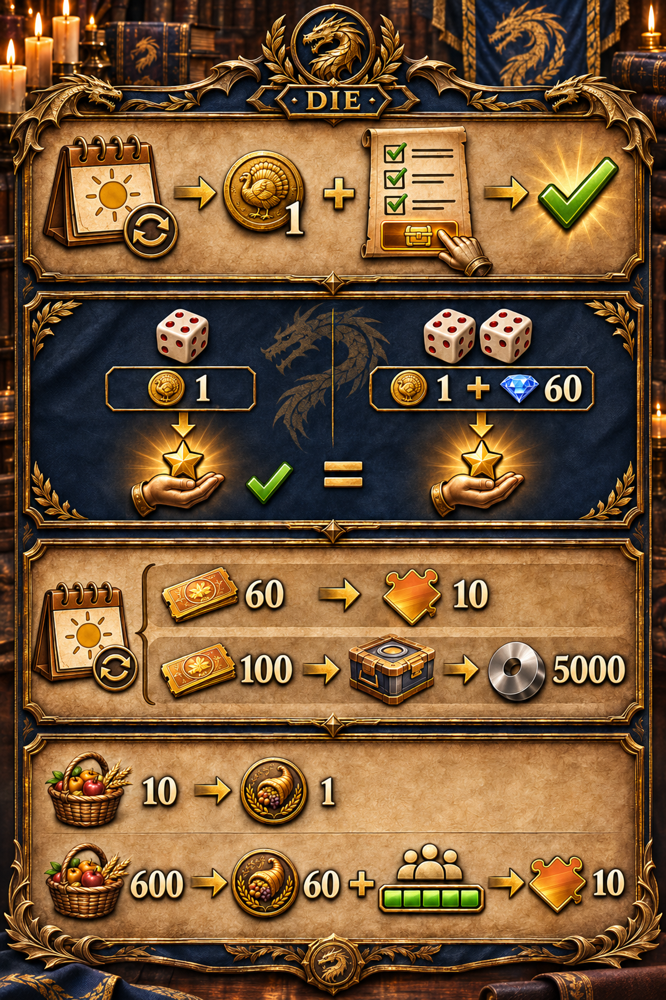
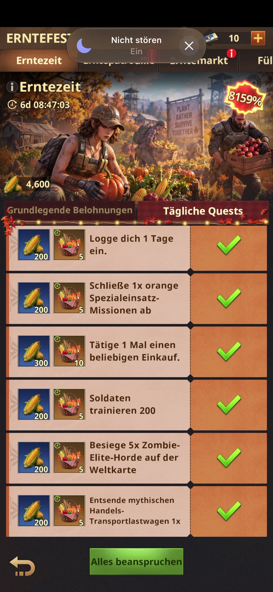
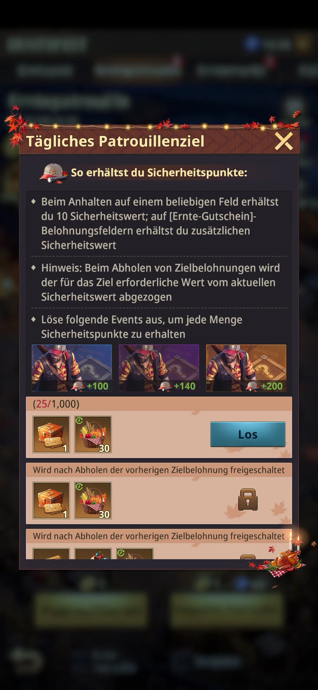
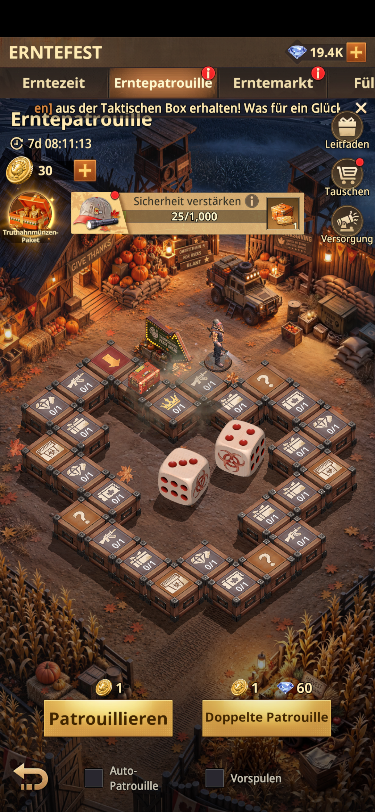
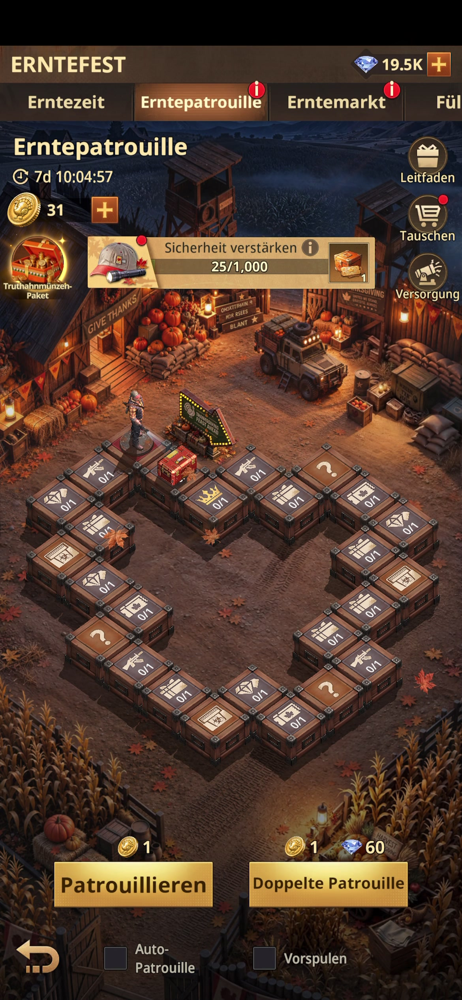
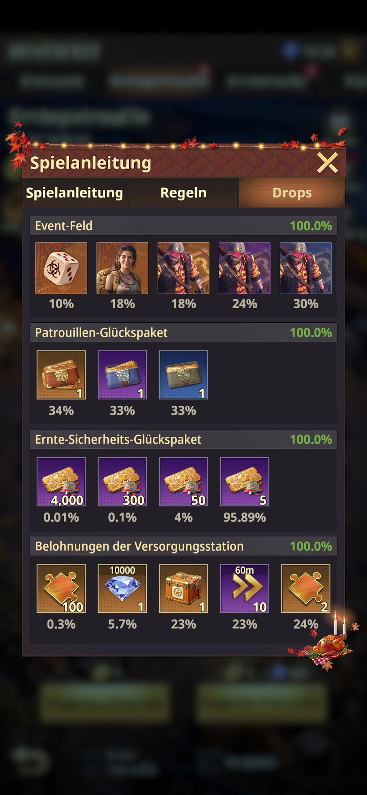
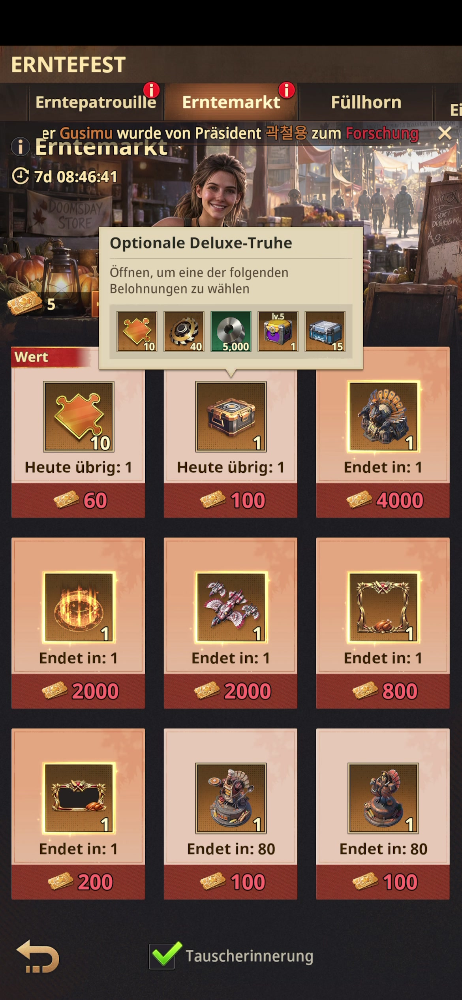
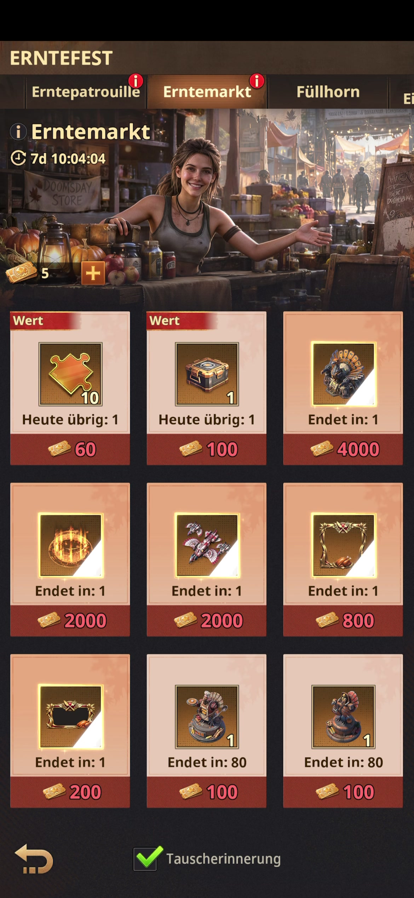
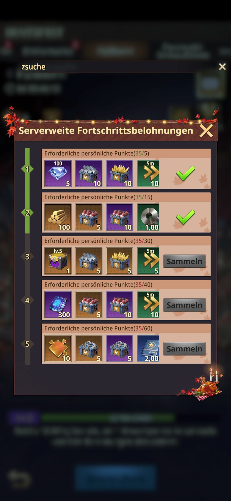
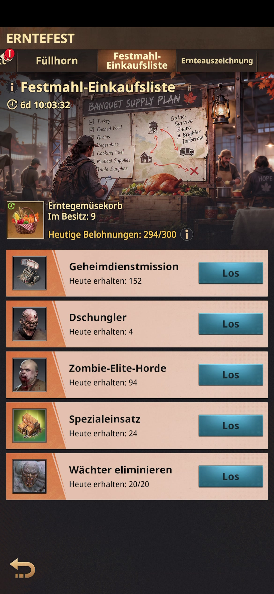

# Event – Harvest Festival

## Key points at a glance

- Claim the **free turkey coin**, pass tasks and available rewards daily. The six tasks without a purchase requirement give **1,300 pass points and 30 baskets** in total.
- **Unused security carries over through the daily reset.** Claiming a patrol objective deducts its requirement. The stockpiling strategy from the flight event therefore cannot simply be transferred.
- With **double patrol, two dice give 2–12 steps** for **1 coin and 60 diamonds**. It gives **no additional reward yield**. Normal patrol with one die and 1–6 steps is sufficient for reward planning.
- The harvest market offers **10 golden universal shards for 60 tickets daily** and the **Optional Deluxe Chest for 100 tickets**. One chest option is **5,000 Refined Stones**, giving twice the stone rate of the normal exchange.
- A **harvest security lucky pack** gives at least **5 tickets**, with a calculated mean of **7.4945**. This is **per pack**, not per coin or dice roll.
- The supply list shows a **daily cap of 300 vegetable baskets**; unused daily allowance carries over. **10 baskets give 1 abundance point**. The five server milestone rewards additionally require **5, 15, 30, 40 and 60 personal points**.
- The pass, cornucopia, supply list and awards show about **6 days 10 hours**, while patrol and market show about **7 days 10 hours** remaining. Check each tab separately.
- F2P and small budgets should prioritise permanent materials they need. The **base skin for 4,000 tickets** is an optional major goal without a verified cost forecast.

> **DIE recommendation:** Use free sources and daily tasks, submit baskets in time and budget only tickets you already own. Coins, lucky packs and tickets are three different quantities.



## What is this event guide for?

This guide explains the **reduced Harvest Festival edition in Z:Route: Redemption** of **23 November 2026**: harvest time, harvest patrol, harvest market, cornucopia, banquet supply list and harvest awards. The two videos, screenshot and alliance information form the complete available evidence for this edition. The guide combines a daily routine with reward and package comparisons for different budgets.

## Your daily routine

1. Claim the **one free turkey coin** in the coin shop and check pass tasks under harvest time.
2. Collect baskets through **intelligence missions, Jungler, zombie elite hordes, special operations and eliminating guardians**. Combine these with normal alliance and competition objectives where possible.
3. Submit complete groups of ten at the cornucopia and check your personal contribution requirement for server rewards. The last displayed milestone requires **60 personal points or 600 submitted baskets** in total; the server must also reach that milestone.
4. Patrol, check available security objectives and empty both the reward cache and event inbox after auto patrol.
5. Buy daily offers only for a defined goal; save other tickets and spend them deliberately before the market closes.

## Which resource belongs where?

| Resource | Purpose | Planning rule |
| --- | --- | --- |
| Turkey coins | Dice rolls in harvest patrol | Normal: 1 coin for one die; double: 1 coin and 60 diamonds for two dice. |
| Security | Patrol objectives and their rewards | Carries over overnight and is spent when claiming an objective. |
| Harvest market tickets | Purchases in the harvest market | Count only your current balance as a reliable shopping budget. |
| Pass points | Harvest time reward tracks | Belong to the pass, not the ticket balance. |
| Vegetable baskets | Cornucopia and shared server progress | 10 baskets for 1 abundance point; complete remainders in time. |

## Timers: the tabs do not all end together

| Area | Time remaining in the recording | What it means |
| --- | --- | --- |
| Harvest time / pass | About 6 days 10 hours | Finish tasks and claim pass rewards earlier. |
| Cornucopia, supply list, harvest awards | About 6 days 10 hours | Submit baskets and claim earned awards in time. |
| Harvest patrol and harvest market | About 7 days 10 hours | These show about one extra day; other areas do not get that extension. |

The table records the timers in the first video. The current timer on each tab is what matters. Finish the pass, cornucopia and awards in time, even if patrol and market remain available longer.

## Harvest time: daily tasks and pass points

Harvest time combines daily tasks with a milestone reward track. A pass chest unlocks at **9,100 pass quest points**. These seven daily tasks are documented:

| Daily task | Pass points | Vegetable baskets |
| --- | ---: | ---: |
| Recruit 10 heroes | 300 | 5 |
| Log in once | 200 | 5 |
| Complete one orange special operation | 200 | 5 |
| Make any purchase | 300 | 10 |
| Train 200 soldiers | 200 | 5 |
| Defeat 5 zombie elite hordes on the world map | 200 | 5 |
| Dispatch one mythical trade truck | 200 | 5 |
| **Total for all seven tasks** | **1,600** | **40** |
| **Total without the purchase task** | **1,300** | **30** |

The six tasks without a purchase requirement give **1,300 pass points and 30 baskets per completed daily set**. Seven such sets mathematically give **7 × 1,300 = 9,100 pass points**, exactly reaching the displayed pass chest threshold. Prepare recruitment cards, an orange mission and a mythical truck in time.

The purchase task separately gives **300 pass points and 10 baskets**. Exclude it when planning without purchases.



## Harvest patrol: keep progress and upgrade tiles

Turkey coins pay for dice rolls; the result determines your steps. Reward tiles give items and tile EXP. Higher tile levels improve rewards. Reaching or passing the start tile grants random rewards and tile EXP from **2 to 4 tiles**. Event tiles trigger their own random events.

### Security and the daily objective chain

Each landing on any tile gives **10 security**. **Harvest ticket reward tiles** give additional security. Three event variants grant another **100, 140 or 200 security points**.

The first objective requires **1,000 security** and rewards **one harvest security lucky pack and 30 baskets**. The following stage also shows one such pack and 30 baskets. Later stages each show a golden bag icon, a cannon-themed decoration and 100 baskets. Each stage unlocks only after claiming the previous one. The requirement then displayed applies to your next claim.



Security objectives change daily. According to the rules, claimable rewards left uncollected from the previous day are mailed; **unused security carries over**. This mailing no longer applies after the event ends. Patrol regularly and claim reachable objectives; unused security does not need to be spent just because a daily reset is approaching.

Auto patrol stores rewards and requires events to be handled manually afterwards. According to the rules, each remaining turkey coin converts at the end into **30 speedup chests of 5 minutes each**, or **150 minutes**. This is not a ticket yield.

### Double patrol: two dice for more steps

In **double patrol, two dice are rolled simultaneously and their results added**. This allows **2 to 12 steps**; normal patrol with one die allows **1 to 6**. It costs **1 turkey coin and 60 diamonds**, compared with one coin for a normal turn.

**Mathematical explanation assuming fair, independent dice:** The average number of steps increases from **3.5 to 7**. Sums have different probabilities: **7** occurs in **6 of 36** combinations, while **2** and **12** each occur in only **1 of 36**.

**Double patrol gives no additional reward yield.** The extra 60 diamonds pay for the second die and more steps in the same turn. This mode is not a reward multiplier. Use **normal patrol** for reward planning and when diamonds are limited. The security rule grants points per landing, not per step travelled.





## Lucky packs: what the drop table establishes

| Tickets per harvest security lucky pack | Displayed probability |
| ---: | ---: |
| 5 | 95.89% |
| 50 | 4% |
| 300 | 0.1% |
| 4,000 | 0.01% |

Calculated mean: **5 × 0.9589 + 50 × 0.04 + 300 × 0.001 + 4,000 × 0.0001 = 7.4945 tickets per security pack**. For 100 such packs this means at least 500 tickets and a mean of 749.45. Assuming independent draws, the chance of at least one 4,000-ticket result would be only about **0.995%**. Do not budget for the rare prize.

The recording also shows a **patrol lucky pack** with 34/33/33% for three different pack icons and a separate supply station pool. Each pool is considered separately. **7.4945 tickets applies per security pack**; it is not a fixed ticket rate per coin. Base buying decisions on your actual ticket balance.



## Harvest market: rewards by personal usefulness

| Visible offer | Tickets | Recorded limit | Assessment |
| --- | ---: | --- | --- |
| 10 golden universal shards | 60 | 1 daily | Consider for targeted hero growth; best visible shard rate. |
| Optional Deluxe Chest | 100 | 1 daily | Choices include 5,000 Refined Stones or 10 golden universal shards. |
| Turkey-themed base skin | 4,000 | 1 per event | A deliberate major goal only; name and bonuses are not displayed. |
| Light effect / aircraft design | 2,000 each | 1 each per event | Check effects and permanent bonuses first. |
| Avatar frame / nameplate | 800 / 200 | 1 each per event | Personal collecting goal. |
| Two golden event decorations | 100 each | 80 each per event | Compare required levels and bonuses in the game. |
| Purple event decoration | 40 | 80 per event | Only for a specific upgrade goal. |
| UR Survivor Chest | 100 | 30 per event | One random UR survivor; no selection. |
| Another 10 golden universal shards | 100 | 30 per event | 10 tickets per shard instead of 6 in the daily offer. |
| Red / golden blueprint | 300 / 60 | 10 / 100 per event | Buy only the quality you need. |
| 10 golden recruitment cards | 100 | 30 per event | Compare with your development goal. |
| UR Wingman Selection Chest | 300 | 5 per event | Select from twelve displayed wingman components to suit your upgrades. |
| 100 wood | 60 | 200 per event | Compare with your current upgrade bottleneck. |
| 3-hour speedup | 10 | 200 per event | 18 minutes per ticket; possible use for leftovers. |
| 5 × 10,000 of the displayed material | 25 | 20 per event | Material name is not shown in detail. |
| SSR Hero EXP Chest | 8 | 1,000 per event | Hero EXP yield depends on base level. |
| SSR Resource Selection Chest | 8 | 1,000 per event | Choose a food, metal or oil chest; yield depends on base level. |
| 100 Refined Stones / 100 blue books | 4 each | 1,000 each per event | Spend leftover tickets only on materials you need. |

The opened tooltips confirm these chests. Other offer names describe their visible icons. At unchanged daily prices, five shard purchases cost **300 tickets for 50 shards**, and five daily Deluxe Chests cost **500 tickets**. Missed daily purchases cannot simply be recovered on the last day.

### Deluxe Chest: double the stone rate confirmed

The **Optional Deluxe Chest** lets you choose **10 golden universal shards**, **40 gear-icon items**, **5,000 Refined Stones**, **one level-5 chest** or **15 resource selection chests**. The descriptions follow the visible choices.

If you need Refined Stones, this daily chest gives **5,000 ÷ 100 = 50 stones per ticket**. The normal exchange of 100 stones for 4 tickets gives **25 stones per ticket**. The daily Deluxe Chest therefore provides **twice the stone value**. For shards, the direct daily offer is cheaper: **6 tickets per shard** instead of **10** through the chest. Choose according to your bottleneck: buy shards in the daily offer, prioritise the Deluxe Chest for stones and use remaining tickets in the normal stone exchange as needed.

The **UR Survivor Chest for 100 tickets is random**. It makes sense only if many of its possible UR survivors would still help your account. The **UR Wingman Selection Chest for 300 tickets** allows a targeted choice. The opened hero EXP chest shows **7,872,000 EXP** and the example food chest **1,327,800 food**; both are values for the recorded base level, not universal quantities.





## Coin packages and actual prices

| Package | Coins | Recorded price | Price per coin |
| --- | ---: | ---: | ---: |
| Small green N package | 2 | €1.19 | €0.595 |
| Blue N package | 4 | €2.49 | €0.623 |
| R package | 8 | €5.99 | €0.749 |
| SR package | 15 | €11.99 | €0.799 |
| SSR package | 30 | €23.99 | €0.800 |
| UR package | 60 | €59.99 | €1.000 |
| MR package with extra item | 110 | €119.99 | €1.091 |
| MR package without that extra item | 110 | €119.99 | €1.091 |

The shop states that packages refresh daily. The two MR versions show **5 and 15 purchases per day** respectively; smaller packages show one each. The green €1.19 package already shows **0/1**: this establishes its price and contents, but not a purchase still available. Extras differ; the table compares coins only. Promotional percentages do not replace a value comparison. Smaller packages in the visible shop are cheaper per coin.

## Recommendations by budget

| Budget | Sensible plan | Spending boundary |
| --- | --- | --- |
| F2P – €0 | Collect the free coin, tasks without a purchase requirement and baskets; aim for the daily Deluxe Chest if you need stones, or the 60-ticket offer for shards. | Plan only with collected tickets and reachable daily purchases. |
| Small budget – up to €20 | Use free rewards first; compare available small daily packages if deliberately buying coins. | A ticket goal remains random even with paid coins. |
| Targeted buyers – €20 to €100 | Pick one main goal, respect daily limits and check the real ticket balance after every patrol. | Use normal patrol; double patrol gives no reward bonus. |
| Major spenders – over €100 | Pursue a skin or collectible only with a fixed total budget and compare ticket progress with your goal. | Do not count rare prizes as shopping funds in advance. |

## Cornucopia and banquet supply list

The supply list shows **294/300** baskets received that day; 294 is a personal snapshot. The daily cap is 300, and unused allowance carries over according to the information text. “Eliminate guardians” additionally shows **20/20**. Other source counts are not verified individual caps. A yield per battle or mission is not specified.

At the cornucopia, **10 vegetable baskets give 1 abundance point**. Everyone on the server contributes to the shared level. The rewards screen adds an important condition: **each milestone reward also requires a minimum personal point total.**

| Server reward milestone | Required personal points | Total baskets to submit | Example of displayed rewards |
| --- | ---: | ---: | --- |
| 1 | 5 | 50 | Includes 5 × 100 diamonds |
| 2 | 15 | 150 | Includes 100 wood and Refined Stones |
| 3 | 30 | 300 | Includes one level-5 chest |
| 4 | 40 | 400 | Includes 300 of the displayed blue chip material |
| 5 | 60 | 600 | Includes 10 golden universal shards |

The thresholds refer to your **total personal points**, not five separate payments. Thus 600 baskets in total meet all five personal requirements. The server must also unlock each shared milestone. At **35 personal points** in the recording, only the first two server milestones are green; personal points alone do not replace server progress.

Baskets come from the supply list, pass tasks and patrol objectives. Your **actual basket balance** determines what you can submit. As a calculation example, seven fully used daily allowances of 300 from the supply list equal **2,100 baskets or 210 abundance points**. Nine leftover baskets do not make a complete point.





## Harvest awards

The awards show thresholds at **1,000, 4,000, 10,000, 20,000, 40,000, 70,000 and 100,000**. The heading names the **Thanksgiving food truck** with **Hero ATK +1,600 at maximum level**. This bonus refers to the maximum level. The displayed **5,600** is the personal snapshot in the recording. Claim earned milestone rewards before this tab’s earlier timer expires.

## Sources and reliability

- Primary sources: videos **20261123_155503000_iOS.MP4** (1:32) and **20261123_171253000_iOS.MP4** (1:13 rounded), both from 23 November 2026; unaltered still frames preserve the game displays.
- **00:06–00:14:** coin packages and free coin. **00:16–00:25:** pass. **00:28–00:50:** patrol rules and drop table.
- **00:53–01:03:** market prices and limits. **01:08–01:10:** cornucopia rule. **01:20–01:25:** basket sources. **01:26–01:31:** awards.
- Second video: **00:02–00:07** daily tasks; **00:10–00:21** security rules and objective rewards; **00:26–00:27** Deluxe Chest; **00:30–00:32** UR Survivor Chest; **00:36–00:38** UR Wingman Selection; **00:41–00:49** EXP and resource chests; **00:54–00:57** server rewards.
- Screenshot **20261123_174848000_iOS.png** shows two dice rolled simultaneously. Alliance confirmation: double patrol adds the dice to give 2–12 steps and provides no additional reward yield.
- Alliance confirmation: this edition is reduced; the supplied material contains the available information. The guide covers this edition without importing extra mechanics, offers or values from the flight event.
- Probabilities apply to their respective pools; one coin is not treated as one security pack. Statements about fair, independent dice are labelled as a mathematical assumption. Planning uses existing tickets and reachable objectives.

**As of 23 November 2026 · Reduced event edition.** Once its end for DIE is confirmed, the guide will be placed in the event archive.

## Language-neutral event illustration

The DIE-style visual guide uses pictograms, numbers and mathematical symbols. It shows daily claims, equal rewards from both patrol modes, daily offers and the required cornucopia contribution. It can be used in every language edition and in alliance chat.

## Alliance message to copy

The copyable message stays below 1,000 characters including formatting commands and line breaks.

```html
<color=#FFD700><b>HARVEST FESTIVAL – CLAIM DAILY</b></color>

<color=#7FFF00><b>FREE:</b></color> Claim the coin, pass tasks and rewards daily. No need to save coins until the last day.

<color=#7FFF00><b>PATROL:</b></color> Claim daily goals, auto rewards and events. Unused security carries over through reset.

<color=#7FFF00><b>DOUBLE:</b></color> 2 dice (2–12 steps) cost 1 coin + 60 diamonds; no extra rewards. Normal patrol is enough.

<color=#7FFF00><b>MARKET:</b></color> Daily: 10 golden shards for 60 tickets or Deluxe Chest for 100 (choose 5,000 stones). Budget only tickets you own.

<color=#7FFF00><b>CORNUCOPIA:</b></color> 10 baskets = 1 point. Last server reward: 600 baskets in total + the required server milestone.

<color=#FFAA00><b>TIMERS:</b></color> Pass, cornucopia and awards end before patrol and market. Check every timer!
```
