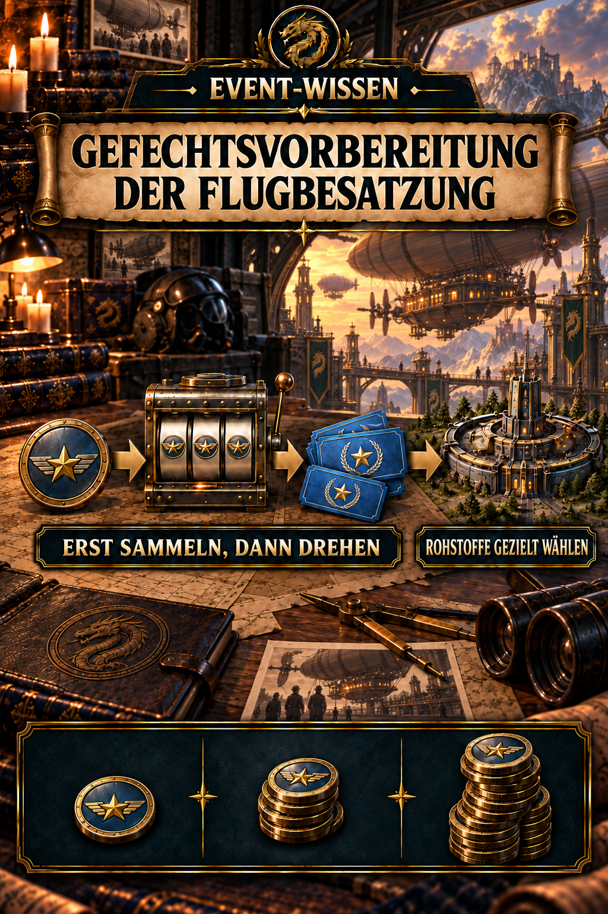
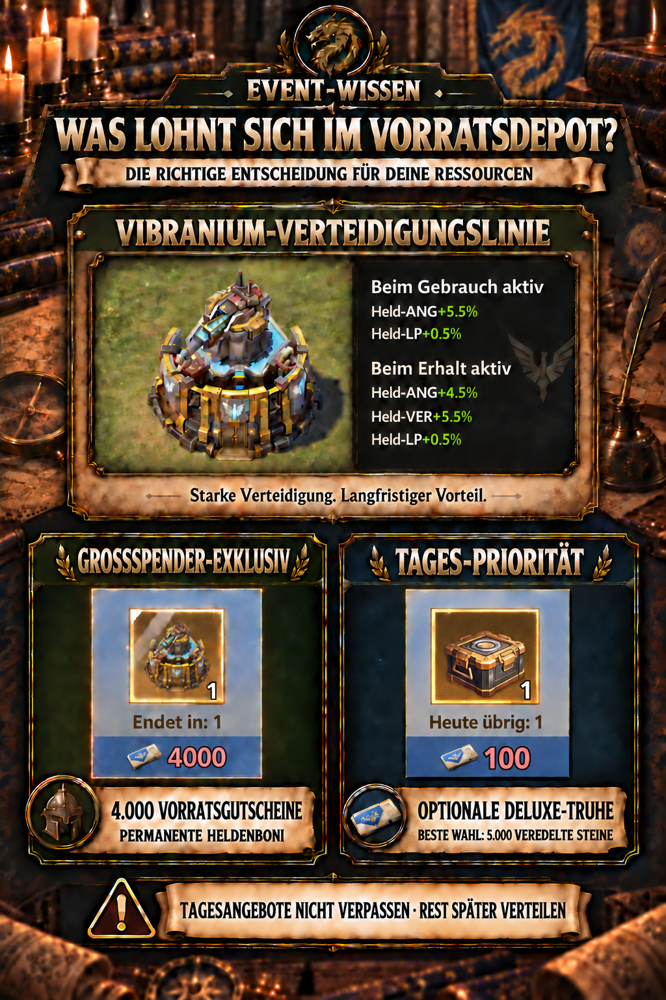
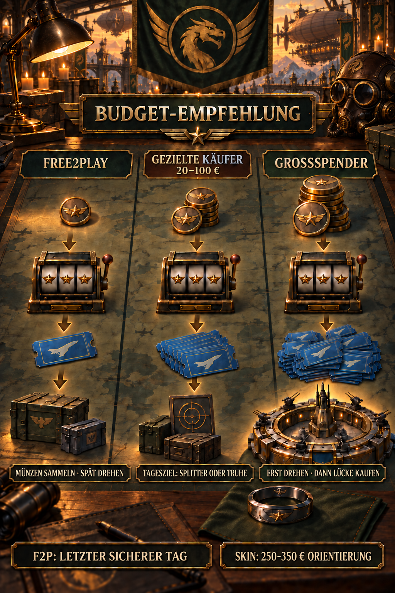

# -Événement – Préparation de la bataille de l'équipage de conduite

## Points clés

- Les **Lancer des offres Sequence 15 Pièces Flying Star par jour d'événement**. Sur cinq jours d'événement, c'est **75 pièces**.
- Il y a aussi **une pièce de monnaie gratuite par boutique réinitialise**. Avec huit fenêtres de réinitialisation accessibles, jusqu'à **83 pièces libres** sont donc possibles au total.
- Ne dépensez pas de pièces individuellement dès que vous les recevez: la progression de la machine à sous se réinitialise quotidiennement. **30, 50, 100, 300, 500, 1,000 ou 1,500 les points**.
- Les **tâche quotidienne limitée dans le temps** chaîne a 15 les étapes. **5, 5, 10, 10, 15 et 20** sont établis pour les six premiers; les récompenses sont maintenant visibles à travers la scène 15.
- L'objectif principal raisonnable pour Free2Play et **Acheteurs ciblés** est des matériaux de progression permanente. **En option, poitrine Deluxe** est particulièrement forte lors du choix 5,000 Pierres raffinées.
- **Free2Play** les joueurs collectent des pièces et se concentrent de préférence tire sur la dernière journée d'utilisation sûre. **Acheteurs ciblés** peut plutôt sécuriser UR Omni Hero Shards ou le Chest Deluxe en option tous les jours.
- Les **Ligne de défense pour le viganium 4,000 Fourniture V** est fort, mais réalistement une récompense exclusive haute-sexe – pas un objectif principal raisonnable avec une €0–100 budget.
- Parmi les paquets de bons d'approvisionnement directs, **€2.49 pour 20 bons** offre le meilleur prix. €5.99 à €119.99, le taux reste pratiquement constant à €0.15 par coupon.
- **La valeur théorique attendue des pièces n'est pas un retour personnel fiable.** Dans un essai pratique, 279 pièces utilisées principalement à 5× produit uniquement 5.38 bons par pièce; autre 50 pièces à 1× atteint 9.2 Les bons directs sont plus prévisibles pour les objectifs fixes; de préférence, ils sont tirés à 1× lors de l'utilisation des pièces.
- Avec un grand stock de pièces et l'objectif de **Approvisionnement maximal V Mouchers**, plusieurs courses quotidiennes à la scène 7 ou 9 sont préférables à une seule course à l'étape 15, puisque toutes les récompenses de tâches visiblement marquées par des bons sont décernées par étape 7.

> **Recommandation rapide :** Enregistrer petit F2P Avec des stocks importants et un voucher focus, répéter les cases de bons précoces sur plusieurs jours à travers la scène 7 ou 9. Les acheteurs ciblés ne sécurisent que les offres quotidiennes souhaitées; lorsqu'ils visent la peau, n'achetez que le solde du bon d'achat après tous les tirages.



## À quoi sert ce guide d'événement?

Ce guide met en place la limite de temps **Préparation de la bataille de l'équipage de conduite** Il explique les monnaies de l'événement, la machine à sous de l'aéroport, le magasin d'approvisionnement et les dépenses raisonnables pour Free2Play Les joueurs, les acheteurs ciblés et les grands dépenseurs. **- Oui.** dans la terminologie du jeu.

Certaines sections ont des durées restantes différentes. Vérifiez toujours chaque onglet, s timer et ne pas échanger des pièces ou des Vouchers de fourniture à la dernière minute.

## Combien de pièces gratuites sont disponibles?

Chaque jour de l'événement, le Launch Sequence offre **15 Pièces d'étoile volante** Les sources et les tâches spécifiques diffèrent de jour en jour. Pour la planification, utilisez le calcul simple: **15 pièces × 5 jours de l'événement = 75 pièces**.

Le magasin fournit également **une pièce libre par réinitialisation**. Le chronomètre visible au début de l'événement dépasse sept jours, permettant probablement huit collections. **jusqu'à 83 pièces libres**. Les tâches manquantes ou une remise à zéro réduisent le total en conséquence.

Important : les points de célébration quotidiens pendant les cinq jours d'événement sont une ressource distincte pour les tâches quotidiennes, et non des pièces Flying Star supplémentaires.

## Les trois ressources les plus importantes de l'événement

| Ressources | Utilisation | Recommandation |
| --- | --- | --- |
| **Pièces d'étoile volante** | Une pièce paie pour un tirage normal à la machine à sous de l'aéroport. 5× le mode multiplie un seul résultat aléatoire par cinq. | Recueillir des pièces libres, les combiner pour une bonne étape quotidienne et dessiner à 1× pour une plus grande prévisibilité. |
| **Fourniture V** | Tiré de tirages, combinaisons, étapes quotidiennes et tirages bonus. Dépensé dans le Dépôt d'Approvisionnement. | Acheter des offres quotidiennes uniquement avec un objectif clair; autrement, enregistrer et répartir délibérément avant l'expiration du dépôt d'approvisionnement. |
| **Fournitures d'aide** | Gagner en remplissant **,Heure de début, tâches** Les autres sections de l'événement peuvent fournir des fournitures d'aide supplémentaires. | Vérifiez régulièrement toutes les tâches et onglets disponibles. |

## Utilisez la machine à sous correctement

Chaque tirage est décerné pour la barre de progression quotidienne. **30, 50, 100, 300, 500, 1,000 et 1,500 les points**. Ce compteur se réinitialise quotidiennement.

Par conséquent:

1. Recueillir des pièces gratuites et des récompenses de tâches chaque jour.
2. Ne pas tourner automatiquement immédiatement après avoir reçu chaque pièce.
3. Économisez jusqu'à ce que vous puissiez atteindre une étape quotidienne valable.
4. Préférez **1×** pour un objectif de bon fixe. 5× le mode permet d'économiser du temps, mais transforme cinq pièces en un seul résultat aléatoire multiplié par cinq, augmentant considérablement la variabilité.
5. Arrêtez après la date butoir prévue. N'achetez pas plus incontrôlablement à cause des pièces déjà dépensées.

Selon les règles relatives aux événements, les pièces inutilisées sont converties après l'événement. **Une pièce égale 30 5 minutes de vitesses**ou 150 minutes. Cela empêche la perte complète, mais est généralement plus faible que les étapes quotidiennes délibérément atteintes et tire des récompenses.

### Mesure pratique: Pourquoi 5× est plus risqué

Un essai documenté utilisé **279 pièces de monnaie principalement en 5Mode ×** et gagnés **1,500 nouveaux bons**. C'est seulement **5.38 bons par pièce**. Au lieu de 279 indépendant 1× résultats, il produit seulement 55 les résultats multipliés par cinq et quatre tirages simples restants – 59 résultats aléatoires indépendants.

Une série ultérieure de **50 Personne 1× tirages** gagné une autre **460 bons**ou **9.2 bons par pièce**. Ensemble, les deux séries ont gagné 1,960 bons de 329 pièces de monnaie, ou **5.96 par pièce**. Les 1La série × est encore petite à 50 La Commission a adopté une proposition de directive sur les marchés publics et les marchés publics, qui prévoit des mesures de soutien pour les entreprises et les entreprises.

Ces mesures ne remplacent pas les probabilités officielles par une nouvelle valeur universelle attendue. La moyenne théorique à long terme est la même dans les deux modes; 1× rend simplement les retours personnels plus stables. Pour un objectif fixe: **tirage au tirage au sort 1×, vérifier les progrès et, de préférence, combler directement un écart restant.**

### Tâches quotidiennes limitées dans le temps : 15 étapes

Les captures d'écran montrent une **15-étape de la chaîne de tâches quotidiennes** Chaque étape ouvre la prochaine étape. Les six premières exigences sont confirmées; les récompenses sont visibles à travers l'étape 15:

| Étape | Besoins | Récompense visible |
| ---: | ---: | --- |
| 1 | **5 confirmée** | 2 boîtes violettes avec symbole de bon |
| 2 | **5 confirmée** | 1 partie de bâtiment violet |
| 3 | **10 confirmée** | 1 boîte or avec symbole de bon |
| 4 | **10 confirmée** | 1 pièce de construction de couleur claire |
| 5 | **15 confirmée** | 2 boîtes en or avec symbole de bon |
| 6 | **20 confirmée** | 1 pièce de construction de couleur claire |
| 7 | inconnu | 4 boîtes en or avec symbole de bon |
| 8 | inconnu | 1 pièce de construction de couleur claire |
| 9 | inconnu | 1 pièce de bâtiment rouge-gris |
| 10 | inconnu | 1 pièce de construction de couleur claire |
| 11 | inconnu | 1 pièce de bâtiment rouge-gris |
| 12 | inconnu | 1 pièce de construction de couleur claire |
| 13 | inconnu | 3 UR Poitrines de survie (randome) UR Survivant) |
| 14 | inconnu | 3 UR Poitrines de survie (randome) UR Survivant) |
| 15 | inconnu | 3 UR Poitrines de survie (randome) UR Survivant) |

Les six premières tâches montrent un total de **65 unités ou actions requises**. Les tâches utilisent des symboles changeants, de sorte que ce total ne doit pas automatiquement être lu comme 65 pièces ou dessins: la rapidité avec laquelle une pièce augmente les progrès pertinents dépend du résultat du tirage.

#### Extrapolation conservatrice des exigences

Une continuation linéaire de la séquence confirmée 5, 5, 10, 10, 15, 20 donne une hypothèse de travail rugueuse de environ **140 les unités de progrès à travers l'étape 9** et environ **360 par étape 15**. Changer les symboles des tâches signifie que ce n'est pas une prévision fiable de pièce. **130–155 par étape 9** et **330–400 par étape 15** sont plus raisonnables qu'une valeur exacte.

#### 280 pièces: étape 9 deux fois ou étape 15 Une fois?

Quiconque le veut **maximiser les V-Souffleurs d'approvisionnement** devrait redémarrer la chaîne après une remise à zéro plutôt que de forcer les étapes finales à tout prix:

- Une étape 7 ou 9 donne **2 pourpre et 7 boîtes en or avec symboles de coupons**.
- **Deux passages à travers la scène 9** donner donc **4 pourpre et 14 boîtes à bons d'or**.
- **Une étape 15** encore donne seulement **2 pourpre et 7 boîtes à bons d'or**. Étapes 8–15 ne montrent aucune autre récompense explicitement marquée avec un symbole de coupon.

Votre hypothèse est donc correcte pour **rendement maximal du bon**: si 280 pièces de monnaie en fait suffisant pour deux étapes complètes9 Les boîtes de bons répétées donnent approximativement **78 Fourniture V** mathématiquement: 2 boîtes pourpre à 4 et 7 les boîtes d'or moyenne autour 10.01 Les chèques chacun. Dans les neuf cases, cela représente une moyenne d'environ **8.67 bons par boîte**. Cependant, les exigences confirmées ne peuvent garantir jusqu'à quel point 280 Les pièces vont partir, car un tirage peut produire différents nombres de symboles correspondants.

Pour **Valeur totale**, la décision est plus nuancé. Une deuxième manche à travers l'étape 9 répète également une décoration pourpre prix à 40 bons dans la boutique et quatre UR décorations à 100 Les bons d'achats sont calculés en fonction de la valeur équivalente de l'atelier. **518 bons**. Étapes 10–15 fournir trois UR décorations à 100 chacun et neuf pièces UR Poitrines de survie au hasard UR Au prix nominal du magasin 100 les bons par poitrine, ceux-ci représentent **1,200 bons de valeur**.

Cependant, ce prix de liste peut rapidement surestimer la valeur personnelle des coffres aléatoires.9 une fois chacun des neuf UR Survivor Chests vaut personnellement au moins autour **24 bons**. Quiconque a à peine besoin de survivants aléatoires est mieux servi par deux étapes-9 les pistes; tous ceux qui peuvent utiliser presque toutes les possibilités UR Le survivant reçoit probablement une valeur totale plus élevée à partir de l'étape 15. Pour le pur voucher focus, la recommandation reste inchangée: atteindre le stade 9 le premier jour, enregistrer l'utilisation réelle des pièces et viser la scène 9 à nouveau le deuxième jour seulement si le stock restant comporte une marge de sécurité suffisante.


### Pourquoi la peau est irréaliste sans budget élevé

Un tirage, une récompense de base pourpre est 5, 50, 250 ou 500 Les probabilités affichées donnent mathématiquement une valeur théorique attendue de autour **10 Vouchers d'approvisionnement par pièce** Les rares résultats élevés augmentent fortement cette valeur. Les combinaisons, les étapes quotidiennes et les bonus de la goutte d'air ajoutent plus, mais sont également aléatoires.

En utilisant seulement la valeur de base théorique, 4,000 Approvisionnement Vouchers aurait besoin environ **400 pièces** En moyenne, les pauvres 5× courir à 5.38 Les bons par pièce nécessiteraient plutôt des **744 pièces**; le court 1× mesure à 9.2 par pièce **435 pièces**. Les deux sont des exemples pratiques, pas une nouvelle prévision pour tous les joueurs. €100 reste fortement dépendant de la chance et ne devrait pas être planifié autour de la peau.

Si un résultat inclut un symbole de chute d'air, il crée une possibilité de sélection supplémentaire. **40% Fourniture V** et **60% Pierres raffinées**. Cela est précieux mais ne garantit pas encore une quantité de bons particulière.

## Quand devriez-vous dépenser des Vouchers d'approvisionnement?

Le Dépôt d'approvisionnement a deux types de limites d'achat :

- **,Restons aujourd'hui : 1”** un achat déclassé ne peut pas être effectué plus tard.
- **,Finit par:...,** indique la limite restante pour toute la période d'offre. Ces achats peuvent être planifiés ensemble peu avant l'expiration.

Faites **pas dépenser automatiquement Vouchers d'approvisionnement chaque jour**. Les dépenses quotidiennes n'ont de sens que si l'une de ces deux offres quotidiennes est votre objectif fixe:

1. **UR Omni Hero Shards:** 10 pour 60 Approvisionnement Vouchers, une fois par jour. Quiconque construit délibérément ces rares durs doit acheter chaque jour désiré.
2. **En option, poitrine Deluxe:** un coffre pour 100 Supply Vouchers, une fois par jour. Cette opportunité expire également avec la remise à zéro.

Si aucune des offres quotidiennes n'est votre objectif, collectez des bons. Près de l'événement, fin, vous connaissez alors votre stock total et pouvez le distribuer sur les offres limitées à l'événement sans les restes inutiles. le délai de dépôt d'approvisionnement expire.

### Vouchers d'approvisionnement direct par jour

Les nouveaux écrans d'offre montrent deux sources quotidiennes, gratuites ou payantes avec des diamants :

- **1 Bon de livraison par jour gratuit**
- **1 bon de fourniture supplémentaire pour 500 diamants**, une fois par jour

Cela permet au plus deux bons directs par jour, mais un seul est vraiment gratuit. **500 diamants pour un seul bon d'approvisionnement n'est généralement pas un bon standard F2P Les échanges commerciaux.** Cela n'a de sens que lorsque ce bon exact permet un achat quotidien important ou un échange complet.

### Évaluation du coffre de luxe en option

Pour 100 Offrez Vouchers, choisissez l'une de ces récompenses visibles:

- 10 UR Omni Hero Shards
- 40 des composants d'or visibles
- 5,000 Pierres raffinées
- 1 niveau5 poitrine
- 15 des boîtes de progression visibles

Les **5,000 Pierres raffinées** sont le choix général le plus fort avec une valeur mesurable fiable. **50 Pierres par bon d'approvisionnement**. Les offres d'échange régulières 100 pierres pour 4 bons, seulement 25 Pierres par bon. Quiconque a besoin de Pierres raffinées obtient donc **double de la valeur** de la poitrine de luxe quotidienne.

Pour UR Omni Hero Shards, cependant, le coffre Deluxe n'est pas le meilleur taux: l'offre quotidienne directe fournit 10 pour 60 les bons, alors que les mêmes 10 coût des shards 100 ne préférez d'autres contenus que lorsque ce matériau spécifique limite votre progression plus que 5,000 Pierres raffinées.

## Dépôt d'approvisionnement : classement de l'optimisation des ressources

Le classement évalue deux choses : **croissance de la puissance à long terme** et **Valeur par bon d'approvisionnement**. Un goulot d'étranglement personnel peut changer la commande.

| Classement | Offre | Taux d'activité | Prestation de longue durée | Évaluation |
| ---: | --- | ---: | --- | --- |
| **1** | **En option, la poitrine Deluxe → 5,000 Pierres raffinées** | 1 pour 100, une fois par jour | 50 pierres par coupon et progression permanente de l'équipement | **Meilleur achat quotidien général** |
| **2** | **UR Omni Hero Shards** | 10 pour 60, une fois par jour | rare, flexible progression permanente du héros | **Objectif principal pour approprié UR héros** |
| **3** | **Pierres raffinées directes** | 100 pour 4 | 25 pierres par coupon; peu coûteux et prévisible jusqu'à la fin de l'événement | **Meilleure utilisation des restes** |
| **4** | **Livres de héros** | 100 pour 4 | progrès du héros permanent; particulièrement bon lorsque les niveaux du héros sont un goulot d'étranglement | **Très fort quand nécessaire** |
| **5** | **Matériel de recherche** | 100 pour 40 | La recherche reste permanente, mais le taux est beaucoup plus cher | **Bon pour un goulot d'étranglement de la recherche** |
| **6** | **Plans, fragments et pièces de construction spécifiques** | 16 à 300 | très élevé lors du déverrouillage direct d'un bonus permanent ou du niveau suivant | **Vérifiez le bonus détaillé et les besoins restants** |
| **7** | **10,000- vol unitaire/matériel de combat** | 10,000 pour 16 | peut fournir une progression permanente du système; la valeur dépend du goulot d'étranglement spécifique | **Situation favorable** |
| **8** | **Matériel/boîtes de progressivité** | 1 pour 8 | peu coûteux, mais contenu et utilité moins prévisible | **Ajout solide** |
| **9** | **3- accélération des heures** | 1 pour 16 | 11.25 minutes par volet; consumable plutôt que permanent | **Seulement pour une urgence de goulot d'étranglement** |
| **10** | **Ressources facilement agricoles** | Par exemple 100 bois pour 60 | pas de progression permanente rare | **Échange général le plus faible** |

Une exception importante s'applique aux plans, fragments et pièces de construction: si un achat débloque immédiatement un boni permanent fort, il peut se classer plus haut. Sans ce but spécifique, le Chest Deluxe avec 5,000 Les échanges directs de pierres sont plus prévisibles.

### Coûts d'opportunité en tant qu'aide à la décision

Chaque achat peut être comparé à des Pierres raffinées:

| Fourniture V Mouchers dépensés | Pierres raffinées de rechange |
| ---: | ---: |
| 8 | 200 |
| 16 | 400 |
| 40 | 1,000 |
| 60 | 1,500 |
| 100 | 2,500 |
| 300 | 7,500 |
| 4,000 | 100,000 |

Le tableau utilise l'échange direct prévisible de 100 pierres pour 4 Les bons. Le Chest Deluxe limitée au quotidien est mieux: 100 bons de réduction, choix des pierres donne 5,000 plutôt que 2,500 Pierres raffinées.

Selon la référence de valeur existante, un équipement mythique nécessite environ **195,500 Pierres raffinées** par rapport au niveau 1 à 40. Les 100,000 pierres disponibles au lieu de la peau égale approximativement 51% de cette exigence totale.

## Prime exclusive pour les hauts-débits : Ligne de Défense du Vitan

Les coûts de la peau **4,000 Fourniture V** et est fort, mais explicitement pas un objectif principal général.

**Activité lors de l'acquisition :**

- Héros ATK +4.5%
- Hero DEF +5.5%
- Héros HP +0.5%

**En outre, tout en étant activement utilisé:**

- Héros ATK +5.5%
- Héros HP +0.5%

Si les primes de propriété et d'utilisation s'appliquent simultanément comme affiché, les totaux de peau activement utilisés **Héros ATK +10%, Hero DEF +5.5% et Hero HP +1%**. C'est une récompense exclusive puissante. Il ne justifie pas de poursuivre un écart aléatoire de bons d'approvisionnement avec des achats supplémentaires sur un petit ou moyen budget.

### Valeur monétaire réelle de la peau de base : Planifier seulement avec certitude

Les probabilités affichées produisent une moyenne théorique élevée à long terme. Cependant, des essais pratiques documentés montrent que cette valeur n'est pas suffisamment fiable pour une décision spécifique en matière de monnaie réelle. **ne plus utilisé pour calculer la peau, prix s**.

Un calcul de la pièce garantie utilise seulement la récompense de base garantie de **5 bons par pièce**. Atteindre 4,000 Les bons exigeraient donc 800 pièces. Après soustraction jusqu'à 83 pièces libres, 717 Le mélange de paquets illustrés le moins cher fournit 718 pièces pour environ **€833.13**. Les gains rares peuvent réduire ce montant mais ne doivent pas être assumés avant d'acheter.

Le parcours entièrement prévisible utilise des packs de bons directs. 20- Les paquets de voucher sur huit périodes d'achat accessibles donne 160 bons pour €19.92. Les autres 3,840 les bons coût €575.93 par le biais de plus gros pack de la gamme. **l'achat direct garanti coûte donc approximativement €595.85, ou autour €596**. Les bons gratuits et déjà gagnés réduisent cela en conséquence.

Un suivi documenté de l'achat de **2,400 bons pour €360** confirme le taux direct régulier de €0.15 par coupon. La stratégie raisonnable est donc d'utiliser des pièces libres et, au maximum, des petits paquets de pièces peu coûteux **en 1Mode ×**, puis vérifier le solde réel et ne fermer que l'écart restant directement. **€596** est moins cher que le calcul de la pièce garantie à l'environ **€833**.



## Recommandations par budget



### Free2Play – €0

1. Gagnez tout 15 Lancez des pièces Sequence sur chacun des cinq jours de l'événement; cela donne 75 pièces de monnaie.
2. Recueillir la pièce de la boutique libre après chaque remise en état; jusqu'à 83 des pièces gratuites sont probablement disponibles.
3. Recueillir le bon de livraison gratuit quotidien. Normalement sauter le second bon pour 500 Des diamants.
4. Plutôt que de répandre des pièces sur de nombreux jours, de préférence économiser jusqu'à la **dernier jour d'utilisation sécuritaire** et les tourner ensemble. Cela établit le stock total et fait le meilleur de la barre de fente quotidienne-reset sur un jour.
5. N'attendez pas la dernière minute : les problèmes de serveur, un minuteur de lecture erronée ou une rédemption oubliée sont des risques évitables.
6. Exception: quiconque a assez de bons tôt qui veut délibérément tous les jours UR Omni Hero Shards ou Deluxe Chests doivent racheter avant la remise.
7. Enlevez la peau de vos plans. Un coup de chance est un bonus, pas une stratégie.

Concentrer des pièces délibérément renoncent aux tâches de fente quotidienne plus tôt. Il n'est donc pas une solution mathématiquement prouvée de valeur maximale, mais une plus robuste F2P La stratégie de la Commission est la suivante :.

### Acheteurs ciblés – €20 à €100

Pour la plupart d'entre nous, c'est la catégorie appropriée. Le taux de pièce visible est:

| Boîte | Pièces | Prix par pièce |
| --- | ---: | ---: |
| €1.19 | 2 | Env. €0.60 |
| €2.49 | 4 | Env. €0.62 |
| €5.99 | 5 | Env. €1.20 |
| €11.99 | 10 | Env. €1.20 |
| €23.99 | 20 | Env. €1.20 |
| €59.99 | 50 | Env. €1.20 |
| €119.99 | 100 | Env. €1.20 |

Ce calcul ne vaut que les pièces d'événement visibles. Les diamants, les coffres et autres contenus de paquet peuvent changer la valeur personnelle.

**Dépenses sensibles:**

- **€20–30:** Commencez par la €1.19 et €2.49 Les deux petits paquets coûtent pour les huit périodes d'achat €29.44 et fournir 48 pièces de monnaie.
- **€30–60:** Utiliser de petits emballages quotidiens comme base; ajouter €5.99 Les packs seulement s'ils garantissent une bonne étape quotidienne fiable.
- **€60–100:** Continuez à planifier autour des matériaux de progression. Achetez plus seulement après une série de tirages et respectez une limite globale difficile.

Même à l'extrémité supérieure de cette gamme, la peau n'est pas une cible saine. Le budget, sa valeur se situe dans des étapes quotidiennes supplémentaires, des bons et des matériaux – pas une garantie de 4,000 Approvisionnement Vouchers.

Parmi les €5.99 offres en **Chaque jour, il faut acheter**, le paquet de valeur de l'équipement avec 1,000 Les pierres raffinées offrent un avantage permanent clair. La recherche ou les packs héros peuvent être mieux si cette zone est votre goulot d'étranglement actuel.

Supply Vouchers peut également être acheté directement:

| Boîte | Fourniture V | Vouchers par euro | Prix par coupon |
| --- | ---: | ---: | ---: |
| gratuit | 1 | – | – |
| 500 diamants | 1 | – | 500 diamants |
| €2.49 | 20 | Env. 8.03 | Env. €0.125 |
| €5.99 | 40 | Env. 6.68 | Env. €0.150 |
| €11.99 | 80 | Env. 6.67 | Env. €0.150 |
| €23.99 | 160 | Env. 6.67 | Env. €0.150 |
| €59.99 | 400 | Env. 6.67 | Env. €0.150 |
| €119.99 | 800 | Env. 6.67 | Env. €0.150 |

Les €2.49 pack, le taux de bon seulement est approximativement **20% mieux** - Plus gros que des paquets. €5.99 Les taux sont presque identiques; le choix d'un niveau change alors principalement la quantité totale, les fournitures d'aide et autres suppléments.

### Acheter des pièces ou des Vouchers de fournitures?

Pour une comparaison équitable, convertir les deux routes en **Vouchers d'approvisionnement par euro**. Les chiffres des monnaies comparent la valeur théorique de 12.8 bons par pièce avec les pauvres observés 5× courir à 5.38 et courte 1× série à 9.2. Les blocs de bons directs garantissent la quantité indiquée.

| Route d'achat | Valeur de calcul, non une base d'achat | Observée 5× / 1× | Évaluation |
| --- | ---: | ---: | --- |
| **2 pièces de monnaie pour €1.19** | Env. 25.6 | Env. 10.8 / 18.4 | le moins cher paquet de pièces; toujours aléatoire |
| **4 pièces de monnaie pour €2.49** | Env. 51.2 | Env. 21.5 / 36.8 | peut être utile, mais non garanti |
| **Pièce au taux régulier d'environ. €1.20** | Env. 12.8 | Env. 5.38 / 9.2 | 1× était beaucoup plus prévisible dans l'essai pratique |
| **20 bons directs pour €2.49** | 20 garantie | 20 garantie | meilleur taux de bon garanti |
| **Les grands blocs de bons directs** | Env. 6.67 bons par euro | Env. 6.67 bons par euro | entièrement prévisible |

Les pièces à prix régulier sont moins performantes que les bons directs lors d'une mauvaise course. Bien que les pièces fournissent en outre des points de fente, des étapes quotidiennes et d'autres récompenses de tirage, elles ne doivent pas plus longtemps, être décrit de façon catégorique comme l'achat de meilleure valeur.

**Exemples spécifiques de cibles quotidiennes:**

| Cible quotidienne | Route directe garantie | Taux des pièces de monnaie, non garantis |
| --- | --- | --- |
| **60 bons pour 10 UR Omni Hero Shards** | 20- plus 40- C'est quoi, ça? **€8.48 garantie** | 6 Coût des pièces bon marché €3.68; à 5×/1× taux, ils seraient rendement autour 32 ou 55 bons |
| **100 bons pour la poitrine Deluxe en option** | 20- plus 80- C'est quoi, ça? **€14.48 garantie** | 11 Coût des pièces €9.67; à 5×/1× taux, ils seraient rendement autour 59 ou 101 bons |

**Règle de décision pour les acheteurs ciblés :**

- **Aujourd'hui, l'offre quotidienne doit être achetée de manière fiable:** Compter les bons existants et acheter directement seulement la quantité restante spécifique.
- **Il serait acceptable de ne pas avoir une offre quotidienne :** Les paquets de pièces bon marché peuvent fournir une meilleure valeur; 1× pour une variabilité plus faible.
- **Objectif de l'événement plus grand sans limite quotidienne:** Tourner les pièces d'abord, puis directement fermer seulement le solde de l'écart de bon.
- **Budget fixe serré:** Ne planifiez pas simultanément autour de la chance de fente et plusieurs achats quotidiens. Choisissez un objectif principal avant d'acheter.

Les bons d'achats gratuits et les bons d'achats acquis réduisent les besoins d'achats réels. €20–100 budget, ne pas acheter automatiquement chaque jour: d'abord décider si le but est des shards, des poitrines de luxe individuelles ou le plus de pierres raffinées possible.

### Les dépenses élevées – sensiblement supérieures €100

1. Seulement dans cette catégorie devrait 4,000 Fournir des Vouchers pour la peau est un vrai objectif.
2. Acheter des packs de pièces et de bons d'achat peu coûteux tous les jours si la peau est bien planifiée. Les packs de jour manquants ne peuvent pas être achetés plus tard au même tarif.
3. Avec un point focal de coupon, répéter les récompenses de la tâche à travers la scène 7 ou 9 plusieurs réinitialisations quotidiennes. 280 pièces de monnaie, en voie d'achèvement 9 deux fois est probablement préférable au forçage 15 Une fois.
4. Vérifiez l'utilisation réelle de la pièce après la première manche. Planifiez une seconde manche aussi profonde seulement avec suffisamment de réserve.
5. Après tous les tirages prévus, vérifiez le total final du bon et achetez directement seulement l'écart restant.
6. Lorsque vous ciblez la peau, n'achetez pas simultanément les poitrines ou les durs de luxe quotidiens à moins que le budget couvre explicitement les deux objectifs.
7. Après la peau, investir des bons d'achat excédentaires dans les coffres Deluxe, les pierres raffinées et les matériaux permanents spécifiques.

## Limites et questions ouvertes

- Les huit pièces de boutique libre attendues nécessitent la collecte dans chaque fenêtre de réinitialisation dans le minuteur d'événement visible.
- Les probabilités donnent des valeurs attendues, et non un résultat garanti pour un compte.
- Sans vues détaillées, on ne peut comparer de façon fiable la qualité des plans, des fragments et des boîtes individuels, et on les classe donc seulement sous condition.
- Pour les tâches quotidiennes limitées dans le temps, seulement étape 1–6 les exigences sont actuellement confirmées. 7–15 les exigences et les types de tâches exacts demeurent non résolus; les fourchettes indiquées ne sont que des extrapolations prudentes.
- Sans chaque type de tâche et contenu d'étape, la valeur globale la plus élevée d'une série de fentes profondes par rapport aux étapes quotidiennes plus petites répétées ne peut pas être calculée exactement.
- Il n'est pas confirmé si tous les joueurs voient des packs identiques et des prix régionaux.
- Les évaluations des paquets de monnaie réelle utilisent les prix visibles en Allemagne sur 28 Septembre 2026.

## Sources et fiabilité

- Captures d'écran de l'événement dans le jeu, Le lancement de Sequence et offres allemandes sur 28 Septembre 2026
- Captures d'écran quotidiennes des tâches limitées dans le temps : étape 1–6 exigences et étape 1–15 récompenses, datées 4 Octobre 2026
- Visibilité détaillée de la ligne de défense virianienne 28 Septembre 2026
- En option Deluxe Chest vue détaillée datée 28 Septembre 2026
- Packs de bons de livraison directe et offres quotidiennes gratuites/diamond 28 Septembre 2026
- Prix intérieur et valeur de référence 28 Septembre 2026
- Toutes les recommandations d'achat reposent sur des contenus visibles; les quantités ou les effets inconnus n'ont pas été estimés.

**À partir de:** 4 Octobre 2026

## Annonce de l'Alliance à copier

```html
<color=#FFD700><b>GUIDE D'ÉVÉNEMENT – CRÈVE DE VOL</b></color>

<color=#7FFF00><b>F2P:</b></color> 15 pièces/jour, 75 en 5 jours; jusqu'à 83 gratuit. Épargnez pour une étape quotidienne. 1 bon gratuit tous les jours.

<color=#7FFF00><b>280- PLAN DE LA COINE :</b></color> Pour les bons, préférez l'étape 7/9 deux fois sur l'étape 15 Une fois. Les boîtes de bons sont à l'étape 1, 3, 5 et 7. Vérifier l'utilisation après l'exécution 1.

<color=#7FFF00><b>- Oui.</b></color> Utilisation 1× pour les buts fixes. 5× donné 5.38, les 1× série 9.2 les bons/coin.

<color=#7FFF00><b>ACHETER :</b></color> Les pièces bon marché d'abord, puis de combler l'écart directement. 60 bons €8.48; 100 bons €14.48.

<color=#7FFF00><b>PEAU:</b></color> 4,000 Chèques. Garantis par des pièces env. €833; bons directs env. €596. Ne comptez jamais les gains rares à l'avance.

<color=#FFAA00><b>- Oui.</b></color> Les points de fente réinitialisent quotidiennement. Offres marquées,Restant aujourd'hui: 1, expire.
```
