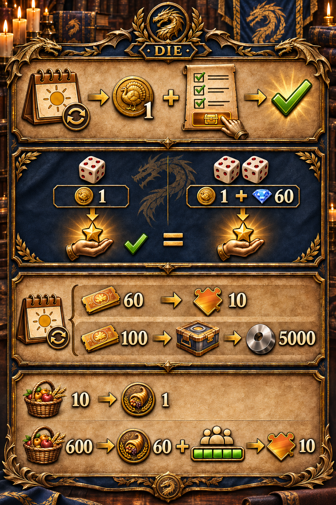
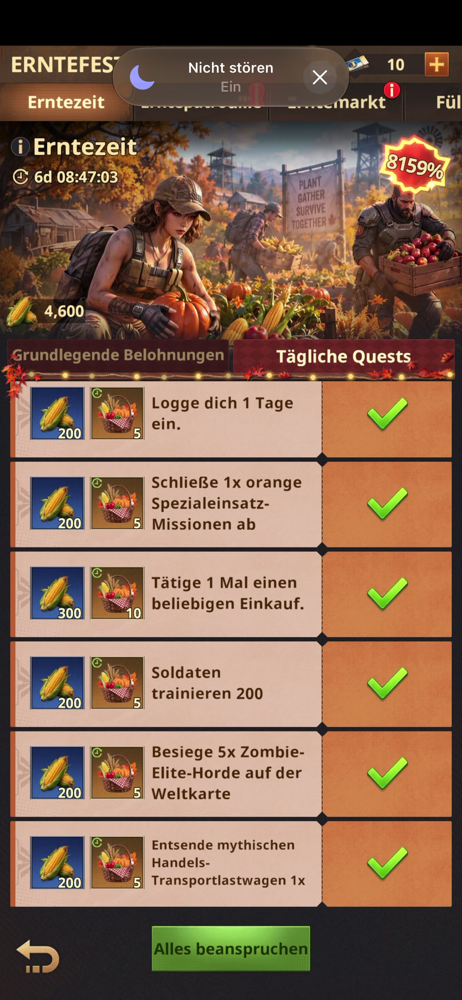
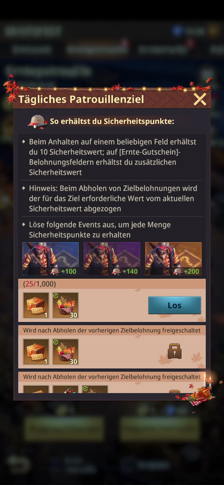
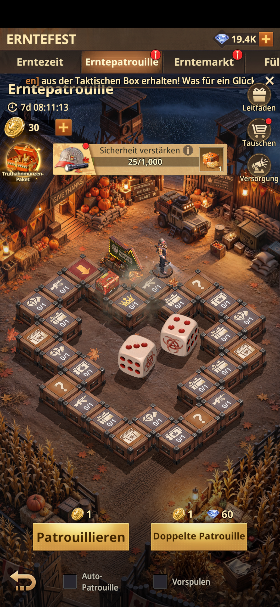
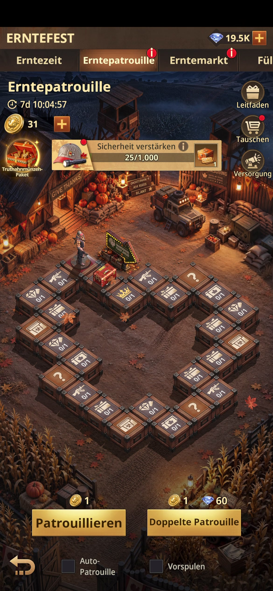
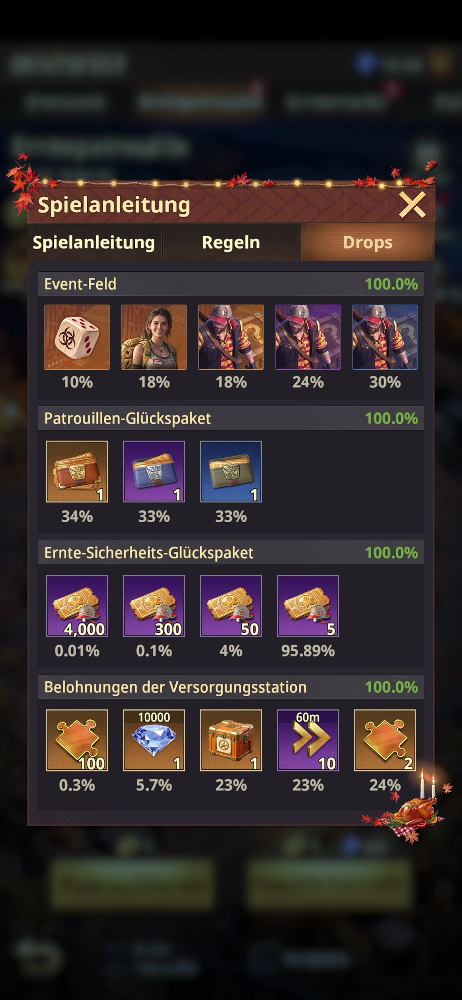
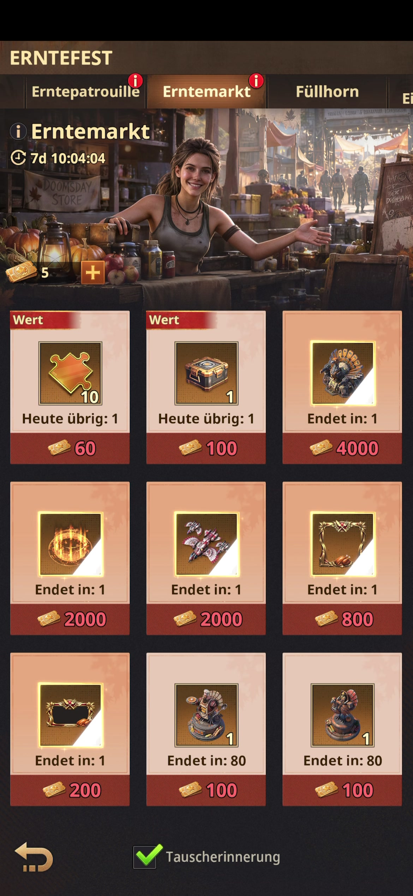
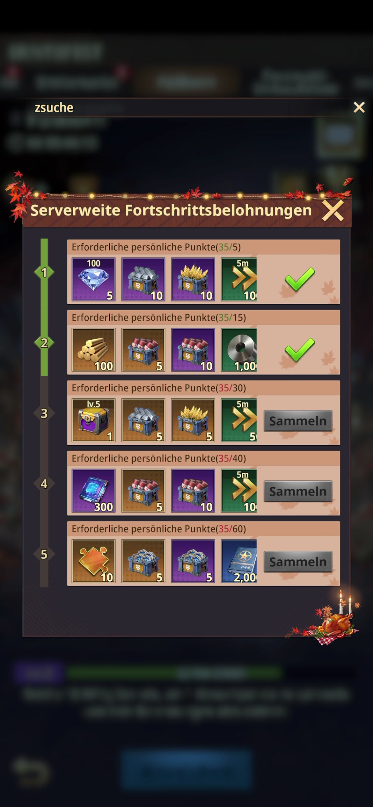
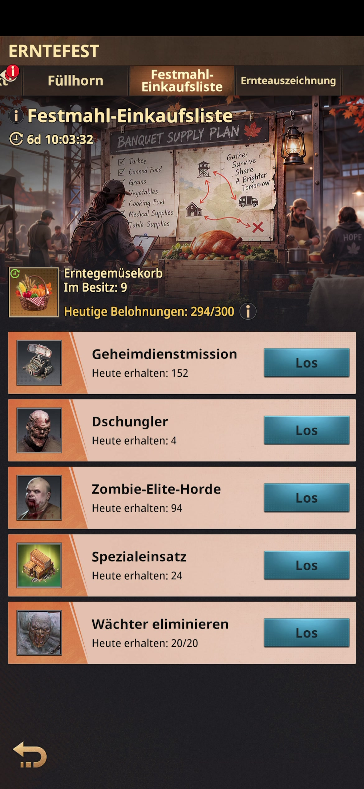

# Événement – Fête des récoltes

## L’essentiel

- Récupérez chaque jour la **pièce de dinde gratuite**, les missions du pass et les récompenses disponibles. Les six missions sans condition d’achat rapportent au total **1 300 points de pass et 30 paniers**.
- **La sécurité restante est conservée après la réinitialisation quotidienne.** Récupérer une récompense de patrouille déduit les points requis. La stratégie d’accumulation de l’événement aérien ne s’applique donc pas automatiquement ici.
- La **double patrouille utilise deux dés : 2–12 cases** pour **1 pièce et 60 diamants**. Elle ne donne **aucune récompense supplémentaire**. La patrouille normale, avec un dé et 1–6 cases, suffit pour planifier les récompenses.
- Au marché des récoltes, **10 fragments universels dorés coûtent 60 tickets par jour** et le **coffre Deluxe au choix coûte 100 tickets**. Ce coffre permet notamment de choisir **5 000 pierres raffinées**, soit le double du rendement de l’échange normal.
- Un **paquet chance de sécurité des récoltes** contient au moins **5 tickets**, avec une moyenne calculée de **7,4945**. Cette valeur s’applique **par paquet**, pas par pièce ni par lancer.
- La liste de provisions affiche un **plafond quotidien de 300 paniers de légumes** ; le quota inutilisé est reporté. **10 paniers donnent 1 point d’abondance**. Les cinq récompenses de serveur exigent aussi **5, 15, 30, 40 et 60 points personnels**.
- Pass, corne d’abondance, liste de provisions et distinctions affichent environ **6 jours et 10 heures**, contre **7 jours et 10 heures** pour la patrouille et le marché. Vérifiez chaque onglet séparément.
- En F2P ou avec un petit budget, privilégiez les matériaux permanents dont vous avez besoin. L’**apparence de base à 4 000 tickets** reste un objectif majeur facultatif sans estimation de coût établie.

> **Conseil pour DIE :** Profitez des sources gratuites et des missions quotidiennes, remettez vos paniers à temps et ne prévoyez de dépenser que les tickets déjà obtenus. Pièces, paquets chance et tickets sont trois quantités distinctes.



## À quoi sert ce guide d’événement ?

Ce guide présente l’**édition réduite de la Fête des récoltes dans Z:Route: Redemption** du **23/11/2026** : période des récoltes, patrouille, marché, corne d’abondance, liste de provisions du banquet et distinctions. Les deux vidéos, la capture et les informations de l’alliance constituent l’ensemble des informations disponibles pour cette édition. Le guide associe une routine quotidienne à une comparaison des récompenses et des packs selon le budget.

## La routine quotidienne

1. Récupérez **la pièce de dinde gratuite** dans la boutique de pièces et consultez les missions du pass dans la période des récoltes.
2. Obtenez des paniers via les **missions de renseignement, le Jungler, les hordes de zombies d’élite, les opérations spéciales et l’élimination de gardiens**. Combinez ces actions avec les objectifs habituels d’alliance et de compétition.
3. Remettez des lots de dix paniers à la corne d’abondance et vérifiez votre contribution personnelle pour les récompenses de serveur. Le dernier palier affiché demande au total **60 points personnels, soit 600 paniers remis** ; le serveur doit aussi atteindre ce palier.
4. Patrouillez, vérifiez les objectifs de sécurité accessibles et videz la réserve de récompenses ainsi que la boîte d’événements après la patrouille automatique.
5. Achetez les offres quotidiennes uniquement pour un objectif précis ; conservez les autres tickets et dépensez-les avant la fermeture du marché.

## Quelle ressource sert à quoi ?

| Ressource | Utilisation | Règle de planification |
| --- | --- | --- |
| Pièces de dinde | Lancer les dés dans la patrouille | Normale : 1 pièce pour un dé ; double : 1 pièce et 60 diamants pour deux dés. |
| Sécurité | Objectifs et récompenses de patrouille | Conservée pendant la nuit, consommée à la récupération d’un objectif. |
| Tickets du marché des récoltes | Achats au marché | Seul le solde disponible constitue un budget certain. |
| Points de pass | Paliers de récompenses des récoltes | Ils appartiennent au pass, pas au solde de tickets. |
| Paniers de légumes | Corne d’abondance et progression du serveur | 10 paniers pour 1 point d’abondance ; complétez les restes à temps. |

## Durées : les onglets ne se terminent pas ensemble

| Zone | Temps restant dans la vidéo | Conséquence |
| --- | --- | --- |
| Période des récoltes / pass | Environ 6 jours et 10 heures | Terminez les missions et récupérez les récompenses plus tôt. |
| Corne d’abondance, liste de provisions, distinctions | Environ 6 jours et 10 heures | Remettez les paniers et récupérez les distinctions à temps. |
| Patrouille et marché des récoltes | Environ 7 jours et 10 heures | Ces onglets affichent environ un jour de plus ; les autres n’en bénéficient pas. |

Le tableau reprend les compteurs de la première vidéo. C’est le compteur actuel de chaque onglet qui fait foi. Terminez donc le pass, la corne d’abondance et les distinctions à temps, même si la patrouille et le marché restent ouverts plus longtemps.

## Période des récoltes : missions et points de pass

La période des récoltes associe des missions quotidiennes à une progression par paliers. Un coffre de pass se débloque à **9 100 points de missions du pass**. Les sept missions suivantes sont documentées :

| Mission quotidienne | Points de pass | Paniers de légumes |
| --- | ---: | ---: |
| Recruter 10 héros | 300 | 5 |
| Se connecter une fois | 200 | 5 |
| Terminer une opération spéciale orange | 200 | 5 |
| Effectuer un achat quelconque | 300 | 10 |
| Entraîner 200 soldats | 200 | 5 |
| Vaincre 5 hordes de zombies d’élite sur la carte | 200 | 5 |
| Envoyer un camion commercial mythique | 200 | 5 |
| **Total des sept missions** | **1 600** | **40** |
| **Total sans la mission d’achat** | **1 300** | **30** |

Les six missions sans achat rapportent **1 300 points de pass et 30 paniers par ensemble quotidien terminé**. Sept ensembles donnent **7 × 1 300 = 9 100 points de pass**, exactement le seuil affiché du coffre. Préparez à temps les cartes de recrutement, une mission orange et un camion mythique.

La mission d’achat rapporte séparément **300 points de pass et 10 paniers**. Ne la comptez pas dans un plan sans achats.



## Patrouille des récoltes : conserver et améliorer la progression

Les pièces de dinde paient les lancers ; le résultat détermine le déplacement. Les cases de récompense donnent des objets et de l’EXP de case. Leur montée en niveau améliore les récompenses. Atteindre ou dépasser la case de départ donne aléatoirement les récompenses et l’EXP de **2 à 4 cases**. Les cases d’événement déclenchent leurs propres événements aléatoires.

### Sécurité et chaîne d’objectifs quotidiens

Chaque arrivée sur une case rapporte **10 points de sécurité**. Les **cases de récompense de tickets des récoltes** en donnent davantage. Trois variantes d’événements ajoutent **100, 140 ou 200 points de sécurité**.

Le premier objectif exige **1 000 points de sécurité** et rapporte **un paquet chance de sécurité et 30 paniers**. Le palier suivant affiche également un paquet et 30 paniers. Les paliers ultérieurs montrent chacun un sac doré, une décoration en forme de canon et 100 paniers. Chaque palier se débloque après récupération du précédent. L’exigence alors affichée s’applique à la prochaine récupération.



Les objectifs changent quotidiennement. Selon les règles, les récompenses récupérables laissées la veille sont envoyées par courrier ; **la sécurité restante est reportée**. Cet envoi ne s’applique plus après la fin de l’événement. Patrouillez régulièrement et récupérez les objectifs accessibles ; un reliquat ne doit pas être dépensé uniquement à cause de la réinitialisation.

La patrouille automatique stocke les récompenses et les événements doivent ensuite être traités manuellement. À la fin, chaque pièce de dinde restante est convertie selon la règle en **30 coffres d’accélération de 5 minutes**, soit **150 minutes**. Ce n’est pas un rendement en tickets.

### Double patrouille : deux dés pour avancer davantage

La **double patrouille lance simultanément deux dés et additionne leurs résultats**. Elle permet de parcourir **2 à 12 cases**, contre **1 à 6** avec un dé. Elle coûte **1 pièce de dinde et 60 diamants**, au lieu d’une pièce pour un tour normal.

**Explication mathématique sous l’hypothèse de dés équilibrés et indépendants :** Le déplacement moyen passe de **3,5 à 7**. Les sommes ont des probabilités différentes : **7** apparaît dans **6 combinaisons sur 36**, tandis que **2** et **12** n’apparaissent chacune que dans **1 sur 36**.

**La double patrouille ne donne aucune récompense supplémentaire.** Les 60 diamants paient le second dé et davantage de déplacement pendant le même tour. Ce mode ne multiplie pas les récompenses. Pour planifier les récompenses et préserver les diamants, utilisez la **patrouille normale**. La sécurité est accordée par arrivée sur une case, pas par case parcourue.





## Paquets chance : ce que confirme la table des gains

| Tickets par paquet chance de sécurité | Probabilité affichée |
| ---: | ---: |
| 5 | 95,89 % |
| 50 | 4 % |
| 300 | 0,1 % |
| 4 000 | 0,01 % |

Moyenne calculée : **5 × 0,9589 + 50 × 0,04 + 300 × 0,001 + 4 000 × 0,0001 = 7,4945 tickets par paquet de sécurité**. Pour 100 paquets, cela donne au moins 500 tickets et une moyenne de 749,45. Avec des tirages indépendants, la probabilité d’au moins un gain de 4 000 tickets serait seulement d’environ **0,995 %**. Ne prévoyez pas ce gain rare dans votre budget.

La vidéo montre aussi un **paquet chance de patrouille** avec 34/33/33 % pour trois icônes de paquets et un ensemble de gains distinct pour la station de ravitaillement. Chaque ensemble est étudié séparément. **7,4945 tickets s’applique par paquet de sécurité** ; ce n’est pas un taux fixe par pièce. Basez vos achats sur le solde réellement obtenu.



## Marché des récoltes : choisir selon ses besoins

| Offre visible | Tickets | Limite affichée | Évaluation |
| --- | ---: | --- | --- |
| 10 fragments universels dorés | 60 | 1 par jour | Pour développer un héros précis ; meilleur taux de fragments visible. |
| Coffre Deluxe au choix | 100 | 1 par jour | Notamment 5 000 pierres raffinées ou 10 fragments universels dorés au choix. |
| Apparence de base au motif de dinde | 4 000 | 1 par événement | Objectif majeur volontaire ; nom et bonus non affichés. |
| Effet lumineux / motif d’avion | 2 000 chacun | 1 chacun par événement | Vérifier les effets et bonus permanents. |
| Cadre d’avatar / plaque de nom | 800 / 200 | 1 chacun par événement | Objectif de collection personnel. |
| Deux décorations d’événement dorées | 100 chacune | 80 chacune par événement | Comparer les niveaux requis et bonus dans le jeu. |
| Décoration d’événement violette | 40 | 80 par événement | Seulement pour une amélioration précise. |
| Coffre de survivant UR | 100 | 30 par événement | Un survivant UR aléatoire ; aucun choix. |
| 10 autres fragments universels dorés | 100 | 30 par événement | 10 tickets par fragment, contre 6 dans l’offre quotidienne. |
| Plan rouge / doré | 300 / 60 | 10 / 100 par événement | Acheter uniquement la qualité nécessaire. |
| 10 cartes de recrutement dorées | 100 | 30 par événement | À comparer avec votre objectif de progression. |
| Coffre de sélection d’ailier UR | 300 | 5 par événement | Choix parmi douze composants d’ailier affichés, selon vos améliorations. |
| 100 bois | 60 | 200 par événement | À comparer avec votre besoin actuel. |
| Accélération de 3 heures | 10 | 200 par événement | 18 minutes par ticket ; usage possible des restes. |
| 5 × 10 000 du matériau affiché | 25 | 20 par événement | Nom du matériau non détaillé. |
| Coffre d’EXP de héros SSR | 8 | 1 000 par événement | Quantité d’EXP selon le niveau de base. |
| Coffre de sélection de ressources SSR | 8 | 1 000 par événement | Choix entre nourriture, métal ou pétrole ; quantité selon le niveau de base. |
| 100 pierres raffinées / 100 livres bleus | 4 chacun | 1 000 chacun par événement | Utiliser les restes pour les matériaux nécessaires. |

Les infobulles ouvertes confirment les coffres indiqués. Les autres noms décrivent les icônes visibles. À prix quotidien inchangé, cinq achats de fragments coûtent **300 tickets pour 50 fragments** et cinq coffres Deluxe quotidiens coûtent **500 tickets**. Les achats quotidiens manqués ne se rattrapent pas simplement le dernier jour.

### Coffre Deluxe : rendement en pierres doublé

Le **coffre Deluxe au choix** propose **10 fragments universels dorés**, **40 objets avec une icône d’engrenage**, **5 000 pierres raffinées**, **un coffre de niveau 5** ou **15 coffres de sélection de ressources**. Les descriptions suivent les choix visibles.

Si vous avez besoin de pierres raffinées, ce coffre quotidien rapporte **5 000 ÷ 100 = 50 pierres par ticket**. L’échange normal de 100 pierres contre 4 tickets donne **25 pierres par ticket**. Le coffre quotidien offre donc **le double de pierres pour le même coût**. Pour les fragments, l’offre quotidienne directe est moins chère : **6 tickets par fragment** au lieu de **10** dans le coffre. Choisissez selon votre besoin : fragments via l’offre quotidienne, pierres de préférence via le coffre Deluxe, puis échange normal avec les tickets restants si nécessaire.

Le **coffre de survivant UR à 100 tickets est aléatoire**. Il est intéressant seulement si de nombreux survivants possibles restent utiles à votre compte. Le **coffre de sélection d’ailier UR à 300 tickets** permet un choix ciblé. Le coffre d’EXP ouvert affiche **7 872 000 EXP** et l’exemple de coffre de nourriture **1 327 800 nourriture** ; ces quantités dépendent du niveau de base enregistré et ne sont pas universelles.




## Packs de pièces et prix réels

| Pack | Pièces | Prix enregistré | Prix par pièce |
| --- | ---: | ---: | ---: |
| Petit pack N vert | 2 | 1,19 € | 0,595 € |
| Pack N bleu | 4 | 2,49 € | 0,623 € |
| Pack R | 8 | 5,99 € | 0,749 € |
| Pack SR | 15 | 11,99 € | 0,799 € |
| Pack SSR | 30 | 23,99 € | 0,800 € |
| Pack UR | 60 | 59,99 € | 1,000 € |
| Pack MR avec objet supplémentaire | 110 | 119,99 € | 1,091 € |
| Pack MR sans cet objet supplémentaire | 110 | 119,99 € | 1,091 € |

La boutique indique un renouvellement quotidien. Les deux versions MR affichent respectivement **5 et 15 achats par jour** ; les petits packs, un chacun. Le pack vert à 1,19 € affiche déjà **0/1** : cela confirme le prix et le contenu, mais pas un achat encore disponible. Les bonus diffèrent ; le tableau compare uniquement les pièces. Les pourcentages publicitaires ne remplacent pas une comparaison de valeur. Les petits packs visibles coûtent moins cher par pièce.

## Conseils selon le budget

| Budget | Plan raisonnable | Limite d’achat |
| --- | --- | --- |
| F2P – 0 € | Récupérer pièce gratuite, missions sans achat et paniers ; viser le coffre Deluxe pour les pierres ou l’offre à 60 tickets pour les fragments. | Prévoir uniquement les tickets obtenus et les achats quotidiens accessibles. |
| Petit budget – jusqu’à 20 € | Utiliser d’abord les gains gratuits ; comparer les petits packs quotidiens disponibles avant un achat volontaire. | L’objectif en tickets reste aléatoire même avec des pièces payées. |
| Achats ciblés – 20 à 100 € | Choisir un objectif principal, respecter les limites et vérifier le solde après chaque patrouille. | Utiliser la patrouille normale ; la double n’ajoute aucune récompense. |
| Gros budget – plus de 100 € | Viser une apparence ou un objet de collection avec un budget total fixe et suivre les tickets réellement obtenus. | Ne pas compter d’avance les gains rares comme budget d’achat. |

## Corne d’abondance et liste de provisions du banquet

La liste affiche **294/300** paniers obtenus ce jour-là ; 294 est un relevé personnel. Le plafond quotidien est de 300 et le quota inutilisé est reporté selon l’infobulle. « Éliminer des gardiens » affiche aussi **20/20**. Les autres compteurs ne constituent pas des plafonds individuels confirmés. Aucun rendement par combat ou mission n’est indiqué.

À la corne d’abondance, **10 paniers de légumes donnent 1 point d’abondance**. Tous les joueurs contribuent au niveau commun du serveur. L’écran des récompenses ajoute une condition essentielle : **chaque récompense de palier exige aussi un minimum de points personnels.**

| Palier de récompense du serveur | Points personnels requis | Total de paniers à remettre | Exemple de récompense affichée |
| --- | ---: | ---: | --- |
| 1 | 5 | 50 | Notamment 5 × 100 diamants |
| 2 | 15 | 150 | Notamment 100 bois et des pierres raffinées |
| 3 | 30 | 300 | Notamment un coffre de niveau 5 |
| 4 | 40 | 400 | Notamment 300 du matériau bleu en forme de puce |
| 5 | 60 | 600 | Notamment 10 fragments universels dorés |

Ces seuils portent sur votre **total de points personnels**, pas sur cinq versements distincts. Il suffit donc de 600 paniers au total pour remplir les cinq conditions personnelles. Le serveur doit aussi débloquer chaque palier commun. Avec **35 points personnels** dans la vidéo, seuls les deux premiers paliers sont verts ; les points personnels ne remplacent pas la progression du serveur.

Les paniers proviennent de la liste de provisions, des missions du pass et des objectifs de patrouille. C’est votre **stock réel de paniers** qui détermine les remises possibles. À titre de calcul, sept quotas quotidiens de 300 entièrement utilisés correspondent à **2 100 paniers, soit 210 points d’abondance**. Neuf paniers restants ne donnent pas encore un point entier.





## Distinctions des récoltes

Les distinctions affichent des seuils de **1 000, 4 000, 10 000, 20 000, 40 000, 70 000 et 100 000**. En haut figure le **camion-restaurant de Thanksgiving**, avec **ATQ des héros +1 600 au niveau maximal**. Ce bonus concerne le niveau maximal. Les **5 600** affichés sont le relevé personnel de la vidéo. Récupérez les récompenses atteintes avant l’expiration du compteur plus court de cet onglet.

## Sources et fiabilité

- Sources principales : vidéos **20261123_155503000_iOS.MP4** (1:32) et **20261123_171253000_iOS.MP4** (1:13 arrondi), du 23/11/2026 ; les images extraites sans modification documentent les écrans du jeu.
- **00:06–00:14 :** packs et pièce gratuite. **00:16–00:25 :** pass. **00:28–00:50 :** règles et table des gains de patrouille.
- **00:53–01:03 :** prix et limites du marché. **01:08–01:10 :** règle de la corne d’abondance. **01:20–01:25 :** sources de paniers. **01:26–01:31 :** distinctions.
- Deuxième vidéo : **00:02–00:07** missions quotidiennes ; **00:10–00:21** sécurité et objectifs ; **00:26–00:27** coffre Deluxe ; **00:30–00:32** coffre de survivant UR ; **00:36–00:38** sélection d’ailier UR ; **00:41–00:49** coffres d’EXP et de ressources ; **00:54–00:57** récompenses du serveur.
- La capture **20261123_174848000_iOS.png** montre deux dés simultanés. Confirmation de l’alliance : la double patrouille additionne les dés pour parcourir 2–12 cases sans récompense supplémentaire.
- Confirmation de l’alliance : cette édition est réduite et le matériel fourni contient les informations disponibles. Le guide ne lui ajoute aucune mécanique, offre ou valeur de l’événement aérien.
- Les probabilités concernent leur ensemble de gains respectif ; une pièce n’est pas assimilée à un paquet de sécurité. Les dés équilibrés et indépendants sont une hypothèse mathématique signalée. Le plan utilise les tickets présents et les objectifs accessibles.

**État au 23/11/2026 · Édition réduite de l’événement.** Après confirmation de sa fin pour DIE, le guide rejoindra les archives des événements.

## Illustration indépendante de la langue

Le schéma au style DIE utilise des pictogrammes, chiffres et symboles mathématiques. Il montre la collecte quotidienne, les récompenses identiques des deux patrouilles, les offres du jour et la contribution requise à la corne d’abondance. Il convient à toutes les langues et au chat d’alliance.

## Message d’alliance à copier

Le message reste sous 1 000 caractères, commandes de mise en forme et sauts de ligne compris.

```html
<color=#FFD700><b>FÊTE DES RÉCOLTES – CHAQUE JOUR</b></color>

<color=#7FFF00><b>GRATUIT :</b></color> Récupérez pièce, missions du pass et récompenses chaque jour. Inutile de garder les pièces jusqu’au dernier jour.

<color=#7FFF00><b>PATROUILLE :</b></color> Récupérez objectifs, gains auto et événements. La sécurité restante passe au jour suivant.

<color=#7FFF00><b>DOUBLE :</b></color> 2 dés (2–12 cases) : 1 pièce + 60 diamants, sans gain supplémentaire. La normale suffit.

<color=#7FFF00><b>MARCHÉ :</b></color> Par jour : 10 fragments dorés pour 60 tickets ou coffre Deluxe pour 100 (choix de 5 000 pierres). Ne comptez que vos tickets acquis.

<color=#7FFF00><b>ABONDANCE :</b></color> 10 paniers = 1 point. Dernière récompense : 600 paniers au total + palier du serveur atteint.

<color=#FFAA00><b>DURÉES :</b></color> Pass, corne d’abondance et distinctions finissent avant patrouille et marché. Vérifiez chaque compteur !
```
