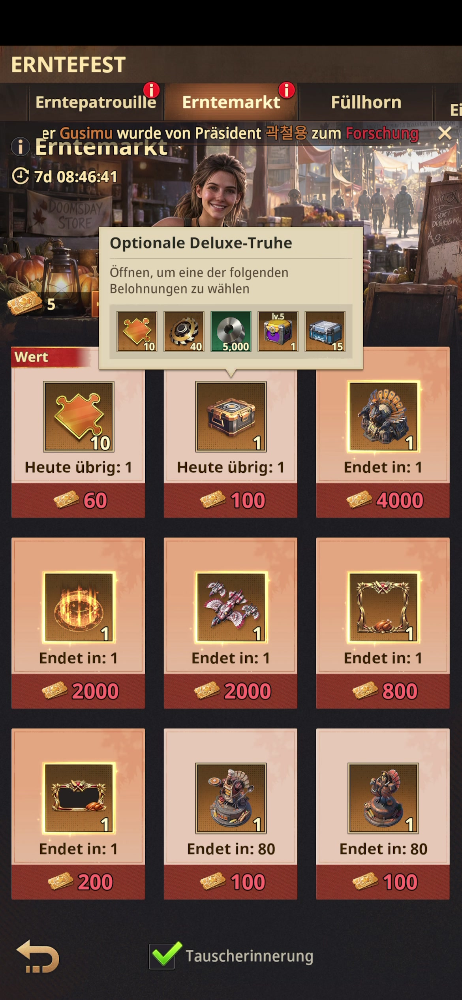

# Événement – Fête des récoltes

## Points clés

- Récupérez **la pièce gratuite, les missions du pass et les récompenses chaque jour**. Les six missions sans achat rapportent **1 300 points de pass et 30 paniers**.
- La double patrouille coûte **1 pièce + 60 diamants**. Deux dés permettent de passer plus souvent par le départ, avec **des bonus de départ supplémentaires et une amélioration plus rapide des cases** ; le total des récompenses n’est pas automatiquement doublé.
- Offres quotidiennes du marché : **10 fragments universels dorés pour 60 tickets** ou un **coffre Deluxe pour 100 tickets**, avec notamment 5 000 pierres raffinées au choix.
- À la corne d’abondance, **600 paniers au total** suffisent pour tous les seuils personnels. Le serveur doit aussi atteindre chaque palier correspondant.


## À quoi sert ce guide d’événement ?

Ce guide présente l’édition réduite de la Fête des récoltes dans Z:Route: Redemption du 23/11/2026 : routine quotidienne, intérêt de la double patrouille et principaux choix de récompenses.

## À faire chaque jour

1. Récupérer la pièce de dinde gratuite et accomplir les missions du pass.
2. Collecter les paniers de la liste de provisions, du pass et des objectifs de patrouille, puis les remettre à la corne d’abondance.
3. Récupérer les objectifs de patrouille atteints ; après la patrouille automatique, récupérer les gains stockés et traiter les événements.
4. Acheter les offres quotidiennes utiles. Les achats manqués ne se rattrapent pas le dernier jour.

Les six missions du pass sans achat sont : recruter 10 héros, se connecter, terminer une opération spéciale orange, entraîner 200 soldats, vaincre 5 hordes d’élite zombies et envoyer un camion commercial mythique. Sept séries quotidiennes complètes donnent **9 100 points de pass** pour le coffre du pass. La mission d’achat séparée ajoute 300 points et 10 paniers.

## Patrouille : normale ou double ?

| Mode | Cases | Coût par tour |
| --- | --- | --- |
| Normale : un dé | 1–6 | 1 pièce de dinde |
| Double : deux dés, résultats additionnés | 2–12 | 1 pièce de dinde + 60 diamants |

Atteindre ou dépasser le départ donne **les récompenses et l’EXP de 2–4 cases aléatoires**. Un niveau de case plus élevé améliore ses récompenses.

Avec des dés équilibrés, la distance moyenne passe de **3,5 à 7 cases par tour**. On peut donc s’attendre, à nombre de pièces égal, à davantage de passages au départ, de bonus associés et à une amélioration plus rapide des cases avec deux dés. Cela ne signifie pas que le total des gains double.

Chaque tour conserve un atterrissage normal valant **10 points de sécurité** ; les cases de tickets et les événements en ajoutent. La sécurité restante est conservée après la réinitialisation quotidienne. Récupérer un objectif déduit la sécurité requise.

**Décision :** Les 60 diamants supplémentaires achètent davantage de déplacement et d’occasions de passer au départ. Si les diamants sont limités, privilégiez la patrouille normale ; la double permet davantage de tours de plateau par pièce. Son gain réel de tickets et sa rentabilité en diamants ne sont pas chiffrés.


## Marché des récoltes : bien dépenser

| Offre | Tickets | Limite | Intérêt |
| --- | ---: | --- | --- |
| 10 fragments universels dorés | 60 | 1 par jour | Moins chers que le choix de fragments dans le coffre Deluxe. |
| Coffre Deluxe au choix | 100 | 1 par jour | Notamment 5 000 pierres raffinées au choix. |
| Coffre de survivant UR | 100 | 30 par événement | Survivant aléatoire ; aucun choix. |
| Coffre de sélection d’ailier UR | 300 | 5 par événement | Choix ciblé parmi douze composants affichés. |

Pour les pierres, le coffre Deluxe donne **50 pierres par ticket**, contre **25** pour l’échange normal. Pour les fragments dorés, l’offre quotidienne directe est moins chère : **6 tickets par fragment** au lieu de **10** via le coffre.

Les gains de tickets sont aléatoires : ne prévoyez que les tickets déjà acquis. L’apparence de base à 4 000 tickets reste un objectif majeur facultatif ; ses bonus ne sont pas établis par les vidéos.



## Corne d’abondance : objectifs personnels et communs

**10 paniers donnent 1 point d’abondance.** Chaque récompense du serveur exige à la fois le palier commun et votre contribution personnelle minimale :

| Palier du serveur | Points personnels | Total de paniers remis |
| --- | ---: | ---: |
| 1 | 5 | 50 |
| 2 | 15 | 150 |
| 3 | 30 | 300 |
| 4 | 40 | 400 |
| 5 | 60 | 600 |

Les contributions se cumulent : **600 paniers au total** remplissent les cinq seuils personnels. Le dernier palier comprend notamment 10 fragments universels dorés. Les points personnels ne remplacent pas la progression du serveur.

La liste de provisions permet jusqu’à **300 paniers** par jour ; le quota inutilisé est reporté. Les missions du pass et objectifs de patrouille donnent aussi des paniers.


## Délais et achats

- Dans l’édition filmée, pass, corne d’abondance, liste de provisions et distinctions finissent environ un jour avant patrouille et marché. Vérifiez chaque onglet et récupérez les récompenses à temps.
- Les petits packs de pièces de la boutique filmée coûtent moins cher par pièce que les grands. Vérifiez limites quotidiennes et disponibilité ; les pièces payées ne garantissent aucun solde précis de tickets.

## Sources et mise à jour

Les sources sont les deux vidéos du jeu et la capture du 23/11/2026. Les [règles du jeu, notamment le point 4](../../../../media/knowledge/Events/Event_02_Erntefest_Regeln.jpg), confirment le bonus de départ. L’hypothèse de passages plus fréquents suppose des dés équilibrés ; aucun gain supplémentaire fixe de tickets n’est établi. Mise à jour : 24/11/2026.

## Annonce d’alliance à copier

Moins de 1 000 caractères, formatage et retours à la ligne compris.

```html
<color=#FFD700><b>FÊTE DES RÉCOLTES – CHAQUE JOUR</b></color>

<color=#7FFF00><b>GRATUIT :</b></color> Récupérez pièce, missions du pass et récompenses chaque jour.

<color=#7FFF00><b>PATROUILLE :</b></color> Récupérez objectifs, gains auto et événements. La sécurité restante passe au jour suivant.

<color=#7FFF00><b>DOUBLE :</b></color> 1 pièce + 60 diamants : 2 dés, 2–12 cases. Permet plus de bonus de départ et une amélioration plus rapide des cases ; pas de total doublé garanti.

<color=#7FFF00><b>MARCHÉ :</b></color> Par jour : 10 fragments dorés pour 60 tickets ou Deluxe pour 100 (choix de 5 000 pierres). Ne comptez que les tickets acquis.

<color=#7FFF00><b>ABONDANCE :</b></color> 10 paniers = 1 point. Dernier gain : 600 paniers au total + palier du serveur atteint.

<color=#FFAA00><b>DURÉES :</b></color> Pass, corne d’abondance et distinctions finissent avant patrouille et marché. Vérifiez chaque compteur !
```
