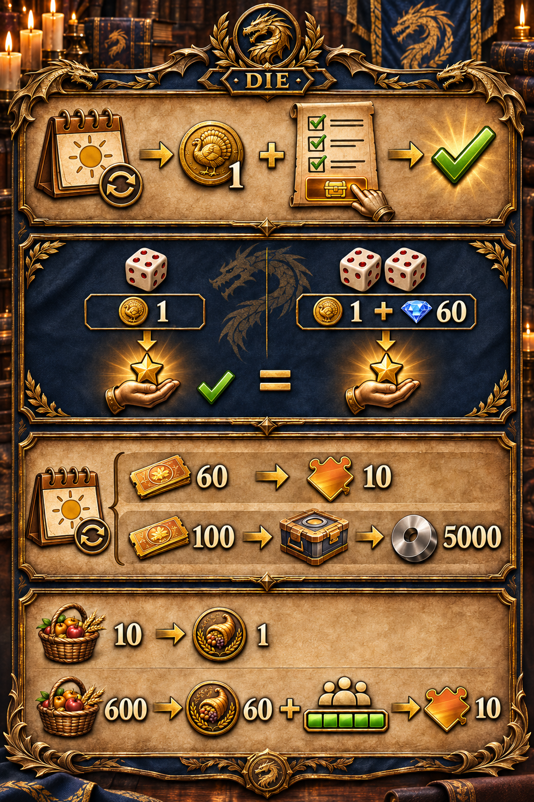
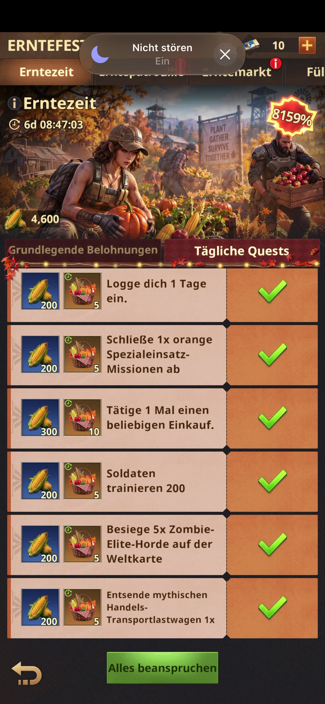
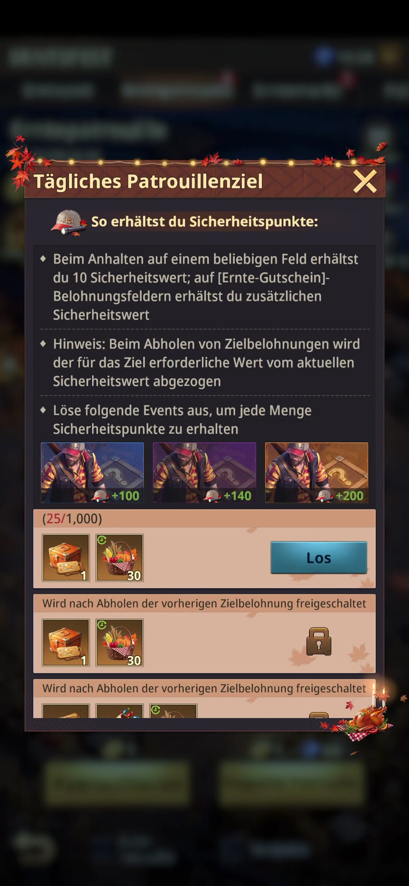
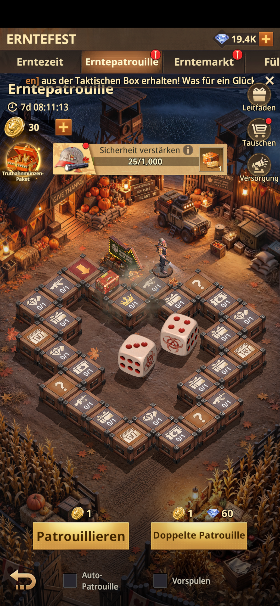
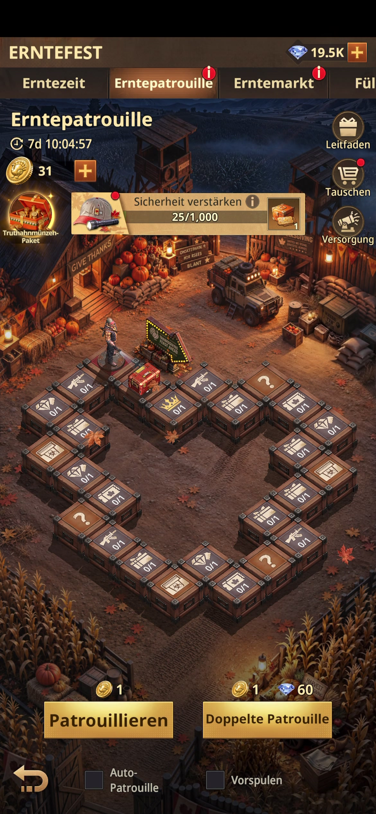
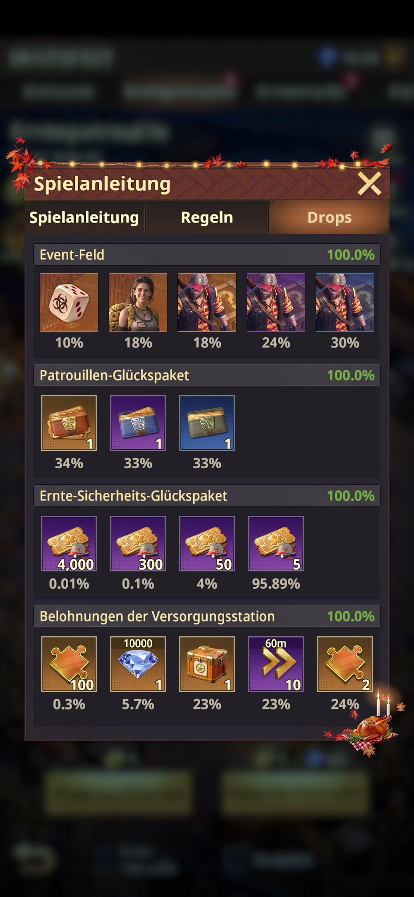
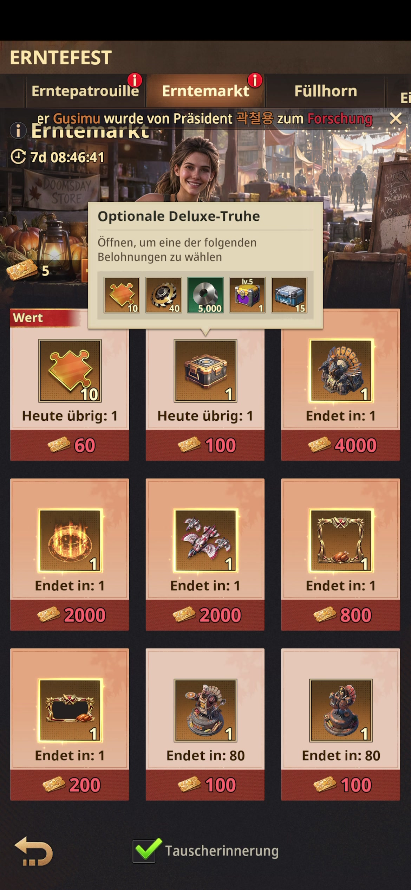
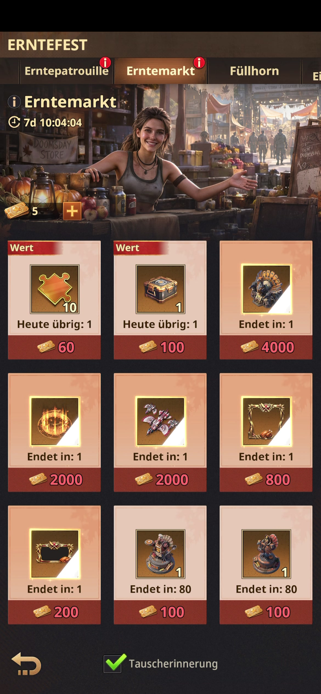
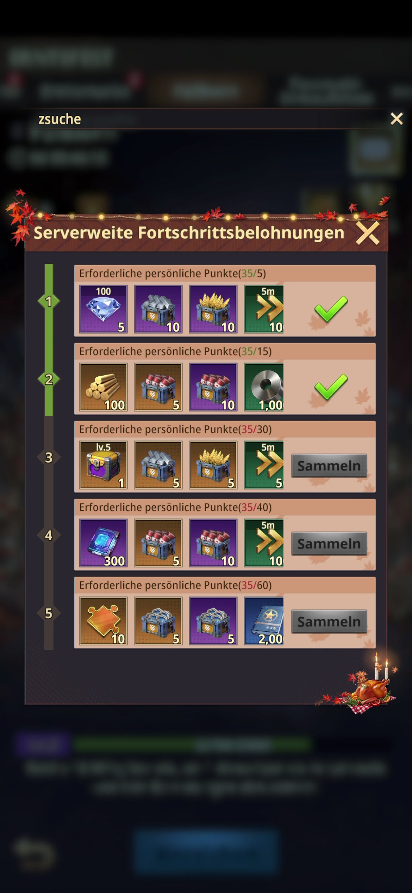
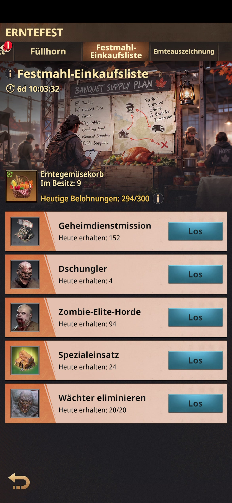

# Evento – Festival da Colheita

## O essencial

- Resgate diariamente a **moeda de peru grátis**, as missões do passe e as recompensas disponíveis. As seis missões sem exigência de compra dão **1.300 pontos de passe e 30 cestas** no total.
- **A segurança restante é mantida após a reinicialização diária.** Resgatar uma meta da patrulha desconta os pontos exigidos. Por isso, a estratégia de acumular moedas do evento aéreo não se aplica automaticamente aqui.
- A **patrulha dupla usa dois dados: 2–12 passos** por **1 moeda e 60 diamantes**. Ela **não aumenta as recompensas**. A patrulha normal, com um dado e 1–6 passos, basta para planejar os prêmios.
- No mercado da colheita, **10 fragmentos universais dourados custam 60 bilhetes por dia** e o **Baú Deluxe de Seleção custa 100 bilhetes**. Uma das opções é **5.000 Pedras Refinadas**, o dobro do rendimento da troca normal.
- Um **pacote da sorte de segurança da colheita** contém pelo menos **5 bilhetes**, com média calculada de **7,4945**. Esse valor é **por pacote**, não por moeda ou lançamento de dado.
- A lista de suprimentos mostra um **limite diário de 300 cestas de vegetais**; o saldo não utilizado do limite passa ao dia seguinte. **10 cestas dão 1 ponto de fartura**. As cinco recompensas do servidor também exigem **5, 15, 30, 40 e 60 pontos pessoais**.
- Passe, cornucópia, lista de suprimentos e condecorações mostram cerca de **6 dias e 10 horas**, enquanto patrulha e mercado mostram **7 dias e 10 horas** restantes. Confira cada aba separadamente.
- No F2P e com pouco orçamento, priorize os materiais permanentes de que precisa. A **aparência de base por 4.000 bilhetes** é uma meta grande opcional, sem previsão de custo comprovada.

> **Recomendação para a DIE:** Aproveite as fontes grátis e as missões diárias, entregue as cestas a tempo e planeje apenas os bilhetes que já tem. Moedas, pacotes da sorte e bilhetes são três quantidades diferentes.



## Para que serve este guia do evento?

Este guia explica a **edição reduzida do Festival da Colheita em Z:Route: Redemption** de **23/11/2026**: época da colheita, patrulha, mercado, cornucópia, lista de suprimentos do banquete e condecorações. Os dois vídeos, a captura e as informações da aliança formam todo o material disponível desta edição. O guia reúne uma rotina diária e comparações de recompensas e pacotes para diferentes orçamentos.

## A rotina diária

1. Resgate **uma moeda de peru grátis** na loja de moedas e confira as missões do passe na época da colheita.
2. Obtenha cestas em **missões de inteligência, Jungler, hordas de zumbis de elite, operações especiais e eliminação de guardiões**. Sempre que possível, combine essas ações com os objetivos normais da aliança e da competição.
3. Entregue grupos completos de dez cestas na cornucópia e confira sua contribuição pessoal para as recompensas do servidor. A última etapa mostrada exige **60 pontos pessoais, ou 600 cestas entregues** no total; o servidor também precisa atingir essa etapa.
4. Patrulhe, confira as metas de segurança disponíveis e resgate tanto os prêmios armazenados quanto os eventos após a patrulha automática.
5. Compre ofertas diárias apenas para uma meta definida; guarde os outros bilhetes e distribua-os antes de o mercado fechar.

## Qual recurso serve para quê?

| Recurso | Uso | Regra de planejamento |
| --- | --- | --- |
| Moedas de peru | Lançar dados na patrulha da colheita | Normal: 1 moeda por um dado; dupla: 1 moeda e 60 diamantes por dois dados. |
| Segurança | Metas da patrulha e suas recompensas | Passa ao dia seguinte e é consumida ao resgatar uma meta. |
| Bilhetes do mercado da colheita | Compras no mercado | Apenas o saldo atual é um orçamento garantido. |
| Pontos de passe | Etapas de recompensas da época da colheita | Pertencem ao passe, não ao saldo de bilhetes. |
| Cestas de vegetais | Cornucópia e progresso coletivo do servidor | 10 cestas por 1 ponto de fartura; complete as sobras a tempo. |

## Prazos: as abas não acabam ao mesmo tempo

| Área | Tempo restante na gravação | Consequência |
| --- | --- | --- |
| Época da colheita / passe | Cerca de 6 dias e 10 horas | Termine as missões e resgate os prêmios do passe antes. |
| Cornucópia, lista de suprimentos e condecorações | Cerca de 6 dias e 10 horas | Entregue cestas e resgate os prêmios conquistados a tempo. |
| Patrulha e mercado da colheita | Cerca de 7 dias e 10 horas | Essas abas mostram cerca de um dia a mais; as outras não recebem essa extensão. |

A tabela registra os contadores do primeiro vídeo. O que vale é o contador atual de cada aba. Termine o passe, a cornucópia e as condecorações a tempo, mesmo que patrulha e mercado continuem disponíveis.

## Época da colheita: missões diárias e pontos de passe

A época da colheita combina missões diárias com uma trilha de recompensas por etapas. Um baú de passe é liberado aos **9.100 pontos de missões do passe**. Estas sete missões estão documentadas:

| Missão diária | Pontos de passe | Cestas de vegetais |
| --- | ---: | ---: |
| Recrutar 10 heróis | 300 | 5 |
| Entrar no jogo uma vez | 200 | 5 |
| Concluir uma operação especial laranja | 200 | 5 |
| Fazer uma compra qualquer | 300 | 10 |
| Treinar 200 soldados | 200 | 5 |
| Derrotar 5 hordas de zumbis de elite no mapa | 200 | 5 |
| Enviar um caminhão comercial mítico | 200 | 5 |
| **Total das sete missões** | **1.600** | **40** |
| **Total sem a missão de compra** | **1.300** | **30** |

As seis missões sem compra dão **1.300 pontos de passe e 30 cestas por conjunto diário completo**. Sete conjuntos dão **7 × 1.300 = 9.100 pontos de passe**, exatamente o limite mostrado para o baú. Prepare a tempo as cartas de recrutamento, uma missão laranja e um caminhão mítico.

A missão de compra dá separadamente **300 pontos de passe e 10 cestas**. Ela não entra no planejamento sem compras.



## Patrulha da colheita: preservar o progresso e melhorar casas

As moedas de peru pagam os lançamentos; o resultado determina os passos. Casas de recompensa dão itens e EXP da casa. Níveis mais altos melhoram os prêmios. Alcançar ou passar pela casa inicial concede recompensas e EXP de **2 a 4 casas** aleatórias. Casas de evento ativam eventos aleatórios próprios.

### Segurança e sequência diária de metas

Cada parada em qualquer casa dá **10 de segurança**. As **casas de recompensa com bilhetes da colheita** dão segurança adicional. Três variantes de evento concedem mais **100, 140 ou 200 pontos de segurança**.

A primeira meta exige **1.000 de segurança** e dá **um pacote da sorte de segurança da colheita e 30 cestas**. A etapa seguinte também mostra um pacote e 30 cestas. Etapas posteriores exibem uma bolsa dourada, uma decoração em forma de canhão e 100 cestas cada. Cada etapa só abre depois do resgate da anterior. A exigência exibida após a liberação vale para o próximo resgate.



As metas mudam diariamente. Pelas regras, recompensas disponíveis e não resgatadas no dia anterior são enviadas por correio; **a segurança restante é mantida**. Esse envio não se aplica após o evento terminar. Patrulhe regularmente e resgate metas acessíveis; não é preciso gastar o saldo só porque a reinicialização diária está chegando.

A patrulha automática armazena recompensas e os eventos precisam ser resolvidos manualmente depois. Ao final, cada moeda de peru restante é convertida, segundo a regra, em **30 baús de aceleração de 5 minutos**, ou **150 minutos**. Isso não é um rendimento em bilhetes.

### Patrulha dupla: dois dados para mais passos

Na **patrulha dupla, dois dados são lançados juntos e os resultados são somados**. Assim, são possíveis **2 a 12 passos**, contra **1 a 6** com um dado. O custo é **1 moeda de peru e 60 diamantes**, em vez de uma moeda no turno normal.

**Explicação matemática supondo dados justos e independentes:** A média de passos passa de **3,5 para 7**. As somas têm probabilidades diferentes: **7** aparece em **6 das 36** combinações; **2** e **12** aparecem em apenas **1 das 36** cada.

**A patrulha dupla não aumenta as recompensas.** Os 60 diamantes extras pagam o segundo dado e mais passos no mesmo turno. Esse modo não multiplica os prêmios. Para planejar recompensas e preservar diamantes, use a **patrulha normal**. Pela regra, a segurança é concedida por parada, não por passo percorrido.





## Pacotes da sorte: o que a tabela confirma

| Bilhetes por pacote da sorte de segurança | Probabilidade exibida |
| ---: | ---: |
| 5 | 95,89% |
| 50 | 4% |
| 300 | 0,1% |
| 4.000 | 0,01% |

Média calculada: **5 × 0,9589 + 50 × 0,04 + 300 × 0,001 + 4.000 × 0,0001 = 7,4945 bilhetes por pacote de segurança**. Para 100 pacotes, isso significa pelo menos 500 bilhetes e média de 749,45. Com sorteios independentes, a chance de pelo menos um resultado de 4.000 bilhetes seria apenas cerca de **0,995%**. Não inclua esse prêmio raro no orçamento.

A gravação também mostra um **pacote da sorte da patrulha** com 34/33/33% para três ícones de pacote e um conjunto separado de prêmios da estação de suprimentos. Cada conjunto é considerado separadamente. **7,4945 bilhetes vale por pacote de segurança**; não é uma taxa fixa por moeda. Baseie as compras no saldo real de bilhetes.



## Mercado da colheita: recompensas conforme sua necessidade

| Oferta visível | Bilhetes | Limite registrado | Avaliação |
| --- | ---: | --- | --- |
| 10 fragmentos universais dourados | 60 | 1 por dia | Para desenvolver um herói específico; melhor taxa de fragmentos visível. |
| Baú Deluxe de Seleção | 100 | 1 por dia | Entre as opções, 5.000 Pedras Refinadas ou 10 fragmentos universais dourados. |
| Aparência de base com tema de peru | 4.000 | 1 no evento | Apenas como grande meta consciente; nome e bônus não aparecem. |
| Efeito luminoso / visual de avião | 2.000 cada | 1 de cada no evento | Confira efeitos e bônus permanentes primeiro. |
| Moldura de avatar / placa de nome | 800 / 200 | 1 de cada no evento | Meta pessoal de coleção. |
| Duas decorações douradas do evento | 100 cada | 80 de cada no evento | Compare os níveis necessários e os bônus no jogo. |
| Decoração roxa do evento | 40 | 80 no evento | Só para uma melhoria específica. |
| Baú de Sobrevivente UR | 100 | 30 no evento | Um sobrevivente UR aleatório; sem escolha. |
| Outros 10 fragmentos universais dourados | 100 | 30 no evento | 10 bilhetes por fragmento, contra 6 na oferta diária. |
| Projeto vermelho / dourado | 300 / 60 | 10 / 100 no evento | Compre apenas a qualidade necessária. |
| 10 cartas de recrutamento douradas | 100 | 30 no evento | Compare com sua meta de desenvolvimento. |
| Baú de Seleção de Wingman UR | 300 | 5 no evento | Escolha entre doze componentes exibidos conforme suas melhorias. |
| 100 de madeira | 60 | 200 no evento | Compare com a falta atual de materiais. |
| Aceleração de 3 horas | 10 | 200 no evento | 18 minutos por bilhete; possível uso das sobras. |
| 5 × 10.000 do material exibido | 25 | 20 no evento | O nome do material não é detalhado. |
| Baú de EXP de Herói SSR | 8 | 1.000 no evento | A quantidade de EXP depende do nível da base. |
| Baú de Seleção de Recursos SSR | 8 | 1.000 no evento | Escolha entre comida, metal ou petróleo; quantidade depende do nível da base. |
| 100 Pedras Refinadas / 100 livros azuis | 4 cada | 1.000 de cada no evento | Use sobras só para materiais necessários. |

As descrições abertas confirmam os baús indicados. Os demais nomes descrevem os ícones visíveis. Mantido o preço diário, cinco compras de fragmentos custam **300 bilhetes por 50 fragmentos**, e cinco Baús Deluxe diários custam **500 bilhetes**. Compras diárias perdidas não podem simplesmente ser recuperadas no último dia.

### Baú Deluxe: rendimento de pedras dobrado

O **Baú Deluxe de Seleção** permite escolher **10 fragmentos universais dourados**, **40 itens com ícone de engrenagem**, **5.000 Pedras Refinadas**, **um baú de nível 5** ou **15 baús de seleção de recursos**. As descrições seguem as opções visíveis.

Se você precisa de Pedras Refinadas, o baú diário dá **5.000 ÷ 100 = 50 pedras por bilhete**. A troca normal de 100 pedras por 4 bilhetes dá **25 pedras por bilhete**. Portanto, o Baú Deluxe diário oferece **o dobro de valor em pedras**. Para fragmentos, a oferta diária direta é mais barata: **6 bilhetes por fragmento** em vez de **10** pelo baú. Escolha conforme sua necessidade: fragmentos na oferta diária, pedras de preferência pelo Deluxe e bilhetes restantes na troca normal de pedras, se necessário.

O **Baú de Sobrevivente UR por 100 bilhetes é aleatório**. Só vale a pena se muitos dos possíveis sobreviventes ainda forem úteis para sua conta. O **Baú de Seleção de Wingman UR por 300 bilhetes** permite uma escolha direcionada. O baú de EXP aberto mostra **7.872.000 EXP**, e o exemplo de baú de comida, **1.327.800 de comida**; são valores do nível de base gravado, não quantidades universais.





## Pacotes de moedas e preços reais

| Pacote | Moedas | Preço registrado | Preço por moeda |
| --- | ---: | ---: | ---: |
| Pequeno pacote N verde | 2 | 1,19 € | 0,595 € |
| Pacote N azul | 4 | 2,49 € | 0,623 € |
| Pacote R | 8 | 5,99 € | 0,749 € |
| Pacote SR | 15 | 11,99 € | 0,799 € |
| Pacote SSR | 30 | 23,99 € | 0,800 € |
| Pacote UR | 60 | 59,99 € | 1,000 € |
| Pacote MR com item extra | 110 | 119,99 € | 1,091 € |
| Pacote MR sem esse item extra | 110 | 119,99 € | 1,091 € |

A loja informa que os pacotes são renovados diariamente. As duas versões MR mostram **5 e 15 compras por dia**, respectivamente; os menores mostram uma cada. O pacote verde de 1,19 € já está marcado como **0/1**: isso confirma preço e conteúdo, mas não uma compra ainda disponível. Os extras variam; a tabela compara apenas moedas. Percentuais promocionais não substituem a comparação de valor. Os pacotes pequenos visíveis custam menos por moeda.

## Recomendação por orçamento

| Orçamento | Plano sensato | Limite de gastos |
| --- | --- | --- |
| F2P – 0 € | Colete moeda grátis, missões sem compra e cestas; busque o Deluxe diário para pedras ou a oferta de 60 bilhetes para fragmentos. | Planeje só com bilhetes coletados e compras diárias acessíveis. |
| Pequeno orçamento – até 20 € | Use os ganhos grátis primeiro; compare os pequenos pacotes diários disponíveis antes de comprar moedas conscientemente. | A meta de bilhetes continua aleatória mesmo com moedas pagas. |
| Compras direcionadas – 20 a 100 € | Escolha uma meta principal, respeite o limite diário e confira o saldo após cada patrulha. | Use a patrulha normal; a dupla não dá bônus de recompensa. |
| Grandes gastos – acima de 100 € | Busque aparência ou colecionável apenas com orçamento total fixo e compare os bilhetes reais com a meta. | Não conte prêmios raros como verba de compra antecipada. |

## Cornucópia e lista de suprimentos do banquete

A lista mostra **294/300** cestas recebidas naquele dia; 294 é um registro pessoal intermediário. O limite diário é 300 e o saldo não usado passa ao dia seguinte, segundo a descrição. “Eliminar guardiões” também mostra **20/20**. Os outros contadores não são limites individuais comprovados. Não há rendimento por batalha ou missão especificado.

Na cornucópia, **10 cestas de vegetais dão 1 ponto de fartura**. Todos os jogadores contribuem para o nível coletivo do servidor. A tela de prêmios acrescenta uma condição importante: **cada recompensa de etapa também exige um mínimo de pontos pessoais.**

| Etapa de recompensa do servidor | Pontos pessoais exigidos | Total de cestas a entregar | Exemplo de recompensa exibida |
| --- | ---: | ---: | --- |
| 1 | 5 | 50 | Inclui 5 × 100 diamantes |
| 2 | 15 | 150 | Inclui 100 de madeira e Pedras Refinadas |
| 3 | 30 | 300 | Inclui um baú de nível 5 |
| 4 | 40 | 400 | Inclui 300 do material azul em forma de chip |
| 5 | 60 | 600 | Inclui 10 fragmentos universais dourados |

Os limites se referem ao seu **total de pontos pessoais**, não a cinco pagamentos separados. Assim, 600 cestas no total atendem aos cinco requisitos pessoais. O servidor também precisa liberar cada etapa coletiva. Com **35 pontos pessoais** na gravação, apenas as duas primeiras etapas estão verdes; pontos pessoais não substituem o progresso do servidor.

As cestas vêm da lista de suprimentos, das missões do passe e das metas da patrulha. O que determina a entrega é seu **saldo real de cestas**. Como exemplo de cálculo, sete limites diários de 300 totalmente usados equivalem a **2.100 cestas ou 210 pontos de fartura**. Nove cestas restantes ainda não dão um ponto inteiro.





## Condecorações da colheita

A trilha mostra limites em **1.000, 4.000, 10.000, 20.000, 40.000, 70.000 e 100.000**. No topo aparece o **food truck de Ação de Graças**, com **ATQ dos heróis +1.600 no nível máximo**. Esse bônus se refere ao nível máximo. Os **5.600** exibidos são o registro pessoal da gravação. Resgate os prêmios alcançados antes de acabar o contador mais curto dessa aba.

## Fontes e confiabilidade

- Fontes principais: vídeos **20261123_155503000_iOS.MP4** (1:32) e **20261123_171253000_iOS.MP4** (1:13 arredondado), de 23/11/2026; quadros sem alterações documentam as telas do jogo.
- **00:06–00:14:** pacotes e moeda grátis. **00:16–00:25:** passe. **00:28–00:50:** regras da patrulha e tabela de prêmios.
- **00:53–01:03:** preços e limites do mercado. **01:08–01:10:** regra da cornucópia. **01:20–01:25:** fontes de cestas. **01:26–01:31:** condecorações.
- Segundo vídeo: **00:02–00:07** missões diárias; **00:10–00:21** segurança e metas; **00:26–00:27** Deluxe; **00:30–00:32** Baú de Sobrevivente UR; **00:36–00:38** seleção de Wingman UR; **00:41–00:49** baús de EXP e recursos; **00:54–00:57** prêmios do servidor.
- A captura **20261123_174848000_iOS.png** mostra dois dados simultâneos. Confirmação da aliança: a patrulha dupla soma os dados para dar 2–12 passos e não aumenta as recompensas.
- Confirmação da aliança: esta edição é reduzida e o material fornecido contém as informações disponíveis. O guia não importa mecânicas, ofertas ou valores extras do evento aéreo.
- As probabilidades pertencem aos seus respectivos conjuntos de prêmios; uma moeda não equivale a um pacote de segurança. Dados justos e independentes são identificados como hipótese matemática. O plano usa bilhetes existentes e metas acessíveis.

**Atualizado em 23/11/2026 · Edição reduzida do evento.** Após a confirmação do fim para a DIE, o guia será incluído no arquivo de eventos.

## Ilustração válida para todos os idiomas

O esquema no estilo DIE usa pictogramas, números e sinais matemáticos. Mostra os resgates diários, os prêmios iguais dos dois modos de patrulha, as ofertas diárias e a contribuição necessária à cornucópia. Pode ser usado em todas as versões de idioma e no chat da aliança.

## Mensagem da aliança para copiar

O texto fica abaixo de 1.000 caracteres, incluindo comandos de formatação e quebras de linha.

```html
<color=#FFD700><b>FESTIVAL DA COLHEITA – RESGATE DIÁRIO</b></color>

<color=#7FFF00><b>GRÁTIS:</b></color> Resgate moeda, missões do passe e prêmios todo dia. Não é preciso guardar moedas até o último dia.

<color=#7FFF00><b>PATRULHA:</b></color> Resgate metas, prêmios auto e eventos. A segurança restante passa para o dia seguinte.

<color=#7FFF00><b>DUPLA:</b></color> 2 dados (2–12 passos) por 1 moeda + 60 diamantes; sem prêmio extra. A normal basta.

<color=#7FFF00><b>MERCADO:</b></color> Por dia: 10 fragmentos dourados por 60 bilhetes ou Deluxe por 100 (escolha 5.000 pedras). Planeje só os bilhetes que já tem.

<color=#7FFF00><b>FARTURA:</b></color> 10 cestas = 1 ponto. Última recompensa: 600 cestas no total + etapa do servidor atingida.

<color=#FFAA00><b>PRAZOS:</b></color> Passe, cornucópia e condecorações acabam antes da patrulha e do mercado. Confira cada contador!
```
