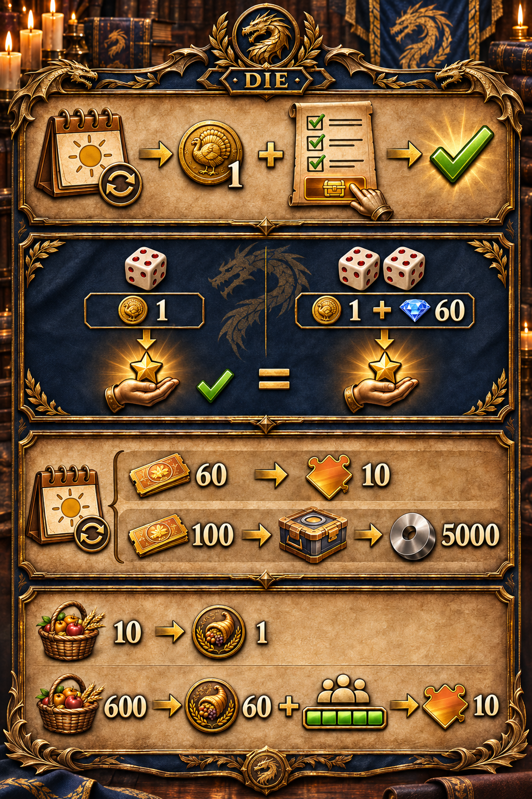
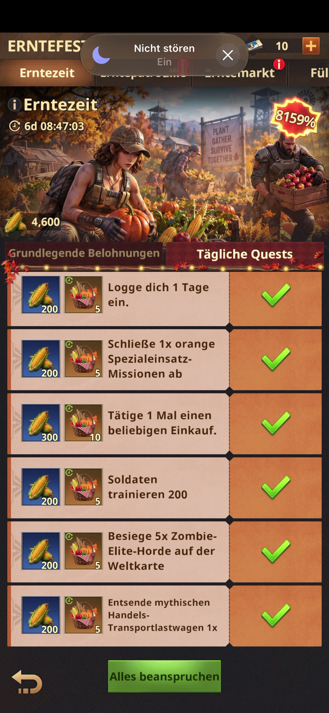
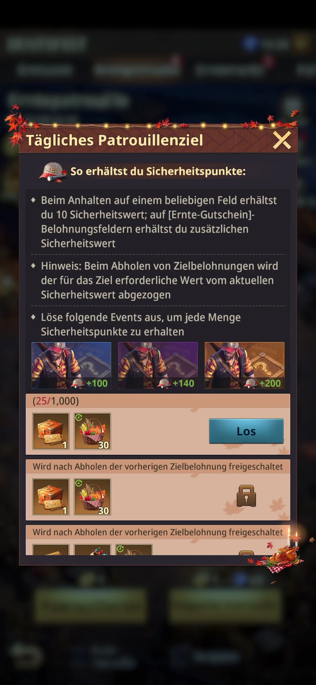
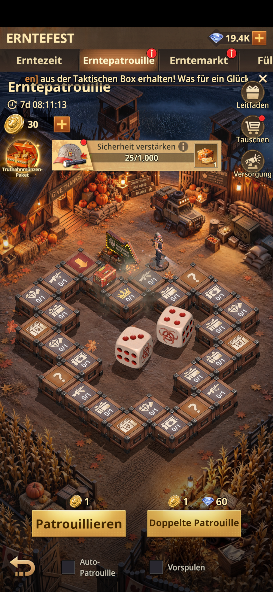
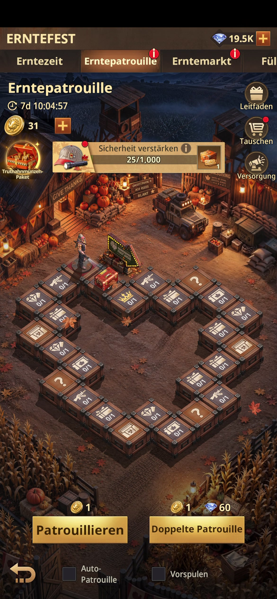
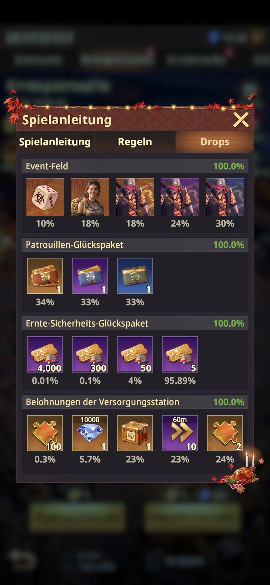
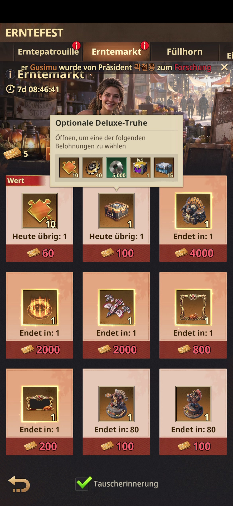
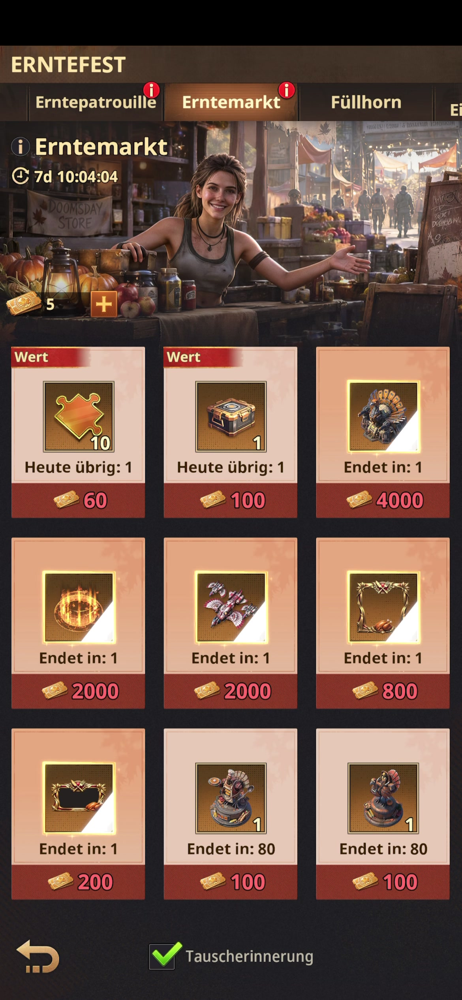
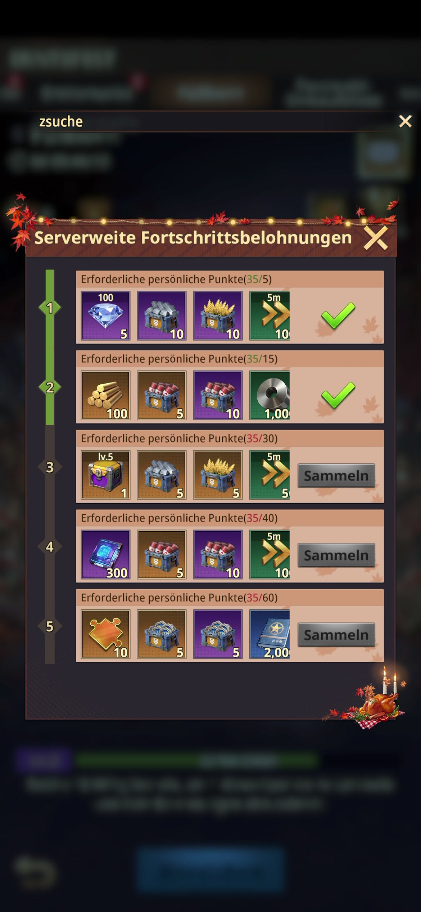
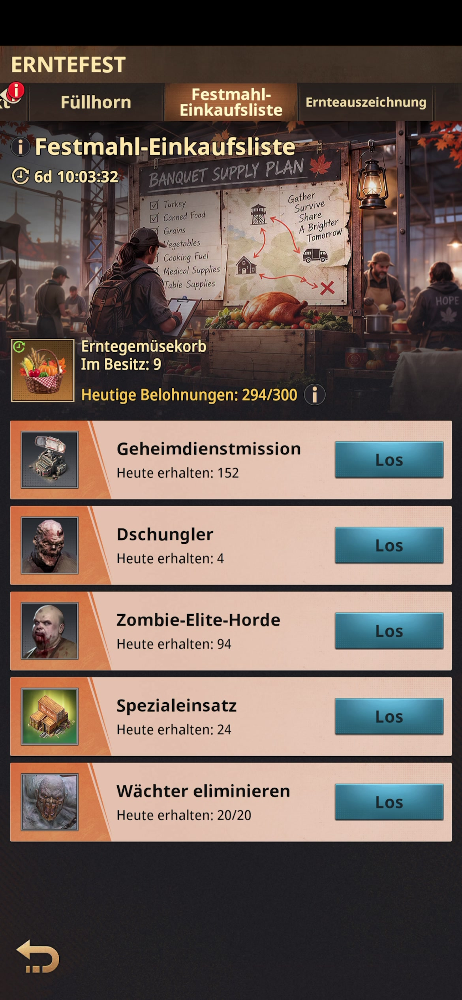

# Событие — Праздник урожая

## Главное

- Ежедневно забирайте **бесплатную монету индейки**, задания пропуска и доступные награды. Шесть заданий без условия покупки дают в сумме **1 300 очков пропуска и 30 корзин**.
- **Остаток безопасности сохраняется после ежедневного сброса.** При получении награды цели списывается требуемое число очков. Поэтому стратегию накопления из авиационного события нельзя автоматически переносить сюда.
- В режиме **двойного патруля используются два кубика: 2–12 шагов** за **1 монету и 60 алмазов**. Он **не увеличивает награды**. Для планирования наград достаточно обычного патруля с одним кубиком и 1–6 шагами.
- На рынке урожая **10 золотых универсальных осколков стоят 60 билетов ежедневно**, а **сундук Deluxe с выбором награды — 100 билетов**. В нём можно выбрать **5 000 очищенных камней**, что вдвое выгоднее обычного обмена камней.
- Один **удачный набор безопасности урожая** содержит минимум **5 билетов**, а расчётное среднее равно **7,4945**. Это значение **за набор**, а не за монету или бросок.
- Список припасов показывает **дневной лимит в 300 овощных корзин**; неиспользованный лимит переносится. **10 корзин дают 1 очко изобилия**. Для пяти серверных наград также нужны **5, 15, 30, 40 и 60 личных очков**.
- У пропуска, рога изобилия, списка припасов и наград осталось около **6 дней 10 часов**, у патруля и рынка — около **7 дней 10 часов**. Проверяйте каждую вкладку отдельно.
- В F2P и при небольшом бюджете сначала планируйте нужные материалы постоянного развития. **Облик базы за 4 000 билетов** — необязательная крупная цель без подтверждённого прогноза стоимости.

> **Совет для DIE:** Используйте бесплатные источники и ежедневные задания, вовремя сдавайте корзины и планируйте покупки только на уже имеющиеся билеты. Монеты, удачные наборы и билеты — три разные величины.



## Для чего это руководство по событию?

Руководство описывает **сокращённую версию Праздника урожая в Z:Route: Redemption** от **23.11.2026**: время урожая, патруль, рынок, рог изобилия, список припасов для пира и награды урожая. Два видео, снимок экрана и сведения альянса составляют всю доступную информацию об этой версии. Здесь объединены ежедневный порядок действий и сравнение наград и пакетов для разных бюджетов.

## Ежедневный порядок действий

1. Забирайте **одну бесплатную монету индейки** в магазине монет и проверяйте задания пропуска во времени урожая.
2. Собирайте корзины через **разведывательные миссии, Джанглера, элитные орды зомби, спецоперации и уничтожение стражей**. По возможности совмещайте это с обычными целями альянса и соревнования.
3. Сдавайте корзины десятками в рог изобилия и проверяйте личные требования серверных наград. Для последнего показанного этапа нужно всего **60 личных очков, то есть 600 сданных корзин**; сервер тоже должен достичь этого этапа.
4. Патрулируйте, проверяйте доступные цели безопасности и после автопатруля забирайте награды из хранилища и обрабатывайте события.
5. Покупайте ежедневные предложения только ради конкретной цели; остальные билеты сохраняйте и распределяйте до закрытия рынка.

## Какой ресурс для чего нужен?

| Ресурс | Назначение | Правило планирования |
| --- | --- | --- |
| Монеты индейки | Броски кубиков в патруле урожая | Обычный: 1 монета за один кубик; двойной: 1 монета и 60 алмазов за два кубика. |
| Безопасность | Цели патруля и их награды | Сохраняется на следующий день, расходуется при получении награды цели. |
| Билеты рынка урожая | Покупки на рынке | Надёжный бюджет — только уже имеющийся запас. |
| Очки пропуска | Шкала наград времени урожая | Относятся к пропуску, а не к балансу билетов. |
| Овощные корзины | Рог изобилия и общий прогресс сервера | 10 корзин за 1 очко изобилия; вовремя дополняйте остаток. |

## Сроки: вкладки заканчиваются не одновременно

| Раздел | Остаток времени на записи | Что делать |
| --- | --- | --- |
| Время урожая / пропуск | Около 6 дней 10 часов | Раньше завершить задания и забрать награды пропуска. |
| Рог изобилия, список припасов, награды урожая | Около 6 дней 10 часов | Вовремя сдать корзины и получить достигнутые награды. |
| Патруль и рынок урожая | Около 7 дней 10 часов | Здесь примерно на день больше; остальные разделы не продлеваются. |

Таблица фиксирует таймеры первого видео. Ориентируйтесь на текущий таймер каждой вкладки. Завершите пропуск, рог изобилия и награды вовремя, даже если патруль и рынок ещё доступны.

## Время урожая: ежедневные задания и очки пропуска

Время урожая объединяет ежедневные задания со шкалой поэтапных наград. Сундук пропуска открывается при **9 100 очках заданий пропуска**. Зафиксированы следующие семь заданий:

| Ежедневное задание | Очки пропуска | Овощные корзины |
| --- | ---: | ---: |
| Нанять 10 героев | 300 | 5 |
| Войти в игру один раз | 200 | 5 |
| Завершить одну оранжевую спецоперацию | 200 | 5 |
| Сделать любую покупку | 300 | 10 |
| Обучить 200 солдат | 200 | 5 |
| Победить 5 элитных орд зомби на карте мира | 200 | 5 |
| Отправить один мифический торговый грузовик | 200 | 5 |
| **Всего за семь заданий** | **1 600** | **40** |
| **Всего без задания на покупку** | **1 300** | **30** |

Шесть заданий без покупки дают **1 300 очков пропуска и 30 корзин за полностью выполненный дневной набор**. Семь таких наборов дают **7 × 1 300 = 9 100 очков пропуска**, ровно показанный порог сундука. Заранее подготовьте карты найма, оранжевую миссию и мифический грузовик.

Задание на покупку отдельно даёт **300 очков пропуска и 10 корзин**. В плане без покупок его не учитываем.



## Патруль урожая: сохранять прогресс и улучшать клетки

Монеты индейки оплачивают броски; выпавшее число определяет шаги. Клетки наград дают предметы и опыт клетки. Повышение уровня клеток улучшает награды. Достижение или прохождение стартовой клетки случайным образом даёт награды и опыт **2–4 клеток**. Клетки событий запускают отдельные случайные события.

### Безопасность и ежедневная цепочка целей

Каждая остановка на любой клетке даёт **10 безопасности**. На **клетках с билетами урожая** начисляется дополнительная безопасность. Три варианта событий дают ещё **100, 140 или 200 очков безопасности**.

Первая цель требует **1 000 безопасности** и даёт **один удачный набор безопасности урожая и 30 корзин**. Следующий этап тоже показывает такой набор и 30 корзин. Более поздние этапы содержат по одному золотому значку сумки, украшению в виде пушки и 100 корзин. Каждый этап открывается после получения предыдущего. Для следующей награды действует требование, показанное после открытия.



Цели безопасности обновляются ежедневно. По правилам доступные, но не забранные вчера награды присылаются почтой; **остаток безопасности переносится**. После окончания события эта рассылка больше не действует. Патрулируйте регулярно и забирайте доступные цели; тратить остаток только из-за приближения дневного сброса не нужно.

Автопатруль сохраняет награды, а события затем нужно обработать вручную. По правилам каждая оставшаяся монета индейки в конце превращается в **30 сундуков ускорения по 5 минут**, то есть **150 минут**. Это не доход в билетах.

### Двойной патруль: два кубика для большего числа шагов

В **двойном патруле одновременно бросаются два кубика, и результаты складываются**. Возможны **2–12 шагов**, а с одним кубиком — **1–6**. Цена — **1 монета индейки и 60 алмазов**, вместо одной монеты за обычный ход.

**Математическое объяснение при допущении честных независимых кубиков:** Среднее число шагов растёт с **3,5 до 7**. Суммы имеют разные вероятности: **7** получается в **6 из 36** сочетаний, а **2** и **12** — лишь в **1 из 36** каждое.

**Двойной патруль не увеличивает награды.** Дополнительные 60 алмазов оплачивают второй кубик и больше шагов за один ход. Этот режим не является множителем наград. Для планирования наград и экономии алмазов используйте **обычный патруль**. Безопасность по правилу даётся за остановку, а не за каждый пройденный шаг.





## Удачные наборы: что подтверждает таблица наград

| Билеты за удачный набор безопасности урожая | Показанная вероятность |
| ---: | ---: |
| 5 | 95,89 % |
| 50 | 4 % |
| 300 | 0,1 % |
| 4 000 | 0,01 % |

Расчётное среднее: **5 × 0,9589 + 50 × 0,04 + 300 × 0,001 + 4 000 × 0,0001 = 7,4945 билета за набор безопасности**. Для 100 таких наборов это минимум 500 билетов и в среднем 749,45. При независимых розыгрышах шанс хотя бы одного выигрыша в 4 000 билетов составляет всего около **0,995 %**. Не закладывайте редкий выигрыш в бюджет.

На записи также есть **удачный набор патруля** с вероятностями 34/33/33 % для трёх значков наборов и отдельный набор наград станции снабжения. Каждый пул рассматривается отдельно. **7,4945 билета относится к одному набору безопасности**; это не фиксированный курс за монету. Покупки планируйте по фактическому запасу билетов.



## Рынок урожая: награды по личной пользе

| Видимое предложение | Билеты | Лимит на записи | Оценка |
| --- | ---: | --- | --- |
| 10 золотых универсальных осколков | 60 | 1 в день | Для целевого развития героя; лучший видимый курс осколков. |
| Сундук Deluxe с выбором награды | 100 | 1 в день | В том числе 5 000 очищенных камней или 10 золотых универсальных осколков на выбор. |
| Облик базы с индейкой | 4 000 | 1 за событие | Только как осознанная крупная цель; название и бонусы не показаны. |
| Световой эффект / оформление самолёта | По 2 000 | По 1 за событие | Сначала проверить эффект и постоянные бонусы. |
| Рамка аватара / именная табличка | 800 / 200 | По 1 за событие | Личная коллекционная цель. |
| Два золотых украшения события | По 100 | По 80 за событие | Сравнить нужные уровни и бонусы в игре. |
| Фиолетовое украшение события | 40 | 80 за событие | Только для конкретной цели улучшения. |
| Сундук выжившего UR | 100 | 30 за событие | Один случайный выживший UR; выбора нет. |
| Ещё 10 золотых универсальных осколков | 100 | 30 за событие | 10 билетов за осколок вместо 6 в дневном предложении. |
| Красный / золотой чертёж | 300 / 60 | 10 / 100 за событие | Покупать только нужное качество. |
| 10 золотых карт найма | 100 | 30 за событие | Сравнивать со своей целью развития. |
| Сундук выбора компонента ведомого UR | 300 | 5 за событие | Выбор из двенадцати показанных компонентов для нужного улучшения. |
| 100 дерева | 60 | 200 за событие | Сравнить с текущей нехваткой материалов. |
| Ускорение на 3 часа | 10 | 200 за событие | 18 минут за билет; возможный вариант для остатка. |
| 5 × 10 000 показанного материала | 25 | 20 за событие | Название материала подробно не показано. |
| Сундук опыта героя SSR | 8 | 1 000 за событие | Количество опыта зависит от уровня базы. |
| Сундук выбора ресурсов SSR | 8 | 1 000 за событие | Выбор еды, металла или нефти; количество зависит от уровня базы. |
| 100 очищенных камней / 100 синих книг | По 4 | По 1 000 за событие | Остаток билетов тратить только на нужные материалы. |

Открытые подсказки подтверждают названные сундуки. Остальные названия описывают видимые значки. При неизменной дневной цене пять покупок осколков стоят **300 билетов за 50 осколков**, а пять ежедневных сундуков Deluxe — **500 билетов**. Пропущенные дневные покупки нельзя просто наверстать в последний день.

### Сундук Deluxe: двойной курс камней подтверждён

В **сундуке Deluxe с выбором награды** доступны **10 золотых универсальных осколков**, **40 предметов со значком шестерёнки**, **5 000 очищенных камней**, **один сундук уровня 5** или **15 сундуков выбора ресурсов**. Названия следуют видимым вариантам.

Если нужны очищенные камни, дневной сундук даёт **5 000 ÷ 100 = 50 камней за билет**. Обычный обмен 100 камней за 4 билета даёт **25 камней за билет**. Таким образом, дневной сундук Deluxe имеет **вдвое большую ценность в камнях**. Для осколков прямое дневное предложение дешевле: **6 билетов за осколок** вместо **10** через сундук. Выбирайте по своей нехватке: осколки — в дневном предложении, камни — прежде всего через Deluxe, остаток билетов при необходимости — в обычный обмен камней.

Предлагаемый **сундук выжившего UR за 100 билетов выдаёт случайную награду**. Он разумен только тогда, когда многие возможные выжившие ещё полезны вашему аккаунту. **Сундук выбора компонента ведомого UR за 300 билетов** позволяет выбрать целенаправленно. Открытый сундук опыта показывает **7 872 000 опыта**, а пример сундука еды — **1 327 800 еды**; это значения для записанного уровня базы, а не универсальные количества.





## Монетные пакеты и фактическая цена

| Пакет | Монеты | Цена на записи | Цена за монету |
| --- | ---: | ---: | ---: |
| Малый зелёный пакет N | 2 | 1,19 € | 0,595 € |
| Синий пакет N | 4 | 2,49 € | 0,623 € |
| Пакет R | 8 | 5,99 € | 0,749 € |
| Пакет SR | 15 | 11,99 € | 0,799 € |
| Пакет SSR | 30 | 23,99 € | 0,800 € |
| Пакет UR | 60 | 59,99 € | 1,000 € |
| Пакет MR с дополнительным предметом | 110 | 119,99 € | 1,091 € |
| Пакет MR без этого предмета | 110 | 119,99 € | 1,091 € |

Магазин указывает ежедневное обновление. Две версии MR показывают соответственно **5 и 15 покупок в день**, меньшие пакеты — по одной. Зелёный пакет за 1,19 € уже отмечен **0/1**: это подтверждает цену и содержимое, но не оставшуюся доступную покупку. Дополнения различаются; таблица сравнивает только монеты. Рекламные проценты не заменяют сравнение ценности. Видимые малые пакеты дешевле за монету.

## Рекомендации по бюджету

| Бюджет | Разумный план | Граница расходов |
| --- | --- | --- |
| F2P — 0 € | Собирать бесплатную монету, задания без покупки и корзины; при нехватке камней стремиться к дневному Deluxe, при нехватке осколков — к предложению за 60 билетов. | Планировать только собранные билеты и доступные дневные покупки. |
| Малый бюджет — до 20 € | Сначала использовать бесплатные награды; при осознанной покупке сравнивать доступные малые дневные пакеты. | Даже оплаченные монеты не гарантируют нужное число билетов. |
| Целевые покупки — от 20 до 100 € | Выбрать одну главную цель, учитывать лимиты и проверять запас после каждого патруля. | Использовать обычный патруль; двойной не даёт бонуса к наградам. |
| Крупные расходы — более 100 € | Покупать облик или коллекционный предмет в пределах фиксированного бюджета и сверять фактические билеты с целью. | Не считать редкие выигрыши будущим бюджетом заранее. |

## Рог изобилия и список припасов для пира

В списке показано **294/300** полученных за день корзин; 294 — личный промежуточный результат. Дневной лимит — 300, неиспользованный остаток по подсказке переносится. У уничтожения стражей также видно **20/20**. Остальные счётчики источников не являются подтверждёнными отдельными лимитами. Доход за бой или миссию не указан.

В роге изобилия **10 овощных корзин дают 1 очко изобилия**. Все игроки сервера вносят вклад в общий уровень. Экран наград добавляет важное условие: **для каждой награды этапа требуется также минимум личных очков.**

| Этап серверной награды | Нужные личные очки | Всего корзин для сдачи | Пример показанной награды |
| --- | ---: | ---: | --- |
| 1 | 5 | 50 | В том числе 5 × 100 алмазов |
| 2 | 15 | 150 | В том числе 100 дерева и очищенные камни |
| 3 | 30 | 300 | В том числе один сундук уровня 5 |
| 4 | 40 | 400 | В том числе 300 показанного синего материала в виде чипа |
| 5 | 60 | 600 | В том числе 10 золотых универсальных осколков |

Пороги относятся к **общему числу ваших личных очков**, а не к пяти отдельным взносам. Поэтому всего 600 корзин достаточно для всех пяти личных требований. Сервер также должен открыть соответствующий общий этап. При **35 личных очках** на записи зелёными отмечены только первые два серверных этапа; личные очки не заменяют прогресс сервера.

Корзины дают список припасов, задания пропуска и цели патруля. Для сдачи важен **фактический запас корзин**. Пример расчёта: семь полностью использованных дневных лимитов списка по 300 дают **2 100 корзин, то есть 210 очков изобилия**. Девять оставшихся корзин пока не дают целого очка.





## Награды урожая

Шкала показывает пороги **1 000, 4 000, 10 000, 20 000, 40 000, 70 000 и 100 000**. Вверху указан **фургон с едой ко Дню благодарения** с бонусом **АТК героев +1 600 на максимальном уровне**. Бонус относится к максимальному уровню. Показанные **5 600** — личный результат на момент записи. Забирайте достигнутые награды до окончания более короткого таймера этой вкладки.

## Источники и достоверность

- Основные источники: видео **20261123_155503000_iOS.MP4** (1:32) и **20261123_171253000_iOS.MP4** (округлённо 1:13) от 23.11.2026; неизменённые кадры фиксируют игровые экраны.
- **00:06–00:14:** пакеты монет и бесплатная монета. **00:16–00:25:** пропуск. **00:28–00:50:** правила патруля и таблица наград.
- **00:53–01:03:** цены и лимиты рынка. **01:08–01:10:** правило рога изобилия. **01:20–01:25:** источники корзин. **01:26–01:31:** награды урожая.
- Второе видео: **00:02–00:07** ежедневные задания; **00:10–00:21** безопасность и награды целей; **00:26–00:27** Deluxe; **00:30–00:32** сундук выжившего UR; **00:36–00:38** выбор компонента ведомого UR; **00:41–00:49** сундуки опыта и ресурсов; **00:54–00:57** серверные награды.
- Снимок **20261123_174848000_iOS.png** показывает два одновременных кубика. Подтверждение альянса: двойной патруль складывает результаты до 2–12 шагов и не увеличивает награды.
- Подтверждение альянса: версия события сокращена, предоставленные материалы содержат доступную информацию. Руководство не переносит сюда дополнительные механики, предложения или значения из авиационного события.
- Вероятности относятся к своим пулам; одна монета не приравнивается к одному набору безопасности. Честные независимые кубики явно обозначены как математическое допущение. Планирование опирается на имеющиеся билеты и доступные цели.

**По состоянию на 23.11.2026 · Сокращённая версия события.** После подтверждения окончания для DIE руководство будет перенесено в архив событий.

## Иллюстрация для всех языков

Схема в стиле DIE использует пиктограммы, числа и математические знаки. Она показывает ежедневный сбор, равные награды обоих патрулей, дневные предложения и нужный вклад в рог изобилия. Подходит для всех языковых версий и чата альянса.

## Сообщение альянса для копирования

Шаблон содержит менее 1 000 символов, включая команды форматирования и переносы строк.

```html
<color=#FFD700><b>ПРАЗДНИК УРОЖАЯ — ЗАБИРАЕМ ЕЖЕДНЕВНО</b></color>

<color=#7FFF00><b>БЕСПЛАТНО:</b></color> Ежедневно забирайте монету, задания пропуска и награды. Копить монеты до последнего дня не нужно.

<color=#7FFF00><b>ПАТРУЛЬ:</b></color> Забирайте цели, автонаграды и события. Остаток безопасности сохраняется после сброса.

<color=#7FFF00><b>ДВОЙНОЙ:</b></color> 2 кубика (2–12 шагов) за 1 монету + 60 алмазов; награды не выше. Обычного достаточно.

<color=#7FFF00><b>РЫНОК:</b></color> В день: 10 золотых осколков за 60 билетов или Deluxe за 100 (можно выбрать 5 000 камней). Считайте только имеющиеся билеты.

<color=#7FFF00><b>ИЗОБИЛИЕ:</b></color> 10 корзин = 1 очко. Последняя награда: всего 600 корзин + достигнутый этап сервера.

<color=#FFAA00><b>ТАЙМЕРЫ:</b></color> Пропуск, рог изобилия и награды заканчиваются раньше патруля и рынка. Проверяйте каждый таймер!
```
