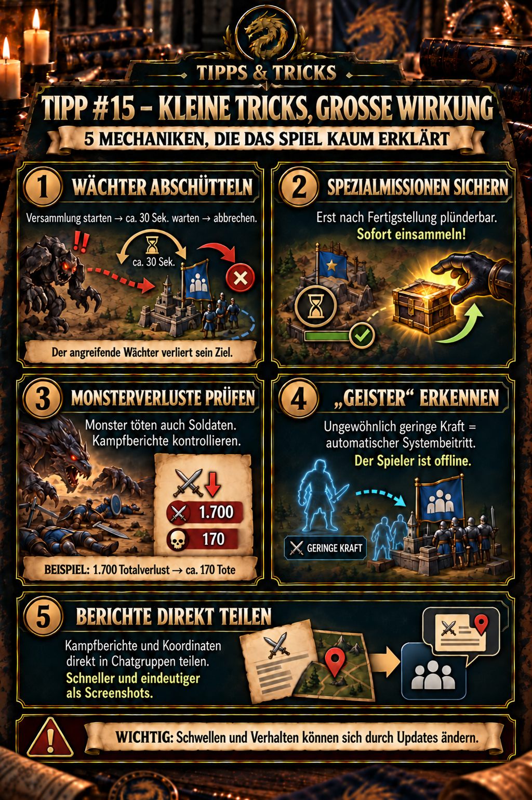

---
arten:
  - Anleitung
  - Optimierung
themen:
  - Allianz
  - Kampf
  - Weltkarte
---

# 💡 Tipp #15 – Kleine Tricks, große Wirkung

## Das Wichtigste in Kürze

- **Angreifenden Wächter abschütteln:** Startet eine Versammlung, wartet ungefähr 30 Sekunden und brecht sie ab. Nach aktueller DIE-Erfahrung verliert der Wächter dadurch sein Ziel und dreht ab.
- **Spezialmissionen sichern:** Eine Spezialmission kann erst nach ihrer Fertigstellung geplündert werden. Sammelt sie deshalb unmittelbar nach Abschluss ein.
- **Monsterverluste prüfen:** Auch erfolgreiche Monsterangriffe können tote Soldaten verursachen. Kontrolliert regelmäßig die Kampfberichte.
- **„Geister“ erkennen:** Ein Beitritt mit ungewöhnlich geringer Kraft ist nach aktueller Beobachtung ein automatischer Systembeitritt; der betreffende Spieler ist offline.
- **Berichte direkt teilen:** Kampfberichte und Koordinaten können direkt in Chatgruppen geteilt werden. Das ist schneller und eindeutiger als ein Screenshot.

> **Merksatz:** Wächter ablenken, Missionen sofort einsammeln, Verluste lesen, Geister erkennen und Informationen direkt teilen.



## Wofür ist dieser Tipp?

Dieser Sammel-Tipp dokumentiert fünf kleine Spielmechaniken, die leicht übersehen werden, im Alltag aber Zeit, Soldaten oder unnötige Rückfragen sparen. Sie gehören nicht zu einem gemeinsamen Ereignis, können jedoch alle ohne lange Vorbereitung sofort genutzt werden.

## 1. Einen angreifenden Wächter abschütteln

Wenn ein Wächter eure Basis als Ziel ausgewählt hat, könnt ihr nach aktueller DIE-Spielerfahrung seinen Angriff abbrechen lassen:

1. Startet eine Versammlung.
2. Lasst sie ungefähr **30 Sekunden** bestehen.
3. Brecht die Versammlung anschließend ab.
4. Kontrolliert auf der Weltkarte, ob der Wächter sein Ziel vergessen hat und abdreht.

Die Versammlung muss nicht bis zum Start durchlaufen. Die 30 Sekunden sind ein Erfahrungswert und kein offiziell dokumentierter Timer. Kontrolliert deshalb immer die Bewegung des Wächters auf der Karte.

Die vollständige Betrachtung von Teamstärke, Verlusten und Ressourcenmanagement bei Wächtern wird bewusst in einem späteren eigenen Tipp behandelt.

## 2. Spezialmissionen unmittelbar einsammeln

Eine Spezialmission kann während ihrer Laufzeit beobachtet oder vorgemerkt werden, aber erst **nach ihrer Fertigstellung** geplündert werden. Prüft bei wertvollen Missionen die verbleibende Laufzeit, merkt euch die Endzeit oder stellt einen Timer und sammelt die Belohnung unmittelbar nach Abschluss ein.

Ein bereits sichtbarer Beobachter bedeutet nicht, dass die Mission schon geplündert wurde; er kann auf die Fertigstellung warten. Schnelles Einsammeln lässt kaum ein nutzbares Plünderungsfenster offen.

## 3. Tote Soldaten bei Monsterangriffen kontrollieren

Monsterkämpfe können auch bei einem Sieg tote Soldaten verursachen. Öffnet deshalb regelmäßig den Kampfbericht und unterscheidet eingesetzte Soldaten, Überlebende, Verwundete und Tote.

### Beispiel aus der DIE-Spielerfahrung

Bei einem Totalverlust von **1.700 Soldaten** gegen einen Wächter wurden ungefähr **170 Soldaten als tot** ausgewiesen.

```text
170 Tote ÷ 1.700 Totalverlust = 10 %
```

Die zehn Prozent beschreiben nur dieses konkrete Beispiel und sind keine allgemeine Todesquote. Monsterstufe, eingesetzte Teams, Teilnehmerzahl und Spielmodus können das Ergebnis verändern. Tipp #12 erklärt die vollständige Auswertung eines Kampfberichts.

## 4. Automatische Beitritte als „Geister“ erkennen

Tritt einer Versammlung ein Team mit **ungewöhnlich geringer Kraft** bei, handelt es sich nach unserer aktuellen Beobachtung um einen automatischen Beitritt durch das System. Der zugehörige Spieler ist offline und hat den Beitritt nicht selbst ausgelöst.

Anthlan bezeichnet diese automatischen Offline-Teilnehmer als **„Geister“**. Für reguläre DIE-Spieler rechnen wir mit Teams von mindestens etwa 500.000 Kraft. Das ist keine feste Systemgrenze, sondern ein Vergleichswert: Entscheidend ist, dass die Kraft auffällig weit unter dem üblichen Niveau der aktiven Mitglieder liegt.

## 5. Kampfberichte und Koordinaten direkt teilen

Kampfberichte und Koordinaten lassen sich direkt in eine Chatgruppe teilen. Koordinaten bleiben dadurch nutzbar, Berichte sind leichter wiederzufinden und Fragen werden eindeutiger als mit einem Screenshot.

Öffnet den Bericht oder die Koordinate, verwendet die Teilen-Funktion und wählt die gewünschte Chatgruppe. Ergänzt bei Kampfberichten eine kurze Frage, damit die anderen sofort wissen, was sie prüfen sollen. Tipp #12 hilft bei der gemeinsamen Auswertung.

## Grenzen und offene Punkte

- Der Versammlungsabbruch nach ungefähr 30 Sekunden und das Vergessen des Ziels beruhen auf aktueller DIE-Spielerfahrung; eine öffentliche offizielle Regelbeschreibung wurde nicht gefunden.
- Ob jede Art von Versammlung denselben Wächtereffekt auslöst, ist noch nicht getrennt dokumentiert.
- Das Verhältnis 1.700 zu ungefähr 170 Toten ist ein Beispiel und keine übertragbare Formel.
- „Ungewöhnlich gering“ ist ein relativer Hinweis und keine feste Systemgrenze; das übliche Kraftniveau der Allianz kann sich weiterentwickeln.
- Bezeichnungen und Positionen der Teilen-Funktion können sich mit der Benutzeroberfläche ändern.

## Quellen und Verlässlichkeit

- **DIE-Praxiswissen:** Wächter-Abbruch, Beispielverluste und die an ungewöhnlich geringer Kraft erkannten „Geister“ stammen aus aktuellen Beobachtungen der Allianz.
- **Spezialmissionen:** Ein ausführlicher [Community-Guide zu Z:Route: Redemption](https://rozamira74.ru/z-route-redemption-gajd-polnoe-rukovodstvo-dlya-novichkov-2026/) beschreibt, dass andere Spieler eine Spezialmission vor dem Ende beobachten und nach der Fertigstellung plündern können.
- **Wächterverluste:** [Z Route Academy – Attacking Watchers](https://zroute.dev/es/combat/attacking-watchers/) dokumentiert anhand eigener Kämpfe, dass auch passend zusammengestellte Gruppen Truppenverluste erleiden können und die Werte nur näherungsweise übertragbar sind.
- **Direktes Teilen und Versionsabhängigkeit:** [Z Route Academy – Updates](https://zroute.dev/updates/) führt das direkte Teilen von Kampfberichten und Koordinaten in Chatgruppen sowie spätere Änderungen an Offline-Beitrittsregeln auf.

**Stand:** 28.10.2026

## Allianz-Mitteilung zum Kopieren

```html
<color=#FFD700><b>💡 TIPP #15 – KLEINE TRICKS, GROSSE WIRKUNG</b></color>

1️⃣ <b>WÄCHTER ABSCHÜTTELN:</b> Greift ein Wächter eure Basis an, startet eine Versammlung und brecht sie nach ungefähr 30 Sekunden ab. Nach aktueller Erfahrung vergisst er sein Ziel und dreht ab.

2️⃣ <b>SPEZIALMISSIONEN SICHERN:</b> Sie können erst nach der Fertigstellung geplündert werden. Wertvolle Missionen deshalb sofort nach Abschluss einsammeln.

3️⃣ <b>MONSTERVERLUSTE PRÜFEN:</b> Auch bei Monsterangriffen sterben Soldaten. Kontrolliert regelmäßig die Kampfberichte. Beispiel: 1.700 Totalverlust gegen einen Wächter bedeuteten ungefähr 170 Tote – kein allgemeiner Festwert.

4️⃣ <b>„GEISTER“ ERKENNEN:</b> Ein Beitritt mit ungewöhnlich geringer Kraft ist nach aktueller Beobachtung ein automatischer Systembeitritt. Der Spieler ist offline – Anthlan nennt diese Teilnehmer „Geister“. Reguläre DIE-Teams sollten mindestens etwa 500.000 Kraft haben; das ist ein Vergleichswert, keine feste Systemgrenze.

5️⃣ <b>DIREKT TEILEN:</b> Kampfberichte und Koordinaten direkt in Chatgruppen teilen. Das ist schneller und eindeutiger als ein Screenshot.

<color=#FF4040><b>WICHTIG:</b></color> Schwellen und Verhalten können sich durch Updates ändern. Prüft bei Abweichungen die aktuelle Ingame-Anzeige.
```
