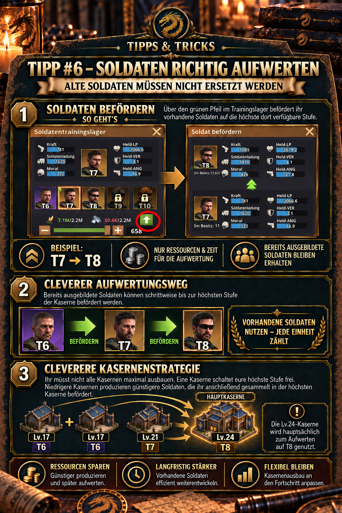

---
arten:
  - Guide
  - Optimization
themen:
  - Troops
  - Development
---

# 💡 Tip #6 – Upgrade soldiers correctly

## Key points

- **Keep old soldiers:** Lower-tier soldiers do not need to be dismissed or trained again from scratch.
- **Use the green arrow:** In the training camp, the green upward arrow opens promotion to the highest tier available there.
- **Pay only for the upgrade:** Promotion requires the resources shown in the dialog and the necessary upgrade time.
- **One main barracks is enough:** A highly developed training camp can unlock the highest tier and promote existing lower-tier soldiers in batches.
- **Keep other camps working:** Lower-level training camps can simultaneously produce the soldiers available to them, who can later be upgraded in the main barracks.

> **Remember:** Train lower tiers, collect existing soldiers and promote them in the highest-level barracks using the green arrow.



## What is this tip for?

This tip shows how to promote soldiers already trained to a higher unlocked tier. This keeps units produced early useful over the long term, and several training camps do not necessarily need to reach the same building level simultaneously.

It is particularly useful if you:

- still have many older soldiers after unlocking a new tier,
- want to concentrate construction resources on a single training camp first,
- operate several training camps at different development levels,
- want to keep producing lower tiers initially and promote them in batches later,
- or have previously overlooked the green arrow in the training camp.

## Training and promotion are different actions

| Action | What happens? | Typical purpose |
| --- | --- | --- |
| **Training** | New soldiers of a tier available in the training camp are produced. | increase troop numbers |
| **Promotion** | Existing lower-tier soldiers are upgraded to a higher available tier. | strengthen existing troops |

Promotion does not create additional soldiers from nothing. You improve previously trained units and pay the resources and time specified in the promotion dialog.

The example in the in-game illustration is:

```text
T7 → T8
```

What matters is the highest soldier tier currently offered by the training camp used. A camp that has unlocked only T7 cannot promote soldiers to T8.

## Promote soldiers using the green arrow

The supplied in-game screenshots show the practical procedure directly in the game interface:

1. Open the **training camp** that has already unlocked your desired target tier.
2. Select the existing lower-tier soldiers you want to improve.
3. Tap the **green upward arrow**.
4. Check the starting and target tiers in the promotion dialog – for example, T7 and T8.
5. Set the desired quantity.
6. Check resource requirements and duration.
7. Start promotion only when the target tier, quantity and costs are correct.

> **Important:** Use the actual in-game screenshot in the tip illustration when following this procedure. Icon positions, colors or labels may change after interface updates; the green upward arrow is the key entry point for promotion.

## What promotion preserves

The benefit is that existing soldiers are not discarded. The selected lower-tier soldiers become soldiers of the higher target tier.

Your earlier investments therefore remain useful:

- The units do not need to be dismissed.
- You do not need to train the same number of additional units from scratch.
- Lower-tier soldiers can gradually be brought up to your current development level.
- A large stock of older troops can be modernized in planned batches.

Promotion is nevertheless **not free**. The game requires resources and time for the upgrade. Exact quantities depend on the starting tier, target tier, number of soldiers and current game state, and must be checked in the promotion dialog.

## The smart barracks strategy

The basic idea: not every training camp needs to be maximized immediately.

- Prioritize developing one **main training camp** to unlock your highest available soldier tier.
- Lower-level training camps remain productive and continue training soldiers of their available tiers.
- These lower-tier soldiers are later promoted in batches to the highest tier in the main training camp.

This initially concentrates building upgrades, construction time and construction resources on the camp that determines the next tier advancement. The other camps remain usable while lagging behind in building level.

### Example from the alliance illustration

| Number | Training camp level | Soldiers available there | Role in the system |
| ---: | ---: | ---: | --- |
| 1× | Lv.24 | T8 | Main barracks: unlock the highest tier and promote existing soldiers to T8 |
| 1× | Lv.21 | T7 | keep producing T7 and later promote them to T8 |
| 2× | Lv.17 | T6 | keep producing T6 and later develop them in batches |

In this example, the Lv.24 barracks mainly serves as a **T8 promotion center**. The three lower-level camps continuously supply soldiers without first upgrading all four buildings to Lv.24.

This example describes a possible development phase. As further tiers are unlocked, the main barracks’ role shifts accordingly.

## What “producing cheaper soldiers” actually means

Lower-level training camps can initially produce their currently available soldiers with lower immediate resource requirements. However, subsequent promotion incurs additional costs and another waiting period.

Two statements must therefore be distinguished:

- **Established:** You can continue producing lower-tier soldiers and later pay only for upgrading them, rather than replacing existing units.
- **Not universally established:** Training followed by promotion always costs fewer total resources or less time than directly training the highest tier.

The main benefit is therefore **flexibility in building development and continued use of existing soldiers**. Whether it is also cheaper overall in a specific situation can only be determined by comparing current in-game costs and times.

## When the strategy is particularly useful

### After unlocking a new tier

When your main barracks has just unlocked T8, a large T6 or T7 stock would otherwise remain weaker in combat. Promotion gradually brings these existing troops up to the new standard.

### When construction resources are scarce

Instead of upgrading four training camps simultaneously, you can prioritize one initially. This fits the general development recommendation to keep only buildings important for the next advancement up to date, rather than distributing resources evenly across all buildings.

### When all training camps should remain busy

Lower-level camps can keep producing units while one camp sets the technological pace. However, check whether an ongoing promotion occupies the main barracks’ regular training queue; verify this behavior against the current in-game display.

### When many low-tier soldiers are available

The larger the older stock, the more important orderly promotion becomes. Work in sensible batches and check after each order which tiers and quantities remain.

## Upgrade priority and soldier tiers

Z Route Academy recommends continuously improving one soldier training camp where possible, because higher soldier tiers are among a team’s largest direct power increases. Its community documentation lists these base levels for unlocks:

| Soldier tier | Listed base level |
| ---: | ---: |
| T7 | 20 |
| T8 | 24 |
| T9 | 27 |
| T10 | 30 |

This table describes **base levels** from the external community source. By contrast, the alliance example with Lv.17, Lv.21 and Lv.24 describes the training camps’ levels. Do not automatically equate the two; always check actual building prerequisites directly in the game.

## A sensible promotion order

If resources are insufficient for all older troops, clear priorities help:

1. **Unlock the target tier:** The main training camp must first provide the desired tier.
2. **Supply active combat teams:** First promote soldiers your regularly used teams actually need.
3. **Avoid small leftover stocks:** Group promotions into manageable batches where time and resources allow.
4. **Keep a resource reserve:** Do not automatically spend everything when important construction or research is also planned.
5. **Bring older troops up to date:** Gradually promote the remaining lower tiers until the desired standard is reached.

The supplied material does not document which soldiers are assigned to a particular team or whether the game automatically favors higher tiers when forming it. Check actual team composition before important battles.

## Check before starting

- Are you in the training camp with the correct highest tier?
- Is **promotion**, rather than normal training, actually selected?
- Are the starting and target tiers correct?
- Is the desired quantity correct?
- Will sufficient resources remain for planned buildings and research?
- Does the duration suit your online or offline period?
- Are training or promotion bonuses currently displayed that you want to use?

## Common mistakes

- **Dismissing lower-tier soldiers:** They can retain value through promotion.
- **Overlooking the green arrow:** This leaves you using only the normal training view.
- **Opening the wrong training camp:** Only a sufficiently developed camp offers the desired target tier.
- **Maximizing all barracks simultaneously:** This ties up construction time and resources when one main camp can initially unlock the highest tier.
- **Assuming an overall saving:** Lower-tier training followed by promotion is not proven cheaper than direct training in every situation.
- **Confirming costs without checking:** Large promotion batches can require substantial resources and time.
- **Training only new T8 soldiers:** A large existing T6/T7 stock remains unnecessarily weak even though it could be promoted.
- **Forgetting the promotion queue:** Check whether, and for how long, this occupies the main camp and blocks other orders.

## Limitations and information still to verify

- Exact resource and time costs for each soldier tier are not fully documented in the supplied material and may differ with bonuses or updates.
- Whether promotions receive the same speed bonuses, office bonuses and alliance help as normal training still needs checking.
- It is not established whether training a lower tier and promoting it is cheaper or faster overall than directly training the target tier.
- Check how training and promotion queues are occupied in the current training camp.
- According to the update overview, inner-city training and research buildings were organizationally consolidated in May 2026. Names and positions in older screenshots may therefore differ from the current interface.
- Server state, game progression and later updates may change unlock requirements. The current building view takes priority.

## Sources and reliability

- **DIE in-game evidence:** The green promotion arrow, T7 → T8 example, resource and time payments for upgrading, and example layout of Lv.24, Lv.21 and Lv.17 training camps come from the supplied alliance illustration and approved announcement.
- **Community source:** [Z Route Academy – Squad Leveling & Composition](https://zroute.dev/getting-started/squad-leveling-composition/) identifies higher soldier tiers as one of the largest direct power increases, recommends prioritizing one soldier training camp, and lists base levels for T7 through T10.
- **Additional development source:** [Z Route Academy – City & Base Rush Guide](https://zroute.dev/city/base-hq-progression/) recommends specifically upgrading mandatory buildings that block progression rather than raising every building evenly.
- **Change history:** The [Z Route Academy – Updates](https://zroute.dev/updates/) documents a reorganization of inner-city training and research buildings on 13 May 2026, with unchanged values.

Research did not locate a publicly available official table with complete promotion costs, times and bonus rules. Values in the current promotion dialog therefore take priority.

Research date: **25 September 2026**.

## Alliance announcement to copy

```html
<size=38><color=#8DAA2D><b>💡 TIP #6 – UPGRADE SOLDIERS CORRECTLY</b></color></size>

Old soldiers do not need replacing! Use the <color=#8DAA2D><b>green arrow</b></color> in the training camp to promote them to the highest tier available there.

➡️ Example: T7 → T8
You pay only the resources & time for the upgrade.

💡 <b>This enables a smart barracks strategy:</b>
You do not need to maximize all barracks. One can unlock your highest tier while lower-level barracks continue producing cheaper soldiers.

You can then promote these soldiers in batches in the highest-level barracks.

<b>Example:</b>
🏰 1× Lv.24 → T8
🏰 1× Lv.21 → T7
🏰 2× Lv.17 → T6

➡️ The Lv.24 barracks is mainly used to <color=#8DAA2D><b>upgrade soldiers to T8</b></color>.
```
