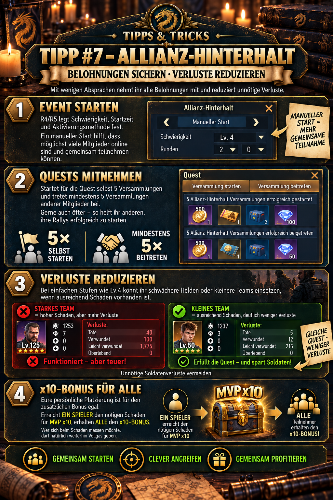

---
arten:
  - Strategy
themen:
  - Events
  - Combat
  - Alliance
---

# 💡 Tip #7 – Alliance Ambush

## Key points

- **Complete both quests:** Start **5 rallies** yourself and join **at least 5 rallies** led by other members.
- **Keep helping after five joins:** Additional participation no longer advances your own quest, but helps others fill and launch their rallies.
- **Adjust losses:** On easy levels such as Lv.4, smaller teams or weaker heroes may be sufficient if the combined damage is safely enough.
- **x10 is a shared goal:** If one participant reaches the damage required for MVP x10, all participants receive the associated bonus; personal ranking does not matter.
- **Maximize damage:** Launch your own rallies with a weaker team and let your strongest team join other members’ rallies as often as possible.
- **Do not weaken blindly:** At higher difficulties or with little damage to spare, successful rallies take priority over minimizing team size.

> **Remember:** Start five rallies, join five rallies, then keep supporting and use only as much combat power as a safe success requires.



## What is this tip for?

This tip shows how the alliance can organize Ambush as a shared event: collect as many personal quest rewards as possible, reliably fill rallies, limit unnecessary soldier losses and unlock the additional x10 bonus together.

Three goals must be considered simultaneously:

1. **Personal quests:** Every member needs their own starts and joins.
2. **Alliance success:** Rallies must fill and deal damage in time.
3. **Loss control:** On easy levels, use no more combat power than necessary.

The best strategy is therefore neither “everyone always at maximum strength” nor “everyone always using minimal teams”. Difficulty, remaining time, online activity and total damage already achieved are decisive.

## 1. Prepare the event

According to the supplied in-game illustration, R4/R5 determine:

- **Difficulty**
- **Start time**
- **Activation method**

A manual start is useful when as many members as possible should participate simultaneously. The alliance can announce the time, gather online players and fill the first rallies quickly.

The update history shows that automatic starting and dedicated event quests were added on 27 May 2026. Automation may be convenient organizationally, but it does not replace an agreed start time when many members should actively participate.

### Recommended announcement before starting

- give the exact start time in server time,
- announce the planned difficulty,
- remind members of **5 starts + 5 joins**,
- explain whether small teams are allowed or strong teams are needed at the selected level,
- identify who will play at full strength for the x10 damage,
- and remind everyone not to leave rallies unnecessarily empty.

## 2. The two personal rally quests

Two separate tasks are required for quest rewards:

| Quest | Personal target | What counts? |
| --- | ---: | --- |
| **Start a rally** | 5× | be the rally leader yourself and successfully launch an Ambush rally |
| **Join a rally** | at least 5× | successfully join another member’s rally |

Your own start does not replace a join, and a join does not replace your own start. Plan for both counters deliberately and check progress directly in the quest window.

> **Important:** The supplied illustration says “successfully started” and “successfully joined”. A rally merely created but never launched, or canceled, may therefore not count. What matters is whether the quest counter actually increases.

## Join first or start your own rally first?

Personal quests and group tactics meet here:

- Your own quest requires five starts of your own.
- For alliance success, existing rallies should still fill as quickly as possible.
- Community recommendations particularly prioritize R4/R5 rallies because they reportedly provide a participant damage bonus.

A practical sequence is:

1. Support open, important or nearly full rallies first.
2. Start your own rally once enough other members are ready to join.
3. Join others’ rallies again between your own starts.
4. Continue filling available seats after completing your own five joins.
5. Do not postpone your five starts until the final minutes.

This avoids opening many half-empty rallies simultaneously while existing ones wait for participants.

## Why joining more than five times is useful

After the fifth join, your personal joining quest is complete. However, the event remains an alliance task:

- Other members still need successful starts of their own.
- Quickly filled rallies launch earlier.
- More successful attacks increase shared total damage.
- Empty seats in bonus rallies waste potential combat power.

Anyone online should therefore not stop immediately after completing both personal counters.

## 3. Assess rally timing correctly

Community documentation lists a **three-minute preparation window** for rallies. March time to the target comes on top of this.

For a successful final attack, the following must therefore hold:

```text
remaining event time > rally preparation + march time
```

Example: if your rally requires three minutes of preparation followed by a 40-second march, it must be created or triggered significantly more than 3:40 minutes before the event ends. According to the community source, a hit after the event expires deals no damage.

### Implications for the final phase

- Do not wait until shortly before the end to complete your five starts.
- Account for the return time of a troop already deployed.
- Move closer to the target when routes are long, if game rules and alliance plans allow it.
- If no bonus rally becomes available in time, individual rallies of your own can provide additional hits during the final phase.

Check the exact rally window in the current event screen, since updates can change event rules.

## 4. Maximize your main team’s damage

Anyone aiming for maximum total damage should **not continually tie up their strongest team leading their own rally**. A rally you start waits a fixed three minutes before departure. During this period, its team is unavailable for several other attacks.

The more efficient division of roles is therefore:

- Use the **weakest team that is still sufficiently combat-ready** to start your own rallies.
- Let your **strongest main team** join as many other members’ rallies as possible in succession.
- Immediately after returning, send the main team into the next suitable rally.

This still completes the “start 5 rallies” quest with the weaker team while allowing your strongest team to participate in a much larger share of actual battles.

### Why this allows more attacks

Your own rally first requires **3 minutes of preparation**, regardless of march distance. In a 30-minute event, approximately **9 rallies of your own** are therefore the practical maximum. The exact number depends on how quickly the first rally is created, outward and return march times, and delays between starts.

When joining others’ rallies, your main team does not need to wait through a complete new personal three-minute period every time. If many members are active and open staggered rallies, the same strong team can be deployed again several times per minute after returning.

Under favorable conditions, approximately **25 main-team attacks** are realistically possible during the 30 minutes. This is a practical guideline, not a guaranteed upper limit.

| Main-team use | Typical limitation | Practical figure over 30 minutes |
| --- | --- | ---: |
| Start your own rallies | 3 minutes of preparation each, plus outward and return marches | at most approximately 9 attacks |
| Join others’ rallies | available rallies and outward/return march times | approximately 25 attacks with good activity |

### Requirements for this strategy

- Enough members must open rallies simultaneously.
- Starts should be staggered so the main team can be sent onward immediately after returning.
- March routes should be as short as possible.
- Open rallies must fill quickly.
- The weaker starting team must remain strong enough for your own rally to succeed.
- The main team must not become stuck in a slow-filling rally or one arriving too late.

### Practical procedure

1. Start your own rally using a weaker team.
2. Simultaneously send your main team into another member’s already open rally.
3. Watch the main team’s return and other rallies’ departure times.
4. After every return, immediately join the next rally with a free seat that will launch in time.
5. Start your next rally with the weaker team again as soon as its sequence and return allow.
6. Ensure you achieve at least five successful starts of your own and five successful joins for the quests.

> **Damage rule:** The weaker team handles slow starts of your own; the strongest team remains mobile and collects as many hits as possible through others’ rallies.

This approach does not automatically maximize every individual rally’s damage. It maximizes the number of deployments of your strongest team and therefore often its total damage throughout the event.

## 5. Reduce losses on easy levels

On an easy difficulty such as **Lv.4**, the alliance can often achieve sufficient total damage without every member deploying their strongest team at full size. Weaker heroes, fewer soldiers or smaller formations can then reduce unnecessary losses.

The principle is:

```text
as few troops as possible – but as much combat power as safe rallies require
```

The supplied illustration provides this comparison:

| Example team | Result according to the illustration | Meaning |
| --- | ---: | --- |
| strong team, Lv.125 | 40 dead, 100 wounded, 1,775 lightly wounded | high damage, but significantly higher losses |
| small team, Lv.50 | 5 dead, 12 wounded, 216 lightly wounded | quest completed, considerably lower losses |

These figures are **not a universal loss calculator**. They only illustrate the supplied graphic’s principle; real losses depend on difficulty, heroes, soldier count, bonuses and battle progress, among other factors.

## When small teams make sense

Smaller teams are suitable when:

- the alliance reliably defeats the current level,
- enough strong players already provide the required damage,
- your participation is mainly needed for quest progress and rally support,
- and the smaller formation does not cause the rally to fail.

## When you should not reduce strength

Use stronger teams when:

- the difficulty is new or close to your limit,
- rallies regularly fail,
- the x10 damage is not yet secured,
- only a few members are online,
- the event is nearly over and every hit counts,
- or R4/R5 explicitly request full combat power.

> **Decision rule:** Secure shared success first, then optimize losses.

According to the update overview, since the 3 June 2026 update, at least one soldier must accompany each deployed hero. A “small team” therefore does not automatically mean a formation without soldiers.

## 6. Unlock the x10 bonus together

According to the approved alliance announcement, personal leaderboard position is irrelevant for the additional bonus. It is enough for **one participant** to reach the required damage for **MVP x10**; afterward, **all participants** receive the associated x10 bonus.

This enables clear division of work:

- One or several strong players focus on the required peak damage.
- Other members complete their 5+5 quests and support rallies with adjusted teams.
- Once the bonus is safely reached, the alliance can reduce losses further.

### What “x10” does not automatically mean

The label **MVP x10** names the bonus target to reach. Without in-game evidence, do not interpret it as “all base rewards are multiplied by ten”. The supplied illustration describes the shared result as additional or doubled rewards. The specific reward display in the current event takes priority.

Anyone who enjoys comparing damage or achieving a personal ranking can continue playing at full strength. However, this competition is not necessary for every member to unlock the shared bonus.

## Additional community tips for more damage

The following suggestions come from a community guide and are less strongly evidenced than the 5+5 quests in the available in-game material:

### Fill R4/R5 rallies first

Rallies opened by R4 or R5 reportedly give participants a damage bonus. Fill their available seats before ordinary rallies.

### Explore a city beforehand

Exploring a city before the event reportedly triggers a small damage bonus for the entire Ambush. The community source lists **+1%**, but itself notes that this value has not been verified directly against an in-game display.

### Use Zara for scoring

Zara reportedly increases the score achieved in Alliance Ambush; the community guide identifies “Roar” as the relevant skill. This suggestion also comes from player experience and should be checked against the current hero and event description.

These additions may improve damage, but do not replace filled rallies, timely starts and sufficiently strong teams.

## Recommended alliance procedure

### Before the event

1. R4/R5 determine difficulty, start time and activation method.
2. Announce the start time and team strategy in alliance chat.
3. Assign strong players to the shared x10 goal.
4. Remind all members of the two separate five-count quests.
5. Optionally check community suggestions such as exploration, Zara and R4/R5 bonus rallies.

### During the event

1. Fill important open rallies.
2. Start your own rallies in time with a weaker but sufficiently strong team.
3. After each return, let the strongest team join another member’s rally as directly as possible.
4. Check quest counters after each successful attack.
5. Reduce team size only if total damage is safely sufficient.
6. Continue supporting rallies after the first five joins.
7. Watch x10 progress and add strong teams if necessary.

### In the final phase

1. Compare remaining time with rally preparation and march time.
2. Do not begin missing personal starts too late.
3. Only open or join rallies that can still hit in time.
4. Switch to stronger teams if total damage is close to the requirement.

## Common mistakes

- **Only starting five rallies of your own:** The five joins are a separate quest.
- **Stopping immediately after 5+5:** Other members still need participants for their own starts.
- **Opening too many rallies simultaneously:** Several rallies remain half empty and start late.
- **Blocking your main team with your own starts:** The fixed three-minute preparation usually allows far fewer attacks than repeatedly joining others’ rallies.
- **Using small teams at excessive difficulty:** Reducing losses does not help if rallies fail or the bonus is missed.
- **Always going all out:** Oversized teams can cause unnecessary soldier losses on easy levels.
- **Reading x10 as ten times the total reward:** Check the exact effect in the current reward window.
- **Forgetting preparation time:** A late-started rally may reach its target only after the event ends.
- **Confusing personal ranking with the shared bonus:** According to the alliance announcement, one player reaching the required MVP-x10 damage is enough to unlock it.

## Limitations and information still to verify

- The complete damage formula, all difficulty levels and exact reward tiers are not reliably documented publicly.
- The +1% bonus from prior exploration and Zara’s scoring advantage are community suggestions not confirmed by the supplied in-game illustration.
- Check in the event screen whether R4/R5 rallies currently provide a damage bonus and how large it is.
- The precise meaning and reward effect of MVP x10 may differ from an assumed tenfold base reward.
- On 5 August 2026, the offline-joining rule for high-level players was tightened. The public update summary does not state every condition; rely on the current event display.
- Quest rewards, required MVP damage and suitable team size can vary with event version, difficulty and server progression.
- Approximately 9 starts of your own and approximately 25 main-team attacks are experience-based figures for a 30-minute event. Participant count, staggered starts, march distance, return time and interaction speed can change the actual result.

## Sources and reliability

- **DIE in-game evidence:** Event preparation, two five-count quests, loss comparison, smaller teams at Lv.4 and shared x10 unlocking come from the supplied alliance illustration and approved announcement.
- **Alliance practical experience:** The split between a weaker starting team and a strong joining team, and the guidelines of approximately 9 and 25 attacks, were added as a tested alliance strategy.
- **Community source:** [Z Route Academy – Alliance Ambush](https://zroute.dev/de/events/alliance-ambush/) describes bonus-rally priority, three-minute rally preparation, march-time planning, and the not fully verified suggestions concerning exploration and Zara.
- **Change history:** The [Z Route Academy – Updates](https://zroute.dev/updates/) documents automatic starts and event quests introduced on 27 May 2026, the minimum of one soldier per hero on 3 June, and a changed offline-joining rule on 5 August.

The external event page itself notes that the full scoring formula, levels and rewards are not yet verified. If there are discrepancies, quest counters, rally timers and reward windows in the current game take priority.

Research date: **25 September 2026**.

## Alliance announcement to copy

```html
<size=38><color=#8DAA2D><b>💡 TIP #7 – ALLIANCE AMBUSH</b></color></size>

A few Ambush tricks help you collect all rewards while reducing losses.

🎁 <b>COMPLETE THE QUESTS</b>
For the quest, start <color=#8DAA2D><b>5 rallies</b></color> yourself and join <color=#8DAA2D><b>at least 5 rallies</b></color> led by other members. Feel free to join more – you help others launch their rallies successfully.

🛡️ <b>REDUCE LOSSES</b>
On easy levels such as Lv.4, you can use weaker heroes or smaller teams if enough damage is available. This avoids unnecessary soldier losses.

🏆 <b>x10 BONUS</b>
Your personal ranking does not matter for the additional bonus. If <color=#8DAA2D><b>one player</b></color> reaches the damage required for MVP x10, <color=#8DAA2D><b>everyone receives the x10 bonus!</b></color>

💡 Anyone who enjoys comparing damage can of course keep going all out. 😉
```
