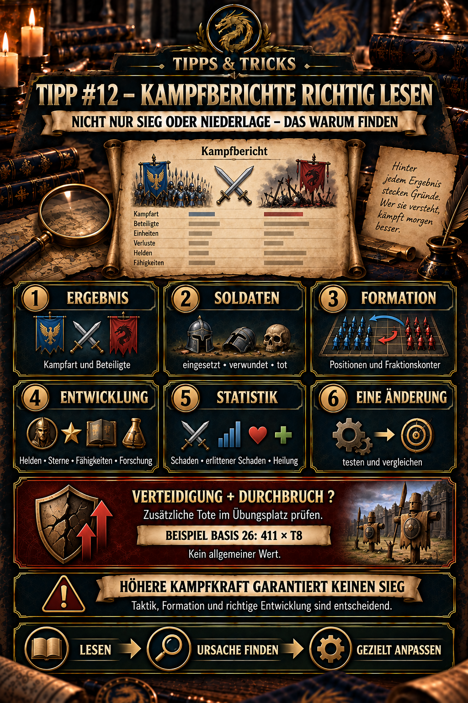

---
arten:
  - Guide
  - Optimization
themen:
  - Combat
  - Troops
---

# 💡 Tip #12 – Read battle reports correctly

## Key points

- Victory or defeat tells you only **what** happened. The complete battle report helps explain **why**.
- First check battle type, attacker, defender and deployed teams. Solo attacks, rallies and garrison defenses are not directly comparable.
- Then compare soldiers: deployed, surviving, lightly wounded, wounded and dead. Their exact treatment depends on battle type and game mode.
- When defense suffers a **breakthrough**, also check training-ground losses. These may be reported separately from deployed defending teams.
- Check heroes, positions and faction counters. Higher total combat power does not guarantee a favorable battle.
- Use both sides’ development details to identify differences in heroes, stars, skills, equipment, research and other enhancements.
- Evaluate damage dealt, damage received and healing according to a hero’s role. A tank does not need to deal the highest damage to be decisive.
- Change **only one thing** for the next test where possible. Otherwise you cannot tell what made the difference.

> **Remember:** Result → troops → formation → development → statistics → test one change.



## What is this tip for?

Battle reports are more than victory notices. They are the most important tool for deliberately improving a formation, explaining unexpected defeats and avoiding repeated costly mistakes.

This tip helps answer questions such as:

- Why did a team with higher combat power lose?
- Is the frontline too weak, or is damage lacking?
- Was a hero in the wrong position?
- Did a faction counter affect the result?
- Which development component distinguishes the two sides?
- Is a poor result a formation problem or simply an unfair comparison?
- Which single change should be tested next?

The exact display may vary by battle type and game version. The reading order nevertheless remains the same.

## The six steps

```text
1. Context and result
          ↓
2. Troop status
          ↓
3. Heroes, positions and counters
          ↓
4. Development details
          ↓
5. Battle statistics and sequence
          ↓
6. Choose one change and test again
```

Jumping directly to individual damage values can obscure the real reason. A hero may deal little damage because the frontline fell too early – or because their task was protection and healing rather than damage.

## 1. Check context and result

First record the circumstances:

- What type of battle was it?
- Who attacked and who defended?
- Was it a solo attack, a rally or a garrison?
- Did several complete teams fight in succession?
- Were event, office, research or other combat bonuses active?
- Were both teams fully replenished before battle?

Only then consider victory or defeat. The result answers just the first question:

> **Which side still had a combat-ready team at the end?**

It does not automatically tell you which formation is better in the long term. An already damaged team, a counter or an active bonus can strongly affect an individual comparison.

### Particularly important in rallies

A rally report may contain several encounters. Therefore check:

- which team occupied A1, A2, A3 or V1, V2, V3,
- who fought whom in the first round,
- which winner entered the next round already damaged, and
- which teams were never used.

The complete pairing logic is in Tip #2 – Rally attacks.

## 2. Read troop status

The most important troop rows typically are:

| Display | Meaning for review |
| --- | --- |
| Deployed | How many soldiers actually entered this battle |
| Surviving | How many remain without a reported wounded status |
| Lightly wounded | Damaged soldiers whose treatment may vary by battle type |
| Wounded | Soldiers generally sent to the hospital or corresponding healing system |
| Dead | permanently lost soldiers unless the mode has a special rule |

Do not interpret these terms without considering the mode. Some events use their own troops, special hospitals or different loss rules. Check event rules first.

### Special case in base defense: Breakthrough and training ground

After a **breakthrough** in base defense, a report may show additional soldiers killed on the training ground. Do not overlook this row or confuse it with losses among the defending teams deployed directly.

For review, this means:

1. Read the deployed teams’ normal combat losses first.
2. Check whether the report shows a breakthrough.
3. Record the additional soldiers killed on the training ground separately.
4. Only then assess the attack’s total harm.

**Observed DIE example:** After a breakthrough against a **level 26** base, an additional **411 T8 soldiers** were reported killed on the training ground.

This is a specific player example, not a general formula. The exact dependencies remain unclear – for example, base level, training ground, existing troop stock, soldier tier or other defensive values. The current report therefore takes priority.

> **Important:** Apparently small losses among visible defending teams may become significantly more costly through additional training-ground losses.

### Compare more than absolute numbers

`1,000 wounded` says little without a reference quantity:

- 1,000 out of 10,000 deployed soldiers equals 10%.
- 1,000 out of 100,000 equals only 1%.

For fair comparisons, the loss rate helps:

```text
loss rate = (lightly wounded + wounded + dead) / deployed soldiers × 100
```

This simple rate is not an official game metric. It is our own review aid. Depending on the purpose, it may be useful to consider deaths separately, since permanent losses matter more than healable wounded soldiers.

### Example

| Team | Deployed | No longer unharmed | Rate |
| --- | ---: | ---: | ---: |
| A | 80,000 | 12,000 | 15% |
| B | 50,000 | 10,000 | 20% |

Team A has more affected soldiers in absolute terms but a better relative exchange. This example only explains the calculation and does not depict a specific in-game battle.

## 3. Check heroes, positions and faction counters

Examine both formations side by side:

- Which five heroes were deployed?
- Who stood in front and who in back?
- Does each position fit the intended role?
- Which factions faced one another?
- Was a counter indicator visible?
- Was the formation complete, or were soldiers or heroes missing?

### Frontline

Front heroes should buy time and protect the back row. Signs of a frontline problem:

- a front hero falls significantly earlier than their counterpart,
- the back row takes heavy damage very early,
- a damage hero placed in front fails to become effective,
- the tank’s development is significantly weaker than the rest of the team.

### Back row

The back row usually provides damage, support or healing. Signs of a problem:

- the team survives for a long time but loses through timeout or insufficient damage,
- a main damage hero deals unexpectedly little damage,
- support abilities fail to reach the intended allies,
- an unfavorable faction counter weakens the formation.

### Counters before combat power

Displayed combat power summarizes many development factors but does not fully represent a specific duel. Faction advantages, hero abilities, targeting, positions and active bonuses can offset or reverse a nominal power advantage.

> **Practical rule:** After an unexpected defeat, check formation and counters first – do not immediately upgrade things indiscriminately.

## 4. Compare development details

According to publicly documented version history, since the 5 August 2026 update, battle reports show development details for both sides. Depending on the report, these may visibly include or allow you to infer:

- hero levels and star tiers,
- abilities or skill development,
- hero equipment,
- soldier tier and troop quantity,
- relevant research,
- Jet, Wingmen or comparable enhancement systems, and
- other permanent development bonuses.

Do not compare every figure simultaneously. First identify the largest plausible difference:

| Observation | Possible cause | Next useful test |
| --- | --- | --- |
| Frontline falls early | tank, equipment, position or research too weak | test a stronger frontline hero or better frontline equipment |
| Team survives but deals insufficient damage | main damage hero or offensive skills weak | deliberately improve one damage factor |
| Similar heroes, very different soldier performance | soldier tier, quantity or research | compare soldier and research details |
| Higher power loses clearly | counter, formation, bonuses or prior damage | test with the same starting conditions and a changed matchup |
| One hero remains ineffective | wrong position or unsuitable synergy | change position or team composition |

The table provides diagnoses, not automatic proof. A report shows one particular encounter. Repeated reports under similar conditions make a hypothesis more reliable.

## 5. Evaluate battle statistics by role

If the report provides individual values, consider at least:

- **damage dealt,**
- **damage received,**
- **healing or shields,** where displayed,
- **remaining troops or survival duration,** and
- **time of elimination,** where discernible from the sequence or replay.

### Damage

High damage matters for damage heroes. However, a high value does not automatically prove the whole formation works well. A hero may deal substantial damage but become effective too late, while the frontline is already collapsing.

### Damage received

High damage received can be positive for a tank if it survives long enough and protects the back row. If it falls immediately, the same value may merely indicate a weak frontline.

### Healing and shields

Support heroes are easily underestimated when comparing damage alone. What matters is whether their healing or shielding reaches the right allies and creates additional fighting time.

### The lowest value is not automatically the problem

Compare each hero against their task. Tanks, support heroes and damage heroes require different metrics. A team of five apparent damage heroes may look strong on paper but still lose through missing protection or synergy.

## 6. Test one change

After review, formulate exactly one working hypothesis:

- “My damage hero in front needs to move to the back.”
- “The opposing faction counter is probably decisive.”
- “My frontline holds, but my main damage hero is underdeveloped.”
- “The team was already damaged; I need a comparison at full troop strength.”
- “My best team occupied the wrong position in the rally.”

Then change only one easily controlled factor and compare the next report. Changing formation, equipment, skills, research and opponent simultaneously makes it impossible to assign a cause.

## A quick diagnostic matrix

| Visible in the report | Check first | Do not hastily assume |
| --- | --- | --- |
| Defeat despite higher power | faction counter, position, bonuses, prior damage | “The combat power display is wrong” |
| Frontline falls very early | frontline heroes, equipment, defense, soldiers | “Only more damage is missing” |
| Long battle ends in defeat | damage output, healing, time limit | “The tank is too weak” |
| Main damage hero deals little damage | position, survival time, targeting, skills | “The hero is fundamentally bad” |
| Many wounded soldiers in a victory | loss rate, opponent, battle purpose | “A victory was automatically efficient” |
| Team fights repeatedly | order and prior damage | “Every battle had the same starting conditions” |
| Defense reports breakthrough | additional training-ground losses | “Only visible team losses count” |

## Share reports usefully

According to documented updates, battle reports can be shared directly in chat groups. Use this feature after more than just defeats.

A good request for review includes:

1. the shared report,
2. the specific question,
3. the suspected cause, and
4. information about active bonuses or prior damage.

Example:

> “Why does my left front hero fall so early? Both teams were full. I suspect a wrong position or weaker frontline equipment.”

This is more useful than simply: “Why did I lose?”

## Common mistakes

- **Looking only at victory or defeat:** The result does not explain the cause.
- **Comparing only total combat power:** This overlooks counters, roles and bonuses.
- **Assessing absolute losses without troop quantities:** Only the proportion makes different team sizes comparable.
- **Treating dead and wounded soldiers equally:** Their consequences may differ greatly by mode.
- **Overlooking training-ground losses after breakthrough:** An additional loss row may appear in base defense.
- **Blaming the lowest damage value:** A tank or support hero has a different task.
- **Mixing several battle rounds:** Winning teams in later rounds may already carry prior damage.
- **Directly comparing different modes:** Loss and healing rules may differ.
- **Changing everything at once:** You cannot identify which change helped afterward.
- **Treating one report as definitive proof:** Repeatable patterns are more reliable than one battle.
- **Reviewing only defeats:** A costly victory can also reveal a poor formation.

## Checklist for every battle report

- [ ] Battle type and target understood
- [ ] attacker and defender assigned correctly
- [ ] complete teams and possible prior damage checked
- [ ] deployed, surviving, wounded and dead soldiers compared
- [ ] breakthrough and additional training-ground losses checked when defending
- [ ] loss proportion considered rather than just absolute count
- [ ] hero positions and roles checked
- [ ] faction counters checked
- [ ] both sides’ development details compared
- [ ] damage dealt, damage received and healing assessed by role
- [ ] pairing order checked for rallies
- [ ] exactly one change chosen for the next test

## Limitations and open questions

- Not every battle type displays the same detail pages and metrics.
- The exact interface may change with updates.
- A static report may provide only limited insight into the battle’s timing.
- Random effects, targeting and ability activations can affect individual results.
- Active bonuses or previous damage may not be immediately apparent in every view.
- The example loss rate is our own calculation aid, not an official in-game score.
- The example of 411 killed T8 soldiers comes from one DIE observation at base level 26 and must not be extrapolated to other bases.

If displays conflict, the current in-game report takes priority. For reliable comparisons, document starting conditions, opponent and the variable changed.

## Sources and reliability

- **Current version history:** [Z Route Academy – Updates](https://zroute.dev/updates/) documents both sides’ development details in battle reports on 5 August 2026 and direct report sharing in chat groups on 29 July 2026.
- **Formation and development:** [Z Route Academy – Squad Leveling & Composition](https://zroute.dev/getting-started/squad-leveling-composition/) recommends reviewing difficult battles through reports and looking for weak tanks, poorly distributed equipment and unsuitable positions, among other factors.
- **Hero roles and counters:** [Z Route Academy – Hero Progression](https://zroute.dev/heroes/hero-progression/) describes front and back rows, faction counters and the distinction between insufficient survivability and insufficient damage.
- **DIE practical knowledge:** Tip #2 documents the order of multiple rally encounters; Tip #7 contains a concrete example of different losses with strong and small teams.
- **DIE in-game observation:** Following a breakthrough while defending a level 26 base, the report showed an additional 411 T8 soldiers killed on the training ground. Dependencies and the calculation formula remain unresolved.

**As of:** 27 September 2026

## Alliance announcement to copy

```html
<color=#FFD700><b>💡 TIP #12 – READ BATTLE REPORTS</b></color>

Victory or defeat shows only <b>what</b> happened. The report shows <b>why</b>.

1️⃣ <b>CONTEXT:</b> Solo attack, rally or garrison? Were both teams complete?
2️⃣ <b>TROOPS:</b> Compare deployed, surviving, wounded and dead soldiers – preferably as proportions.
When defending after a <b>breakthrough</b>, also check additional deaths on the <b>training ground</b>.
3️⃣ <b>FORMATION:</b> Check hero positions, roles and faction counters.
4️⃣ <b>DEVELOPMENT:</b> Compare stars, skills, equipment, soldiers and research on both sides.
5️⃣ <b>STATISTICS:</b> Assess damage dealt, damage received and healing according to each hero’s role.

<color=#FF4040><b>DO NOT:</b></color> Look only at victory or total combat power.

<color=#7FFF00><b>Then change exactly one thing and compare the next report!</b></color>
```
