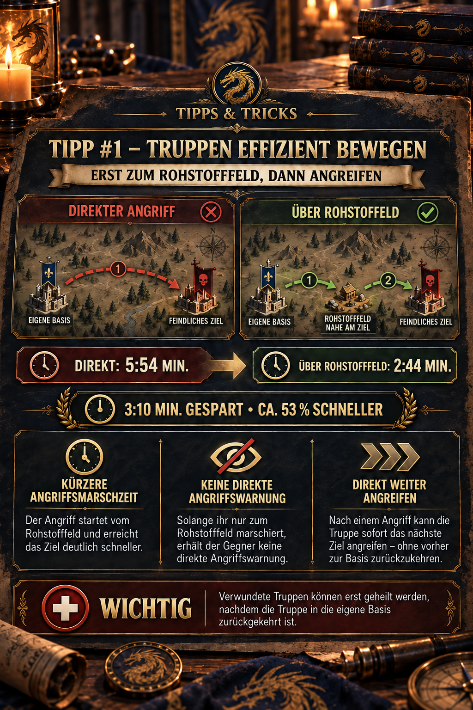

---
arten:
  - Stratégie
  - Optimisation
themen:
  - Troupes
  - Carte du monde
---

# Conseil #1 – Déplacer efficacement les troupes

## Points clés

- **Préparez une attaque :** Envoyez la troupe dans site de ressources près de la cible d'abord, puis lancez l'attaque réelle de là.
- **Réduire le temps de réaction:** La route finale d'attaque devient plus courte, donnant à l'adversaire le temps de réagir. Cela ne donne pas à la troupe un bonus de vitesse.
- **Continuez à vous battre immédiatement :** Après une attaque, une troupe prête au combat peut attaquer sa prochaine cible immédiatement.
- **Retraitez plus vite :** Après l'attaque, marchez vers site de ressources proche et appuyez immédiatement sur,Retreat,. Cela utilise la vitesse de marche plus rapide ressource-tile pour le voyage de retour.
- **Rappelez-vous la guérison:** Les soldats blessés ne peuvent être guéris qu'après être retournés dans votre propre base.

> **Rappelez-vous :** Site de ressources raccourcissent le voyage crucial – tant en attaquant que en reculant.



## À quoi sert cette astuce ?

Cette astuce s'applique principalement aux attaques planifiées sur des cibles plus éloignées. Au lieu d'attaquer directement de votre base, vous utilisez site de ressources comme un **point de départ ou de départ**. L'avantage vient d'une meilleure position de départ pour l'attaque réelle, plutôt que d'augmenter la vitesse de marche.

Cela vous aide :

- raccourcit considérablement la route d'attaque finale,
- donner à la cible le temps de réagir,
- attaquer plusieurs cibles voisines par succession, et
- Déplacez votre troupe avec souplesse autour de la carte après une attaque ou ramenez-la plus vite.

## Comment fonctionne la tactique du point de cheminement

1. **Choisissez une cible :** Décidez quelle base ou autre cible vous voulez attaquer.
2. **Trouver une carrure de ressource :** Choisissez une tuile aussi proche que possible de la cible qui peut servir de point de mise en scène unique.
3. **Envoyez la troupe en avant :** Mars à la carrure de ressources d'abord, plutôt que directement à la cible réelle.
4. **Préparez l'attaque :** Regardez la marche et vérifiez la cible, le temps de marche et l'effectif des troupes encore avant d'attaquer.
5. **Attaque depuis le point de départ :** Lancez l'attaque seulement quand vous êtes proche de la cible. Une variante décrite par la communauté redirige la marche vers la cible réelle peu avant d'atteindre la tuile de ressource.
6. **Décidez de ce qui suit :** Attaquez une autre cible à proximité, ou rendez la troupe à votre base si des soldats blessés ont besoin de guérison.

## Pourquoi la tactique fonctionne

### Temps de réaction plus court que la vitesse plus élevée

Site de ressources n'augmente pas automatiquement la vitesse de marche. Après le prépositionnement, la troupe est tout simplement plus proche de la cible. **voie d'attaque finale**, et l'adversaire a le temps de répondre à l'attaque spécifique.

Bien que la troupe ne marche que vers site de ressources, elle n'est pas en marche directe contre la base cible. Cependant, la troupe reste visible sur la carte mondiale. **ne rend pas une marche invisible**; initialement, il ne cache que l'intention réelle et raccourcit la fenêtre entre la délivrance du commandement d'attaque et l'impact.

### Attaque plusieurs cibles sans rentrer chez elles

Après une bataille, la troupe n'a pas nécessairement à retourner à sa propre base d'abord. S'elle reste prête au combat, elle peut attaquer la prochaine cible directement de sa position actuelle. sont dans la même zone.

> **Important:** Les soldats blessés ne peuvent être guéris qu'après le retour de la troupe à votre propre base. Après chaque bataille, vérifiez si une autre attaque vaut vraiment le temps gagné.

### Utilisez site de ressources pour une retraite plus rapide

Site de ressources sont utiles pour plus que s'approcher d'une cible. Après une attaque, vous pouvez également les utiliser pour ramener la troupe à votre base plus rapidement:

1. Sélectionner un **carrelage des ressources près de la troupe, position actuelle** après l'attaque.
2. Envoyez la troupe vers cette tuile.
3. Immédiatement après le début de la marche, appuyez **- Retraite.**. - La troupe n'a pas à atteindre la tuile des ressources d'abord.
4. La marche de retour utilise alors la vitesse de marche des ressources-tiles plutôt que la vitesse plus lente d'une marche directe vers la base.

Vous n'avez pas besoin d'une tuile de ressource près de votre propre base. Ce qui compte est une tuile près de la troupe qui est facile à atteindre, vous permettant de commencer la marche de ressource et l'annuler immédiatement.

> **Prestations pratiques:** Cela permet aux soldats blessés de retourner à l'hôpital plus rapidement et de rendre la troupe disponible plus tôt.Comparez brièvement le temps de retour affiché avant de confirmer, puisque la recherche, les bonus et les mises à jour de jeu peuvent affecter ces temps.

## Exemple de l'illustration

| Comparaison | Heure de mars | Converti |
| --- | ---: | ---: |
| Attaque directe | 5:54 min | 354 secondes |
| Attaque à partir site de ressources | 2:44 min | 164 secondes |
| Temps économisé sur la route d'attaque | **3:10 min** | **190 secondes** |

La route d'attaque plus courte prend donc autour **53.7% ou du temps**:

`(354 − 164) ÷ 354 × 100 = 53.7%`

En d'autres termes, l'attente du commandement d'attaque est seulement autour **46.3%** Dans cet exemple, l'attaque directe prend environ **2.16 fois aussi longtemps**. La vitesse réelle de marche ne change pas.

> **Contexte :** Ce calcul compare l'attaque directe à une attaque **d'site de ressources déjà atteint**. Il exclut le temps passé avant le positionnement. Pour une seule attaque spontanée, le voyage global peut donc être aussi long ou même plus long. L'avantage tactique provient principalement de la réduction de l'adversaire, le temps de réaction, le positionnement tôt, ou lancer plusieurs attaques consécutives.

## Quand la méthode en vaut-elle la peine?

| Situation actuelle | Évaluation |
| --- | --- |
| L'attaque est prévue à l'avance | **Très utile :** Vous pouvez déplacer la troupe près de la cible en temps utile sans émettre un commandement d'attaque direct. |
| Plusieurs objectifs sont étroitement liés | **Très utile :** Après la première bataille, la troupe peut avancer tout droit. |
| L'opposant devrait avoir le moins de temps possible pour réagir | **Utile:** La route finale, et donc la fenêtre d'avertissement spécifique, devient plus courte. |
| La troupe devrait revenir rapidement après l'attaque. | **Très utile :** Marchez vers site de ressources proche et sélectionnez immédiatement, Retraite,. |
| Tu ne veux qu'une seule attaque immédiate | **Comparer en premier:** Le prépositionnement et la route finale peuvent prendre plus de temps que le trajet direct. |
| La troupe a déjà beaucoup de soldats blessés | **Préférez retourner :** La guérison est impossible sans retourner à la base. |

## Liste de contrôle pratique

- Site de ressources est-elle vraiment plus proche de la cible que votre position actuelle?
- La tuile est-elle libre et la troupe peut-elle y arriver en toute sécurité?
- Combien de temps dure la dernière ligne de la ressource jusqu'à la cible?
- L'adversaire est-il actif et est-il susceptible de remarquer la marche sur la carte?
- Les effectifs restants sont-ils suffisants pour l'attaque et une deuxième cible possible?
- La troupe doit - elle revenir pour guérir après, ou peut - elle continuer à se battre?
- Y a-t-il site de ressources près de la troupe, la position actuelle pour la retraite?
- Le retour via,march vers site de ressources → retraite immédiate, en fait plus rapide que d'aller directement à la base?

## Limites et questions ouvertes

- Cette tactique **ne fournit pas d'invisibilité**. Les joueurs attentifs peuvent repérer la marche sur la carte et devinez votre intention.
- Une fois l'attaque réelle commencée, supposons que la cible peut recevoir un avertissement. L'affichage et le timing exacts de l'avertissement doivent être vérifiés dans le jeu à nouveau après les mises à jour majeures.
- Les temps de mars dépendent de la distance, de la recherche, des primes actives et de la troupe utilisée. 5:54 et 2:44 Les minutes sont un exemple pratique spécifique, et non des valeurs universelles.
- La tuile de ressource sert de point de positionnement. Si elle devient occupée, nettoyée ou inutilisable d'une autre manière, vous avez besoin d'un point de cheminement alternatif.
- La variante de retraite repose également sur le calcul actuellement observé dans le jeu. Revérifier les heures de marche affichées après les mises à jour du jeu.

## Sources et fiabilité

- **DIE exemple pratique:** Les temps, la procédure, la note de guérison et la variante de retraite viennent de l'alliance, les connaissances pratiques, l'annonce approuvée de l'alliance et l'illustration de jeu.
- **Source communautaire:** [Z Route Academy – Tactics de mars : approches de point de repère](https://zroute.dev/combat/march-tactics/) décrit la même technique en utilisant site de ressources comme un point de départ et la liste comme,Communauté vérifiée, à partir de 14 Septembre 2026.
- **Page du jeu officiel:** [Route Z: Redemption sur l'App Store Apple](https://apps.apple.com/app/z-route-redemption/id6762268182). Recherche sur 25 Septembre 2026 n'a pas trouvé de documentation officielle accessible au public expliquant ce mécanicien de marche en détail.

En cas de divergence, l'affichage courant dans le jeu prend la priorité. Les captures d'écran ou les tests reproductibles de l'Alliance doivent être utilisés pour mettre à jour cet article.

## Annonce de l'Alliance à copier

```html
<size=38><color=#8DAA2D><b>► TEMPS #1 – MOVE TROOPS EFFICACEMENT</b></color></size>

Envoyez vos troupes à une <color=#8DAA2D><b>carrelage des ressources près de la cible</b></color> d'abord, et attaquez de là.

<b>Avantages:</b>
- -,,,,,,,
- Pas d'avertissement d'attaque directe alors que vous marchez seulement vers site de ressources
-Après une attaque, la troupe peut attaquer sa prochaine cible immédiatement – sans revenir à la base en premier.

<b>Exemple :</b>
Direct : 5:54 min
Par site de ressources: 2:44 min
À propos <color=#8DAA2D><b>53% Plus vite!</b></color>

<color=#D85B45><b>- Oui.</b></color> Les troupes blessées ne peuvent être guéries qu'après le retour des troupes dans votre propre base.
```
