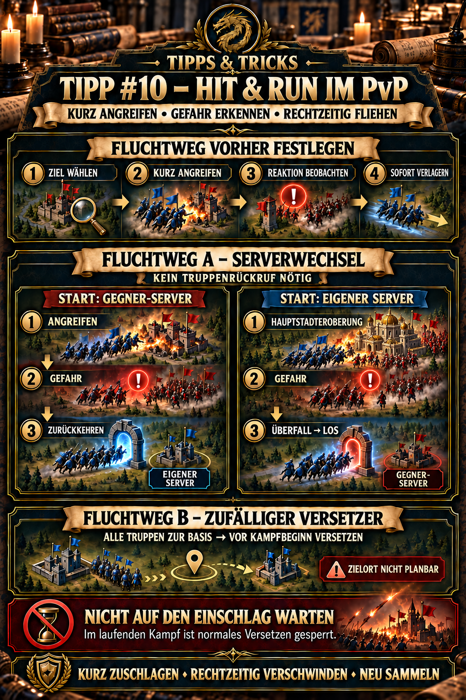

---
arten:
  - Stratégie
  - Optimisation
themen:
  - Événements
  - Combat
  - Troupes
  - Carte du monde
---

# Conseil #10 – Hit & Run in PvP

## Points clés

- **Affichage & Exécuter** signifie attaquer brièvement une cible valable et déplacer votre base avant que l'adversaire puisse efficacement riposter.
- Pour les petites alliances, cela a souvent plus de sens que de défendre une position intenable contre des adversaires beaucoup plus forts.
- **Route d'évasion A – le serveur voyage à travers Raid:** Cette sortie de secours fonctionne dans les deux sens. Si vous vous battez sur le serveur adverse, utilisez **Retour** Si vous vous battez sur votre propre serveur pendant Conquête de la capitale, utilisez **Concours Alliance → Raid → Aller** pour atteindre le serveur adverse. Selon le courant DIE expérience joueur, les troupes en dehors de votre base n'ont pas besoin d'être rappelés d'abord.
- **Route d'évacuation B – Réemplacement aléatoire :** Rappelez toutes les troupes à votre base et utilisez le Aléatoire de Relocator avant le début de la bataille. La nouvelle position de bord ne peut pas être planifiée, mais vous sépare rapidement du point de danger précédent.
- N'attendez pas l'impact. Une fois la bataille en cours, un relocalisateur normal ne peut plus être utilisé.
- Après chaque relocalisation, vérifiez immédiatement la position, les marches entrantes, le statut de bouclier, Battle Frenzy et vos troupes, les routes de retour.

> **Rappelez-vous :** Grève brièvement, reconnaît le danger tôt, disparaît dans le temps.



## À quoi sert cette astuce ?

Cette astuce décrit un mobile PvP la tactique pour les situations où maintenir votre poste de façon permanente serait trop coûteux ou désespérée, notamment pour :

- petites alliances face à des adversaires beaucoup plus forts,
- Raid dans la compétition d'alliance,
- Conquête de la capitale pendant l'Expédition Frenzy,
- ouvert PvP phases avec de nombreuses attaques entrantes, et
- attaques individuelles sur des bases ennemies mal protégées.

Hit & Run n'est pas une invitation à des attaques individuelles aveugles. Attaquez une cible seulement lorsque le retour possible justifie le risque et une voie d'évacuation en cours de route est préparée.

## Principe de base

```text
Sélectionner la cible
      ↓
attaque brièvement et de manière contrôlée
      ↓
Regardez la réponse ennemie
      ↓
Déménagement dans le temps
      ↓
de vérifier la situation, les troupes et la protection
```

La tactique échange la position permanente de la mobilité. Donnez à l'adversaire le moins de temps possible pour:

- organiser un rassemblement,
- bloquer votre position de retour,
- attaquez votre base à plusieurs reprises, ou
- vous forcez à un échange prolongé avec de lourdes pertes.

La retraite n'est pas un échec ici, mais une partie prévue de l'attaque.

## Avant chaque attaque : Décidez de la voie d'évasion

Attaque seulement une fois que ces questions sont répondues:

1. Est-ce que Raid est actuellement ouvert?
2. Vous combattez-vous seul ou sur le serveur adverse – et quel transfert vous fait sortir de danger?
3. Un relocalisateur aléatoire est-il dans votre inventaire?
4. Est-ce que tous les mouvements normaux peuvent être rappelés rapidement?
5. Battle Frenzy ou un autre statut de blocage de téléportation est-il déjà actif?
6. Comment identifierez-vous la réponse ennemie – une marche entrante, un drapeau de rallye, un scoutisme ou un joueur fort qui se téléporte à proximité?
7. À quel signal allez-vous arrêter sans tenter, une dernière attaque,?

> **Règle pratique:** Décidez de la voie d'évacuation avant d'attaquer, pas sous la pression du temps après.

## Route d'évacuation A: Changer les serveurs par Raid

Pendant le Concours Alliance, l'interface allemande peut inscrire cette section **Raubzug** ou **Überfall**. Le voyage du serveur peut servir de route d'évacuation dans les deux sens :

- **Vous vous battez sur le serveur adverse :** Après attaque, utiliser **Retour** quand vous êtes menacé et sautez sur votre propre serveur.
- **Vous vous battez sur votre propre serveur :** Cela peut se produire surtout pendant la conquête du capital. **Concours Alliance → Raid → Aller** pour sauter sur le serveur adverse.

Selon les données actuelles DIE expérience joueur, ce transfert de serveur croisé fonctionne même avec vos troupes en dehors de la base. Cela le rend particulièrement utile pour un retrait rapide: un rappel complet est inutile pour cette route.

### Procédure

1. Avant d'attaquer, vérifiez sur quel serveur vous êtes et quel transfert est disponible comme sortie de secours.
2. Attaque la cible prévue.
3. Regardez la carte et les marches entrantes.
4. En danger évident, choisissez immédiatement la direction appropriée:
   - **Serveur Opposant → propre serveur:** **Retour**.
   - **Serveur propre → serveur opposé :** **Concours Alliance → Raid → Aller**.
5. Confirmez le voyage du serveur et sélectionnez la nouvelle position où le jeu l'offre.
6. Vérifiez immédiatement les affichages des troupes, les itinéraires de retour et les marches entrantes après avoir voyagé.
7. Combattre, guérir ou se regrouper seulement après avoir réévalué la situation.

### Avantages

- Aucun rappel préalable de toutes les troupes requises.
- Gratuit selon l'expérience de joueur documentée.
- Selon votre côté de départ, la limite du serveur peut servir de sortie de secours dans les deux sens.
- Selon l'expérience documentée, la destination sur le serveur adverse et votre nouvelle position d'accueil lors du retour peuvent être librement choisies.

### Limites

- Disponible seulement lorsque le raid est ouvert et que le voyage est autorisé.
- Vérifiez l'état de combat, Battle Frenzy et les règles spéciales dans le dialogue de confirmation actuel.
- Comment chaque marche amicale ou ennemie déjà active est gérée après le saut n'est pas entièrement documentée publiquement.
- Raid, le serveur de destination n'est pas automatiquement le même que l'adversaire dans un autre événement simultané. Vérifiez la destination et retournez l'itinéraire avant de confirmer.

Le voyage complet vers l'extérieur et le retour est décrit dans le Conseil #9 – Relocaliser gratuitement par Raid.

## Route d'évacuation B: Rappeler les troupes et utiliser un relocalisateur aléatoire

Le Aléatoire déplace votre base vers une position sur la carte, bord que vous ne pouvez pas sélectionner librement. Il est moins pratique qu'un téléporté ciblé mais fonctionne comme une sortie de secours préparée peu coûteux.

Pour cette procédure, rappelez-vous vos troupes à la base d'abord.

### Procédure

1. Arrêtez immédiatement les attaques.
2. Rappelez toutes vos équipes et vos marches à votre base.
3. Vérifiez si l'adversaire a déjà frappé ou si la bataille est en cours.
4. Ouvrir la **Rélocator aléatoire**.
5. Confirmez le téléport avant le début de la bataille.
6. Après avoir sauté, vérifiez votre nouvelle position, vos adversaires, votre bouclier et vos troupes.
7. Si la position du bord est mauvaise, ne dépensez pas de façon réflexive des rélocats plus précieux; évaluez d'abord le nouveau danger.

### Avantages

- Disponible indépendamment du Raid si vous avez un article et le téléportage est autorisé.
- Moins cher qu'un Rélocateur avancé.
- La relocalisation aléatoire rend l'adversaire plus difficile à poursuivre immédiatement à votre emplacement précédent.

### Limites

- Toutes les troupes requises doivent revenir à temps.
- La destination ne peut pas être planifiée et peut être loin de l'alliance ou de la cible de l'événement.
- Une fois la bataille en cours, il est trop tard pour ce téléport.
- Une marche entrante n'est pas une licence d'attente : plus le temps restant est court, plus le risque de manquer la fenêtre de téléportation est grand.

Plus de propriétés des trois relocalisateurs sont couverts par le Conseil #4 – Téléportez correctement.

## Quelle voie d'évacuation convient?

| Situation actuelle | Itinéraire privilégié | Pourquoi |
| --- | --- | --- |
| Danger après avoir attaqué sur le serveur adverse | **Retour** | transfert rapide vers votre propre serveur |
| Danger après avoir combattu sur votre propre serveur, par exemple lors de la conquête de Capital | **Raid → Aller** | transfert rapide vers le serveur adverse |
| Voyage de serveur disponible, les troupes continuent de marcher | **Saut d'assaut** | aucun rappel complet n'est nécessaire |
| Raid non disponible, toutes les troupes sont à la maison | **Rélocator aléatoire** | sortie de secours préparée et peu coûteuse |
| Nouvelle position exacte requise | **Rélocator avancé** | seul ce relocalisateur régulier permet un placement ciblé |
| Bataille déjà en cours | **pas de relocalisateur normal** | le retrait a commencé trop tard |
| Route d'évasion floue ou bloquée | **ne pas attaquer** | Hit & Run sans la course est simplement une attaque risquée |

## Hit & Run pendant la conquête du capital

Pour une petite alliance, Hit & Run peut être une alternative utile lorsque des combats objectifs coordonnés avec des équipes de raid fixes sont irréalistes. Les équipes de raid préparées ont la plus grande influence sur la capitale et les batteries; quiconque ne peut pas fournir suffisamment de joueurs actifs ou forts pour cela peuvent à la place:

- attaque seulement des cibles clairement approuvées, légèrement protégées,
- lancer de brèves attaques de notation ou de décharge de pression,
- reconnaître les contre-attaques fortes tôt,
- déplacer la base dans le temps par un saut ou un relocalisateur de raid,
- préserver les troupes et les déployer à nouveau après leur retrait.

Cette tactique ne remplace pas la planification opérationnelle à l'échelle du serveur. Cependant, elle empêche une petite alliance de consommer toutes ses troupes dans une position qu'elle ne peut pas maintenir de façon réaliste.

Avant l'événement, décider clairement :

- **Plan objectif:** Soutenez la capitale et les batteries avec le serveur.
- **Plan & Lancer & #160;:** Lancez des attaques mobiles, occupez des adversaires, poursuivez des objectifs personnels de manière contrôlée et limitez vos pertes.

Changer de plan uniquement sur instruction. Sinon, les joueurs manquent à l'objectif tandis que d'autres assument le soutien partagé.

## Signalisations à arrêter

Envisager de retirer au plus tard quand l'un de ces signaux apparaît :

- Un joueur bien plus fort téléporte tout de suite.
- Un drapeau de rallye apparaît sur votre base.
- Plusieurs marches ennemies commencent simultanément.
- Vos troupes sont déjà lourdement endommagées.
- La voie d'évacuation prévue peut se fermer.
- Le leadership opérationnel exige un changement de secteur ou de plan.

Toutes les actions de scoutisme ne sont pas automatiquement une attaque. Néanmoins, avec une grande différence de puissance, réagir trop tôt est souvent préférable que réagir une seconde trop tard.

## Erreurs courantes

- **Attaque sans voie d'évacuation préparée:** Hit & Run devient une attaque risquée ordinaire.
- **En attente d'impact :** Les relocalisateurs normaux ne fonctionnent pas pendant une bataille en cours.
- **Revoir inutilement toutes les troupes pour un saut en rafale :** Actuellement DIE l'expérience montre que cela est inutile.
- **Quitter les troupes en dehors lorsque vous utilisez le Rélocator aléatoire :** Cette procédure les rappelle à la base d'abord.
- **Commencer, une autre attaque, :** Des secondes supplémentaires peuvent coûter le retrait sécuritaire.
- **Confusant la destination Raid avec l'adversaire de l'événement:** Vérifiez le serveur cible avant chaque saut de serveur croisé.
- **Non vérifié après le téléportage :** Examiner immédiatement les routes des troupes, les marches entrantes, les boucliers et les nouveaux environs.
- **Confusant Hit & Run avec fuite constante :** Après avoir déménagé, regrouper, guérir et préparer le prochain déploiement contrôlé.
- **Laisser le groupe objectif sans accord:** Les tactiques mobiles et le plan objectif doivent être assignés au préalable.

## Limites et questions ouvertes

- Le saut à l'eau avec des troupes en dehors de la base repose sur le courant DIE expérience de joueur et le déjà documenté Conseil #9.
- La gestion des marches amicales et ennemies actives après un voyage entre serveurs n'est pas encore documentée pour chaque cas.
- Le Relocator Aléatoire est mis en évidence par le Conseil #4; qui, outre une bataille en cours, empêche son utilisation a encore besoin de tests.
- Les règles de téléportation, les cooldowns, les serveurs cibles et les événements recoupant peuvent changer avec les mises à jour.
- Un nouvel emplacement n'est pas automatiquement sûr. Réévaluer la carte après chaque saut.

## Sources et fiabilité

- **DIE connaissances pratiques:** La combinaison de sauts en fuite lorsque les troupes sont menacées et en rappel avant d'utiliser un Aléatoire Relocator vient de l'expérience actuelle des joueurs de l'alliance.
- **Autres DIE Conseils:** Conseil #4 documente les rélocats, les effets et les restrictions de combat; Conseil #9 documente le saut croisé gratuit et son utilisation avec les troupes en dehors de la base.
- **Description du rôle communautaire:** [Expédition Frenzy – Zroute Non officielle](https://zroutegame.com/expedition-frenzy/) décrit un mobile,Boncer, rôle: attaquer des cibles légèrement protégées et immédiatement téléporter lorsque contre-attaqué au lieu de rester à la cible.
- **Confirmation publique des déplacements des serveurs :** [Guerre interservatrice at IMPH](https://imph.info/interserver-war) confirme la téléportation sur le serveur adverse pendant Alliance Competition mais ne documente pas toutes les variantes d'évasion décrites ici.

**À partir de:** 27 Septembre 2026

## Annonce de l'Alliance à copier

```html
<color=#FFD700><b>► TEMPS #10 – HIT & RUN IN PvP</b></color>

Attaque seulement lorsque votre <b>la voie d'évacuation est déjà décidée</b>Ne restez pas contre une forte résistance!

🌍 <b>VOIE A – VOYAGE DE SERVEUR :</b> Raid fonctionne comme une sortie de secours dans les deux sens: sur le serveur adverse, utiliser <b>Retour</b> sur votre propre serveur – par exemple pendant Conquête de la capitale – sautez vers l'adversaire par <b>Concours Alliance → Raid → Aller</b>. L'expérience actuelle indique que les troupes en dehors de votre base n'ont pas besoin de se rappeler.

❓ <b>ROUTE B – RANDOM RELOCATEUR:</b> Ramenez toutes les troupes à la base et au téléport <b>avant</b> La bataille commence.

⚠️ <color=#FF4040><b>N'attendez pas pour l'impact!</b></color> Un relocalisateur normal est bloqué pendant une bataille en cours.

<color=#7FFF00><b>Grève brièvement → reconnaître le danger → disparaître dans le temps → regrouper.</b></color>
```
