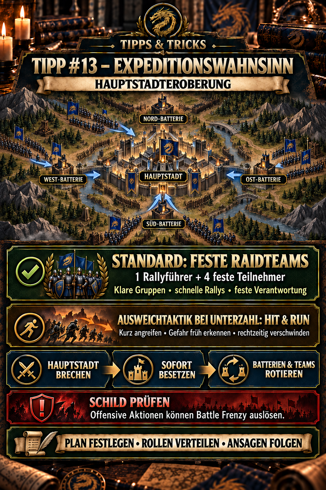

---
arten:
  - Guide
  - Stratégie
themen:
  - Événements
  - Combat
  - Alliance
  - Carte du monde
---

# Conseil #13 – Expédition Frenzy: Conquête du capital

## Points clés

- Du dimanche au vendredi, collecté conjointement **Points de zone de guerre** déterminer quel serveur attaque samedi et qui se défend.
- Pendant la phase de combat, l'objectif du serveur partagé est important : les agresseurs doivent capturer la capitale adverse, tandis que les défenseurs doivent l'empêcher.
- Les quatre **piles** Les batteries contrôlées et bien garnies mettent les troupes ennemies à l'intérieur de la capitale sous pression.
- Une alliance atteint **impact maximal** avec des équipes de raid fixes : un chef de rallye responsable, quatre participants désignés, des cibles préparées, des signaux et des substituts.
- Les ARN coordonnées peuvent également être fortes et réussies. Elles prennent généralement plus de temps, réagissent plus lentement et obtiennent des résultats optimaux de façon fiable.
- Si une petite alliance ne peut pas déployer des équipes de raid viables ou avoir un objectif, **Affichage & Exécuter** est une alternative délibérée: attaquer brièvement et se déplacer à temps avant une contre-attaque supérieure.
- Pas d'attaques individuelles non coordonnées contre la capitale. Après rotation, les équipes endommagées guérissent, réorganisent et se déploient à nouveau seulement sur instruction.
- Les actions offensives telles que l'attaque, le dépistage ou la jonction d'une attaque peuvent mettre fin à un bouclier et déclencher **Frise de bataille**. Vérifiez l'avis actuel avant chaque action.
- Selon le présent DIE calendrier, la phase de bataille dure au plus quatre heures et peut se terminer plus tôt une fois qu'un côté atteint **100% Progrès réalisés**.

> **Rappelez-vous :** Utilisez des équipes de raid fixes pour une pression objective maximale; quand elles sont plus nombreuses, passez délibérément à Hit & Run contrôlé.



## À quoi sert cette astuce ?

Ce conseil explique la conquête du capital dans **Expédition Frenzy**. L'événement est un combat inter-serveurs : plusieurs alliances du même serveur poursuivent conjointement un objectif contre leur serveur adverse assigné.

Cette page vise à prévenir trois problèmes communs:

1. Les joueurs confondent la phase de notation hebdomadaire avec la phase de bataille réelle.
2. Tout le monde se concentre sur la capitale et laisse les piles vides.
3. Les membres attaquent individuellement, perdent leurs boucliers et consomment des troupes sans soutenir l'attaque partagée.
4. Les petites alliances tentent de défendre une position intenable quand un plan de Hit & Run mobile préserverait mieux les troupes.

La conquête de capital décrite ici n'est pas équivalente à une capture de capital ordinaire dans votre propre serveur. Les règles, les objectifs autorisés et la coopération peuvent différer.

## Expédition Frenzy en trois phases

| Phase | Période | Signification |
| --- | --- | --- |
| La zone de guerre | Du dimanche au vendredi | Le serveur collecte conjointement des points Warzone. |
| Évaluation | Vendredi | Le serveur à plus haut niveau devient attaquant ; l'autre devient défenseur. |
| Conquête de la capitale | Samedi | Les deux serveurs se battent pour la capitale, les batteries et la barre de progression. |

Les points de zone de guerre et les points personnels servent à des fins différentes :

- **Points de zone de guerre** déterminer les rôles d'attaque et de défense pendant la semaine.
- **Points personnels** sont gagnés pendant la phase de bataille et comptent pour des récompenses personnelles.
- **Victoire du serveur** dépend de l'objectif de conquête ou de défense partagé.

Toute personne ne poursuivant que des scores personnels peut manquer de l'objectif du serveur. Avant la bataille, décider si un joueur est affecté à la capitale, une batterie, un support ou une autre tâche approuvée.

## Plan principal et tactique alternative

La conquête du capital a un ordre tactique clair de priorité. La lutte objective avec les équipes de raid fixes est la meilleure application des normaux coordonnés et a la plus grande influence sur la capitale et les batteries. suffisamment forts, toujours disponibles pour mettre en œuvre pleinement cette.

| Approche | Objectif | Évaluation |
| --- | --- | --- |
| **Plan principal – équipes de raid fixes** | capture, occupe et tourne à travers la capitale et les batteries avec des groupes de cinq personnes préparés | une organisation optimale pour un impact maximal; exige une responsabilité claire et suffisamment de participants actifs |
| **Rassemblement non coordonné** | former des individus forts et des membres disponibles | encore utile, mais plus lent, plus sujet à erreur et moins fiable qu'une équipe de raid fixe |
| **Alternative – Hit & Run** | faire de brèves attaques, éviter les forces ennemies supérieures et préserver les troupes | raisonnable lorsque les équipes de raid ne sont pas disponibles ou que l'objectif ne peut pas être maintenu en permanence |

Hit & Run n'est donc pas égal à une lutte objective organisée optimalement; c'est une alternative délibérée quand elle est plus nombreuse ou insuffisamment active. d'accord.

### Hit & Run comme alternative pour les petites alliances

Lorsque la tenue de façon permanente est irréaliste, il n'y a qu'une attaque clairement choisie et que la distance demeure mobile.

1. **Saut d'assaut :** Comme Conquête de la capitale peut coïncider avec Raid dans Alliance Competition, l'événement peut être utilisé pour sauter sur le serveur adverse quand il est menacé. DIE Les troupes en dehors de la base n'ont pas besoin de rappeler d'abord.
2. **Rélocateur aléatoire :** Si le saut à l'eau n'est pas disponible, rappelez-vous toutes les troupes à la base. Ensuite, utilisez un relocalisateur aléatoire – strictement avant que la bataille ne soit déjà en cours.

Les bases sont dans le Conseil #10 – Hit & Run in PvP. Conseil #11 – Équipes de raid fixes en PvP explique la préparation et la direction de groupes fixes de cinq personnes.12 – Lire les rapports de bataille correctement aide avec la revue ultérieure.

## Lire correctement l'horaire

Les heures de jeu se réfèrent au temps du serveur. 2026 date, DIE calendrier liste la phase de bataille, par exemple, de **16:00 à 20:00 Heure locale allemande**. Ne pas prendre en compte en permanence cette heure locale : les changements d'économie de lumière et les mises à jour du jeu peuvent modifier la conversion.

Avant chaque événement, vérifiez donc:

1. la date et l'heure dans la DIE calendrier,
2. le statut d'agresseur ou de défenseur après vendredi,
3. lorsque l'accès au serveur adverse s'ouvre,
4. le début de la phase de bataille, et
5. conditions de victoire actuelles dans la fenêtre de l'événement.

La documentation actuelle indique que la phase de bataille se termine au plus tard quatre heures ou plus tôt lorsque l'un ou l'autre des côtés atteint **100% Progrès réalisés**. Le texte courant dans le jeu prend la priorité pour l'événement spécifique.

## Capital et batteries

La capitale est au centre. Quatre piles l'entourent :

| Position de la carte | Nom |
| --- | --- |
| en haut à gauche | Ouest |
| en haut à droite | Nord |
| en bas à gauche | Sud |
| en bas à droite | Est |

Selon le mécanicien documenté publiquement, une batterie contrôlée par votre serveur tire sur les équipes ennemies à l'intérieur de la capitale. La batterie ne capture pas la capitale elle-même, mais rend plus difficile pour l'adversaire de la tenir en permanence.

Cela crée une priorité simple:

> **La capitale décide du résultat – les batteries rendent le maintien durable ou non durable.**

Une attaque qui ne se concentre que sur la capitale peut donc échouer même après un premier rallye réussi. Si les batteries ennemies restent actives, les nouvelles garnisons continuent à s'affaiblir. Inversement, une batterie complète offre peu d'avantages si personne ne prend ou ne prend la relève. défend la capitale.

### Valeurs des batteries documentées par la communauté

Le guide communautaire détaillé documente actuellement les valeurs suivantes : DIE archive ne les a pas confirmés indépendamment par ses propres captures d'écran actuelles:

| Équipes de garnison | Temps de recharge documenté |
| ---: | ---: |
| 0–4 | 10 secondes |
| 5–9 | 9 secondes |
| 10–14 | 8 secondes |
| 15–19 | 7 secondes |
| 20 | 6 secondes |

En conséquence, chaque cinquième équipe réduit le temps de recharge d'une seconde; à 20 Les équipes devraient atteindre le minimum documenté. Vérifier la capacité actuelle et les descriptions des effets en jeu avant le déploiement. Quels que soient les nombres individuels, cela reste valable pour la planification pratique de l'alliance : **Une batterie capturée mais à peine occupée exerce une pression inférieure à celle d'une batterie entièrement supportée.**

## Attribuer des rôles pour le plan objectif

Ces noms ne sont pas des rôles de jeu officiels. Ils décrivent les tâches à assigner avant de commencer.

### Direction opérationnelle

Le leadership opérationnel surveille la carte et les progrès, place les marqueurs et autorise :

- la cible à attaquer en premier,
- qui commence un rassemblement,
- lorsqu'il faut renforcer le capital ou une batterie,
- lorsque les équipes endommagées tournent, et
- quand abandonner une cible pour en obtenir une plus importante.

Pendant une attaque en cours, seul un petit nombre de joueurs clairement identifiés devraient donner des ordres.

### Groupe de capital

Ce groupe est composé des équipes les plus solides et fiables, prêtes au combat. Leur tâche n'est pas de marcher en solo dans la capitale, mais de :

1. enlever les garnisons ennemies par des troupes armées coordonnées,
2. rapidement déployer des équipes amicales après une capture réussie,
3. soulager les garnisons endommagées dans le temps, et
4. répondre immédiatement à une prise de contrôle ennemie avec une contre-attaque préparée.

Pour un impact maximum, le groupe de capital travaille en équipes de raid fixes avec un leader responsable et quatre participants assignés. Nommez un remplaçant au préalable si possible. Si cette structure n'est pas entièrement possible, l'alliance peut encore former des archivistes solides avec les membres disponibles; laisser plus de temps pour les appels, les vérifications d'équipe et le remplacement des participants.

### Groupes de batteries

Assignez au moins un joueur responsable ou un groupe fixe à chaque batterie prioritaire.

- saisir la cible qui leur est assignée,
- rapporte des garnisons ennemies fortes,
- remplir les fentes disponibles,
- rotation des équipes endommagées, et
- ne quittez pas leur position pour une cible solitaire lointaine.

Deux batteries de contrôle fiable peuvent être un objectif intermédiaire raisonnable; quatre batteries de contrôle créent une pression partagée maximale. la force.

### Appui et sécurité des positions

Les joueurs faibles peuvent également contribuer de façon décisive:

- remplir complètement les lettres d'identification approuvées,
- occuper des batteries avec des équipes encore utilisables,
- renforcer les bases de leur propre alliance,
- bloquer les points d'atterrissage et les approches près des joueurs importants,
- signaler les marqueurs et les mouvements ennemis, et
- fournir une aide d'alliance pour la guérison entre les vagues d'attaque.

La coopération transfrontalière sur le même serveur est possible à l'objectif partagé. Cependant, selon la documentation communautaire actuelle, les membres ne peuvent toujours pas rejoindre une autre alliance, s'unir ou renforcer une autre alliance, s base. et de la protection de base au sein de votre propre alliance.

## Préparation avant la bataille

### Vendredi

- Vérifiez le statut d'agresseur ou de défenseur.
- Évaluer les combats objectifs avec des équipes de raid fixes comme plan principal; choisir Hit & Run comme alternative si la force ou l'activité est insuffisante.
- Nommer le leadership opérationnel, les leaders de rallye, quatre participants fixes et les remplaçants de chaque équipe de raid.
- Assigner les groupes de capital et de batterie.
- Demandez-vous sur la participation et les périodes approximatives en ligne.
- D'accord marqueurs, canal de discussion et commandes courtes.
- Expliquez quelles actions personnelles les membres doivent subordonner à l'objectif du serveur.

### Avant l'ouverture de l'accès

- Vérifiez l'équipe principale, l'effectif et les créneaux de marche.
- Videz l'hôpital et vérifiez la capacité.
- Préparer les ressources de guérison, de marche et de réinstallation.
- Vérifiez les primes de combat actif et leur durée.
- Activer un bouclier de paix seulement en sachant que les actions offensives peuvent y mettre fin.
- Rouvrir le tuyau #8 sur la guérison rapide et organiser assez d'aide.

### Avant le début de la bataille

- Prenez la position assignée.
- Ne pas repérer ou attaquer sans approbation.
- Vérifiez quel joueur ouvre le rallye.
- Nommez clairement les symboles de la batterie et du capital pour éviter de confondre le Nord, le Sud, l'Est et l'Ouest.
- Assigner les premières équipes de remplacement et l'ordre de rotation.

## Plan d'attaque pour le serveur attaquant

### 1. Positions sécurisées

Les attaquants doivent utiliser la phase d'accès et de positionnement disponible. Les marches courtes et les points d'atterrissage gratuits aux côtés des joueurs forts deviennent précieux pendant la bataille.

### 2. Choisissez une cible d'ouverture partagée

Avant de commencer, la direction opérationnelle décide si elle doit attaquer une batterie spécifique, plusieurs batteries ou la capitale directement. Le plan doit correspondre à la force réelle et le nombre de participants.

### 3. Briser les garnisons avec des symboles

Les attaques solos contre une forte garnison de la capitale ont dispersé des soldats blessés, révélé des positions et peut déclencher Battle Frenzy. Le chef du rallye commence, les quatre participants assignés se remplissent immédiatement d'équipes approuvées, et tout le monde attend la Si un membre n'est pas disponible, le substitut pré-nommé s'y met. Un rallye fort reste possible sans équipes de raid fixes, mais nécessite une phase de rassemblement et de vérification plus longue.

### 4. Å Å Å Å Å Å Å Å

Une attaque réussie n'est que le point de transition. Les équipes fraîches doivent entrer dans la cible immédiatement alors que les équipes endommagées reviennent et guérissent.

### 5. Stabiliser les batteries en parallèle

Pendant que le groupe de la capitale fonctionne, les groupes de batteries réduisent le bombardement ennemi et augmentent la pression amicale. Les équipes plus faibles peuvent être tactiquement plus précieuses ici que dans une attaque non coordonnée contre la capitale.

## Plan de défense pour le serveur de défense

### 1. Bonnes positions de travail tôt

Les défenseurs connaissent la zone cible. Les joueurs forts et les partisans assignés devraient occuper des endroits importants avant le départ, plutôt que d'arriver après la première attaque.

### 2. Ne pas voir la capitale isolément

Une forte garnison de capital sans contrôle de batterie fait face à des bornes continues. La défense de la batterie fait donc partie de la défense de capital.

### 3. Gardez les garnisons de remplacement prêtes

Après un rallye ennemi, il faut savoir immédiatement qui remplace les équipes éliminées ou endommagées. Ne commencez pas à chercher des équipes fraîches seulement une fois que la capitale est vide.

### 4. Coordonne les contre-attaques

Lorsque l'adversaire prend une cible, ses équipes impliquées sont souvent déjà endommagées. Une contre-attaque préparée utilise cette brève fenêtre mieux que plusieurs attaques en solo retardées.

## Bouclier et frénésie de combat

Selon les documents communautaires actuels, ces règles de base s'appliquent :

| Mesures à prendre | Conséquence du bouclier documenté |
| --- | --- |
| Capital d'attaque, batterie ou base | les extrémités de bouclier; Fringy de bataille |
| Rejoignez un rassemblement offensif | les extrémités de bouclier; Fringy de bataille |
| Scout une cible | les extrémités de bouclier; Fringy de bataille |
| Tenir une position passivement | bouclier reste possible |
| Renforcer un membre, base au sein de votre propre alliance | bouclier reste possible |

Battle Frenzy est listé là comme **15 minutes**, empêchant un nouveau bouclier pendant ce temps. DIE les avis d'événement également spécifier 15 Néanmoins, vérifiez l'avertissement actuel avant chaque action, car des mises à jour ou des règles spéciales peuvent modifier des cas individuels.

> **Règle de sécurité:** Toute personne affectée à un soutien sous un bouclier ne doit pas attaquer, juste brièvement, ou de scouter indépendamment.

## Rotation, guérison et redéploiement

Une équipe n'est pas automatiquement fraîche après avoir gagné. Son effectif restant détermine si elle peut continuer à tenir.

Un cycle propre ressemble à ceci:

`fight → occupy target → watch damage → relieve → return → heal in small batches → redeploy`

Trois règles aident :

1. **N'attendez pas l'effondrement complet.** La rotation en temps opportun préserve la préparation.
2. **Organisez le soulagement avant le retrait.** L'équipe endommagée ne quitte la garnison qu'une fois qu'un remplaçant marche ou est arrivé.
3. **Accélérez la guérison ensemble.** Les petits lots et l'alliance active aident les équipes à revenir plus rapidement; voir Conseil #8.

## Planifier de manière délibérée les objectifs du serveur et les points personnels

Conquête de la capitale offre des classements personnels, mais pas toutes les actions de haut niveau contribuent également à la victoire. Dans le plan objectif optimal, un joueur assigné poursuivant une cible solitaire lointaine est absent du rallye décisif. Inversement, Les cibles individuelles mobiles peuvent être destinées à une alternative de Hit & Run explicitement ordonnée.

Avant la bataille, établir:

- qui soutiennent exclusivement l'objectif du serveur,
- quels joueurs suivent le plan de Hit & Run mobile,
- lorsque des points personnels peuvent être recueillis,
- quelles cibles ne doivent pas explicitement être attaquées, et
- quand tous les joueurs doivent retourner dans la capitale.

Les récompenses personnelles sont valables. Ce qui compte, c'est que le plan objectif soit prioritaire alors que l'alliance offre des équipes de raid viables pour elle. Assigner un groupe Hit & Run séparément et délibérément; il ne doit pas lier le rallye engagé les participants.

## Erreurs courantes

- **Constant la notation hebdomadaire avec la bataille :** Les points de zone de guerre déterminent l'attaque et la défense; ils ne remplacent pas samedi, les combats.
- **Ne regarder que la capitale :** Sans piles, une garnison nouvellement capturée est rapidement sous pression.
- **Marchant individuellement dans des garnisons fortes:** Cela crée des pertes sans assurer une prise de contrôle coordonnée.
- **Ne pas se reconstituer après capture:** Une cible vide ou faiblement occupée est immédiatement perdue à nouveau.
- **Épuisant chaque joueur fort simultanément:** Il ne reste pas de groupe pour une contre-attaque.
- **Garder les équipes endommagées trop longtemps :** La rotation en temps opportun est meilleure que l'élimination complète.
- **Perte accidentelle d'un bouclier :** La participation au scoutisme ou au rassemblement peut aussi être considérée comme une action offensive.
- **Déplanifier d'autres alliances :** Un objectif partagé ne permet pas automatiquement de soutenir d'autres alliances, des traditions ou des bases.
- **Combattre des points personnels :** Le résultat du serveur est décidé à la capitale et les batteries.
- **Forcer une position intenable:** Les petites alliances peuvent délibérément choisir Hit & Run plutôt que de consommer toutes les troupes à l'objectif.
- **En supposant des temps fixes pour toujours:** Revérifier l'heure du serveur, l'heure locale allemande et les changements d'heure pour chaque événement.

## Liste de contrôle pour le déploiement compact

### Avant de commencer

- [ ] Attaque ou défense confirmée
- [ ] des équipes de raid fixes affectées à des objectifs, ou Hit & Run délibérément choisi comme alternative
- [ ] temps actuel et phase d'accès vérifiés
- [ ] chef opérationnel, chef de rallye, quatre participants et remplaçant nommé pour chaque équipe de raid
- [ ] Groupes de capital et de batterie affectés
- [ ] hôpital, troupes, créneaux de marche et réinstallateurs préparés
- [ ] règles de bouclier et de combat Frenzy lire
- [ ] les marqueurs et les commandes de chat ont accepté

### Pendant la bataille

- [ ] prioriser le plan objectif; utiliser Hit & Run seulement lorsqu'il est attribué en conséquence
- [ ] remplir complètement les caractères avec des équipes appropriées
- [ ] occuper la capitale immédiatement après une attaque réussie
- [ ] ne pas laisser les piles vides
- [ ] soulager les équipes endommagées à temps
- [ ] guérir en petits lots et fournir une aide d'alliance
- [ ] signaler les progrès et les mouvements ennemis

## Limites et questions ouvertes

Plusieurs valeurs détaillées manquent encore de notre propre courant DIE Les preuves en jeu, notamment :

- le calcul exact de la barre de progression,
- temps de recharge et seuils actuels,
- dommages et traitements infligés aux soldats frappés par des batteries,
- des valeurs ponctuelles personnelles complètes,
- différences possibles entre les rondes d'expédition, et
- changements à partir de mises à jour ultérieures.

La stratégie distingue donc les principes stables – les symboles coordonnés, le capital plus les batteries, les rôles et la rotation – des nombres dépendants de la version.

## Sources et fiabilité

- **DIE calendrier et base opérationnelle:** [Conquête de la capitale sur 26 Septembre 2026](../../../Termine/fr/2026_09_26_Hauptstadteroberung.md) – logique d'attaque/defender, fenêtre temporelle, 100% progrès, répartition des tâches et combat Frenzy.
- **Documentation communautaire détaillée :** [Expédition Frenzy – Zroute Non officielle](https://zroutegame.com/expedition-frenzy/) – phases, temps du serveur, coopération, positions et valeurs de la batterie, notation personnelle et rôles. La source elle-même identifie de nombreuses revendications ou détails non résolus lus uniquement à partir de captures d'écran.
- **Notes de version:** [Z Route Academy – Mises à jour](https://zroute.dev/updates/) documente la révision visuelle de l'Expédition Frenzy et les changements ultérieurs au retour, marqueurs et récompenses, entre autres mises à jour.
- **Autres DIE Conseils:** Conseil #2 sur les caractères, Conseil #4 sur le téléportage, Conseil #8 sur la guérison rapide, Conseil #9 sur le saut à la vitesse libre, Conseil #10 sur Hit & Run, Conseil #11 sur les équipes de raid fixes et le Conseil #12 sur la lecture des rapports de bataille.

**À partir de:** 27 Septembre 2026

## Annonce de l'Alliance à copier

```html
<color=#FFD700><b>► TEMPS #13 – L'EXPÉDITION FRENZ</b></color>

Pendant <b>Conquête de la capitale</b>, la lutte coordonnée et objective prend la priorité:

🏰 <b>PRINCIPAUX PLANS – TÉLÉMATS RA</b> 1 leader du rallye + 4 Les participants fixes. Attaquez la capitale seulement sur instruction, occupez-la immédiatement après, remplissez les batteries et soulager les équipes endommagées.

⚡ <b>ALTERNATIVE – HIT & RUN:</b> Si nous ne pouvons pas tenir un objectif : des attaques brèves, reconnaître le danger tôt et disparaître à temps à travers un saut ou un relocalisateur Raid.

🤝 <b>- Oui.</b> Les responsabilités fixes produisent un impact maximum. Les fortes signatures spontanées fonctionnent aussi, mais ont besoin de plus de temps et sont moins fiables.

🛡️ <color=#FF4040><b>ATTENTION:</b></color> Attaquer, repérer ou joindre un rallye peut mettre fin à votre bouclier et déclencher 15 Des minutes de Battle Frenzy.

<color=#7FFF00><b>Les équipes Raid d'abord – Hit & Run quand la tenue est irréaliste!</b></color>
```
