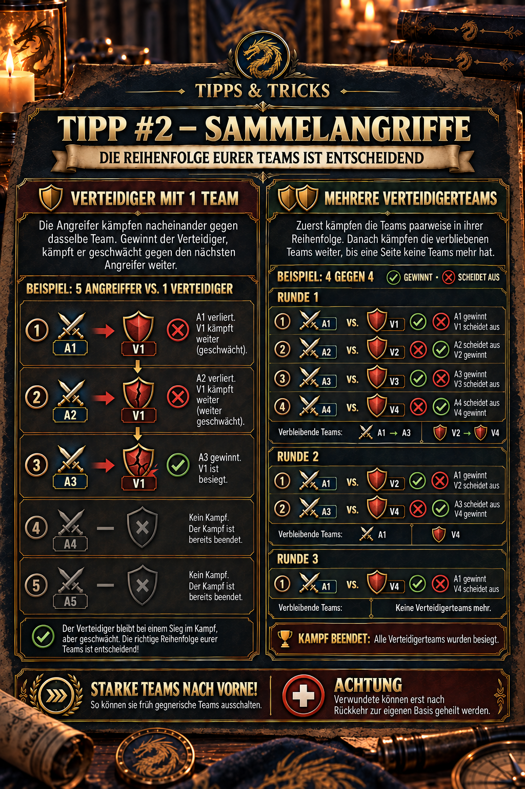

---
arten:
  - Guia
  - Estratégia
themen:
  - Combate
  - Aliança
---

# 💡 Dica #2 – Ataques de ataque conjunto

## Pontos-chave

- **Coloque equipes fortes na frente:** As equipes líderes lutam primeiro e, se vencerem, podem eliminar outros adversários.
- **Só uma equipe defensora:** Os atacantes enfrentam a mesma equipe cada vez mais fraca de sucessão.
- **Várias equipes defensoras:** A1 primeiro luta contra o V1, A2 luta contra V2, e assim por diante. As equipes sobreviventes são então emparejadas novamente em sua ordem existente.
- **Os vencedores continuam a lutar enquanto são enfraquecidos:** Os danos já sofridos permanecem; os soldados feridos só podem ser curados depois de retornarem à sua própria base.

> **Lembre-se:** A posição determina o primeiro adversário – O resultado determina a próxima rodada.



## Para que é esta gorjeta?

Esta dica explica o **Ordem de batalha dentro de um ataque de ataque conjunto**. Entender a ordem ajuda-o a decidir:

- Qual é a equipe que ocupa a primeira posição,
- Por que não todas as equipes enviadas necessariamente lutam,
- Como vários atacantes gradualmente enfraquecem uma única equipe defensiva,
- Como as parelhas entre vários defensores continuam em várias rodadas, e
- Por que uma equipe fraca mal posicionada pode tornar todo o ataque conjunto desnecessariamente caro.

Esta dica diz respeito aos **Ordem das equipes completas de jogadores ou de marchas dentro do ataque conjunto**. A disposição dos cinco heróis dentro de uma equipe individual é uma camada separada e não é coberta aqui.

## Termos e regra básica

| Abreviação | Significado |
| --- | --- |
| **A1, A2, A3 …** | Equipe de ataque na posição 1, 2, 3 … |
| **V1, V2, V3 …** | Equipe de defesa na posição 1, 2, 3 … |
| **Rondas** | Uma sequência de emparejamentos diretos entre as equipes que permanecem |
| **O restante da equipe** | Uma equipe que ganhou o encontro e pode continuar a lutar. |

A primeira rodada começa com posições iguais:

`A1 against V1 → A2 against V2 → A3 against V3 → A4 against V4 …`

Após cada encontro, a equipe derrotada é eliminada. A equipe vencedora permanece em batalha na sua condição atual. Se as equipes permanecerem em ambos os lados depois, os sobreviventes são novamente emparejados **na sua ordem existente**. Isto repete-se até que um lado não tenha mais equipes.

> **Lembre-se:** A posição determina o primeiro adversário. O resultado determina quem luta novamente na próxima rodada.

## Caso 1: O defensor tem apenas uma equipe

Se apenas uma equipe de defesa estiver disponível, os atacantes lutam contra a mesma equipe em sucessão. Quando o defensor ganha um encontro, fica para enfrentar o próximo atacante – Mas carrega as perdas e danos de batalhas anteriores.

### Seqüência de exemplo

| Encontro | Resultado de exemplo | Consequências |
| --- | --- | --- |
| A1 contra V1 | V1 ganha | A1 é eliminada; V1 continua a lutar enquanto enfraquecido. |
| A2 contra V1 | O V1 ganha outra vez. | A A2 é eliminada; o V1 é ainda mais enfraquecido. |
| A3 contra V1 | A3 ganha | O V1 é eliminado, a defesa termina. |
| Equipes A4 e posteriores | Não há mais batalha. | Não resta nenhuma equipe defensora. |

Este exemplo mostra dois pontos importantes:

1. Os atacantes usados cedo podem enfraquecer uma forte equipe defensiva mesmo quando perdem.
2. Assim que o último defensor é derrotado, a batalha termina. Os atacantes mais antigos da ordem não são usados.

## Caso 2: Ambos os lados têm várias equipes

Com várias equipes em defesa, a batalha começa com emparejamentos em posições iguais. Só os vencedores lutam novamente.

### 1a rodada – ordem original

Para esta ilustração da sequência apenas, suponha os seguintes resultados:

| Emparelhamento | Resultado de exemplo | Restes na batalha |
| --- | --- | --- |
| A1 contra V1 | A1 ganha | A1 |
| A2 contra V2 | V2 ganha | V2 |
| A3 contra V3 | A3 ganha | A3 |
| A4 contra V4 | V4 ganha | V4 |

Após a primeira rodada, restam os seguintes elementos:

- **Atacantes:** A1, A3
- **Defensores:** V2, V4

### 2a rodada – Os sobreviventes são emparejados novamente.

As restantes equipes mantêm a sua ordem relativa:

| Emparelhamento | Resultado de exemplo | Restes na batalha |
| --- | --- | --- |
| A1 contra V2 | A1 ganha | A1 |
| A3 contra V4 | V4 ganha | V4 |

### 3a rodada – A decisão

Só A1 e V4 restam agora:

`A1 against V4 → the winner decides the rally attack.`

Estes vencedores são apenas um exemplo ilustrativo para deixar a ordem clara. Os resultados reais no jogo dependem dos heróis, soldados, pesquisas, equipamentos, bônus, contadores e danos já sofridos, entre outros fatores.

## Por que equipes fortes pertencem à frente

Uma equipe forte na primeira posição pode fazer mais do que ganhar o primeiro confronto. Se ficar pronto para o combate, pode eliminar mais equipes inimigas em rodadas posteriores. Isto significa:

- Os defensores perigosos são retirados cedo,
- menos atacantes posteriores têm de lutar,
- As perdas totais do ataque conjunto diminuem frequentemente, e
- Mais equipes permanecem inteiramente ou em grande parte intactas.

“Forte” Não significa simplesmente a maior potência de combate demonstrada. Outros fatores decisivos incluem:

- Força de tropa atual e perdas existentes,
- funções e posições de herói dentro da equipe,
- um bônus adequado para formação e facções,
- Investigação, equipamento e bônus de combate ativo, e
- potenciais pontos fortes ou fracos contra a equipe oposta.

> **Regra de padrão:** Se não tiver informações detalhadas sobre a defesa, coloque a equipe mais forte e confiável pronta para o combate em primeiro lugar. Uma contraformação deliberada às vezes pode ser mais útil do que simplesmente escolher o maior poder de combate.

## O que a aliança deve coordenar antes de começar

1. **Defina o objetivo e o objetivo:** O objetivo é uma vitória confiável, enfraquecer um defensor forte ou minimizar perdas?
2. **Identificar a equipe mais forte disponível:** A força de combate por si só não é suficiente; o número de tropas e a formação também devem ser adequados.
3. **Verifique a ordem exibida:** Antes de começar, verifique qual é a equipe que ocupa a A1, A2, A3, etc.
4. **Evite equipes inadequadas:** Uma equipe fraca ou fortemente danificada não deve bloquear uma posição importante perto da frente.
5. **Revisem o relatório após a batalha:** Verifique os emparejamentos reais, vencedores e tropas restantes. Esta é a única forma de determinar se a ordem assumida ainda se aplica e que formação precisa de melhoria.

Verifique como as posições podem ser realmente atribuídas ou alteradas na interface atual diretamente na janela de ataque conjunto antes de começar. Não confie apenas na ordem em que os jogadores anunciaram a sua participação no bate-papo de aliança.

## Conceitos errados comuns

### “Cada equipe enviada lutará.”

Não, não, não. Uma vez que o lado oposto é completamente derrotado, a batalha termina. As equipes subsequentes podem, portanto, permanecer sem ter um encontro próprio.

### “Só a primeira batalha é importante .”

Não, não, não. Os vencedores podem lutar novamente em rodadas posteriores. Uma equipe forte colocada cedo pode, portanto, afetar ou eliminar vários adversários.

### “O maior poder de combate ganha automaticamente .”

Não é necessariamente. A composição, o número de tropas, o equipamento, a investigação, os bônus e os danos anteriores influenciam o resultado. Use relatórios de batalha em vez de confiar em uma única figura de poder.

### “Uma equipe que perdeu era inútil .”

Não é necessariamente. Uma equipe inferior pode já danificar o inimigo e enfraquecê-lo para o próximo atacante. No entanto, sacrificar deliberadamente uma equipe não é uma recomendação padrão geral: uma má ordem pode criar soldados feridos desnecessários e manter um adversário forte na batalha por mais tempo.

## Soldados feridos e ataques de acompanhamento

A ordem afeta tanto a vitória quanto a distribuição das perdas. Equipes que lutam cedo e repetidamente podem acumular mais soldados feridos. Após o ataque conjunto:

> **Atenção:** Os soldados feridos só podem ser curados depois de voltarem à sua própria base.

Planejar mais do que o primeiro ataque. Considere também a marcha de retorno, a capacidade do hospital e se é planejado outro ataque conjunto imediatamente depois.

## Revisão prática após um ataque de ataque conjunto

Regista pelo menos estes pontos do relatório da batalha:

- Que equipes ocuparam o A1, A2, A3 ou V1, V2, V3?
- Que combinação inicial foi mostrada para cada equipe?
- Quais os vencedores lutaram novamente numa próxima rodada?
- Com quantas tropas restantes entraram na batalha seguinte?
- Que equipes nunca foram usadas?
- Outra ordem poderia ter evitado perdas ou dado uma vitória anterior?

Um único relatório mostra uma sequência. Vários relatórios seguindo as mesmas regras de emparejamento transformam-no em conhecimento confiável da aliança.

## Limitações e questões abertas

- A lógica exata de emparejamento vem de observações no jogo e do conhecimento prático da aliança; a pesquisa não localizou uma descrição detalhada oficial pública.
- A interface e as opções de classificação podem mudar com as atualizações. Verifique as posições exibidas imediatamente antes do início.
- Ainda é necessário confirmar se a mesma ordem se aplica a todos os tipos de ataque conjunto ou se os eventos ou alvos individuais utilizam regras especiais.
- Só as estatísticas de combate não explicam todos os resultados. Se houver discrepâncias, o atual relatório de batalha no jogo tem prioridade.

## Fontes e confiabilidade

- **Conhecimentos práticos da DIE:** A lógica de acoplamento, a sequência com um ou vários defensores e a nota de cura vêm do anúncio da aliança aprovado e da ilustração que o acompanha.
- **Fonte comunitária:** [Academia de Rota Z – Equação e composição do esquadrão](https://zroute.dev/de/getting-started/squad-leveling-composition/) recomenda desenvolver o esquadrão principal primeiro, posicionando os heróis corretamente e revisando batalhas difíceis através de relatórios de batalha. A página marca de forma transparente a fiabilidade das suas informações.
- **Mais leituras comunitárias:** O [Manual de estratégia da primeira temporada no Scribd](https://www.scribd.com/document/1071138090/Z-Route-Redemption-Season-1-Complete-Strategy-Handbook-Published-2) Recomenda a equipe mais forte e adequada disponível, a coordenação rápida e a posterior regeneração das tropas para as concentrações prioritárias. No entanto, não descreve a lógica de acoplamento aqui apresentada em detalhes.

Data da investigação: **25 de Setembro de 2026**. Quando existem conflitos de informações, são prioritárias as exibições atuais no jogo e os relatórios de batalha reprodutíveis.

## Anúncio da Aliança para copiar

```html
<size=38><color=#8DAA2D><b>💡 TIP # 2 – Ataques de ataque conjunto</b></color></size>

Em ataques de ataque conjunto, os <color=#8DAA2D><b>A ordem das suas equipes é crucial!</b></color>

<b>Defensor com 1 equipe:</b>
Os atacantes lutam contra a mesma equipe de sucessão. Se o defensor ganhar, continua contra o próximo atacante enquanto está enfraquecido.

<b>Várias equipes defensoras:</b>
A1 vs. V1 → A2 vs. V2 → A3 vs. V3, e assim por diante.
As equipes restantes continuam a lutar em sua ordem até que um lado não tenha mais equipes.

➡️ <color=#8DAA2D><b>Coloque equipes fortes na frente!</b></color> Isto permite-lhes eliminar equipes inimigas cedo.

<color=#D85B45><b>Atenção .</b></color> Os soldados feridos só podem ser curados depois de voltarem à sua própria base.
```
