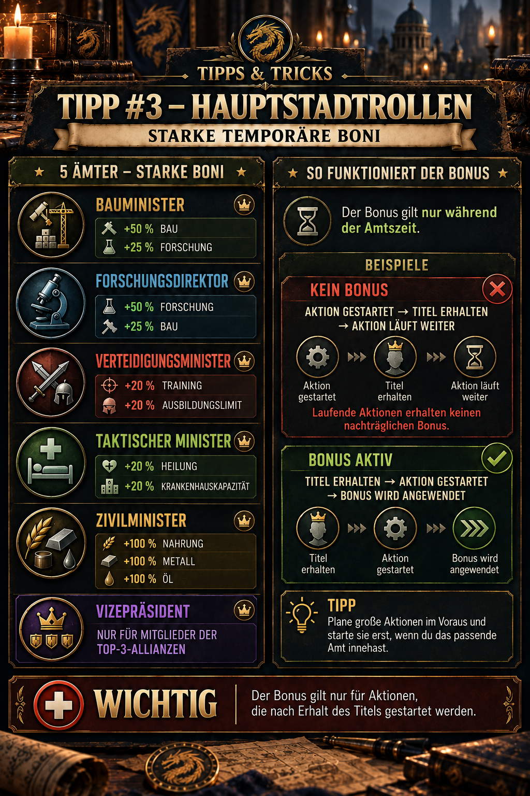

---
arten:
  - Guia
  - Optimização
themen:
  - Aliança
  - Desenvolvimento
---

# 💡 Dica #3 – Funções de capital

## Pontos-chave

- **Escolha o papel certo:** A construção, a investigação, a formação, a cura e os recursos têm cada um o seu próprio papel de capital.
- **Título um, segunda ação:** A construção, a investigação, a formação ou a cura já em andamento não recebem o bônus retroativamente.
- **Preparar ações importantes:** Ter recursos, pré-requisitos e uma fila disponível antes de receber o título.
- **Ativação de verificação:** Antes de começar, verifique se o título está realmente ativo e se a duração ou a capacidade exibidas diminuíram ou aumentaram.
- **Vice-Presidente:** Este título está disponível apenas para os membros de uma das três principais alianças.

> **Lembre-se:** Primeiro é nomeado, verifica o bônus, e depois começa a grande ação.



## Para que é esta gorjeta?

Os papéis de capital dão aos seus detentores bônus poderosos, mas temporários. Usados corretamente, podem reduzir a duração da construção e da pesquisa, permitir grandes lotes de treinamento, melhorar a cura após batalhas pesadas ou aumentar a produção de recursos.

O factor decisivo é: **tempo**: O título não se aplica retroactivamente a uma ação já em curso. Prepare tudo antes da nomeação para que possa começar a ação desejada imediatamente após receber o título.

## Visão geral dos papéis do capital

| Função do capital | Bônus listados | Especialmente adequado para |
| --- | --- | --- |
| 🏗️ **Ministro da Construção** | +50% de velocidade de construção · +25% de velocidade da investigação | construção de edifícios longos ou melhorias de base; |
| 🔬 **Diretor de Investigação** | + 50% de velocidade de investigação · + 25% de velocidade da construção | Tecnologias prolongadas; alternativamente, uma grande modernização do edifício |
| ⚔️ **Ministro da Defesa** | +20% de velocidade de formação · limite de formação de +20% | Grandes lotes de treinamento de soldados, preparação para eventos de combate ou de pontuação |
| 🏥 **Ministro da Táctica** | + 20% de velocidade de cura · + 20% da capacidade hospitalar | cura após grandes batalhas e antes de continuar a lutar |
| 🌾 **Ministro Civil** | +100% alimentos, metais e óleo | períodos de alta produção ou recolha de recursos |

A tabela reproduz os valores documentados na ilustração da aliança. As versões e traduções do jogo podem diferir, por isso a exibição de papéis no jogo atual sempre tem prioridade.

## A regra mais importante: a hora de partida determina o bônus

Com base nas observações realizadas até agora, o seguinte se aplica à construção, à investigação, à formação e à cura:

| Ordem | Resultado |
| --- | --- |
| Iniciar a ação → receber título | **Sem bônus retroativo** para a ação já em curso |
| Receber título → iniciação da ação | **O bônus é aplicado ao início** |

### Não há bônus para ações já em curso

Se a construção já estiver em andamento e depois se tornar Ministro da Construção, o tempo de construção restante não é automaticamente recalculado. O mesmo se aplica à investigação, à formação e à cura já iniciadas.

### Iniciar a ação durante o mandato

Primeiro, receba nomeações, depois verifique a duração ou capacidade exibida. Só iniciar a ação preparada quando o título estiver visível.

Uma fonte da comunidade informa que uma ação iniciada durante o prazo mantém a sua duração reduzida mesmo que o título expire antes de ser concluído. Isto corresponde à lógica observada do tempo de início, mas a ilustração disponível no jogo não o prova explícitamente. Sempre que possível, verifique o temporizador antes e depois do termo de um período e documente o resultado.

## Preparação antes da nomeação

Um título poderoso oferece pouco benefício se ainda precisar encontrar recursos, cumprir requisitos pré-requisitos ou liberar uma fila durante o curto prazo. Prepare o seguinte:

1. **Escolha uma ação adequada:** Decidir com antecedência qual edifício, projecto de investigação, lote de formação ou ação de cura iniciar.
2. **Requisitos de verificação:** Os níveis de edifícios, as áreas de investigação ou os espaços hospitalares disponíveis devem já estar em vigor.
3. **Preparar recursos:** Cestas de recursos abertos apenas quando necessário e garantir que todos os custos sejam cobertos.
4. **Mantenha a fila livre:** O espaço de construção, pesquisa, formação ou cura deve estar disponível no momento da consulta.
5. **Coordenar com a liderança:** Indique qual papel você precisa e quando estará pronto para começar.
6. **Verifique o título:** Após a nomeação, abra o perfil e confirme que o título correto está ativo.
7. **Comparar a visualização:** Verifique a duração, a quantidade de produção ou a capacidade exibidas antes do início final.
8. **Iniciar a ação:** Só agora confirme a ação preparada.

> **Regra prática:** Não comece a planear depois da consulta. O termo é para começar, não para procurar.

## Qual papel é adequado para qual ação?

### Ministro da Construção

O Ministro da Construção é a primeira escolha para uma modernização de edifícios particularmente longa ou cara. É especialmente valioso para projectos que duram vários dias ou bloqueiam o desenvolvimento da base.

Se não for possível atualmente um grande projecto de construção, o bônus adicional de investigação pode ainda ser útil. No entanto, para pesquisas genuinamente longas, o diretor de pesquisa é o papel mais forte.

### Diretor de Investigação

Use o Diretor de Pesquisa para tecnologias longas. Prepare a pesquisa completamente e assegure-se de que nenhuma outra tecnologia bloqueie a fila.

O bônus adicional de construção é uma alternativa útil, mas não corresponde ao bônus principal do ministro da Construção.

### Ministro da Defesa

Esta função combina formação mais rápida com um limite de formação mais elevado. O maior benefício é, portanto, oferecido por um grande lote de formação preparado.

Antes de começar, verifique o número de soldados exibidos e a duração do treinamento. Isto mostra se ambas as partes do bônus estão ativas. O papel é particularmente útil antes das fases de combate ou nos dias de evento em que o treinamento ganha pontos.

### Ministro da Táctica

O Ministro Táctico melhora a velocidade de cura e a capacidade hospitalar. É preferível usá-lo após batalhas pesadas ou imediatamente antes de outra fase de combate planejada.

Exerça precaução com a capacidade adicional do hospital: até que os testes reprodutíveis estabeleçam como o jogo lida com a queda de capacidade novamente após o término do período, não preencha deliberadamente o hospital muito além da sua capacidade normal.

### Ministro Civil

O Ministro Civil aumenta a produção de alimentos, metais e petróleo. Ao contrário da construção, pesquisa, formação e cura, esta não é claramente uma ação de fila iniciada uma vez.

Verifique o jogo:

- Se a bonificação produz recursos apenas durante o período de atividade,
- Se o tempo de recolha é importante, e
- Como se combina com os bônus de produção existentes.

A ilustração disponível confirma o valor de +100%, mas não a lógica exacta do cálculo. Até que um ensaio reprodutível esteja disponível, não apresentar qualquer outra alegação como regra estabelecida.

## Leia corretamente os bônus de velocidade

Um **+ 50% de velocidade** bônus não significa automaticamente **50% menos tempo**. Com um simples cálculo aditivo, uma ação com 100 unidades de velocidade base seria executada em 150 unidades depois. A sua duração seria de aproximadamente dois terços do tempo original – cerca de 33% de poupança.

Os bônus existentes provenientes de pesquisas, VIP, equipamentos ou eventos podem afetar ainda mais a poupança adicional. A visualização exibida no jogo é, portanto, mais confiável do que uma conversão geral.

### Exemplo de cálculo simplificado

Supondo um simples cálculo aditivo sem outros bônus:

| Bonus de velocidade | Duração restante | Tempo aproximado economizado |
| ---: | ---: | ---: |
| +20% | 83.3% | 16.7% |
| +25% | 80.0% | 20.0% |
| +50% | 66.7% | 33.3% |

Esta tabela é uma orientação matemática, não uma fórmula de jogo confirmada. Use sempre a tela de tempo no jogo para planejar o jogo.

## Vice-Presidente e as três principais alianças

De acordo com a notificação documentada no jogo, o **Vice-Presidente** O título está disponível exclusivamente para os membros das três alianças mais bem classificadas.

Esta dica não enumera um bônus específico para o vice-presidente. Por conseguinte, não se deduz nenhum efeito adicional do requisito de elegibilidade. Para a documentação completa ainda é necessária uma captura de tela da descrição do papel e dos seus valores exibidos.

## Procedimento de aliança recomendado

Um processo claro ajuda a beneficiar o maior número possível de membros:

1. Os membros registam o papel e a ação planeada de que necessitam.
2. Só os jogadores totalmente preparados entram na rodada de nomeação atual.
3. Uma pessoa responsável atribui os papéis em sequência.
4. Cada destinatário confirma brevemente que o título é visível.
5. A ação preparada é iniciada imediatamente.
6. Um início bem sucedido é confirmado para que o papel possa ser transmitido.

Uma lista de espera ou horários fixos de compromisso ajudam com papéis particularmente populares. Isto evita o desperdício de um termo enquanto o destinatário ainda procura recursos ou pré-requisitos.

## Erros comuns

- **Começando muito cedo:** Uma ação já em curso não recebe o bônus retroativamente.
- **Pedindo o papel errado:** Um bônus secundário de +25% é mais fraco do que o bônus principal correspondente de +50%.
- **Bloquear a fila:** A ação preparada não pode começar durante a nomeação.
- **Não verificar o título:** A ação é desencadeada antes de a nomeação ser realmente activa.
- **Percentagens de mal-entendidos:** Um bônus de velocidade é confundido com uma redução idêntica do tempo.
- **Adopção de uma regra especial não testada:** As alegações comunitárias são utilizadas sem comparação com a exibição atual no jogo.

## Limitações e informações ainda a verificar

- Os valores de papel na ilustração da aliança são documentados, mas podem mudar com as atualizações do jogo.
- A ilustração não especifica a duração exacta do termo. Z Route Academy relata aproximadamente um minuto; verifique isso no jogo usando o tempo do servidor.
- A Academia Z Route afirma também que cada função de ministro fornece um bônus base compartilhado de +50% para a investigação, a construção e a formação. A ilustração disponível no jogo não estabelece esta adição, por isso permanece **Não resolvido**.
- Ainda são necessários testes para determinar se as ações iniciadas mantêm de forma confiável a sua duração reduzida após o termo do prazo em cada área.
- O cálculo exato do ministro civil e o comportamento do aumento temporário da capacidade hospitalar após o término do mandato exigem testes reprodutíveis.
- O requisito principal do vice-presidente vem do aviso no jogo; os seus benefícios específicos ainda não foram documentados.

## Fontes e confiabilidade

- **Evidências de DIE no jogo:** Os nomes dos papéis, os bônus na tabela, a restrição dos três principais do vice-presidente e a regra de "título primeiro, ação segundo" vêm do anúncio da aliança aprovado e da ilustração que acompanha o jogo.
- **Fonte comunitária:** [Academia de Rota Z – Posições oficiais (ministros)](https://zroute.dev/de/alliance/official-positions/) A lista de cinco funções e percentagens de ministros é a mesma que confirmada pela comunidade. As reivindicações sobre o prazo de aproximadamente um minuto, a retenção dos bônus iniciados e o bônus base compartilhado adicional são explicitamente tratadas aqui como exigindo verificação porque nossas próprias provas no jogo estão faltando.
- **Fonte adicional:** [Academia de Rota Z – Investigação](https://zroute.dev/city/research/) descreve outros bônus permanentes de construção, investigação, formação e cura. Isto explica por que a economia de tempo real pode diferir entre contas e de exemplos simples.

Data da investigação: **25 de Setembro de 2026**. Se houver discrepâncias, utilize a descrição atual do papel no jogo e os valores exibidos imediatamente antes do início.

## Anúncio da Aliança para copiar

```html
<size=38><color=#8DAA2D><b>💡 TIP #3 – ROLES CAPITALES</b></color></size>

O capital oferece poderosos bônus temporários:

🏗️ <b>Ministro da Construção:</b> +50% construção / +25% investigação
🔬 <b>Diretor de Investigação:</b> +50% de investigação / +25% de construção
⚔️ <b>Ministro da Defesa:</b> +20% de formação / limite de formação de +20%
🏥 <b>Ministro da Táctica:</b> + 20% de recuperação / + 20% da capacidade hospitalar
🌾 <b>Ministro Civil:</b> +100% de alimentos, metais e óleo

👑 <b>Vice-Presidente:</b> Só para os membros das três principais alianças.

<color=#D85B45><b>IMPORTANTE:</b></color> O prémio só se aplica durante o mandato e apenas às ações <color=#8DAA2D><b>Começou depois de receber o título</b></color>.
```
