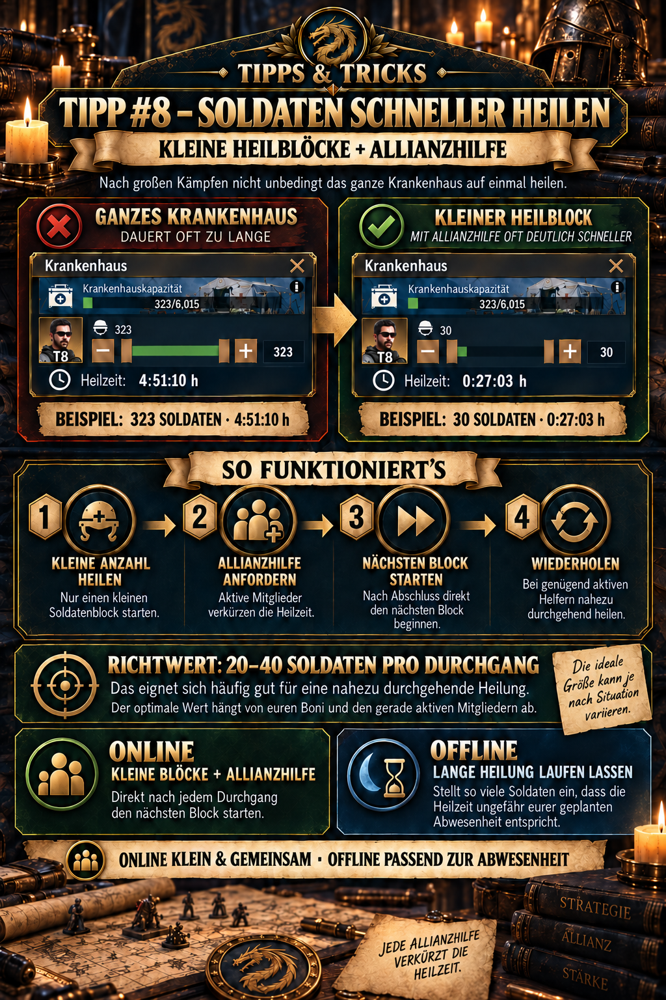

---
arten:
  - Guia
  - Optimização
themen:
  - Tropas
  - Aliança
---

# 💡 Dica #8 – Curar soldados mais rápido

## Pontos-chave

- **Curar em pequenos lotes enquanto estiver online:** Não comece a curar automaticamente todo o hospital.
- **Solicite ajuda da Aliança imediatamente:** Cada ajuda oportuna reduz o tempo restante de cura.
- **Começa com 20–40 soldados:** Esse intervalo geralmente é adequado para um teste inicial; o tempo de cura realmente mostrava mais depois.
- **Calcular o tempo de cura instantânea:** Multiplicar o seu pessoal **Tempo de ajuda** Por número de membros que podem ajudar imediatamente. O lote de cura não deve demorar mais do que isto.
- **Repita imediatamente:** Assim que um lote terminar, comece o próximo e peça ajuda novamente.
- **Planejar de forma diferente offline:** Antes de uma ausência mais longa, configure um lote grande cujo tempo de cura corresponda aproximadamente ao seu período offline.

> **Lembre-se:** Tempo de ajuda × auxiliares imediatos = tempo máximo de cura para um lote de cura instantânea.



## Para que é esta gorjeta?

Esta dica mostra como pequenos lotes de cura e ajuda repetida de aliança podem muitas vezes tornar um grande número de soldados feridos prontos para o combate muito mais rápido. Em vez de estabelecer uma tarefa de cura que dure várias horas, divida o estoque em seções curtas que a ajuda da aliança pode reduzir substancialmente.

O método é particularmente útil:

- Após grandes batalhas PvP,
- quando o hospital está muito ocupado,
- Enquanto mais batalhas ainda estão acontecendo,
- quando vários membros da aliança estão simultaneamente online,
- ou quando quiser salvar diamantes e speedups de cura.

No entanto, requer o seu envolvimento ativo. Se você está prestes a desligar, uma longa tarefa de cura que corresponda à sua ausência funciona melhor.

## Por que os pequenos lotes de cura funcionam

Depois de começar a curar, pode pedir ajuda da Aliança. Membros ativos então pressionar “Ajuda”, reduzindo o tempo restante.

Quanto tempo cada ajuda subtrai é mostrado em seus valores buff pessoais **Tempo de ajuda**. Este valor consiste em parte em bônus de construção, tecnologia da aliança e sobreviventes. A Comissão **Ajuda a limitar** também limita o número de ajuda que uma única ação pode receber.

No entanto, o planejamento não deve utilizar automaticamente todo o limite de ajuda. O que importa é quantos membros estão atualmente online e provavelmente responderão **imediatamente** A sua solicitação.

O princípio é:

```text
Pequeno lote de cura → pedir ajuda → auxiliares reduzem o temporizador →
extremos de lote → Começar o próximo lote de cura
```

A velocidade aumentada não vem de um bônus de cura mais forte, mas de usar o processo de ajuda novamente para cada novo lote.

## Cura online passo a passo

1. Abre o hospital e verifique os números e os níveis de feridos.
2. Abra a sua visão geral e leia **Tempo de ajuda** e **Ajuda a limitar**.
3. Estimar realmente quantos membros irão ajudar imediatamente – Não apenas o número de pessoas que aparecem na Internet.
4. Calcule o seu tempo de cura instantânea a partir disto.
5. Selecione soldados suficientes para o tempo de cura exibido para cair logo abaixo desse resultado.
6. Comece a curar.
7. Pedido **Aliança ajuda imediatamente**.
8. Assim que o lote terminar, iniciar imediatamente o próximo e pedir ajuda novamente.
9. Repita até que todos os soldados desejados sejam curados ou que você queira desligar.

> **Importante:** Apertar o botão de ajuda da aliança novamente depois de cada lote de cura recém-iniciado. Um pedido de ajuda anterior não se aplica automaticamente a lotes subsequentes.

## Calcular o tempo de cura instantânea

A fórmula é:

```text
Tempo de cura instantânea = Tempo de ajuda × assistentes imediatos esperados
```

O número de auxiliares utilizados não deve exceder o seu limite de ajuda pessoal:

```text
número de auxiliares utilizados = o menor dos
“Auxiliares imediatos esperados” e “Ajuda a limitar”
```

O tempo óptimo de cura é, portanto, **não um valor fixo universal**. Mude quando o seu Tempo de Ajuda aumenta ou mais ou menos membros podem responder imediatamente.

### Exemplo específico da nova captura de tela no jogo


*(Como chegar a esta visão: toque a sua base no mapa do mundo → selecionar “Set Shield” → mudar para o “Tipo de economia” A tabela está no topo.)*

Utilize o valor total máximo em cada caso para o cálculo – não apenas um dos bônus individuais listados abaixo.

A captura de tela mostra:

- **Limitação de ajuda:** 25
  - Bonus de construção: 17
  - Sobreviventes: 8
- **Tempo de ajuda:** 742 segundos por ajuda
  - Bonus de construção: 54
  - Alliance Tech: 94
  - Sobreviventes: 594

Os componentes do Tempo de Ajuda totalizam 742 segundos. Isto é igual **12 minutos e 22 segundos por ajuda**.

Se você espera **5 ajuda imediata**:

```text
742 segundos × 5 auxiliares = 3.710 segundos
3.710 segundos = 1 hora, 1 minuto e 50 segundos
```

Para este perfil, cinco auxilios podem completar imediatamente um lote de cura com duração máxima **1:01:50**. Na prática, permitir uma pequena margem de segurança – por exemplo, um tempo de cura exibido de aproximadamente **60 minutos**.

> **Decisão de exemplo:** Se cinco auxiliares confiáveis estiverem on-line, selecione soldados suficientes para que o temporizador apareça em pouco menos de uma hora. Então comece a curar, peça ajuda e coloque imediatamente o próximo lote depois dos cinco socorros.

### Assistência Tabela de tempo para o valor do exemplo 742

| Auxiliares imediatos | Redução total de tempo | Parcela máxima de cura instantânea |
| ---: | ---: | ---: |
| 1 | 742 segundos | 0:12:22 |
| 2 | 1.484 segundos | 0:24:44 |
| 3 | 2.226 segundos | 0:37:06 |
| 4 | 2.968 segundos | 0:49:28 |
| 5 | 3.710 segundos | **1:01:50** |
| 10 | 7.420 segundos | 2:03:40 |
| 25 | 18.550 segundos | 5:09:10 |

A linha com 25 ajuda descreve apenas o máximo matemático no limite de ajuda exibido. Só é possível se 25 membros realmente ajudarem a tempo.

## Número de soldados ou tempo de cura calculado – Qual é melhor?

A contagem de soldados é fácil de lembrar, mas o tempo de cura é mais preciso.

| Orientação | Benefícios | Limitação |
| --- | --- | --- |
| **20–40 soldados** | Pronto para definir e um bom primeiro teste | diferentes níveis de soldados e bônus produzem tempos diferentes |
| **30–50 minutos de cura** | ponto de partida útil para a comunidade geral | ainda não explica com precisão o tempo de ajuda pessoal e o número de auxiliares |
| **Tempo de ajuda × auxiliares esperados** | dá o seu tempo de cura instantânea pessoal | só funciona se os membros contados realmente ajudar imediatamente |

Por exemplo, a ilustração fornecida mostra:

- **323 soldados:** 4:51:10 horas de cura
- **Trinta soldados:** 0:27:03 horas de cura
- com **5 auxiliares:** aproximadamente 37 minutos de redução possível, conforme a orientação ilustrada

O valor de cerca de 37 minutos da ilustração mais antiga pertence aos amantes usados naquela época. Com o tempo de ajuda agora documentado de 742 segundos, cinco ajudantes reduzem em vez disso até **1:01:50**. Isto mostra por que nem 20–40 soldados nem um cobertor 30–O temporizador de 50 minutos pode ser óptimo para cada perfil.

## Determine o seu próprio tamanho de lote ideal

O melhor tamanho é o **O maior lote cujo tempo de cura é totalmente coberto pela aliança ajuda a esperar imediatamente**.

### Procedimento de ensaio simples

1. Leia o seu Tempo de Ajuda pessoal.
2. Contem membros de quem podem esperar ajuda imediata.
3. Multiplicar os dois valores e converter o resultado em horas, minutos e segundos.
4. Escolha soldados suficientes para que o temporizador de cura caia logo abaixo desse resultado.
5. Peça ajuda e verifique se todos os membros planejados respondem.
6. Ajustar o próximo lote:
   - Tudo ajuda a chegar imediatamente e o lote termina. → manter o tempo de destino,
   - menos ajuda do que o esperado → reduzir o próximo lote em conformidade,
   - auxiliares adicionais se tornam confiáveis → recalcular o próximo lote.

Isto produz uma orientação pessoal melhor do que uma contagem fixa de soldados.

### Quando menos membros estão online

Com poucas assistentes, o lote deve ser menor para acabar instantaneamente. Contem apenas os membros que provavelmente responderão. Cinco jogadores mostrados online não são automaticamente iguais a cinco ajudas imediatas.

Possíveis respostas:

- utilizar lotes menores,
- Peça ajuda no chat da Aliança.
- adiar a cura para um período mais ativo, se a capacidade hospitalar o permitir;
- ou deliberadamente iniciar um lote mais longo se não continuar a lutar de qualquer maneira.

## Por que curar o hospital inteiro de uma só vez é muitas vezes desfavorável

Uma grande tarefa de cura é conveniente, mas faz mau uso da ajuda repetida da aliança enquanto você está online:

- O temporizador pode durar várias horas.
- A ajuda disponível pode não reduzir a zero.
- Não pode começar outro lote de cura enquanto o tempo restante corre.
- A aliança só pode ajudá-lo na próxima tarefa.
- Pode então ser necessário acelerar ou diamante para um retorno imediato à batalha.

Em vez disso, pequenos lotes criam muitas tarefas curativas curtas. Cada tarefa pode receber ajuda novamente.

## Quando uma grande tarefa de cura ainda está certa

O método de lote exige o início da próxima tarefa imediatamente após a conclusão. Se você dormir, trabalhar ou parar de verificar o jogo por um período mais longo, uma pequena tarefa de cura terminaria rapidamente e deixaria o hospital ocioso depois.

Portanto, antes de desconectar, selecione soldados suficientes para o tempo de cura para corresponder aproximadamente à sua ausência planejada.

| Situação | abordagem recomendada |
| --- | --- |
| Muitos membros online, você permanece ativo | em pequenos lotes, solicite ajuda imediatamente, repita diretamente |
| Poucos ajudantes online | lotes de ensaio menores ou aceitar cicatrização mais longa |
| Vais desligar brevemente. | estabelecer um lote que dure aproximadamente até o seu retorno |
| Vais ficar offline durante a noite. | iniciar uma grande tarefa de cura que dura várias horas |
| As lutas continuam e o hospital se enche novamente . | priorizar lotes curtos e coordenar ativamente a ajuda |

> **Regra offline:** Não selecione a menor quantidade possível; mantenha a fila útil durante a sua ausência.

## Coordenar a aliança ajuda adequadamente

O método só funciona se outros membros pressionarem “Ajuda”. Uma boa organização aumenta, portanto, o seu efeito:

- Curar durante períodos de alta atividade da aliança quando possível.
- Anunciem uma fase de cura compartilhada no chat após grandes batalhas.
- Ajudem constantemente os outros membros também, para que todos possam terminar os lotes rapidamente.
- Comece o próximo lote imediatamente enquanto os auxiliares permanecem online.
- Não utilize aceleradores antes da chegada dos auxiliares disponíveis.

A investigação da Aliança pode melhorar o Tempo de Ajuda pessoal. No exemplo, **94 dos 742 segundos** Venham da Alliance Tech. Uma aliança ativa beneficia, portanto, duas vezes: muitos membros fornecem ajuda, e uma tecnologia mais forte aumenta a redução de tempo por ajuda.

## Incorporar os bônus de cura de forma sensata

A velocidade de cura e a capacidade hospitalar mudam o seu valor ideal pessoal. Em especial, o Ministro da Táctica da Dica 3 oferece, de acordo com a visão geral do papel disponível:

- **+ 20% velocidade de cicatrização**
- **+20% da capacidade hospitalar**

Se receber um bônus de cura temporária, revise o temporizador e ajuste o tamanho do lote. Um bônus pode permitir que você inclua mais soldados em um lote com a mesma duração de alvo.

Se um bônus se aplica apenas à cura iniciada após a ativação, deve ser verificado em relação ao escritório atual ou à descrição do bônus. Não aplicar regras de outros tipos de ação à cura sem verificação.

## Recursos, aceleradores e “cura livre”

Os guias comunitários às vezes falam de “livre” ou “Instantâneo” A cura. Eles querem dizer que a ajuda da Aliança pode terminar um lote curto sem **Diamantes ou velocidades**.

Isto não significa automaticamente que os recursos normais de cura sejam desnecessários. Verifique os requisitos de recursos do hospital antes de cada início. O método reduz principalmente **tempo** e guarda elementos de aceleração opcionais.

## Um procedimento sensato após grandes batalhas

1. Verifique a ocupação do hospital e a capacidade restante.
2. Leia o Tempo de Ajuda pessoal e a Limitação de Ajudar na visão geral.
3. Determine no chat da aliança quantos ajudantes podem responder imediatamente.
4. Calcular o Tempo de Auxiliar × auxiliares esperados.
5. Configure a contagem de soldados para que o temporizador caia abaixo do tempo de cura instantânea calculado.
6. Solicite ajuda e verifique se a redução esperada ocorre.
7. Repita sem o tempo de inatividade enquanto estiver online.
8. Passe para um lote longo antes de desconectar.
9. Depois de voltar, revise os soldados feridos restantes e a capacidade do hospital.

## Erros comuns

- **Curar o hospital inteiro de uma só vez:** Isto impede uma ajuda eficaz e repetida.
- **Usando apenas a contagem de soldados:** Quarenta soldados de nível superior podem ter um tempo de cura diferente de quarenta soldados do nível inferior.
- **Confusão do limite de ajuda com os auxiliares disponíveis:** Um limite de 25 não garante que 25 membros estejam online e vão ajudar imediatamente.
- **Contando todos os jogadores online:** Conta apenas os membros que podem pressionar “Ajuda” No tempo.
- **Falha em verificar o tempo de ajuda:** Sobreviventes, edifícios e tecnologia da Aliança podem mudar o seu valor pessoal.
- **Pedir ajuda da Aliança é tarde demais.** Quanto mais cedo você pedir, os membros mais antigos podem responder.
- **Não continuando após um lote:** O método ganha velocidade através da repetição.
- **A escolha de lotes excessivamente grandes quando a atividade é baixa:** Sem assistentes suficientes, persiste um longo tempo restante.
- **Começando um pequeno lote antes de desligar:** Acaba rapidamente e deixa a fila de cura vazia para o resto da ausência.
- **Usar velocidades imediatamente:** Primeiro, espera para ver até onde a ajuda da Aliança reduz o temporizador.
- **Confuso “livre” com recurso livre:** A ajuda da Aliança economiza principalmente tempo, diamantes e velocidades; os custos normais de cura podem ainda ser aplicáveis.
- **Ignorando a capacidade hospitalar:** Durante batalhas mais longas, verifique regularmente quanto espaço resta.

## Limitações e informações ainda a verificar

- A captura de tela atual mostra o tempo de ajuda 742 e o limite de ajuda 25. Estes valores aplicam-se ao perfil mostrado e não automaticamente a outros membros.
- O cálculo assume que o valor total do Tempo de Ajuda em segundos é subtraído do temporizador. Verifique o exemplo com um lote de cura real e cinco ajuda.
- A ilustração mais antiga, de aproximadamente 37 minutos para cinco auxiliares, reflete diferentes fãs e não é universalmente substituída pelo valor atual deste perfil.
- 20–40 soldados ou 30–50 minutos restam apenas intervalos de partida gerais; o cálculo pessoal utilizando o Tempo de Ajuda e os auxiliares disponíveis de forma confiável é mais preciso.
- O efeito do nível e do tipo de ferida dos soldados sobre o tempo de cura por unidade não é documentado completamente.
- Verifique a interação entre o Ministro Táctico, pesquisa pessoal, investigação da aliança e outros bônus de cura contra o temporizador atual.
- A capacidade hospitalar, os auxiliares disponíveis e a situação de batalha ativa podem exigir prioridades diferentes da eficiência temporal máxima.

## Fontes e confiabilidade

- **Evidências de DIE no jogo:** A comparação entre a cura completa e um lote pequeno, 20–40 soldados como orientação, tempos de exemplo, cinco auxiliares e a estratégia on-line/offline provêm da ilustração fornecida da aliança e do anúncio aprovado.
- **Imagem de tela do perfil atual:** Os documentos de visualização de buff adicionados Help Limit 25 e Help Time 742, divididos em bônus de construção, Alliance Tech e bônus sobrevivente. O exemplo de cinco ajudas foi calculado a partir destes valores.
- **Fonte comunitária:** [Academia de Rota Z – Cura Instantânea no Hospital](https://zroute.dev/de/combat/hospital-healing/) descreve a cicatrização em lote, uma faixa-alvo geral de aproximadamente 30–50 minutos e ajuda repetida da Aliança. A sua redução baseada em percentagem é refinada pelo atual jogo “Tempo de ajuda” valor, ou deve ser verificado contra o temporizador na sua própria versão de jogo.
- **Fonte adicional da Aliança:** [Academia de Rota Z – Investigação da Aliança](https://zroute.dev/de/alliance/alliance-research/) descreve a ajuda de aliança mais forte como um benefício de pesquisa que melhora o tempo economizado por cada membro.
- **Fonte de papel adicional:** [Academia de Rota Z – Posições oficiais](https://zroute.dev/alliance/official-positions/) Documenta o estado comunitário dos bônus de velocidade de cura e de capacidade hospitalar do ministro tático.

As fontes públicas são predominantemente documentação comunitária. A sua exibição pessoal, o diálogo de cura atual, as ajudas recebidas reais e o tempo restante, portanto, têm prioridade.

Data da investigação: **25 de Setembro de 2026**.

## Anúncio da Aliança para copiar

```html
<size=38><color=#8DAA2D><b>💡 TIP #8 – Os soldados são curados mais depressa</b></color></size>

Depois de grandes batalhas, não cure necessariamente todo o hospital de uma só vez! <color=#8DAA2D><b>Pequenos lotes de cura + ajuda de aliança</b></color> são muitas vezes muito mais rápidas.

🏥 <b>Como funciona:</b>
Cura apenas um pequeno número de soldados, e depois pede ajuda da Aliança. Se existirem membros suficientes online, o tempo de cura é reduzido. – Então, comece o próximo lote imediatamente.

💡 <b>Guia:</b>
Por aí . <color=#8DAA2D><b>20–40 soldados por lote</b></color> muitas vezes funciona bem para uma cura quase contínua. O valor ideal depende dos seus bônus e dos membros atualmente ativos.

🌙 <b>Quando não está disponível:</b>
Simplesmente selecione soldados suficientes para o tempo de cura para corresponder à sua ausência planejada.

➡️ <color=#8DAA2D><b>Em linha: pequenos lotes + ajuda da aliança</b></color>
➡️ <b>Offline: deixe uma longa tarefa de cura correr</b>
```
