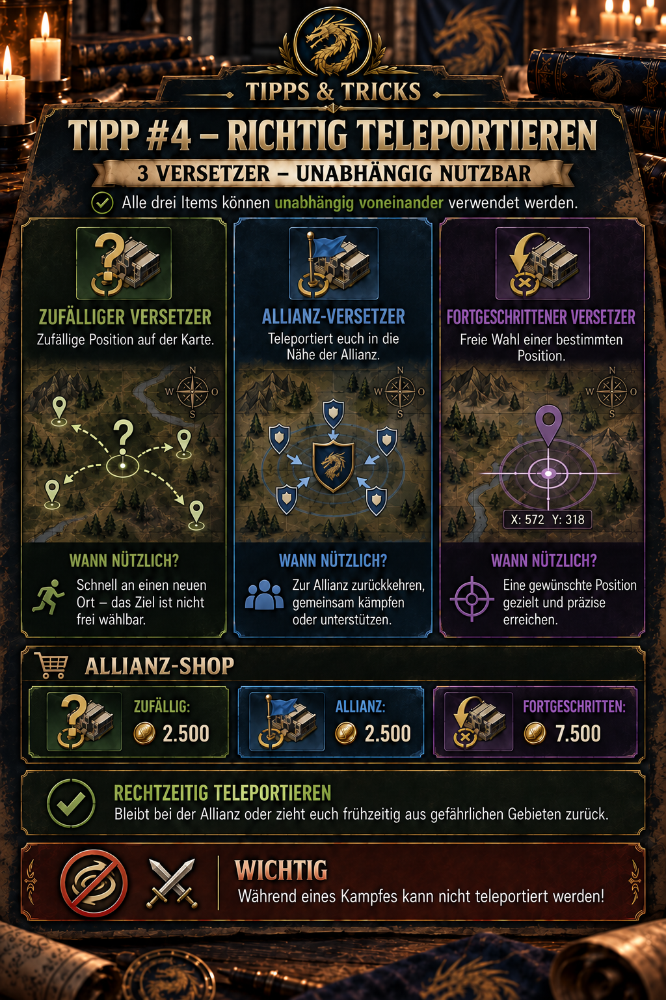

---
arten:
  - Руководство
themen:
  - Карта мира
  - Альянс
---

# 💡 Совет №4 — правильная телепортация

## Ключевые моменты

- **Случайный релокатор:** недорого, но размещает вашу базу в случайном месте на краю карты.
- **Релокатор Альянса:** перемещает вашу базу ближе к альянсу и обычно является лучшим выбором для быстрой перегруппировки.
- **Расширенный релокатор:** позволяет занять конкретную позицию, но стоит в три раза дороже — 7500 монет альянса.
- **Независимые элементы:** Три релокатора представляют собой отдельные предметы телепортации, а не последовательные уровни улучшения.
- **Не реагируйте слишком поздно:** Вы не можете телепортироваться во время боя. Уйти вовремя.

> **Помните:** Случайное для гибкости, Альянс для перегруппировки, Расширенное для точной позиции.



## Для чего этот совет?

Этот совет поможет вам выбрать правильный релокатор. Все три предмета перемещают вашу базу, но существенно отличаются по **где** вы приедете и сколько монет альянса стоит их использование.

При правильном использовании релокаторы помогут вам:

- быстро возвращайся в альянс,
- сократить марши к общим целям,
- занять согласованную позицию при формировании альянса,
- вовремя покинуть опасные зоны и
- используйте дорогие усовершенствованные релокаторы только тогда, когда точное положение действительно необходимо.

## Прямое сравнение трех релокаторов

| Релокатор | Пункт назначения | Цена в магазине альянса | Типичное использование |
| --- | --- | ---: | --- |
| ❓ **Случайный релокатор** | случайное местоположение на краю карты | 2,500 | быстрый и недорогой переезд без необходимости определенной должности |
| 🚩 **Переместитель Альянса** | выбранная игрой позиция рядом с альянсом | 2,500 | возвращение в альянс, сражение вместе или оказание поддержки |
| 📍 **Расширенный релокатор** | специально выбранная доступная позиция | 7,500 | точное размещение, скоординированное построение или стратегическое расположение |

Таким образом, один усовершенствованный релокатор стоит столько же, сколько **три случайных или три релокатора альянса**. Более высокая цена дает контроль над точным пунктом назначения, а не более мощный эффект телепортации.

## Что значит «независимый»

Три релокатора — это разные предметы, каждый из которых имеет свою цель. Вам не нужно использовать случайный релокатор, а затем релокатор альянса, прежде чем вы сможете использовать расширенный релокатор.

Выберите предмет, который напрямую соответствует вашей цели. Ненужный промежуточный телепорт стоит всего лишь еще одного предмета и может поставить вас в худшее положение.

## Случайный релокатор

Random Relocator стоит недорого, но не дает вам контроля над пунктом назначения. Ваша база расположена в **случайное положение на краю карты**. Это удобно, когда быстрое изменение местоположения имеет большее значение, чем точное местоположение, и вы намеренно хотите выйти за пределы центральных областей карты.

### Полезные ситуации

- Вы хотите покинуть область, не достигая конкретных координат.
- Вы хотите изменить положение, не используя дорогой Advanced Relocator.
- Новая должность является лишь временным местом.

### Ограничения

- Случайное положение края может находиться далеко от альянса и важных объектов карты.
- Новое место автоматически не является безопасным или стратегически полезным.
- Второй телепорт может потребоваться, если результат окажется неудовлетворительным.

> **Помощь в принятии решения:** Если вы все равно захотите присоединиться к альянсу впоследствии, обычно более разумным выбором является Alliance Relocator по одинаковой цене.

## Переместитель Альянса

Alliance Relocator переносит вас ближе к альянсу. Это стандартный выбор, когда вы находитесь вдали от группы и хотите снова играть вместе с другими участниками.

### Полезные ситуации

- Вы находитесь далеко от альянса после события или переезда.
- Альянс собирается для совместного нападения или обороны.
- Вам нужны более короткие марши для поддержки и общих целей.
- Вы хотите уйти из опасной зоны в сторону своей группы.

### Ограничения

«Рядом с альянсом» не означает автоматически, что вы предпочитаете конкретное место. Игра определяет пункт назначения в соответствии с правилами размещения и доступным пространством.

Если формации требуется определенный пробел, ряд или координата, Advanced Relocator — более надежный выбор.

## Расширенный релокатор

Advanced Relocator позволяет вам свободно выбирать конкретную доступную позицию. Таким образом, это самый точный, но и самый дорогой из трех пунктов.

### Полезные ситуации

- Ожидается, что вы займёте заранее согласованные координаты.
- Альянс выстраивает упорядоченное формирование вокруг цели или сильного члена.
- Вы намеренно хотите занять позицию с короткими маршами к месту событий или боевых действий.
- Релокатор Альянса доставит вас в нужную область, но не всегда в нужное место.

### Проверьте перед подтверждением

- Действительно ли выбранное место свободно?
- Соответствует ли эта позиция согласованному формированию альянса?
- Есть ли поблизости противники или другие опасности?
- Можно ли оттуда добраться до важных целей короткими маршрутами?
- Стоит ли точная позиция дополнительных 5000 монет альянса по сравнению с Релокатором альянса?

## Какой релокатор выбрать?

| Цель | Рекомендуемый релокатор | Причина |
| --- | --- | --- |
| Просто покиньте текущее местоположение | **Случайный релокатор** | недорого, если пункт назначения не имеет значения |
| Вернитесь в свой альянс | **Переместитель Альянса** | та же цена, что и у Random, но нацелена на нужную область |
| Сражайтесь вместе или окажите поддержку | **Переместитель Альянса** | обычно сокращает маршруты до группы |
| Занимать точные координаты | **Расширенный релокатор** | только этот релокатор обеспечивает определенный контроль положения |
| Устранить пробел в формировании альянса | **Расширенный релокатор** | точное размещение важнее цены |
| Побег во время продолжающейся битвы | **Нет** | телепортация заблокирована во время боя |

## Безопасная процедура перед телепортацией

1. **Определите свою цель:** Хотите сбежать, вернуться в альянс или достичь точной позиции?
2. **Выберите подходящий товар:** Не используйте автоматически самый дорогой релокатор.
3. **Проверьте боевой статус:** Если ваша база уже в бою, телепортироваться уже поздно.
4. **Проверьте регион назначения:** Для выбора позиции просмотрите окружение, противников, доступное пространство и соглашения альянса.
5. **Проверить товар и стоимость:** Прежде чем подтвердить, убедитесь, что предполагаемый релокатор действительно выбран.
6. **Телепорт:** Подтверждайте только тогда, когда позиция и цель совпадают.
7. **Проверка после телепортации:** Просмотрите свое новое местоположение и соответствующим образом скорректируйте дальнейшие марши или оборонительные меры.

## Вовремя покинуть опасные зоны

Важнейшим пунктом безопасности является боевое ограничение. Релокатор – это инструмент для **подготовка и своевременное реагирование**, а не уйти от уже идущей битвы.

Когда приближается опасность:

1. Проверьте ситуацию и расстояние противника.
2. Решите, имеет ли больше смысла защита, поддержка или отступление.
3. Выберите необходимый релокатор.
4. Завершите телепорт до начала битвы.

> **Важно:** Вы не можете телепортироваться во время боя. Ожидание, пока удар не удалит вашу возможность безопасного вывода средств.

Доступная внутриигровая иллюстрация не поясняет, какие дополнительные состояния входят «в бою». Блокируют ли его активные марши, участие в митингах или определенные индикаторы боевого состояния, следует проверить и задокументировать отдельно.

## Тратьте монеты альянса с умом

Монеты Альянса накапливаются со временем и также необходимы для приобретения других дефицитных предметов. Поэтому сообщество рекомендует сохранять их в первую очередь для мирных щитов, телепортов и сброса талантов, а не для легко добываемых базовых ресурсов.

Для релокаторов это означает:

- Держите наготове хотя бы один подходящий аварийный телепорт вместо того, чтобы ходить по магазинам, находясь в опасности.
- Используйте более дешевый инструмент «Перемещение альянса» для обычного возврата в альянс, где это возможно.
- Используйте Advanced Relocator только тогда, когда точные координаты обеспечивают реальное тактическое преимущество.
- Не тратьте весь свой баланс монет, если приближаются фазы боя или перемещения.

Подходящий резерв зависит от активности, планов альянса и наличия товара в магазине. Никакого универсально применимого минимального количества публично не установлено.

## Распространенные ошибки

- **Путаница случайного перемещения с безопасностью:** Случайный означает, что он не близок к альянсу и не свободен от врагов.
- **Использование Релокатора Альянса для точного размещения:** Он доставит вас близко, но не гарантирует нужные координаты.
- **Потеря расширенного релокатора:** Простое возвращение в альянс часто стоит 2500, а не 7500 монет.
- **Ожидание боя:** После начала боя телепортация становится невозможной.
- **Телепортация без координации:** Свободно выбранная позиция может нарушить запланированное построение или зарезервированный разрыв.
- **Планирование без резерва:** Пустой инвентарь обычно становится очевидным именно тогда, когда необходим быстрый переезд.

## Ограничения и информация, которую еще предстоит проверить

- Эффекты, цены и боевые ограничения описаны на прилагаемой внутриигровой иллюстрации, но могут измениться при обновлениях или настройках магазина.
- Остается неясным, как именно игра определяет близость к пункту назначения Релокатора Альянса.
- Еще необходимо тестирование, чтобы установить, какие активные состояния, помимо продолжающегося боя, блокируют использование.
- Наличие товара в магазине, лимиты покупок и время обновления не описаны в доступных материалах.
- Не установлено, потребляет ли элемент неудачная попытка размещения; всегда проверяйте диалоговое окно подтверждения.
- В межсерверных зонах или особых мероприятиях могут применяться разные правила телепортации. Положитесь на текущий внутриигровой дисплей.

## Источники и надежность

- **DIE внутриигровые доказательства:** Поведение трех релокаторов, цены в магазинах альянса, независимое использование и боевые ограничения взяты из утвержденного объявления альянса и сопровождающей внутриигровой иллюстрации.
- **Источник сообщества:** [Академия Z Route – Исследования Альянса](https://zroute.dev/de/alliance/alliance-research/) описывает вклады альянса как источник монет альянса и рекомендует экономить эту дефицитную валюту в первую очередь для мирных щитов, телепортов и сброса талантов.
- **Дополнительный источник сообщества:**  Публикация [Руководство по стратегии первого сезона на Scribd](https://www.scribd.com/document/1071138090/Z-Route-Redemption-Season-1-Complete-Strategy-Handbook-Published-2) рекомендует перейти в альянс как можно раньше и оставаться в группе, потому что это сокращает время марша и облегчает поддержку. Однако он не документирует подробно три типа товаров и цены.

Дата исследования: **25 сентября 2026 г.**. Если есть расхождения, воспользуйтесь текущим магазином альянса и внутриигровым диалогом подтверждения.

## Объявление Альянса для копирования

```html
<size=38><color=#8DAA2D><b>💡 СОВЕТ №4 – ТЕЛЕПОРТИРУЙТЕСЬ ПРАВИЛЬНО</b></color></size>

Есть три релокатора, которые можно использовать. <color=#8DAA2D><b>независимо друг от друга</b></color>:

❓ <b>Случайный релокатор</b>
→ случайное положение на карте

🚩 <b>Переместитель Альянса</b>
→ телепортирует вас ближе к альянсу

📍 <b>Расширенный релокатор</b>
→ свободный выбор конкретной должности

<b>Магазин Альянса:</b>
Случайно: 2500
Альянс: 2500
Продвинутый уровень: 7500

➡️ Используйте релокаторы, чтобы оставаться с альянсом или вовремя уйти из опасных зон.

<color=#D85B45><b>ВАЖНО:</b></color> Телепортироваться во время боя нельзя!
```
