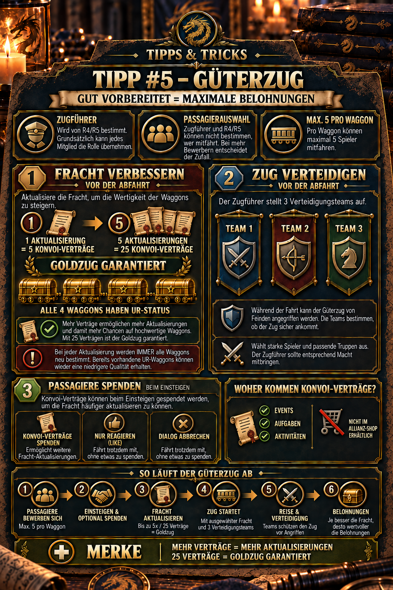

---
arten:
  - Руководство
  - Стратегия
themen:
  - События
  - Альянс
---

# 💡 Совет №5 — грузовой поезд

## Ключевые моменты

- **Проводник поезда:** R4/R5 назначает члена для подготовки грузового поезда. Роль не ограничивается определенным рангом.
- **Планируйте золотой поезд:** Обновление стоимости груза **5 контрактов на конвой**. После **5 обновлений**, или **25 контрактов**, гарантирован золотой поезд с четырьмя вагонами УР.
- **Полные изменения груза:** Обновление меняет весь груз, а не отдельные вагоны. Коляска, уже имеющая качество UR, до гарантии может снова стать хуже.
- **Помните о защите:** Перед отправлением кондуктор настраивает **3 защищающиеся команды**.
- **Пассажиров нельзя выбрать:** Каждый вагон перевозит не более **5 участников**. Если заявок слишком много, игра выбирает случайным образом – ни проводник, ни R4/R5 не могут вмешаться.
- **Собирайте контракты:** Контракты на конвоирование основаны на событиях, задачах и действиях; их нет в магазине альянса.

> **Помните:** Сначала заключите 25 контрактов, обновите пять раз и перед отъездом создайте три сильные команды защиты.



## Для чего этот совет?

В этом совете объясняется весь процесс грузового поезда: от назначения кондуктора через заявки и добровольные пожертвования по контракту до обновления груза и настройки защиты. Цель состоит в том, чтобы предсказуемо использовать дефицитные контракты на конвои, избежать недоразумений при выборе пассажиров и отправить поезд в путь с ценным грузом и хорошей защитой.

Статья особенно полезна для:

- **R4/R5**, которые назначают кондуктора и координируют выезд,
- тот **дирижер**, который готовит груз и оборону,
- **пассажиры**, которые могут подавать заявки и вносить вклад в Контракты на конвоирование,
- и всем участникам, которые хотят понять, почему для гарантированного золотого поезда требуется 25 контрактов.

## Роли и обязанности

| Роль | Задача | Что может решить эта роль? |
| --- | --- | --- |
| **R4/R5** | Назначьте дирижера и координируйте процесс внутри альянса | кто станет дирижером |
| **Дирижер** | Обновите груз и создайте три команды защиты перед отправлением. | как часто обновляться и какие команды защищают |
| **Пассажиры** | Подайте заявку на перевозку и добровольно пожертвуйте договоры при посадке | стоит ли вносить вклад в контракты |
| **Игровая система** | Выбор кандидатов при превышении подписки | кто на самом деле войдет в состав совета, если подаст заявку слишком много участников |

Ключевое различие: кондуктор управляет поездом, но **не могу выбрать предпочтительных пассажиров**. Согласно доступной внутриигровой документации, R4/R5 также не влияют на случайный выбор.

## 1. Назначить проводника

R4 или R5 назначают проводника. Эту задачу обычно может взять на себя любой член альянса; их ранг не имеет решающего значения.

Поскольку важнейшими приготовлениями занимается дирижер, альянсу следует выбирать, исходя из практических критериев:

- Будет ли участник надежно подключен к сети перед отъездом?
- Понимают ли они цель альянса – например, золотой поезд или экономичное использование контрактов?
- Смогут ли они выставить три подходящие команды защиты?
- Согласовано ли количество контрактов на сопровождение поезда, включая пожертвования пассажиров?

> **Практическая рекомендация:** Сделайте больше, чем просто назовите кого-то: заранее договоритесь, является ли освежение на пути к золотому поезду твердой целью. Это предотвращает остановку после нескольких обновлений, поскольку последние контракты отсутствуют.

## 2. Пассажиры подают заявку

Каждая из четырех кареток вмещает максимум **5 пассажиров**. Если все четыре открыты для пассажиров, это дает **20 мест** всего.

Если на карету поступает более пяти заявок, игра выбирает случайным образом. Далее следуют два важных правила:

- Подача заявки не гарантирует место в случае превышения подписки.
- Руководитель и R4/R5 не могут отдавать предпочтение или исключать отдельных участников.

Поэтому выбор не следует рассматривать как личное решение руководства альянса. Любой, кто не был выбран для перебронированной перевозки, был исключен игровой механикой.

Не документировано, влияют ли время подачи заявки, VIP-статус или другие характеристики на текущую вероятность выбора. Прилагаемая внутриигровая иллюстрация описывает выбор только как случайный.

## 3. Пожертвуйте контракты на конвой при посадке на борт.

На прилагаемом внутриигровом рисунке показано, что выбранные пассажиры могут пожертвовать контракты на конвой при посадке. Эти пожертвования помогают проводнику чаще обновлять груз.

Пожертвование - это **добровольный**:

- Пассажиры, делающие пожертвования Convoy Contracts, садятся на борт и увеличивают доступный запас.
- Судя по внутриигровой иллюстрации, садятся и те, кто только отвечает или закрывает диалог без пожертвования.
- Таким образом, пожертвование не является обязательным требованием для размещения, и его не следует путать со случайным выбором заявителя.

Предварительная координация по-прежнему имеет смысл для альянса. Если несколько выбранных пассажиров вносят небольшие суммы, проводнику не нужно предоставлять все 25 контрактов только на пять обновлений.

## 4. Обновить груз

Стоимость одного обновления **5 контрактов на конвой**. После пяти обновлений золотой поезд гарантирован; тогда все четыре вагона получают статус UR.

| Количество обновлений | Всего требуемых контрактов | Гарантированный результат |
| ---: | ---: | --- |
| 1 | 5 | Груз полностью перекачен |
| 2 | 10 | гарантии золотого поезда пока нет |
| 3 | 15 | гарантии золотого поезда пока нет |
| 4 | 20 | гарантии золотого поезда пока нет |
| 5 | 25 | **Золотой поезд гарантирован: все 4 вагона УР** |

### Почему отдельные товарные вагоны не обеспечивают прогресса

Каждое обновление **перебрасывает все вагоны**. Существующие качества индивидуально не блокируются. Поэтому каретка UR из более раннего результата может получить более низкое качество при следующем обновлении.

Это имеет два последствия:

1. До гарантированного пятого раунда рефреш - это не чистое улучшение, а новая перекатка всего груза.
2. Любой, кто специально стремится к золотому поезду, должен заложить в бюджет полный бюджет. **25 контрактов до старта**. В противном случае альянс может получить худшие промежуточные грузы и недостаточное количество контрактов для достижения гарантий.

Заблаговременное заключение 25 контрактов является стратегической рекомендацией, основанной на документально подтвержденных затратах и полном обновлении контрактов. Это не дополнительное правило игры.

## 5. Создайте три защищающиеся команды.

Перед отправлением кондуктор настраивает **3 защищающиеся команды**. Товарный поезд может быть атакован или разграблен во время пути, поэтому слабые или неполные команды подвергают уже вложенные контракты ненужному риску.

Перед стартом ведущий должен проверить все три команды:

- Назначены ли самые сильные из доступных героев?
- Достаточно ли солдат выделено?
- Соответствуют ли друг другу герои, типы войск и доступные бонусы формирования?
- Случайно выбрана слабая повседневная или сборная команда?
- Действительно ли все три слота защиты заняты?

Общедоступные примечания к обновлению показывают, что грузовой поезд недавно получил **выбор бонуса отряда во время грабительских атак**, а его интерфейс и правила несколько раз пересматривались. Проверьте прямо в игре, какие бонусы доступны на данный момент и как именно они работают.

## 6. Откуда берутся контракты на конвоирование?

В прилагаемой внутриигровой документации перечислены три источника:

- **События**
- **Задачи**
- **Мероприятия**

Контракты на конвоирование недоступны в **магазин альянса**. Поэтому альянс не может просто покрыть недостающий баланс монетами альянса непосредственно перед отъездом.

Конкретный, постоянно действующий перечень всех событий и задач с их количеством достоверно не документируется публично. Награды и периоды событий могут меняться, поэтому авторитетным источником является текущий предварительный просмотр наград в игре.

### Разумное планирование запасов

- Не тратьте контракты без согласования, когда альянс планирует золотой поезд.
- Перед отправлением проверьте, сколько контрактов действительно доступно на поезд.
- Заранее сообщите пассажирам, что они могут добровольно пожертвовать контракты при посадке.
- Планируйте с **25 контрактов на самом деле доступны**, а не просто обещанные пожертвования.

## Полный процесс

1. **R4/R5 назначить проводящего.**
2. **Участники подают заявки** для вагонов; в каждом вагоне не более пяти мест.
3. **Игра выбирает случайным образом при превышении подписки.** Проводник и R4/R5 не могут управлять выбором.
4. **Посадка избранных пассажиров** и может добровольно пожертвовать Контракты на конвои.
5. **Кондуктор освежает груз.** Каждое обновление стоит пять контрактов и перебрасывает все вагоны.
6. **После пяти обновлений**, или 25 контрактов, гарантирован золотой поезд с четырьмя вагонами УР.
7. **Ведущий выставляет три защищающиеся команды.**
8. **Товарный поезд отправляется.** Во время поездки могут произойти нападения или попытки грабежа.
9. **Награды распределяются после завершения.** Их качество зависит от подготовленного груза и текущих правил игры.

## Рекомендуемый процесс альянса для золотого поезда

### Прежде чем приложения откроются

- Выберите кондуктора и планируемое время отправления.
- Объявите всему альянсу, что общей целью является 25 контрактов на конвои.
- Уточните, кто может вносить вклад в контракты.

### Прежде чем обновить груз

- Посчитайте реально имеющиеся контракты.
- Учитывайте только те пожертвования, которые надежно доступны.
- Решите, сможет ли альянс выполнить все пять обновлений.

### Перед отъездом

- Убедитесь, что после пятого обновления все четыре каретки отображают статус UR.
- Тщательно проверьте все три защищающиеся команды.
- Просмотрите текущие бонусы отряда или правила грабежа в игре.
- Только потом начинайте.

## Распространенные ошибки

- **Начинаем со слишком малого количества контрактов:** После нескольких перебросов средства для достижения гарантированного пятого обновления отсутствуют.
- **Предполагая, что каретки UR заблокированы:** При следующем обновлении будет перераспределен весь груз; отдельные каретки UR не сохраняются автоматически.
- **Попытка назначить пассажиров вручную:** При наличии более пяти претендентов на вагон решение принимается случайным образом.
- **Смущающие пожертвования с правом на борт:** Судя по внутриигровой иллюстрации, избранные пассажиры могут сесть на борт без пожертвований.
- **Оптимизация только груза:** Ценному поезду по-прежнему нужны три полезные команды защиты.
- **Ищем контракты в магазине альянса:** Их там нет по документированному состоянию.
- **Подсчет обещанных, а не имеющихся пожертвований:** Если взнос не поступит, гарантия золотого поезда может быть упущена.

## Ограничения и информация, которую еще предстоит проверить

- Правила и интерфейс грузового поезда несколько раз обновлялись в августе и сентябре 2026 года. Поэтому конфликтующие внутриигровые дисплеи имеют приоритет над этой статьей.
- Текущие количества и точные источники всех контрактов на конвои не задокументированы публично.
- Еще необходимо проверить, влияют ли время подачи заявки, VIP-статус или другие характеристики на выбор пассажиров. Доступная иллюстрация описывает только случайный выбор.
- Неясно, как успешные или отраженные грабительские нападения меняют вознаграждения кондуктора и отдельных пассажиров в соответствии с действующими правилами.
- Прочтите точные эффекты бонусов отряда, добавленных в августе 2026 года, прямо на текущем экране выбора.
- Окна отправления, время ожидания, продолжительность подачи заявки и возможные суточные лимиты также не полностью описаны в доступном материале.

## Источники и надежность

- **DIE внутриигровые доказательства:** Распределение ролей, стоимость обновления, гарантия золотого поезда, полная смена вагонов, три защищающиеся команды, лимит пассажиров, случайный выбор, добровольные пожертвования и источники Конвоя на конвой взяты из предоставленной иллюстрации альянса и утвержденного объявления.
- **Документация сообщества по официальным обновлениям:** [Z Route Academy – Обновления](https://zroute.dev/updates/) резюмирует официальные сообщения. В нем документированы бонусы отрядов за грабеж грузового поезда 19 августа 2026 года, изменения в правилах и интерфейсе 26 августа и еще одна визуальная редакция 9 сентября.
- **Дополнительная сводка обновлений:** A [Сообщение BlueStacks об обновлении от 19 августа 2026 г.](https://www.reddit.com/r/BlueStacks/comments/1vtdgxx/z_route_redemption_update_0819_is_live_with_elite/) также упоминается выбор бонусов отряда при грабеже, пересмотренные уведомления о назначении кондуктора и изменения в отображении пассажиров.

В ходе исследования не было обнаружено общедоступного полного официального руководства, охватывающего все действующие правила для грузовых поездов. Поэтому наиболее надежным источником являются конкретные внутриигровые дисплеи, показывающие стоимость, выбор, бонусы и награды.

Дата исследования: **25 сентября 2026 г.**.

## Объявление Альянса для копирования

```html
<size=38><color=#8DAA2D><b>💡 СОВЕТ №5 – ГРУЗОВОЙ ПОЕЗД</b></color></size>

🚂 <b>дирижер</b> назначается R4/R5. Обычно эту роль может взять на себя любой участник.

🎁 <b>Улучшить груз:</b>
Каждое обновление стоит <b>5 контрактов на конвой</b>. После <color=#8DAA2D><b>5 обновлений</b></color>, золотой поезд гарантирован:
➡️ Тогда все 4 вагона имеют <color=#8DAA2D><b>Статус УР!</b></color>
➡️ Для этого необходимо <b>25 контрактов на конвои</b> всего.

🛡️Перед отправлением кондуктор настраивает <b>3 защищающиеся команды</b>.

👥 Максимум <b>5 пассажиров в вагоне</b>. Если применимо больше, выбор является случайным – проводник и R4/R5 не могут решить, кто сядет на борт.

💡 Контракты на конвои основаны на событиях, задачах и действиях – <b>не магазин альянса.</b>
```
