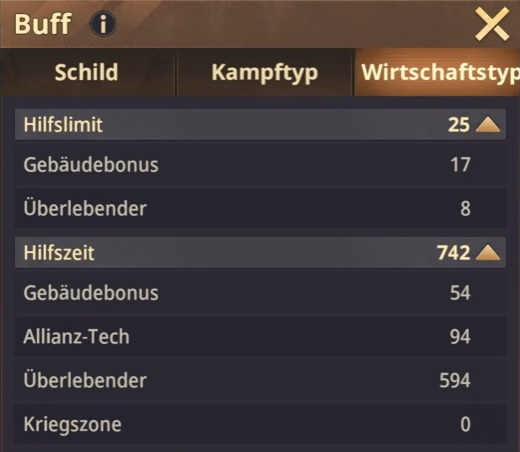

---
arten:
  - Руководство
  - Оптимизация
themen:
  - Войска
  - Альянс
---

# 💡 Совет №8 — ускоренное лечение солдат

## Ключевые моменты

- **Лечите небольшими порциями, находясь в сети:** Не начинайте автоматически лечить всю больницу.
- **Немедленно запросите помощь альянса:** Каждая своевременная помощь сокращает оставшееся время выздоровления.
- **Начните с 20–40 солдат:** Этот диапазон часто подходит для первоначального теста; время заживления на самом деле имело большее значение позже.
- **Рассчитайте время мгновенного исцеления:** Умножьте свое личное **Время помощи** по количеству участников, которые могут помочь немедленно. Исцеляющая партия не должна занимать больше времени.
- **Повторите немедленно:** Как только одна партия закончится, начните следующую и снова запросите помощь.
- **Планируйте иначе в автономном режиме:** Перед длительным отсутствием установите большую партию, время восстановления которой примерно соответствует периоду оффлайн.

> **Помните:** Время помощи × непосредственные помощники = максимальное время лечения для пакета мгновенного лечения.


## Для чего этот совет?

Этот совет показывает, как небольшие порции исцеления и постоянная помощь альянса часто могут гораздо быстрее подготовить к бою большое количество раненых солдат. Вместо того, чтобы ставить одну задачу исцеления, рассчитанную на несколько часов, разделите запас на короткие участки, которые помощь альянса может существенно сократить.

Этот метод особенно полезен:

- после крупных PvP-сражений,
- когда больница сильно занята,
- в то время как дальнейшие сражения все еще происходят,
- когда несколько участников альянса одновременно находятся в сети,
- или когда вы хотите сэкономить алмазы и ускорить лечение.

Однако это требует вашего активного участия. Если вы собираетесь отключиться от сети, лучше подойдет длительная лечебная задача, соответствующая вашему отсутствию.

## Почему небольшие лечебные порции работают

После начала лечения вы можете запросить помощь альянса. Затем активные участники нажимают «Помощь», сокращая оставшееся время.

Сколько времени отнимает каждая помощь, показано в ваших личных значениях усиления в разделе **Время помощи**. Эта ценность частично состоит из строительных бонусов, технологий альянса и выживших. **Лимит помощи** также ограничивает количество помощи, которую можно получить за одно действие.

Однако при планировании не следует автоматически использовать весь лимит помощи. Важно то, сколько участников в настоящее время онлайн и могут ответить. **немедленно** по вашему запросу.

Принцип таков:

```text
небольшая порция исцеления → запросить помощь → помощники сокращают таймер →
партия заканчивается → начать следующую лечебную партию
```

Увеличение скорости происходит не за счет одного более сильного бонуса за исцеление, а за счет повторного использования процесса помощи для каждой новой партии.

## Онлайн исцеление шаг за шагом

1. Откройте госпиталь и проверьте количество и уровни раненых.
2. Откройте обзор баффов и прочитайте **Время помощи** и **Лимит помощи**.
3. Реалистично оцените, сколько участников окажут помощь немедленно, а не просто сколько их появится в сети.
4. Исходя из этого, рассчитайте время мгновенного исцеления.
5. Выберите достаточно солдат, чтобы отображаемое время лечения упало чуть ниже этого результата.
6. Начни лечиться.
7. Запрос **Альянс поможет немедленно**.
8. Как только партия закончится, сразу же начните следующую и снова запросите помощь.
9. Повторяйте до тех пор, пока все желаемые солдаты не будут исцелены или пока вы не захотите выйти из сети.

> **Важно:** Нажимайте кнопку помощи альянса еще раз после каждой новой партии исцеления. Предыдущий запрос на помощь не применяется автоматически к последующим пакетам.

## Рассчитать время мгновенного исцеления

Формула:

```text
время мгновенного исцеления = время помощи × ожидаемые немедленные помощники
```

Количество задействованных помощников не должно превышать ваш личный лимит помощи:

```text
использованное количество помощников = меньшее из
«ожидаемые непосредственные помощники» и «лимит помощи»
```

Таким образом, оптимальное время заживления **не универсальное фиксированное значение**. Оно меняется, когда время помощи увеличивается или большее или меньшее количество участников могут ответить немедленно.

### Конкретный пример из нового внутриигрового скриншота



*(Как перейти к этому представлению: коснитесь своей базы на карте мира → выберите «Установить щит» → переключитесь на вкладку «Тип экономики» вверху.)*

Используйте для расчета максимальное общее значение в каждом случае, а не только один из отдельных бонусов, перечисленных под ним.

На скриншоте показано:

- **Лимит помощи:** 25
  - Бонус строительства: 17
  - Выжившие: 8
- **Время помощи:** 742 секунды за помощь
  - Бонус строительства: 54
  - Технологии Альянса: 94
  - Выживших: 594

Компоненты «Время помощи» составляют 742 секунды. Это равно **12 минут и 22 секунды на одну помощь**.

Если вы ожидаете **5 немедленных помощи**:

```text
742 секунды × 5 помощников = 3710 секунд.
3710 секунд = 1 час, 1 минута и 50 секунд.
```

Для этого профиля пять подсказок могут немедленно завершить сеанс исцеления продолжительностью не более **1:01:50**. На практике допускайте небольшой запас прочности – например, отображаемое время заживления примерно равное **60 минут**.

> **Пример решения:** Если в сети пять надежных помощников, выберите достаточно солдат, чтобы таймер показывал чуть меньше часа. Затем приступайте к лечению, просите о помощи и сразу после пяти помощи ставьте следующую порцию.

### Таблица времени справки для примера значения 742

| Непосредственные помощники | Общее сокращение времени | Максимальная партия мгновенного исцеления |
| ---: | ---: | ---: |
| 1 | 742 секунды | 0:12:22 |
| 2 | 1484 секунды | 0:24:44 |
| 3 | 2226 секунд | 0:37:06 |
| 4 | 2968 секунд | 0:49:28 |
| 5 | 3710 секунд | **1:01:50** |
| 10 | 7420 секунд | 2:03:40 |
| 25 | 18 550 секунд | 5:09:10 |

Строка с 25 подсказками описывает только математический максимум при отображаемом пределе помощи. Это достижимо только в том случае, если 25 участников действительно вовремя помогут.

## Подсчет солдат или рассчитанное время лечения – какой ориентир лучше?

Количество солдат запомнить легко, но время лечения более точное.

| Руководство | Преимущество | Ограничение |
| --- | --- | --- |
| **20–40 солдат** | быстрая установка и хороший первый тест | разные уровни солдат и бонусы дают разное время |
| **30–50 минут исцеления** | полезная отправная точка для общего сообщества | еще не учитывает точно личное время помощи и фактическое количество помощников |
| **Время помощи × ожидаемые помощники** | дает ваш личный таймер мгновенного исцеления | работает только если посчитанные члены действительно помогают немедленно |

Например, на прилагаемом рисунке показано:

- **323 солдата:** 4:51:10 часов исцеления
- **30 солдат:** 0:27:03 часа исцеления
- с **5 помощников:** примерно 37 минут возможного сокращения, как показано на рисунке.

Примерно 37-минутное значение старой иллюстрации относится к усилителям, использовавшимся в то время. Благодаря документально подтвержденному времени помощи, равному 742 секундам, пять помощников вместо этого сокращают время до **1:01:50**. Это показывает, почему ни 20–40 солдат, ни общий 30–50-минутный таймер не могут быть оптимальными для каждого профиля.

## Определите свой собственный оптимальный размер партии

Лучший размер – это **крупнейшая партия, время заживления которой полностью покрыто альянсом, помощь ожидается немедленно**.

### Простая процедура тестирования

1. Прочтите свое личное время помощи.
2. Подсчитайте участников, от которых вы можете ожидать немедленной помощи.
3. Умножьте два значения и преобразуйте результат в часы, минуты и секунды.
4. Выберите достаточно солдат, чтобы таймер лечения упал чуть ниже этого результата.
5. Запросите помощь и проверьте, отвечает ли каждый запланированный участник.
6. Настройте следующую партию:
   - вся помощь прибудет немедленно, и партия закончится → соблюдайте заданное время,
   - меньше помощи, чем ожидалось → соответственно сократите следующую партию,
   - дополнительные помощники надежно становятся активными → пересчитывают следующую партию.

Это дает лучший личный ориентир, чем фиксированное количество солдат.

### Когда меньше участников онлайн

Если помощников немного, партия должна быть меньше, если она все равно должна завершиться мгновенно. Учитывайте только участников, которые, скорее всего, действительно ответят. Пять игроков, показанных онлайн, не приравниваются автоматически к пяти немедленным подсказкам.

Возможные ответы:

- использовать меньшие партии,
- кратко попросить помощи в чате альянса,
- отложить заживление до более активного периода, если позволяют возможности больницы,
- или намеренно начните более длинную партию, если вы все равно не будете продолжать сражаться.

## Почему вылечить всю больницу сразу часто бывает невыгодно

Одна большая задача по исцелению удобна, но не позволяет использовать повторяющуюся помощь альянса, пока вы онлайн:

- Таймер может работать несколько часов.
- Доступные подсказки не могут свести его к нулю.
- Вы не можете начать новую порцию исцеления, пока идет оставшееся время.
- Альянс сможет снова помочь вам только на следующем задании.
- Тогда для немедленного возвращения в бой могут понадобиться ускорения или алмазы.

Вместо этого небольшие партии создают множество коротких задач по исцелению. Каждая задача может получить помощь снова.

## Когда большая задача исцеления все еще актуальна

Пакетный метод требует запуска следующей задачи сразу после завершения. Если вы пойдете спать, поработаете или перестанете проверять игру на более длительный период, небольшая задача по исцелению быстро завершится, и после этого больница останется бездействующей.

Поэтому, прежде чем выходить из сети, выберите достаточное количество солдат на время лечения, примерно соответствующее вашему запланированному отсутствию.

| Ситуация | Рекомендуемый подход |
| --- | --- |
| Многие участники онлайн, вы остаетесь активными | небольшие партии, немедленно обратиться за помощью, повторить напрямую |
| Несколько помощников онлайн | меньшие тестовые партии или допускайте более длительное заживление |
| Вы ненадолго отключитесь от сети | установите партию примерно до вашего возвращения |
| Вы отключитесь от сети на ночь | начать большую задачу по исцелению, продолжающуюся несколько часов |
| Бои продолжаются, и больница снова заполняется | расставлять приоритеты для коротких партий и активно координировать помощь |

> **Офлайн-правило:** Не выбирайте минимально возможное количество; держите очередь с пользой занятой во время вашего отсутствия.

## Координируйте помощь альянса правильно

Этот метод работает только в том случае, если другие участники действительно нажимают «Помощь». Поэтому хорошая организация увеличивает свой эффект:

- По возможности лечите в периоды высокой активности альянса.
- Объявите в чате о совместном этапе исцеления после крупных сражений.
- Постоянно помогайте другим участникам, чтобы каждый мог быстро закончить партии.
- Начните следующую партию немедленно, пока помощники остаются онлайн.
- Не используйте ускорения до прибытия доступных подсказок.

Исследования Альянса могут улучшить время личной помощи. В примере **94 из 742 секунд** из Alliance Tech. Таким образом, активный альянс получает двойную выгоду: многие члены оказывают помощь, а более совершенные технологии увеличивают сокращение времени на одну помощь.

## Разумно используйте лечебные бонусы.

Скорость выздоровления и вместимость больницы меняют вашу личную идеальную ценность. В частности, тактический министр из совета 3 предлагает, согласно имеющемуся обзору ролей:

- **+20% к скорости исцеления**
- **+20% вместимость больницы**

Если вы получили временный бонус к исцелению, перепроверьте таймер и отрегулируйте размер партии. Бонус может позволить вам включить в партию больше солдат с той же целевой продолжительностью.

Применяется ли бонус только к исцелению, начатому после активации, следует проверить по текущему описанию офиса или бонуса. Не применяйте к исцелению правила из других типов действий без проверки.

## Ресурсы, ускорения и «бесплатное лечение»

Руководители сообщества иногда говорят о «бесплатном» или «мгновенном» исцелении. Они означают, что помощь альянса может завершить короткую партию без **алмазы или ускорения**.

Это не означает автоматически, что обычные лечебные ресурсы не нужны. Перед каждым запуском проверяйте потребности больницы в ресурсах. Этот метод в первую очередь уменьшает **время** и сохраняет дополнительные элементы ускорения.

## Разумная процедура после крупных сражений

1. Проверьте заполняемость больницы и оставшуюся вместимость.
2. Прочтите время личной помощи и лимит помощи в обзоре баффов.
3. Определите в чате альянса, сколько помощников смогут ответить сразу.
4. Рассчитайте время помощи × ожидаемое количество помощников.
5. Установите количество солдат так, чтобы таймер был чуть ниже расчетного времени мгновенного исцеления.
6. Обратитесь за помощью и убедитесь, что происходит ожидаемое снижение.
7. Повторяйте без простоя, находясь в сети.
8. Переключитесь на длинный пакет перед выходом в автономный режим.
9. После возвращения перепроверьте оставшихся раненых солдат и вместимость госпиталя.

## Распространенные ошибки

- **Исцеление всей больницы одновременно:** Это предотвращает эффективную повторную помощь.
- **Используя только количество солдат:** Время лечения сорока солдат высокого уровня может отличаться от времени лечения сорока солдат более низкого уровня.
- **Непонятный лимит помощи с доступными помощниками:** Ограничение в 25 не гарантирует, что 25 участников онлайн, и поможет немедленно.
- **Считаем каждого онлайн-игрока:** Учитывайте только тех участников, которые могут вовремя нажать «Помощь».
- **Не удалось перепроверить время справки:** Выжившие, здания и технологии Альянса могут изменить вашу личную ценность.
- **Запросить помощь альянса слишком поздно:** Чем раньше вы сделаете запрос, тем раньше участники смогут ответить.
- **Не продолжать после одной партии:** Метод приобретает скорость за счет повторения.
- **Выбор слишком больших партий при низкой активности:** Без достаточного количества помощников таймер остается продолжительным.
- **Запуск небольшого пакета перед отключением от сети:** Оно быстро заканчивается и оставляет очередь исцеления пустой до конца отсутствия.
- **Использование ускорений немедленно:** Сначала подождите, чтобы увидеть, насколько помощь альянса сократит таймер.
- **Путаница «бесплатно» и «без ресурсов»:** Помощь альянса в основном экономит время, алмазы и ускорения; обычные затраты на лечение все еще могут применяться.
- **Игнорирование мощности больницы:** Во время длительных сражений регулярно проверяйте, сколько места осталось.

## Ограничения и информация, которую еще предстоит проверить

- На текущем снимке экрана показано время помощи 742 и лимит помощи 25. Эти значения применяются к показанному профилю, а не автоматически к другим участникам.
- В расчете предполагается, что полное значение времени помощи в секундах вычитается из таймера. Перепроверьте пример с реальной целительной партией и пятью помощьми.
- На старой иллюстрации примерно 37 минут для пяти помощников отражают различные усиления и не всегда заменяются текущим значением этого профиля.
- 20–40 солдат или 30–50 минут остаются лишь общими стартовыми диапазонами; личный расчет с использованием Help Time и надежных помощников становится более точным.
- Влияние уровня солдата и типа раны на время лечения единицы не полностью документировано.
- Проверьте взаимодействие между Тактическим министром, личными исследованиями, исследованиями альянса и другими бонусами исцеления по текущему таймеру.
- Вместимость госпиталя, наличие помощников и активная боевая ситуация могут потребовать иных приоритетов, чем максимальная экономия времени.

## Источники и надежность

- **DIE внутриигровые доказательства:** Сравнение полного исцеления и небольшой партии, 20–40 солдат в качестве ориентира, примерного времени, пяти помощников и онлайн-/офлайн-стратегии взято из предоставленной иллюстрации альянса и утвержденного объявления.
- **Скриншот текущего профиля:** Добавлены документы просмотра положительных эффектов «Лимит помощи 25» и «Время помощи 742», разделенные на бонус строительства, технологии Альянса и бонус выжившего. Пример с пятью подсказками был рассчитан на основе этих значений.
- **Источник сообщества:** [Z Route Academy – мгновенное исцеление в больнице](https://zroute.dev/de/combat/hospital-healing/) описывает пакетное исцеление, общий целевой диапазон примерно 30–50 минут и неоднократную помощь альянса. Его процентное уменьшение уточняется по текущему внутриигровому значению «Время помощи» или должно быть проверено по таймеру в вашей собственной версии игры.
- **Дополнительный источник альянса:** [Академия Z Route – Исследования Альянса](https://zroute.dev/de/alliance/alliance-research/) описывает более сильную помощь альянса как преимущество исследования, которое увеличивает время, сэкономленное каждым участником.
- **Дополнительный источник роли:** [Z Route Academy – Официальные позиции](https://zroute.dev/alliance/official-positions/) документирует состояние сообщества в отношении бонусов к скорости лечения и вместимости госпиталей министра тактики.

Публичные источники — это преимущественно документация сообщества. Таким образом, ваш личный дисплей усиления, текущий диалог исцеления, фактическая полученная помощь и оставшийся таймер имеют приоритет.

Дата исследования: **25 сентября 2026 г.**.

## Объявление Альянса для копирования

```html
<size=38><color=#8DAA2D><b>💡 СОВЕТ №8 – ЛЕЧИТЕ СОЛДАТОВ БЫСТРЕЕ</b></color></size>

После крупных сражений не обязательно лечить весь госпиталь сразу! <color=#8DAA2D><b>Небольшие порции исцеления + помощь альянса</b></color> зачастую гораздо быстрее.

🏥 <b>КАК ЭТО РАБОТАЕТ:</b>
Исцелите лишь небольшое количество солдат, а затем обратитесь за помощью к альянсу. Если достаточное количество участников онлайн, их помощь резко сокращает время лечения – тогда немедленно начните следующую партию.

💡 <b>РУКОВОДСТВО:</b>
Вокруг <color=#8DAA2D><b>20–40 солдат в партии</b></color> часто хорошо работает для почти непрерывного исцеления. Оптимальное значение зависит от ваших бонусов и активных участников.

🌙 <b>ПРИ ПЕРЕХОДЕ В ОФФЛАЙН:</b>
Просто выберите достаточное количество солдат на время лечения, примерно соответствующее вашему запланированному отсутствию.

➡️ <color=#8DAA2D><b>Онлайн: небольшие партии + помощь альянса</b></color>
➡️ <b>Офлайн: позвольте выполнить длительную задачу исцеления</b>
```
