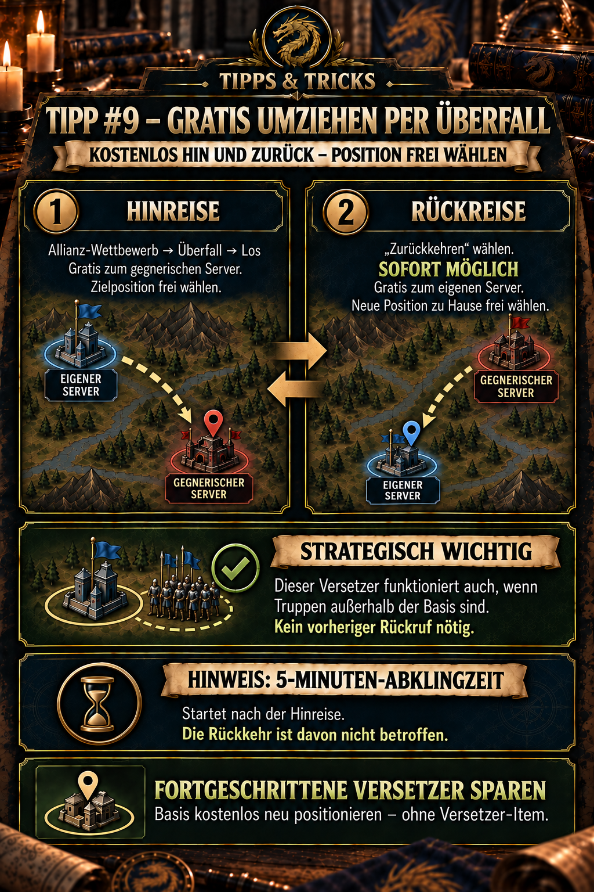

---
arten:
  - Руководство
  - Оптимизация
themen:
  - События
  - Карта мира
---

# 💡 Совет №9 — бесплатное перемещение через рейд

## Ключевые моменты

- Открыть **Соревнование Альянсов → Рейд → Вперед** бесплатно путешествовать на противоположный сервер.
- Во время путешествия вы можете свободно выбирать пункт назначения — аналогично Advanced Relocator.
- Поездка за границу начинается **5-минутное время восстановления**. Однако это не блокирует обратный путь.
- Использование **«Возвращение»** немедленно бесплатно вернет вас обратно на ваш сервер.
- По возвращении вы также можете выбрать новую позицию для своей базы.
- **Стратегически важно:** Релокатор также работает, пока войска находятся за пределами вашей базы. Никакого предварительного отзыва не требуется.
- Это позволяет вам перемещать свою базу без расширенного перемещения, пока доступен рейд.

> **Помните:** Бесплатно подпрыгните к противнику, а затем сразу же выберите новую исходную позицию с помощью «Возврата» — даже если войска находятся за пределами вашей базы.



## Для чего этот совет?

Рейд обычно представляет собой механику межсерверного боя. Однако его поездки туда и обратно также могут служить бесплатным релокатором: отправляйтесь на противоположный сервер, затем используйте «Возврат», чтобы немедленно выбрать новую позицию на вашем домашнем сервере. Время восстановления, начатое путешествием наружу, выполняется независимо от этого варианта возврата.

В отличие от многих обычных ситуаций телепортации, вам не нужно ждать, пока все войска вернутся на вашу базу. Бесплатное перемещение через Рейд также может начаться, пока войска находятся снаружи. Это делает метод тактически полезным, даже когда ваши подразделения в данный момент маршируют.

Это особенно полезно, если вы хотите:

- приблизиться к своему альянсу,
- покинуть неблагоприятное или опасное положение,
- организовать формирование для предстоящего мероприятия,
- занять место в зоне альянса,
- или сохраните Advanced Relocators для ситуаций, когда Raid недоступен.

Принципиальное отличие от обычного переноса сервера: вы не переезжаете на другой сервер навсегда. Путешествие происходит в рамках ограниченного по времени рейда и заканчивается возвращением на домашний сервер.

## Как работает бесплатный переезд

Метод состоит из двух свободных вариантов выбора позиции: выезда на сервер противника и последующего возвращения на свой сервер.

```text
Соревнование Альянсов → Рейд → Вперед
            ↓
Выберите позицию на сервере противника.
            ↓
Выберите «Возврат» — доступно сразу.
            ↓
выберите новую позицию на своем сервере

Отдельное примечание: поездка наружу начинает перезарядку.
5 минут. Возврат не влияет.
```

### 1. Отправляйтесь на противоположный сервер.

1. Открыть **Соревнование альянсов**.
2. Переключиться на **Рейд**.
3. Нажмите **«Иди»**.
4. Выберите доступное место назначения на противоположном сервере.
5. Перед подтверждением убедитесь, что релокатор или другая валюта не требуются.
6. Подтвердите прыжок.

Согласно имеющемуся опыту игрока, вы можете свободно выбирать позицию на сервере противника. Таким образом, путешествие наружу работает как расширенный релокатор, но только в рамках события «Рейд».

### 2. Верните немедленно бесплатно.

1. После путешествия снова откройте Рейд.
2. Выбрать **«Возвращение»** – Вам не нужно ждать пять минут.
3. Найдите нужную новую позицию на своем домашнем сервере.
4. Прежде чем подтвердить возвращение, проверьте окрестности.

Согласно документированному опыту игроков, обратная дорога также бесплатна. Важно не просто подтверждать пустое место: координаты, выбранные при возвращении, станут новой позицией вашей базы.

### Понимайте время восстановления правильно

Прыжок к противнику запускает **5-минутное время восстановления**, но это **не период ожидания перед возвращением**. «Возврат» остается доступным немедленно.

Поэтому таймер не отображается как отдельный этап между поездками туда и обратно. Проверьте внутриигровой дисплей, чтобы определить, какие еще действия рейда он ограничивает в текущей версии.

> **Важно:** Поездка за границу → возможен немедленный возврат. Отображаемое время восстановления работает отдельно и не блокирует «Возврат».

## Стратегически важно: войска могут находиться за пределами вашей базы.

Перемещение через рейд работает, даже если войска находятся за пределами вашей базы. ты **не надо их вспоминать** перед поездкой или дождитесь их возвращения.

Это стратегически ценно:

- Отдаленные войска не задерживают перестановку позиций.
- Вы можете сразу воспользоваться благоприятной возможностью и переехать бесплатно.
- Запланированное изменение позиции не следует откладывать только потому, что войска развернуты в другом месте.
- В этой ситуации продвинутые релокаторы все равно можно сохранить.

Это утверждение касается требования использования релокатора: войска за пределами вашей базы не препятствуют его использованию. Он не устанавливает автоматически, куда маршируют эти войска после передислокации или как осуществляется активный марш. После изменения позиции проверьте дисплеи затронутых войск и маршруты возвращения.

> **Практическое правило:** Войска снаружи? Для этого релокатора нет проблем – предварительный вызов не требуется.

## Почему это спасает Advanced Relocator

Расширенный релокатор позволяет вам свободно выбирать пункт назначения. Рейд достигает того же эффекта, что и этот совет, благодаря механике возврата: вы можете разместить свою базу в новой доступной позиции на домашнем сервере, не используя предмет.

| Метод | Позиция свободно выбирается | Стоимость | Доступность |
| --- | :---: | --- | --- |
| Расширенный релокатор | Да | 1 релокатор | когда предмет доступен и телепортация разрешена |
| Рейдовый выезд | Да | бесплатно по наблюдениям игроков | только пока доступен Рейд |
| Возвращение из рейда | Да | бесплатно по наблюдениям игроков | сразу после выездной поездки; независимо от времени восстановления |

Таким образом, Raid не заменяет полностью Advanced Relocator. Это возможность сохранения для конкретного события. Обычный релокатор остается важным для спонтанных перемещений за пределы мероприятия.

Подробнее об обычных релокаторах см. **Совет №4 – Телепортируйтесь правильно**.

## Выберите хорошую новую должность

Бесплатный возврат особенно ценен, если вы заранее планируете место назначения. Рассмотрим:

- **Близость к альянсу:** Короткие маршруты облегчают помощь, подкрепление и совместные действия.
- **Доступное пространство:** Убедитесь, что соседним участникам также будет достаточно места.
- **Расстояние от противников:** Визуально привлекательная позиция может быть стратегически неудачной, если рядом с ней находятся сильные противники.
- **Близость к целям:** Во время предстоящих событий короткие марши могут иметь большее значение, чем идеальный строй.
- **Ресурсные плитки и маршруты:** Не блокируйте важные маршруты и осмотрите территорию вокруг планируемого формирования альянса.
- **Координация:** Прежде чем размещать базу, спросите R4/R5 о запланированных рядах, секторах или точках сбора.

Если несколько участников используют метод одновременно, альянсу следует заранее отметить желаемые позиции или согласовать их в чате. В противном случае могут легко возникнуть пробелы или конкурирующие претензии на привилегированные позиции.

## Полезные ситуации

### Вернитесь в альянс

Если ваша база находится далеко за пределами зоны альянса, используйте возврат, чтобы воссоединиться с общим строем. Это экономит усовершенствованный релокатор и впоследствии сокращает многие марши.

### Исправьте неудачную позицию

Даже незначительные ошибки в размещении могут оказаться разрушительными — например, база, блокирующая ряд или стоящая слишком далеко от центра. Бесплатный возврат позволяет исправить это, не тратя ценный предмет на перемещение нескольких плиток.

### Перегруппируйтесь перед мероприятием

Если альянс меняет свой состав перед битвой или сбором событий, Рейд может предоставить хорошую возможность для реорганизации. Однако пункт назначения должен быть определен еще до прыжка.

### Держите релокаторов в качестве резерва на случай непредвиденных обстоятельств.

Усовершенствованные релокаторы особенно полезны, когда необходимо быстрое перемещение за пределы рейда. Использование бесплатного возврата для запланированных переездов позволяет сохранить больше предметов на случай реальных чрезвычайных ситуаций.

## Контрольный список перед прыжком

- Есть **Рейд** в настоящее время открыт и доступен для вас?
- Действительно ли в подтверждении указан бесплатный трансфер?
- Знаете ли вы желаемую область назначения на своем домашнем сервере?
- Достаточно ли там свободного места?
- Согласована ли новая позиция с альянсом?
- Войска находятся за пределами базы? Это не блокирует релокатор; вспоминать ненужно.
- Вы учли **5-минутное время восстановления** на другие действия Рейда, не путая его с ограничением возврата?
- Учтены ли текущие марши, бои или другие ограничения в текущем меню?
- Вы проверили текущие уведомления о щитах и усилениях?

Последний пункт намеренно сформулирован как проверка: доступные общедоступные источники недостаточно документально подтверждают, используются ли во время рейда мирные щиты, усиления, марши или продолжающиеся сражения и каким образом. Не полагайтесь на дополнительные претензии; перед подтверждением проверьте текущий экран в игре.

## Распространенные ошибки

- **Запутанный Рейд с постоянным переносом сервера:** Это ограниченное по времени путешествие к противнику и обратно.
- **Рассматривая время восстановления как ограничение на возврат:** Это неправильно – «Возврат» можно выбрать сразу.
- **Отзыв каждого отряда в качестве меры предосторожности:** Для данного релокатора это необязательно; войска за пределами вашей базы не блокируют ее.
- **Прыжки без возврата:** Заранее решите, где будет стоять ваша база впоследствии.
- **Подтверждаю слишком быстро:** Прежде чем завершить возвращение, проверьте окрестности, формирование альянса и координаты.
- **Планируем использовать метод в любое время:** Работает только при наличии соответствующего Рейда.
- **Использование релокатора без проверки:** Для этого метода пройдите через Соревнования Альянсов и Рейды, а не через обычное меню релокатора.
- **Предполагая дополнительные эффекты:** Претензии по поводу щитов, баффов или активных маршей необходимо проверять в текущей версии игры.
- **Рассматривая таймер как постоянный:** Обновления могут изменить время восстановления; внутриигровой дисплей имеет приоритет.

## Ограничения и открытые вопросы

Общедоступная информация о рейде ограничена. Внешний источник сообщества подтверждает, что игроки могут телепортироваться на сервер противника во время Соревнования Альянсов и сражаться там. Однако свободный выбор позиции в обоих поездках и конкретный 5-минутный период восстановления, описанный здесь, основаны на предоставленном текущем опыте игрока и документации альянса.

Перед использованием проверьте:

- отображаются ли обе поездки как бесплатные,
- доступны ли по-прежнему свободный выбор позиций на обоих серверах,
- длится ли таймер еще 5 минут,
- какое другое действие рейда в данный момент ограничивает таймер – согласно имеющемуся опыту игрока, возвращение не входит в их число,
- как появляются войска за пределами вашей базы после перестановки и какие маршруты возврата показывает игра,
- какие ограничения применяются к продолжающимся маршам или боям,
- и как в текущей версии обрабатываются активные щиты или усиления.

## Источники и надежность

- **Первичная основа:** предоставлено текущее описание игрока и изображение существующего альянса в Рейде.
- **Публичное подтверждение межсерверного путешествия:** [Межсерверная война – обзор сообщества IMPh](https://imph.info/interserver-war) описывает соревнование альянсов и телепортацию на противоположный сервер.
- **Не полностью проверено публично:** бесплатные поездки туда и обратно, свободный выбор позиции при возвращении и специальный 5-минутный период восстановления. Для этих деталей приоритет имеет текущий внутриигровой дисплей.

**По состоянию на:** 26 сентября 2026 г.

## Объявление Альянса для копирования

```html
<b>💡 СОВЕТ 9 — БЕСПЛАТНО ПЕРЕЕЗЖАЙТЕ ЧЕРЕЗ РЕЙД</b>

<b>Рейд</b> полезен не только для боя – вы также можете использовать его как <b>бесплатный релокатор</b>!

➡️ Через <b>Соревнование Альянсов → Рейд → Вперед</b>, ты можешь телепортироваться <b>на противоположный сервер бесплатно</b>.

➡️ Вы можете <b>свободно выбирать</b> ваша позиция – как и в случае с Advanced Relocator.

➡️ Тогда воспользуйтесь <b>Возврат</b> идти <b>домой бесплатно</b>. Вы также можете свободно выбрать там свою новую должность.

⚔️ <b>СТРАТЕГИЧЕСКИ ВАЖНО:</b> Этот релокатор работает даже с войсками за пределами вашей базы. Вам не нужно их сначала вспоминать.

⏱️ Прыжок к противнику запускает <b>5-минутное время восстановления</b>.

<b>👉 Бесплатно переместите свою базу и сохраните Advanced Relocators!</b>
```
