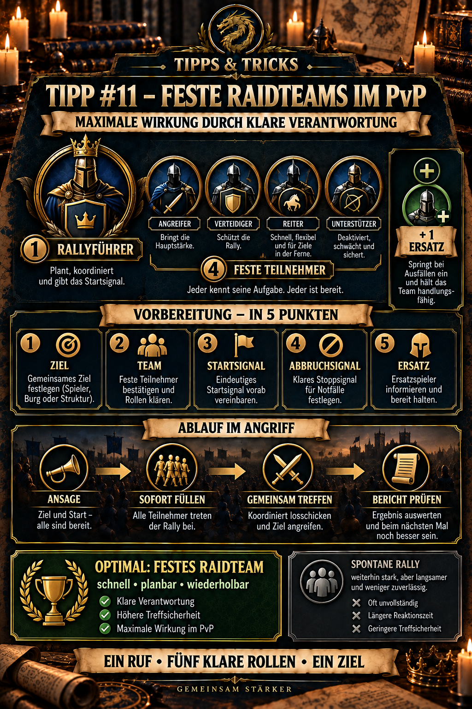

---
arten:
  - Стратегия
  - Оптимизация
themen:
  - Бой
  - Альянс
  - Войска
  - События
---

# 💡 Совет №11 — постоянные рейдовые команды в PvP

## Ключевые моменты

- A **рейдовая группа** организован вокруг одного ответственного руководителя митинга и четырех закрепленных за ним участников.
- Фиксированные группы – оптимальный формат митинга: каждый знает цель, команду, сигнал старта, сигнал остановки и свою ответственность.
- Лидер митинга делает больше, чем просто открывает митинг. Они проверяют цель и время, определяют построение и после боя решают, следует ли повторить, повернуть или отойти.
- Четыре участника сохраняют свою согласованную PvP-команду и один слот для марша, присоединяются немедленно и не меняют состав самостоятельно.
- По крайней мере, один запасной в каждой рейдовой команде предотвращает остановку всего процесса, когда участник недоступен.
- Стихийно наполненный митинг также может быть сильным и выигрышным. Без фиксированных обязанностей заполнение обычно занимает больше времени, качество команды варьируется, а последующие атаки сложнее планировать.
- Кратко просматривайте отчет о битве после каждой важной атаки. Затем измените только одну вещь, где это возможно.

> **Помните:** Один звонок, пять четких ролей, одна общая цель.



## Что такое фиксированная рейдовая команда?

Фиксированная рейдовая команда — это подготовленная группа для PvP-слётов. Эти пять человек готовы работать вместе во время операции:

1. **один лидер митинга**, ответственный за открытие и руководство атакой,
2. **четыре постоянных участника**, которые сразу присоединяются к согласованным командам.

Группа из пяти человек – это **организационная модель альянса**. Он определяет четкие обязанности, а не обязательно универсальные технические ограничения игры. Если текущая мощность сбора или событие показывают другие значения, внутриигровой дисплей всегда имеет приоритет.

Совет №2 объясняет базовую механику ралли. Этот совет основан на этом и отвечает на организационный вопрос: как возможный розыгрыш может стать быстрой и повторяемой процедурой PvP?

## Почему фиксированные команды работают лучше

При стихийном митинге организация часто начинается только после его начала:

- Кто онлайн?
- У кого есть свободное место на марше?
- Какая команда должна присоединиться?
- Подходит ли формация для этой цели?
- Кто заменяет недоступного участника?
- Кто откроет следующую атаку?

Эти вопросы требуют времени. Противник может подкреплять, лечить, телепортироваться или готовить контратаку.

Фиксированная рейдовая группа отвечает на эти вопросы перед развертыванием. Это создает четыре преимущества:

| Преимущество | Эффект |
| --- | --- |
| **Скорость** | Ралли заполняется после сигнала без длительного поиска. |
| **Предсказуемость** | Сила группы, герои и примерная численность отряда известны. |
| **Ответственность** | Один человек решает; четверо знают, чего от них ждут. |
| **Повторяемость** | После просмотра отчета и исправления та же группа может быстро развернуться снова. |

Поэтому для достижения максимального эффекта фиксированные рейдовые группы являются лучшим применением тактики сбора.

## Пять ролей

### 1. Лидер митинга

Руководитель митинга несет оперативную ответственность. Они:

- проверить цель, гарнизон и активность противника,
- координировать атаку с оперативным руководством,
- укажите утвержденную команду или желаемый тип команды,
- начинать только тогда, когда участники и запасные будут доступны,
- подавать сигналы старта, остановки и повтора,
- прочитайте отчет о битве позже, и
- объявите, следует ли лечить, вращаться или атаковать снова.

Самый сильный игрок часто является хорошим лидером, но одной силы недостаточно. Надежность, осведомленность и четкая коммуникация одинаково важны.

### Со 2 по 5. Фиксированные участники

Каждый участник:

- сохраняет одно место для марша свободным в оговоренное время,
- использует заранее согласованную PvP-команду,
- присоединяется только к одобренному митингу,
- не меняет героев или построение без консультации,
- немедленно сообщает о недостаточности войск, готовности к лечению или времени онлайн,
- ждет следующей инструкции после атаки.

Более слабый, но надежный участник часто более ценен, чем более сильный игрок, который отвечает только после нескольких звонков.

### Заменить

Запасной игрок не занимает одно из пяти фиксированных мест, но знает ту же процедуру. Они вмешиваются, когда кто-то недоступен, все еще лечится или не может вовремя освободить место для марша.

Без заранее назначенной замены происходит именно та задержка, которой стремятся избежать команды фиксированных рейдов.

## Карта рейда перед битвой

Каждой рейдовой команде достаточно короткой копируемой оперативной карты:

```text
РЕЙД-КОМАНДА А
Лидер митинга: [Имя]
Участники: [Имя 1] / [Имя 2] / [Имя 3] / [Имя 4]
Заменить: [Имя]
Основная цель: [Цель или тип цели]
Требование к команде: [Основная команда/фракция/утверждённое формирование]
Стартовый сигнал: [короткое слово или символ]
Стоп-сигнал: [короткое слово или символ]
Канал координации: [Чат Альянса/отдельный чат]
```

Более короткие и четкие сигналы уменьшают вероятность недопонимания во время боя.

## Оптимальная процедура атаки

### 1. Утвердите цель

Оперативное руководство или руководитель митинга отмечает ровно одну цель. Ни один второй человек одновременно не начинает конкурирующий розыгрыш с одними и теми же участниками.

### 2. Подтвердите готовность

Четыре фиксированных участника кратко подтверждают. Тот, кто не готов, немедленно сообщает об этом; заместитель вступает во владение.

### 3. Начать ралли и сразу заполнить

Лидер митинга начинает. Четыре назначенных игрока присоединяются к согласованной команде. Остальные участники не занимают зарезервированные места без спроса.

### 4. Наблюдайте за воздействием и противодействием.

Во время атаки оперативное руководство следит за подкреплением, подходом маршей и возможными контратаками. Рейдовая команда не начинает параллельно другое действие.

### 5. Прочтите отчет

После удара проверьте как минимум:

- Солдаты развернуты и потеряны,
- формирование противника и счетчики фракций,
- Нанесенный урон, полученный урон и исцеление,
- видимые различия в развитии,
- в обороне базы возможный прорыв и дополнительные смерти на полигоне.

Совет № 12 — Правильно читайте отчеты о боях, объясняет полный обзор.

### 6. Примите четкое решение о дальнейших действиях.

Лидер митинга дает ровно одно следующее действие:

- **ПОВТОРИТЬ** – та же группа, та же цель,
- **НАСТРОЙКА** – протестировать одно указанное изменение,
- **ПОВОРОТАТЬ** – следующая рейдовая команда вступает во владение,
- **ИСЦЕЛЕНИЕ** – группа восстанавливает готовность,
- **СТОП** – цель или ситуация не оправдывают повторного нападения.

## Организуйте несколько рейдовых команд.

Большие, активные альянсы должны формировать несколько фиксированных команд, а не перегружать одну группу:

| Группа | Возможная задача |
| --- | --- |
| **Рейдовая команда А** | разбить самую сильную цель или основной гарнизон противника |
| **Рейдовая команда Б** | последующая атака, контратака или вторая цель |
| **Рейдовая команда С** | резерв, смена или защита важных игроков |

Оперативное руководство ставит цели и не позволяет группам забирать участников друг друга. Например, во время «Захвата столицы» одна команда может быть назначена в столицу, а другие — в приоритетные батареи.

## Если полная группа из пяти человек недоступна

Фиксированная группа из пяти человек оптимальна, но не каждый альянс может постоянно выставлять ее полностью. Тогда:

1. назовите доступных основных игроков,
2. по-прежнему четко формулируйте цель и требования к команде,
3. искать недостающих участников специально перед началом,
4. дайте больше времени для заполнения и проверки,
5. после атаки еще раз подтвердите, кто готов к следующему митингу.

Такое ралли все еще может быть очень сильным. Это просто медленнее и менее надежно повторяемо. Целью остается постепенное формирование фиксированных рейдовых групп из повторяющихся спонтанных участников.

Если даже для этого не хватает достаточной силы или активности и позицию невозможно удержать, совет №10 — «Бей и беги» в PvP — более подходящая альтернатива.

## Распространенные ошибки

- **Начало митинга до поиска участников:** Противник получает лишнее время на реакцию.
- **Нет фиксированного лидера:** Множественные инструкции создают конкурирующие цели и пустые подъемы.
- **Участники меняют команды самостоятельно:** Запланированная общая численность и роли нарушаются.
- **Распределение сильных игроков по нескольким группам:** Две рейдовые группы одновременно полагаются на одного и того же человека.
- **Именование, не имеющее замены:** Одно отсутствие останавливает весь процесс.
- **Слепо повторяя после победы:** Противник мог изменить построение, гарнизон или подкрепление.
- **Изменение всего после поражения:** Следующий отчет не сможет показать, какая корректировка действительно помогла.
- **Ставить личные цели выше групповых обязательств:** Преданный участник должен оставить свой слот марша доступным для рейдовой команды.

## Компактный контрольный список

### Перед развертыванием

- [ ] Назван лидер митинга
- [ ] четыре постоянных участника подтверждены
- [ ] назначен хотя бы один запасной
- [ ] определены основные и альтернативные цели
- [ ] утвержденная команда или формирование согласовано
- [ ] известны сигналы пуска и останова
- [ ] доступны слоты и войска для марша
- [ ] исцеление и уход подготовлены

### Во время развертывания

- [ ] стартует только ответственный лидер митинга
- [ ] фиксированные участники заполняются немедленно
- [ ] замена присоединяется только по указанию
- [ ] Сообщается о подкреплениях противника и контрмаршах
- [ ] ровно одно последующее решение, принятое после отчета

## Источники и контекст

- **Связанные советы DIE:** Совет № 2 объясняет атаку с целью сбора, а совет № 10 рассматривает в качестве альтернативы «Бей и беги». Совет № 12 касается просмотра отчетов о боях; Совет № 13 применяет рейдовые команды к захват столицы.
- **Документация сообщества по межсерверному бою:** [Expedition Frenzy – Неофициальный Zroute](https://zroutegame.com/expedition-frenzy/) описывает общую координацию целей и ограничения на участие в митингах между альянсами.
- Фиксированная структура из пяти человек, обязанности и оперативные карты представляют собой **DIE организационная рекомендация** для быстрых и повторяемых PvP-митингов. Текущие внутриигровые ограничения и правила событий имеют приоритет.

**По состоянию на:** 27 сентября 2026 г.

## Объявление Альянса для копирования

```html
<color=#FFD700><b>💡 СОВЕТ № 11 – ФИКСИРОВАННЫЕ РЕЙД-КОМАНДЫ</b></color>

Для достижения максимального эффекта мы сражаемся в <b>фиксированные группы по пять человек</b>:

👑 <b>1 лидер митинга</b> проверяет цель и время, начинает розыгрыш и после этого решает, следует ли повторить, повернуть или остановиться.

⚔️ <b>4 постоянных участника</b> оставить согласованную PvP-команду и место для марша свободными. Присоединяйтесь сразу после старта – никаких самостоятельных изменений в команде.

🔄 <b>1 замена</b> называется заранее и вмешивается только по указанию.

Сильные спонтанные подъемы остаются возможными, но требуют больше времени и менее надежно обеспечивают оптимальные результаты.

<color=#7FFF00><b>Один звонок – пять четких ролей – одна общая цель!</b></color>
```
